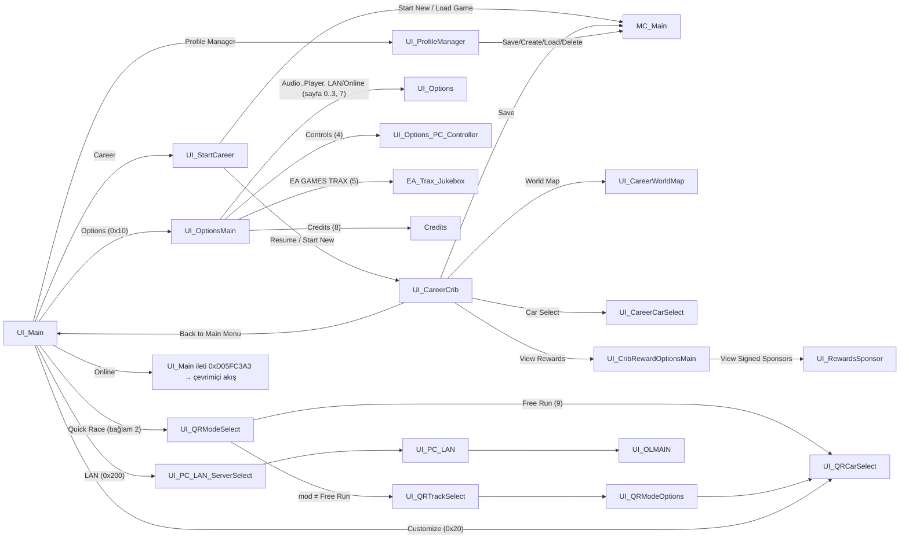

# `SPEED2.EXE` atlası — oyunun tamamı, adresleriyle

Hedef: NFSU2 v1.2 `SPEED2.EXE` (sha256 `f9dd86c0…`, korumasız; küçük harfli `speed2.exe` v1.0 +
kopya koruması, kullanılmıyor). Sembol yok, RTTI yok (yalnız beş `std` istisna sınıfı). Bu belge
exe'nin **haritası**: hangi adres aralığı hangi alt sistem, hangi chunk'ı kim yüklüyor, hangi ekran,
hangi kamera, oyun döngüsü nasıl dönüyor — ve her alt sistem için ya okunduğu yer (ROADMAP bölümü,
PryHUB modülü) ya da "okunmadı".

Derin okumalar burada tekrarlanmıyor; fizik, lastik, direksiyon, motor, nitro, stil puanları, kamera
koltuğu, rakip becerisi ve lastik bandı `ROADMAP.md`'nin "`SPEED2.EXE`'den" bölümlerinde.

**Nasıl üretildi.** `tools/speed2-atlas.py` (objdump + exe'nin kendi baytları, ~4 s):
her dizgeyi onu adresiyle kullanan fonksiyona bağlar, chunk yükleyici kayıtlarını, vtable'ları ve
FEng ekran tablosunu çıkarır. Derin noktalar REA/Ghidra 12.1.4 decompile'ı ile okundu (15 161
fonksiyon, 7 158 tanımlı dizge). Kanıt düzeyi: **okundu** = decompile/assembly'de görüldü;
**çıkarım** = ad, konum ya da veri şekli söylüyor, kod yürütülerek doğrulanmadı.

```
tools/speed2-atlas.py "$EXE" regions 64      # 64 KiB'lık dilimler ve sözlükleri
tools/speed2-atlas.py "$EXE" chunks          # chunk id → yükleyici / kullanan fonksiyonlar
tools/speed2-atlas.py "$EXE" string 'Mover$' # dizge → fonksiyonlar
tools/speed2-atlas.py "$EXE" funcs 'drift'   # fonksiyon → dokunduğu dizgeler
tools/speed2-atlas.py "$EXE" vtables         # vtable'lar, kurucularının dizgeleriyle
```

Okumalardan çıkan biçim araçları (yalnız okur; çıktıları oyun verisi, repoya girmez):

```
tools/nfsu2-save.py <kayıt> [--map|--fix OUT]   # 20CM kayıt kabı, CRC'ler, kariyer özeti — §10.9
tools/nfsu2-sound.py abk|gin <dosya> [--wav …]  # ABK/BNK + EA-XA v2, GIN + EA-XAS v0 — §11.1
tools/fx/rsrc.py "$EXE" <dizin>                 # .rsrc'deki 23 D3DX efektini çıkarır — §12.1
tools/fx/fx2.py <dizin>/IDI_CAR_FX              # fx_2_0 + vs/ps bayt kodu dökümü
tools/fng.py <FrontB.lzc|*.bun> [paket.fng]     # FEng paketleri: liste, nesne ağacı, betikler — §14
tools/nfsu2-anim.py banks|parts|scenes|scene|evt|cameras <dosya>   # animasyon, NIS, kamera — §17
tools/nfsu2-eagl.py <dosya> [ad] [--frames a,b,c]                # EAGL kanal çözücüsü — §17.9
tools/nfsu2-acid.py <dosya> [ad -v|--emitters|--check]          # Acid parçacık tanımları — §19
tools/nfsu2-probe.py <log.csv> [saniye]                          # oyunu başlatıp iddiaları canlı sınar — §24
```

---

## 0. Nereden başlamalı

Atlas iki katmanlı: §1–§9 2026-11-16'ya kadarki harita ve oyun mantığı, §10–§23 2026-11-18'deki saf tersine mühendislik turları.
Her bölümün sonunda "Açık kalanlar" ve exe'den iki kez okunmuş bir "Sabitler" tablosu var; düzeltmeler yerinde yapıldı, eski
okuma gerektiğinde notla anılıyor.

| Soru | Bölüm | İlk bakılacak adres / araç |
|---|---|---|
| Exe'nin hangi aralığı ne? Ana döngü, saat | §1, §2, §18.1 | `0x5811C0`, `0x601A60`; `speed2-atlas.py regions` |
| Hangi chunk'ı kim yüklüyor? | §3, §13.3 | `speed2-atlas.py chunks` (iki yükleyici listesi) |
| Araba fiziği (süspansiyon, lastik, motor, vites, nitro) | ROADMAP fizik bölümleri, §22 | kopya `0x5B4DC0` → `0x5AC4F0` |
| Yükseltmeler, Dyno, performans çubukları | §22 | `0x5A6B50..0x5A74A0`, `0x4FF160` |
| Rakip AI ve trafik | §7, §7.9, §8, §8.9 | seçici `0x42D0F0`, PID `0x409DA0`, kavşak `0x425150` |
| Yarış kuralları, ters yön, reset, drag | §9, §9.7 | `0x600710`, `0x6009A0`, vites `0x594F20` |
| Yarış kipleri, parametre bloğu, 2 oyunculu | §21 | `0x89E7A0`, hızlı yarış `0x4B2D60` |
| Kariyer, para, sponsor, aşama geçişi, SMS | §10, §10.12 | `0x85AD40`, `0x532C60`; `nfsu2-save.py` |
| Kayıt dosyası | §10.9, §16.9 | CRC `0x6FE173`; `nfsu2-save.py --map` |
| Araba özelleştirme, parçalar, boya/vinyl | §16 | CarParts `0x636BE0`, model adı `0x60FF80`, deri `0x611F10` |
| Render, gölgelendiriciler, araba boyası | §12 | kare `0x5D2850`/`0x5CAAD0`; `tools/fx/` |
| Sis, ışık, gökyüzü, gece/gündüz | §15 | atmosfer hacimleri `0x8003B600`, sis `0x614300` |
| Parçacıklar ve lastik izleri | §19 | yayım `0x491E50`, iz `0x59DBB0`; `nfsu2-acid.py` |
| Şehrin akışı, PVS, çarpışma | §3.0.x, §13 | `0x88EB00`, `0x5E5110`, `0x80034150` |
| Ses: dosyalar, motor karışımı, oyun tarafı | §11, §11.6, §11.7 | `0x7F0DE0`, `0x817FE0`, `0x474310`; `nfsu2-sound.py` |
| Kamera | §5, §17.6 | `0x5F1FD0`, `0x451B70` |
| Ön yüz paketleri ve ekran akışı | §4, §14, §14.9 | `0x541FC0`, `0x8384C4`; `fng.py --names tools/feng-names.txt` |
| Animasyon, NIS ara sahneleri | §17, §17.9 | `0x6E2C90`, `0x436840`; `nfsu2-anim.py`, `nfsu2-eagl.py` |
| Tekrar, giriş, dosya kuyruğu, bellek havuzları | §18 | `0x8650B8`, `0x5809C0`, `0x57E800` |
| GPS, mini harita, HUD | §20 | `0x81CBC0`, `0x4CA840`, `0x600090` |
| Bir bölümün açık maddesi kapandı mı? | §23 | eski listedeki `→ §23.x.n` işareti |
| Bir iddia canlıda sınandı mı? | §24 | `tools/nfsu2-probe.py` |

**Önceki okumaları değiştiren bulgular** (port ya da PryHUB için önemli olanlar):

- **Turbo eğrisi torka ekleniyor** (`0x5A6E30`, parça olmasa da) — "fizik okumuyor" notu yanlıştı; turbolu stok güçler ancak
  böyle tutuyor (§22.2; ROADMAP ve PryHUB `Engine::turbo_nm` notu yanlış).
- ~~PC'de gece/gündüz yok~~ — **canlı ölçüm çürüttü** (§24): kapı `0x870D14` açılışta 1 (nesne kurucusu `this+0x64` ile yazıyor);
  gökyüzü/sis/ton geçişi çalışıyor (§15.4).
- Çarpışma anahtarı **bölge geneli** `0x3412F` indeksi; bariyer açıklığı orada (§3.0.2, §13.2.9).
- Akış **PVS'yle** (mesafeyle değil) yapılıyor (§13.1).
- `0x4031C0` boş fonksiyon (`ret 0x4`): "yön okları" ve kamera `AUDIO_TRIGGER` etkisiz (§20).
- `0x5A7530` Dyno kaydırıcısı değil, drift/Street X/drag kip ayarı (§22.4).
- `0x8901xx` "ikinci bayraklar" hiç yazılmıyor (§21.4); 2 oyunculu kipe PC'de yol yok (§21.5).
- Ses: ABK P1 = GIN'in çaldığı tanenin devri; LFO'lar ve çapraz geçiş kaydırmaları oyunda kapalı (§11.7).
- Müzik ve konuşma kurulumda: `SDATA/sdat.viv` BIG4 arşivi (§11.1, §23.4.26) — ilk turdaki "kurulumda yok" yanlıştı.
- Kariyerde rakip becerisi rastgele değil, olay kaydından (§23.1.32); ROADMAP'teki kura yalnız hızlı yarışta.

**Doğrulama yöntemi.** Çatal raporlarının bütün sabitleri ana iş parçacığında exe'den (python) ve objdump'tan yeniden okundu;
çelişen sayılar (ör. JOY_EVENT 223 kayıt, ekran tablosu 180 kayıt) doğrudan sayıldı; "en şaşırtıcı" iddialar (turbo, gece/gündüz
kapısı, boş fonksiyon, ELF bankaları, MemoryFile önekleri, kübik anahtarlar) ayrıca kodla ya da veriyle sınandı. Canlı ölçüm
(§24) gece/gündüz kapısı okumasını **çürüttü** — statik sınama da aynı kör noktaya (nesne alanı `this+kayma` yazımı) düşmüştü.

---

## 1. Bölümler ve büyük resim

| Bölüm | VA | Boyut |
|---|---|---|
| `.text` | `0x401000–0x782AF1` | 3,6 MB |
| `.rdata` | `0x783000–0x7E71DB` | 401 KB (vtable'lar, float sabitleri, `0x19930520` FuncInfo'ları) |
| `.data` | `0x7E8000–0x8BB5F8` | 848 KB, 212 KB'ı dosyada (FEng tablosu, statik nesneler) |
| `.rsrc` | `0x8BC000` | simge, sürüm ve **23 derlenmiş D3DX efekti** (`RT_RCDATA`, `IDI_*_FX`, fx_2_0) — §12.1 |

`.text` içinde oyun kodu ile statik bağlanmış kütüphaneler ayrık bloklar halinde:

| Aralık | Ne | Kanıt |
|---|---|---|
| `0x401000–0x430000` | **AI ve trafik**: AIGoal/AIAction/FuturePoint/Pathfinding havuzları (`0x4035D0`), TrafficMover (`0x4087B0`), StreamingTrafficCarManager (`0x412720`), RandomEncounterManager (`0x412E40`), **GPS'in A\* yol bulucusu** (nesne `0x81CBC0`, §20.1) | dizgeler, §20 |
| `0x430000–0x440000` | Animasyon: AnimCtrl, CAnimPart/Skeleton/NFSAnimBank (`0x4313B0…`), WorldAnim (`0x4385B0`), kapı/kaput animasyonları | dizgeler |
| `0x440000–0x456000` | **Kamera**: mover sınıfları, CameraAI, kamera animasyonları (`0x8003B200–0x8003B202`, yükleyici `0x44AB60`, uygulayıcı `0x451B70`; `0x44A7A0` yalnız editörün `.moo` metin yazıcısı — §17.6), ana bellek havuzu (`0x440360` "Main Pool") | §5 |
| `0x456000–0x488000` | **Ses**: araç sesi (`SND ShiftDisengage`, `SND: Nitrous`, yol gürültüsü `0x45FB00`), mikser havuzları (`0x4678C0`), hava/yağmur/sıçrama | dizgeler |
| `0x488000–0x496000` | Acid parçacıkları (`0x4886E0`), eModel/ePoly/eStreamingPack havuzları, **katı model ve TPK yükleyicileri** (§3) | chunk kaydı |
| `0x496000–0x570000` | **Ön yüz (FEng)**: 180 ekranın (157'si kuruculu) sınıfları, garaj, özelleştirme, Dyno, harita, kariyer, online menüler | §4 |
| `0x570000–0x582000` | **Oyun akışı ve çekirdek**: dosya kuyruğu (`0x5736D0`), kaynak dosyaları (`0x570F80`), tekrar (ReplayManager `0x8650B8`, durum `0x57AD80`), giriş (`0x5809C0`; `0x579550` olay düğümü havuzu), zaman biriktiricileri `0x57A050`/`0x57A0E0`, WinMain `0x580E00`, ana döngü `0x5811C0` | §2, §18 |
| `0x582000–0x590000` | Dil/metin, kalıcı veriler, oyun ayarları | dizgeler |
| `0x590000–0x5B6000` | **Fizik**: RigidBody/Suspension/Wheel/Engine/DriveTrain/Aerodynamics/TwoWheelAckermanSteering havuzları (`0x598F10`), çarpışma (`0x592B00`, `0x593DB0`, `0x5A0200`), PhysicsMover (`0x5A47B0`), MellowMover (`0x5A2900`), BeltMover (`0x59E930`), kırılabilir nesneler (`0x5B0E30`, `0x5B4220`) | ROADMAP fizik bölümleri |
| `0x5B6000–0x5D3000` | **Render (eView/eSolid/eTexture)**: doku kovaları, ışık malzemeleri (`0x5BB700`), D3D9 sarmalayıcı, `g_textureHeaderPool`/`g_vertexBufferHeaderPool` (`0x5D21F0`), ekran efektleri (`seeulator`, `filtertexture`, gökyüzü morph) | dizgeler |
| `0x5D3000–0x5EB000` | **Dünya/pist**: TrackStreamer (`0x88EB00` nesnesi), topoloji ağacı (`0x5D8350`), TrackPath (`0x5DECB0`), olaylar (`0x5D7AF0`), yol ızgarası, sis/çalı sallanması (`FernShaker 0x5E5670`) | §3 |
| `0x5EB000–0x606000` | **Yarış/oyun dünyası**: oyuncu, kamera yöneticisi (`0x5F1FD0`), sürükleme/drafting, drift, yarış başlangıcı, gece/gündüz, duraklat, yükleme ekranı, tik/zaman (`0x601A60`) | §2, §5 |
| `0x606000–0x640000` | **Araba**: CarTypeInfo (`0x610110` GetCarTypeInfo, `0x610130` FindByHash), araba yükleme havuzları (`0x61C700`), CarParts (`0x636BE0`, arama `0x61B520`/`0x61B670`/`0x61B980`), model adı `0x60FF80`, RideInfo `0x631A70`, deri birleştirme `0x61D790` → `0x611F10`, doku listesi `0x631E20`, kabin/neon/ICE | §16 |
| `0x640000–0x6E0000` | **Kütüphane**: D3DX HLSL/efekt derleyicisi (hata metinleri "shader", "register", "sampler") | dizgeler |
| `0x6E0000–0x710000` | **Kütüphane**: EAGL animasyon (`EAGLAnim Memory Pool`), EA RealCore 6.23 dosya sistemi (`big_vfs.cpp`, `prefetch.cpp`), RealGraph şekil | kaynak yolları |
| `0x708000–0x73C000` | **Kütüphane**: EA SND9 ses motoru (V9.03.04, `DirectSoundCreate` yalnız `0x725DD4`/`0x725FE9`), AEMS çalışma anı (ilkel tablo `0x817FE0`), EA SPCH konuşma, PathFinder müzik — §11 | dizgeler, okundu |
| `0x73C000–0x75B000` | **Kütüphane**: EA online (GameSpy/EA Messenger, lobi `LobbyCore.cpp`), HTTP | dizgeler |
| `0x75B000–0x783000` | **MSVC CRT** (giriş `0x75BCC7`) + **statik başlatıcılar** (`0x77xxxx`, 839 fonksiyon: chunk kayıtları, havuz adları, istisna funclet'leri) | §3 |

Oyuna özgü kod kabaca `0x401000–0x640000` (≈2,5 MB); gerisi kütüphane ve CRT.

---

## 2. Oyun döngüsü ve akış (okundu)

- **WinMain `0x580E00`**: tek örnek kontrolü (`"speed2.exe"`), başlatma `0x57ED10`, sonra akış
  durumunu ayarlar (`"LoadingFrontEnd"` → `0x57FF10`, ya da demo `0x53FEB0`/oto test `0x4FEF60`),
  ana döngü `0x5811C0`, kapanış `0x5CF960`.
- **Akış durumu** bir fonksiyon göstericisi + argüman + ad üçlüsü: `0x865484` (fn), `0x865488`
  (arg), `0x86548C` (ad dizgesi). Ana döngü göstericiyi sıfırlayıp çağırır; çağrı yeni bir durum
  yazarsa aynı karede onu da çalıştırır. Görülen adlar: `LoadingFrontEnd`, `LoadingRegion`
  (`0x580EE0`), `ServiceNISLoad` (`0x577F00`), `EndGameFlowLoadingFrontEnd` (`0x580090`),
  `Delay wait for Frontennd` (`0x578350`). Oyun durumu `0x8654A4` (`GAMEFLOW_STATE_*`, ad dizisi `0x7FA9E0`: 0 NONE, 1 LOADING_FRONTEND, 2 UNLOADING_FRONTEND, 3 IN_FRONTEND,
  4 LOADING_REGION, 5 LOADING_TRACK, **6 RACING**, 7 UNLOADING_TRACK, 8 UNLOADING_REGION, 9 EXIT_DEMO_DISC; §23.1).
- **Ana döngü `0x5811C0`** (kare başına, sıra okundu; adların bir kısmı çıkarım): akış geri
  çağrıları (iki tur) → `0x4C1210` (FEng bölgesi) → yarış varsa `0x600FA0`/`0x601020(3,0)` →
  `0x57EAD0(geçen ms)` → yarışta: `0x601A60` ile dt, `0x5809C0` (giriş: 0x1C8 baytlık oyuncu
  kayıtları `0x8655A0`, olay kuyruğu `0x865980`), `0x5F00F0`/`0x5F0130`, `0x609CE0(dt)` (dünya
  güncellemesi) → `0x60AEE0`, `0x5663B0`, `0x600900`, `0x44EFE0` (kamera) → `0x5CE850`/`0x5CE8A0`/
  `0x5D2850` (render bölgesi) → `0x57A050`/`0x57A0E0` (**zaman biriktiricileri**: gerçek ve simülasyon zamanını 60 Hz kare ve
  4000 Hz tik sayaçlarına çeviriyor, §18.1) → `0x5CEC80`.
- **Saat**: oyun tik'i **4000 Hz** (`0x86518C`, tik × `0x784268` = 0,00025 s). `0x601A60` simülasyon
  dt'sini gerçek zamana bağlar: sapma ≤0,25 s ve >1 ms ise dt `[0,85; 1,2] × dt` aralığında
  kıstırılarak yakalanır, büyükse saat atlar. 1/13 s'den (`0x784504`) uzun kareler "yavaş" sayılır,
  art arda 10 tanesi `0x4EC570`'i çağırır (ne yaptığı okunmadı). Kare sınırlayıcı en fazla 0,03 s bekler
  (`0x5EA360`, `0x788150`).

---

## 3. Chunk yükleyicileri — dosya biçimlerinin exe tarafı

`bChunkLoader(id, load, unload)` kurucusu `0x43C0B0`; nesneler 64 kovalı bir hash tablosuna
(`0x828050`, sayaçlar `0x827FE8`) asılır. Statik başlatıcılarda 24 kayıt var. Bunun yanında **ikinci, düz bir yükleyici listesi** var: `.data` `0x7FA858`'de
36 yükleme, hemen ardından (`0x7FA8E8`) 36 eş boşaltma fonksiyonu; `0x570D70` sırayla dener, `0x577B10` boşaltır
(tam liste §13.3, `chunks` raporunun başında). Diğer chunk'lar kendi üst chunk'larının yükleyicisi içinde `switch` ile açılıyor. PryHUB sütunu `gizmo-nfs`'in o
kimliği tanıyıp tanımadığını söylüyor.

| Chunk | Yükleyici | Ne (kanıt) | PryHUB |
|---|---|---|---|
| `0x80134000` | `0x494060` | katı model listesi (eSolid) — içi `0x134002–0x13401B`, `0x80134100` (`0x493BB0`, `0x493F20`, `0x48D910`) | var |
| `0xB3300000` / `0xB3320000` / `0xB0300100` | `0x494EA0` | doku paketi (TPK), animasyonlu doku, sıkıştırılmış TPK | ilk ikisi var, `0xB0300100` yok |
| `0x80135000` / `0x80135100` / `0x135200` | `0x48E070` | ışık malzemeleri (`0x48DF90`; `0x135001`, `0x135101`) | `0x135200` var |
| `0x80034100`, `0x34107` | `0x5DF8A0` | pist akış bölümleri (alt `0x34101–0x34106`; `0x5DF810` yükleyici değil, takılma denetimi — §13.1.6) | **yok** |
| `0x34108` | `0x5DB2E0` | sahne grupları (`SMOKEABLE`, `BARRIERS_*`), `+0x28` ad hash'i — §13.2.8 | **yok** |
| `0x34110–0x34113` | `0x5DEF30` | TrackStreamer (`0x88EB00`) akış dizini — §3.1 | var (`world::streaming`) |
| `0x80034150` (`0x34151–0x34155`) | `0x5EA0F0` | **görünürlük paketi**: sürülebilir bölge sınır çokgenleri + bölge başına yükleme listesi (PVS), olay ekleri, bölge grupları — akışı bu sürüyor, §13.1.3, §13.3.1 | **yok** |
| `0x34250` | `0x5E0190` | 8 türlü ışık/hacim kaydı (0x64), okuyanı bulunamadı — §13.2.10 | **yok** |
| `0x3412F`, `0x80034130` | `0x5E81C0` | `0x3412F` **bölge geneli bariyer anahtar tablosu** (açıklık sayacı), `0x80034130` çarpışma paketi + ızgarası — §3.0.2, §13.2.9 | **yok** |
| `0x34146` | `0x5D8470` | işaretçiler (topoloji ağacı `0x5D8350` yanında) | var (`MARKER_CHUNK`) |
| `0x80034147` | `0x5DA490` | rota/yol ağı üst chunk'ı — içi `0x34148–0x3414D` (`0x5D9A90`) | var |
| `0x34201` | `0x5D3EB0` | **TrackInfo**: 131 pist × 0x128 (`0x883DA0`; geçerli pist `0x883DAC`), ad, bölge, olay no — §13.2.1 | **yok** |
| `0x34026` | `0x5B0E30` | **kırılabilir nesne tanımları**, 0x100 bayt; tür 19 sınıftan (`0x7FC808`: NONE, GARBAGE_BAG, SHOPPING_CART, METAL_FENCE, TRAFFIC_CONE, WATER_DRUM, OIL_DRUM, PARKING_METER, ROAD_SIGN_METAL/WOOD, MARKET_STALL, SANDWICH_BOARD, SAW_HORSE, METAL_SMALL/BIG, WOODBOX, TRASHCAN, GLASS, CHAIR) — okundu | **yok** |
| `0x34027` | `0x5B0E30` | kırılabilir nesne **yerleşimleri**, 0x70 bayt (matris + 4 alan), pist bölümüne asılı (`0x5DB680`) — okundu | **yok** |
| `0x39100–0x39102` | `0x579340` | **tekrar/demo dosyası** (`REPLAY\REPLAY0.BIN`): başlık, durum anlık görüntüleri, girdi bit akışı; tutucu `0x865564` — §18.2.5 | **yok** |
| `0x34600`, `0x34601`, `0x34607–0x34609`, `0x80034602` (`0x34603–0x3460C`) | `0x636BE0` | CTI, araba ışık malzemeleri, yuva → ad alanı, **CarParts** (parçalar, öznitelikler, model adı blokları, 75 ad alanı) — §16.1 | çoğu var; `0x3460B`, `0x3460C` **yok** |
| `0x80034A10` (`0x34A11–0x34A1F`) | `0x512C00` (arama `0x500250`) | **kariyer veri tabanı**: olaylar, sponsorlar, aşamalar, kapaklar, SMS, dükkânlar, nakit noktaları — §10.1 | **yok** |
| `0x34A07`, `0x80034A30`/`0x34A31–33` | `0x599430` | GLOBALB tabloları (stil olayları, performans çubukları) | `0x34A07` var |
| ~~`0x34800`~~ | `0x5EFE30` | **chunk değil**: 0x34800 (210 KiB) baytlık "Online" bellek havuzunun boyu — §13.2.7 | — |
| `0x8003B200–0x8003B202` (`0x3B210`) | `0x44AB60` (boşaltan `0x452E90`) | **kamera animasyonları**: rota (L4R?), genel (InGame*), sahne (InGameCommon); anahtar 0x88 bayt — §17.6 | **yok** |
| `0x8003B600` | `0x60B810` | **atmosfer hacimleri**: konuma bağlı sis, yağmur, rüzgâr, ekran tonu paletleri — §13.2.4 | **yok** |
| `0x80035000`/`0x80035010`/`0x35020`/`0x35021` | `0x491C70` | **Acid parçacık efektleri**: `0x35021` tanımlar, `0x35020` yayıcılar (GLOBALB 92, L4RA 37 + 116 yerleşik) — §13.2.5, §15.6 | **yok** |
| `0xE34010` / `0xE34009` | `0x4348F0` / `0x434E10` | **EAGL animasyon bankası / iskelet** (içleri MIPS ELF nesnesi, 30 fps) — §17.2 | **yok** |
| `0x80037020` (`0x37030`, `0x37040`) / `0x80037050` (`0x37060`, `0x37070`) | `0x4377F0` / `0x431870` | NIS sahne başlığı + nesneleri / sahne dizini + seçim tabloları — §17.5 | **yok** |
| `0x37100` | `0x4381B0` | araba başına 21 parça menteşe matrisi (`PARTS_ANIMATIONS.bin`) — §17.3 | **yok** |
| `0x37080`, `0x37090`, `0x37110`, `0x37150` | `0x435A90`, `0x43A460`, `0x43A260`, `0x43A1F0` | dünya animasyonları (kapılar, uçak, vinç) — §17.4 | **yok** |
| `0x39000` | `0x4FFAA0` | dil dosyası | var |
| `0x30210` / `0x30203` | `0x51BD30` | **FEng paketleri**: sıkıştırılmış (`u32 hash` + JDLZ/HUFF) / açık `FEn\xE7` — §14 | **yok** |
| `0x30201` | `0x52CD00` | FEng yazı tipi kaydı (çıkarım) — §14.1 | **yok** |
| `0x39020` | `0x52CD90` | FMV listesi, 40 × 0x28 — §14.1 | **yok** |
| `0x30220` | `0x61C3C0` | hazır araba kayıtları (0x338; `DDAY_PLAYER_CAR` …), FEng değil — §14.1, düzen §16.6 | **yok** |
| `0x30230` / `0x30231` | `0x5108A0` / `0x5108E0` | `MAGAZINES_FRONTEND/SHOWCASE.BIN` kamera kayıtları (çıkarım) — §14.1 | **yok** |
| `0x3A000` | `0x40A460` | **ölü**: yazdığı üç global'i okuyan yok, hiçbir dosyada yok — §13.2.6 | — |
| `0x3B700` | `0x48A280` (kapatan `0x48A2B0`) | ön yüz (garaj/vitrin) ışık düzenleri, 0x74 bayt, `FrontB.lzc`'de 10 kayıt — §12.0; Acid parçacıkları **değil** | **yok** |
| `0x80036000`, `0x36001–0x36003` | `0x5DBF60` | bölüm başına **sürüş sesi tetikleyicileri** (lamba direği, sütun, ağaç) — §13.2.2 | **yok** |
| `0x80034020`, `0x39200–0x39202` | `0x5A1750` | **dışbükey çarpışma hacimleri** (kırılabilirler, araba `_CV`); `0x34021` kodda var, dosyada yok — §13.2.3 | **yok** |

Tam ve güncel liste: `tools/speed2-atlas.py "$EXE" chunks` (yalnız ID'yi kullanan fonksiyonlar dahil).

### 3.0 Kırılabilir nesneler ve trafik tabloları: dosya tarafı (ölçüldü, 2026-11-16)

- **`0x34026`, `L4R?.BUN`** — kırılabilir nesne tanımları. Payload 16 bayta hizalı (8 bayt dolgu), sonra
  0x100 baytlık kayıtlar (L4RA'da 79). `+0x08` `char[24]` model adı (`ZCS_GardenGate`, `ZCS_Barrel_A`,
  `CS_STREETSIGN_B` …); `+0x20` kütle (0,15 …), `+0x24..+0x2C` üç 1,0; `+0x30..+0x5C` eylemsizlik köşegeni gibi
  küçük değerler; **`+0x80` = `bStringHash(ad)` — 79/79**; `+0xB0` vec3 (kütle merkezi?); tür alanı
  `bStringHash(TÜR_ADI)` (19 adın tablosu `0x7FC808`; 79'un 66'sında adlandı, kalan 13 `NONE` dışı bilinmeyen).
- **`0x34027`, `STREAML4R?.BUN` bölümlerinde** — yerleşimler: 0x10 baytlık başlık (`+0x0C` sayı), sonra
  0x70 baytlık kayıtlar. `+0x00` tanımın hash'i (514/514 eşleşti, L4RA), `+0x10..+0x2C` AABB (min/max xyz),
  `+0x30` 2B yön, `+0x60` dünya konumu xyz,1. L4RA'da 514 yerleşim: 227 `ZCS_Barrel_A`, 157 `CS_STREETSIGN_B`,
  62 `ZCS_GarbageCanD`, 26 `ZCS_OrangeBumper` …
- **Model bağlantısı açık:** ad/hash yalnız `L4R?.BUN`'da iki yerde geçiyor (tanım ve `0x39200`, 89 kayıt);
  şehir bundle'ında katı model başlığı olarak bulunmadı. Geometrinin nerede olduğu okunmadı.
- **`0x34124` kurulumda yok** (çapraz trafik çıkışları, §8): exe'nin yolu var, veri gelmiyor.
- **`0x34123`** yalnız `ROUTESL4RA`'nın 122 dosyasında, hepsi aynı: 38 kavşak × 276 bayt. Dosyadan gelen
  anlamlı kısım `+0x04` iki `u16` şerit bloğu no'su (`Lane::id`) ve `+0x0A..+0x0D` iki küçük sayı;
  kaydın geri kalanı çalışma anı yuvaları (−1, 0, −1,0).
- **`0x34122`** her rota dosyasında: 4 baytlık başlık + 32 baytlık kayıtlar, yönlü çiftler halinde
  (`5→55`, `55→5`) ve yanında iki blok no'su (`0x66`/`0x65`): şerit blokları arası bağlantı gibi (çıkarım).

### 3.0.1 Şehrin örneklenmiş sahnesi: `0x34102`/`0x34103` (okundu ve ölçüldü, 2026-11-16)

Exe'nin bölüm yükleyicisi (`0x5DF8A0`, `0x80034100`'ün çocukları): `0x34101` bölüm başlığı (16 bayta hizalı,
`+0x0C` bölüm no), `0x34102` model listesi (`boy/0x44`), `0x34103` örnekler (16'ya hizala, `boy>>6`),
`0x34104` 0x24'lük kayıtlar, `0x34105` (u16,u16) bölüm bağları, `0x34106` 0x80'lik kayıtlar. Yüklemede
modelin üç hash'i katılara çözülüyor (`0x5DFA90..0x5DFB37`; 0, `0xBE43EDBB`, `0x72923C81` atlanıyor).

- **Model (0x44):** ad `char[32]`, `+0x20` üç model hash'i (LOD 1A/1B/1Z), `+0x30` çalışma anı göstericileri.
- **Örnek (0x40):** `+0x00/+0x0C` dünya AABB; **`+0x18` u16 model indeksi** (48 270/48 270 geçerli);
  `+0x1A` bayraklar (`+0x1B & 2` aynalama, `0x5DB4B0`); `+0x20` konum; **`+0x2C` 3×3 int16 dönüş+ölçek,
  satır düzeninde, birim 1/8192**. Modelin gerçek köşeleri bu matrisle dönüştürülünce 43 877 örneğin
  43 798'inde örneğin kendi AABB'sine %5 içinde oturuyor (uymayanlar sınırı sonsuz `ANM_*`).

**Sonuç — şehrin büyük kısmı hiç doğru yerde çizilmiyordu.** `STREAML4RA`'da kimlik matrisli olmayan
her katı (6 342) bir örnek modeli; kendi başlık matrisleri **yazarlık konumu** (ör. `(-8093,-527,-978)`,
şehrin 1 km altında). Doğru yerleşimleri 48 270 örnekte (43 792 tekilleştirme sonrası): binalar, 3 828
`XO_TRACKBARRIER`, 1 899 `XW_GUARDRAIL`, lambalar, trafik ışıkları, ağaçlar, çitler. `lod.rs`'in ölçtüğü
"kaba katmanlar 651 m'ye kadar uzakta, bir eksene paralel" ızgarası da bu yazarlık yerleşimiydi.
PryHUB: `gizmo_nfs::world::scenery`; oyun: `world::instance` / `Bundles::scenery` (`NFS_SCENERY=off` eski hâl).

**Gruplar (`L4R?.BUN`):** `0x34108` = 130 sahne grubu (`u32,u32, char[32], hash, u32, u32 sayı, u16[sayı]`,
4'e dolgu); üyeler `0x34107` (8 bayt: bölüm no, örnek indeksi, bayrak) ile örneklere çözülüyor. `0x5F54A0`
yarışta `PLAYER_BARRIERS_%d` + `BARRIERS_%d` (pist no `0x88F2C0`), kariyerde `BARRIERS_CAREER%d` açıyor.
Bariyer örneklerinin bayrağı `+0x1A = 0x210` (başka hiçbir örnekte yok). `0x34106` grup değil: örnek başına
128 baytlık **ön-ayıklayıcı görünürlük biti** (32×32 hücre × 32 m), örneğin `+0x1C` alanı kayıt indeksi — §13.1.8. Ölçümler ve pilot bedeli: ROADMAP "Şehrin yarısı yanlış yerdeydi".

### 3.0.2 Oyunun dünya çarpışması: `0x80034130` (okundu ve ölçüldü, 2026-11-16)

Yükleyici `0x5E81C0` → `0x5D8140`: `0x34131` başlık (16'ya hizalı), **`0x34134` 32 baytlık çokgenler**
(`boy>>5`; RA'da 153 625), `0x34135` u16, `0x34136`/`0x34137` u32 listeleri. Çokgen `0x5D7F10`'da açılıyor,
köşeler `0x5D2CC0`'da:

| Ofset | Tür | Anlam |
|---|---|---|
| `+0x00` | u8 | **anahtar**: 0 sabit, ≠0 açılıp kapanan (12 049; %70'i yarış bariyeri içinde, medyan yükseklik 6,8 m = bariyer modeli) |
| `+0x01` | u8 | kutu köşe indeksleri (2'şer bit) |
| `+0x02` | u8 | gövdeye kopyalanıyor (`+0xB`) |
| `+0x03` | u8 | `0x10` dörtgen (yoksa üçgen), `0x04` sonsuz duvar (z = ±2048) |
| `+0x04` | i16 | **taban yükseklik, m** |
| `+0x08`/`+0x10` | i16×4 | X/Y, ×1/8 m |
| `+0x18` | i16×4 | **tabandan yükseklik, ×1/256 m** |

Doğrulama: 18 437 düz çokgenin 18 349'u gömülü zeminle 0,5 m içinde, medyan fark 2 mm. Sabit dik çokgen
19 093 + ~21 700 sonsuz sınır duvarı. Eşya kapsamı (dik çokgenle kesişen örnek): korkuluk %100, duvar
korkuluğu %99, çitler %85–99, sokak lambaları %92–99, binalar; kedi gözü %0, trafik ışığı %1, ağaç/çalı
%14–58 (yan duvara değme). Kırılabilir eşyalar ve araçlar ayrı dışbükey gövdelerle (`L4R?.BUN` `0x80034020`:
`0x39200` ad, `0x39201` köşeler, `0x39202` indisler; 89 gövde). Gövde kurucu `0x5AA0B0`, çağıran `0x5AE930`.
PryHUB: `gizmo_nfs::world::collision`; oyun: `world::game_collision` / `Bundles::collision`
(`NFS_GAME_COLLISION=off` eski kural: çizilen her şey katı).

`+0x00` anahtarı **bölge genelinde** `0x3412F` tablosunun indeksi (L4RA'da 126 kayıt, adı `BARRIERS_4041`,
`PLAYER_BARRIERS_4162` …); kayıttaki `+0x08` açıklık sayacı 0 ise çokgen yok sayılıyor, yarış kurulumu (`0x5F54A0`)
kendi bariyerlerini açıyor — §13.2.9. (Eski not: anahtarı paket içi sanınca eşleme %25 tutarlı görünmüştü.)
`0x34137`/`0x34136` paketin ~32 m'lik çarpışma ızgarası ve hücre listeleri.

### 3.1 Şehrin akış dizini: `0x34110–0x34113` (okundu, `L4RA.BUN` ile doğrulandı)

Yükleyici `0x5DA7A0` dört chunk'ı TrackStreamer nesnesine (`0x88EB00`) asıyor. `L4RA.BUN`'da:

- **`0x34110` — bölüm dizini**, 0x50 baytlık kayıt, L4RA'da 393 tane:

  | Ofset | Tür | Anlam | Kanıt |
  |---|---|---|---|
  | `+0x00` | `char[8]` | bölüm adı: `X0`, `F25`, `R99` | veri |
  | `+0x08` | `u16` | bölüm numarası = harf sırası × 100 + sayı (F25 → 625, R99 → 1899, X0 → 2400); exe bu alanla arıyor | `0x5DA7A0` + veri |
  | `+0x10` | `u32` | 1 (ilk kayıtta 0) | veri |
  | `+0x14` | `u32` | **`STREAML4RA.BUN` içindeki bayt ofseti** | uçların en büyüğü 117 528 224 < dosya 118 489 088 |
  | `+0x18`, `+0x1C` | `u32` ×2 | okunan bayt / **etkinleşmeden sonra yerleşik kalan bayt** (dokular karta gidince blok küçülüyor; bütçe `0x5DF1C0` bununla) | `0x5DAB40`, `0x5DF1C0` |
  | `+0x20` | `u32` | `10000·kademe + no` = **okuma sırası anahtarının tabanı** (X/Y/Z 0, ana bölümler 1, uzak katmanlar 2) | `0x5DF580`, §13.1.1 |
  | `+0x24..+0x2C` | `f32` ×3 | merkez x, y ve **yarıçap** (m, dünya Z-üstü) | veri |
  | `+0x30` | `u32` | hash | veri |

  Yani her bölüm kendi sınır dairesiyle diskte nerede durduğunu söylüyor: mesafeye göre akış
  (ROADMAP M5) için gereken dizin bu. **Sekiz bölgenin hepsinde doğrulandı** (PryHUB altın testi
  `every_streaming_section_is_its_own_chunk_stream`): ad→numara kuralı kök `--` dışında her kayıtta
  tutuyor, dilimler örtüşmüyor, **her dilim kendi başına bir chunk akışı** (`8 + boyut` yürüyüşü tam
  dilimin sonuna iniyor). `X`, `Y`, `Z` harfli bölümlerin yarıçapı her bölgede 0 — yer kaplamayan
  ortak bölümler (ilk `Y` bölgenin doku paketinin çoğunu taşıyor); diğer hepsinin dairesi var. İkinci
  boyut alanı, dilimi doku paketiyle başlayan bölümlerde ilkinin %0,5–2'si (pikseller karta gidince
  bellekte kalan kısım olabilir; çıkarım). PryHUB: `gizmo_nfs::world::streaming` (`sections`, `near`).
- **`0x34111`** — 8 bayt, L4RA'da sıfır (bir gösterici yeri).
- **`0x34112`** — 16 baytlık `(x1, y1, x2, y2)` çizgi parçaları; L4RA'da 6 tane, uçları birbirine
  ekli (iki polyline). **Geçiş çizgisi değil**: akışın ileri bakış noktası bu çizgileri
  kesiyorsa ileri bakış iptal (`0x5E4F20` → `0x5D4D50`; §13.1.3). Exe bunları 16'ya bölünmüş sayıyla tutuyor (`in_ECX[5]`).
- **`0x34113`** — değişken uzunluklu kayıtlar: 0x14 baytlık başlık (`+0x13` = sayı), ardından
  `sayı × {u16 bölüm no, gösterici}`; yükleyici bölüm numaralarını `0x34110` kayıtlarına bağlıyor.
  Yükleme durum makinesinin 5. durumunda işleniyor (§13.1.4); sekiz bölgenin hepsinde boş.

---

## 4. Ön yüz: FEng ekran fabrikası (okundu)

`.data` `0x7F7DC8`'den başlayan tablo `{ const char *paket.fng; Screen *(*kurucu)(…); … }` **180 × 0x1C** (`0x7F7DC8..0x7F917C`);
157'sinin kurucusu var, 23'ü çalışma anında kaydediliyor (`GenericDialog*`, `HUD_*`, `Loading*`). Alanlar §14.9.1. Seçmeler:

| Paket | Kurucu | | Paket | Kurucu |
|---|---|---|---|---|
| `UI_Main.fng` | `0x4ED6B0` | | `UI_PerformanceDyno_MAIN.fng` | `0x55D7F0` |
| `GarageMain.fng` | `0x4EB130` | | `UI_PerformanceTuning_Sliders.fng` | `0x55DB10` |
| `UI_CareerWorldMap.fng` | `0x4F9D30` | | `UI_PerformanceDyno_Chart.fng` | `0x55AF20` |
| `UI_InGame_WorldMap.fng` | `0x4F9C10` | | `UI_Paint.fng` | `0x56C1B0` |
| `UI_QRModeSelect.fng` | `0x4EF280` | | `UI_Rims_Browser.fng` | `0x56B350` |
| `UI_QRTrackSelect.fng` | `0x4EF9B0` | | `UI_DecalMain.fng` | `0x554AC0` |
| `UI_QRCarSelect.fng` | `0x4FC190` | | `UI_ICEMAIN.fng` | `0x560550` |
| `UI_Pause.fng` | `0x4F4790` | | `UI_PostRaceResults.fng` | `0x4FBB60` |
| `Loading_Tips.fng` | `0x4D9480` | | `UI_SMS_Mailbox.fng` | `0x4E2050` |

`0x790C2C..` ekran tabanı **değil**: ana menü seçeneklerinin 2 yuvalı `{yık, React}` vtable'ları art arda (`0x790C30` Quick Race,
`0x790C40` Options, `0x790C50` Career …); ekran sınıfının vtable'ı 7 yuvalı (§14.9.2). Özelleştirme
listelerinin tabanı `0x791948…` ailesi (19 yuva). FEng paketlerinin (`*.fng`) biçimi, betikleri ve mesaj
dağıtıcısı §14'te; ayrıştırıcı `tools/fng.py` (PryHUB'da yok).

---

## 5. Kamera (okundu — önceki bir notu düzeltir)

Kamera yöneticisinin `SetMode(mode)`'u **`0x5F1FD0`**. Hangi modun hangi mover'ı kurduğu, istisna
eşleme tablosundan (FuncInfo `0x7E50A8`, unwind map `0x7E5028`, 16 durum) mover adlarıyla okundu:

| Mod | Sınıf | Kurucu | Boyut |
|---|---|---|---|
| 1 | `CubicCameraMover` — **oyuncunun kovalama/tampon kamerası** | `0x451660` | 0x60 |
| 2 | `DebugWorldCameraMover` | `0x455B10` | 0x48 |
| 3 | `TrackRouteEditorCameraMover` | `0x44DBF0` | 0x2C |
| 0xF, 0x10 | `TrackCarCameraMover` (`0x44BEA0`, 0x470) — pist boyu geçiş; olmazsa `CubicCameraMover` | | |
| 0x11 | `AutoPilotCameraMover` | `0x44ED50` | 0x2C |
| 0x12 | `IceCameraMover` (garaj/ICE) | `0x453C00` | 0xD0 |
| 0x13 | `CopViewCameraMover` | `0x4519E0` | 0x40 |
| 0x14 | `ShowcaseCameraMover` | `0x452520` | 0xA0 |
| 0x15 | `DynoCarCameraMover` | `0x452600` | 0xC0 |
| diğer | `OrbitCarCameraMover` | `0x4531A0` | 0xD0 |

**Yeni:** oyuncunun bakış ayarı (`0x83AA74[oyuncu×10]`) POV kimliğine doğrudan değil, bir
eşlemeyle gidiyor (`0x5EB400` → `0x502500`): ayar 0→POV 2, 1→4, 2→1, 3→0, 4→5 (bilinmeyen→0).
Yani menüdeki sıra tampon/kaput içeriden başlayıp yakın, uzak, yüksek dış kameraya gidiyor; POV,
arabanın kaydındaki tablodan (`+0x720`, `0x441140`; PryHUB `CameraView`) aranıyor, yoksa POV 0.
POV 2 ve 3 her kurulumda yumuşatma durumunu sıfırlıyor (`0x44DE90` sonu: sert bağlı). Hıza bağlı
0xB0 baytlık anahtar kare enterpolasyonu `0x446DC0`'da (kurucu `0x451660` hız `0x787154` ile çağırıyor).

> **Ad düzeltmesi.** ROADMAP "Kovalama kamerası: koltuk arabanın kaydında" bölümü okunan kodu
> `TrackCarCameraMover`'a bağlıyor. Okunan kural fonksiyonları (`0x44DE90`, `0x445C20`, `0x453570`)
> doğru, ama sınıf `CubicCameraMover`: `0x44DE90`'ı onun kurucusu `0x451660` çağırıyor, ve
> `TrackCarCameraMover` yalnız 0xF/0x10 modlarında kuruluyor. Sayılar değişmiyor.

---

## 6. Alt sistemlerin durumu

| Alt sistem | Çapa | Durum |
|---|---|---|
| Süspansiyon, lastik, sürtünme çemberi | `0x5A8790`, `0x5A8280`, `0x59D600` | okundu — ROADMAP |
| Motor, aktarma, vites, nitro, drafting | `0x5B4DC0`, `0x5EBD80` | okundu — ROADMAP (stil puanı → nitro `0x6016A0` okunmadı) |
| Direksiyon (klavye/analog), karşı direksiyon | `0x41DFC0`, `0x405DC0` | okundu — ROADMAP |
| Stil puanları, drift olayı | `0x56C740`, `0x56ED40` | okundu — ROADMAP, PryHUB `globalb::style` |
| Dyno ayar aralıkları | `0x5ACA50` | okundu — PryHUB `Chassis` |
| Rakip becerisi, lastik bandı | GLOBALB `0x34B00`, `0x408200` | okundu — ROADMAP |
| Hareket sınıfları (PhysMov, Melov8r) | `0x5A47B0`, `0x5A2900` | okundu — ROADMAP |
| Kamera modları ve POV | `0x5F1FD0`, `0x451660` | okundu — §5 |
| Oyun döngüsü, saat | `0x5811C0`, `0x601A60` | okundu — §2 |
| Kırılabilir nesneler | `0x5B0E30` | biçim okundu — §3, PryHUB'da yok |
| AI sürüş (yol takibi, eylem seçimi, geçme/engelleme, PID) | `0x41C5E0`, `0x415F80`, `0x421030`, `0x41D8D0`, seçici `0x42D0F0` | okundu — §7, §7.9 |
| Trafik | `0x42F910`, `0x408820`, `0x412950`, kavşak `0x425150` | okundu — §8, §8.9 |
| Yarış kuralları (sıra, tur, drag, outrun, ters yön, reset) | `0x5F7C30`, `0x606CB0`, `0x6076D0`, `0x600710`, `0x6009A0` | okundu — §9, §9.7 |
| Ses | `0x456000–0x488000`, SND9/AEMS `0x708000–0x73C000` | okundu — §11 (motor çapraz geçişi ABK'nin içindeki x86 kodunda, açık); `tools/nfsu2-sound.py` |
| GPS, mini harita, dünya haritası, HUD | yol bulucu `0x81CBC0`, mini harita `0x4CA840`, HUD `0x4F8BF0`/`0x600090` | okundu — §20 (A\*, uzunluk maliyeti) |
| Parçacıklar (Acid) ve lastik izleri | yayım `0x491E50`, güncelleme `0x492E10`, iz üretimi `0x59DBB0` | okundu — §19, `tools/nfsu2-acid.py` |
| Render hattı, gölge, gökyüzü | `0x5B6000–0x5D3000`, kare `0x5D2850`/`0x5CAAD0`, efektler `.rsrc` | okundu — §12, §15 (sis = atmosfer hacimleri; gece/gündüz geçişi çalışıyor, canlıda ölçüldü §24; Acid = `0x80035000`); `tools/fx/` |
| Pist akışı (TrackStreamer) | `0x88EB00`, durum makinesi `0x5E6A70`, küme `0x5E5110` | okundu — §13 (PVS ile, mesafeyle değil); chunk'ları PryHUB'da yok |
| Ön yüz paketleri (FEng) ve ekran akışı | `0x51BD30`, dağıtıcı `0x541FC0`, güncelleme `0x558C00`, FE yöneticisi `0x8384C4` | okundu — §14, §14.9, `tools/fng.py` + `tools/feng-names.txt` |
| Animasyon, NIS ara sahneleri, kamera animasyonları | EAGL `0x6D80B0`, NIS `0x43B240`, kamera `0x451B70` | okundu — §17, `tools/nfsu2-anim.py` (iskeletli kanal sıkıştırması açık) |
| Araba özelleştirme (parçalar, model adları, boya/vinyl, kayıt kaydı) | CarParts `0x636BE0`, `0x60FF80`, `0x611F10` | okundu — §16 (boya/vinyl deriye CPU'da pişiyor; çıkartmalar ayrı model) |
| Tekrar, giriş, dosya sistemi, yükleme, bellek havuzları | ReplayManager `0x8650B8`, giriş `0x5809C0`, dosya pompası `0x57E800` | okundu — §18 (tekrar = yeniden simülasyon + girdi bit akışı) |
| Yarış kipleri, yarış parametre bloğu, 2 oyunculu kip | `0x89E7A0` (sıfırlama `0x5ED5F0`), hızlı yarış `0x4B2D60` | okundu — §21 (bölünmüş ekran PC'de erişilemez) |
| Performans yükseltmeleri, Dyno, performans çubukları | kopya `0x5AC4F0`, Dyno `0x4FF160`, çubuklar `0x5B6A20`/`0x5B53A0`/`0x5B5490` | okundu — §22 (**turbo eğrisi torka ekleniyor**) |
| Kariyer, para, sponsor, SMS | kariyer nesnesi `0x85AD40`, GLOBALB `0x80034A10` (`0x512C00`) | okundu — §10 (aşama ilerleme koşulu açık) |
| Kayıt dosyası / profil | `20CM` kabı `0x6FC000..`, CRC `0x6FE173`, serileştirici `0x52A280` | okundu — §10.9, `tools/nfsu2-save.py` |
| Online | `0x73C000–0x75B000` | kapsam dışı |

---

## 7. AI sürüş: rakipler yolu nasıl takip ediyor (2026-11-16)

Kapsam: rakip yarışçının nişan noktası, direksiyonu, gaz/freni, hız hedefi, kaçınma ve takılma.
Lastik bandı ve beceri dağılımı ZATEN okunmuştu (ROADMAP "Rakiplerin lastik bandı", "Rakiplerin becerisi") — burada yok.

Kanıt düzeyi: **[okundu]** = decompile/assembly satırı doğrudan gösteriyor; **[çıkarım]** = yapı okundu, ad/anlam tahmin;
**[ölçüldü]** = gerçek dosyada sayıldı.

Araçlar: REA `batch_decompile` (Ghidra) çağrı hedefleri için; yalnız vtable'dan çağrılan fonksiyonlar Ghidra'da
**fonksiyon değil** (artımlı bağlama thunk'ları, `0x4204D0 → 0x41C5E0` gibi) — onlar `objdump` dökümünden okundu.
Eğri/tablo sayıları exe'den python ile okundu (`ai/curve.py`: eğri = `{n, xmin, xmax, ölçek=(n−1)/(xmax−xmin), veri*}`,
okuyucusu `0x5764D0`, doğrusal ara değer).

---

### 0. Katmanlar (kim kimi çağırıyor)

| katman | adres | ne |
|---|---|---|
| Kontrolcü `AICarController` | vtable `0x7852B0`, Update `0x42ABD0` | hedef (goal) ve eylem (action) seçer, sürücüye hedef verir |
| `RaceCarController` | vtable `0x785370`, Update `0x42C0C0` → `0x42ABD0` | yarışa özel: yarış başı bekleme, yoldan uzaklaşınca sıfırlama |
| Hedef (AIGoal) | vtable'lar `0x784768` "Win road race", `0x7847D0` "Win drag race", `0x7848A0`/`0x784900` trafik | slot 13 = her karede hız/hedef üretir: yarış `0x41C5E0`, trafik `0x41C380` |
| Eylem (AIAction) | `JustDrive 0x785684`, `Draft 0x7856B4`, `Pass 0x7856D8`, `NudgeAvoidable 0x785704`, `Block 0x785728`, `GetUnstuck 0x785784`, `AccidentRecovery 0x7857E8`, `AvoidAvoidable 0x785858`, `StopDriving 0x78591C` | 9 yuvalı: [1]=anlık görüntü, [2]=yürüt, [5]=ad, [6]=**tamamlandı mı**, [7]=başarısız mı, [8]=süre doldu mu (`0x403120`); tetikleri hedefin seçicisi soruyor — §7.9.1 |
| Sürücü (`PsychoDriver` `0x784EB0`, `RealDriver` `0x784F40`, `DragDriver` `0x785118`) | `SetDrive` = vtable +0x38 = `0x4054A0`; adım `0x421030` | hedef hız + nişan noktasından direksiyon/gaz/fren |
| DriveTarget | +0x10'dan 16 B'lık noktalar, sayaç bayt +0 | eylemin çizdiği yol (kaçınma, geri çıkma için) |
| FuturePoints | vtable `0x784AA0`, kayıt reset `0x40AD20` | önümüzdeki şerit noktaları + dosyadaki şerit hız baytları |

`SetDrive(hız, a2, a3, bayrak)` sürücüye `+0x230/+0x234/+0x238/+0x23C` yazar **[okundu, `0x4054A0`]**. Kontrolcü durdururken
`SetDrive(0,0,0,1)`, yarış başında `SetDrive(100.0,0,0,1)` çağırıyor (`0x42C1A1`) **[okundu]**.

Düşünme seyrekleştirilmiş: kontrolcü hedef/eylem seçimini her karede değil, araba sırası `kare % 8` (drag'de `% 4`) tuttuğunda
ve son düşünmeden ≥0,2 s (`0x784554`) geçtiyse yapıyor (`0x42ABD0`) **[okundu; "kare sayacı" `0x7FB724` çıkarım]**.

---

### 1. Nişan noktası — ileri bakış

`FUN_00415F80` (sürücü adımının ilk işi) **[okundu]**:

```
mover = araba+0x28 (1 PhysMov, 3 MeloMvr, 4 "tür4", diğer)   ← ROADMAP'teki hareket sınıfı numarası
PhysMov | tür4 | (MeloMvr ve araba+0x24==4):
    L = eğri_0x7E9D94(ileri_hız +0x42C) × eğri_beceri(beceri baytı)
    eğri_0x7E9D94: x 0..160, 10 nokta: 22,9 22,9 24,0 27,9 33,0 39,0 45,8 49,4 53,1 55,9  (m)
    eğri_beceri  : PhysMov 0x7E9DF8 [1,3 → 1,1], diğer 0x7E9DE4 [0,6 → 1,1], x = beceri 0..3
aksi hâlde (kip m: MeloMvr→0, diğer/trafik→3):
    L = max(ileri_hız × T[m], Dmin[m])     T 0x7839B0 = 0,55 0,4 0,35 0,55 0,9 0,4   Dmin 0x7839CC = 15 15 15 5 9 15
```

- Beceri baytı `0x5B5330` (araba+0x10+0x10, `+4`). Okunmuş beceri değerleri 3–5 olduğundan eğri ucunda: **L × 1,1** [çıkarım].
- Eğrinin x ekseni ham `+0x42C` = **m/s** (kod mph göstermek için ×2,237 ile çarpıyor, §9.7.1); 0..160 yalnız eğrinin tanım aralığı.
  m/s okunursa: 0 km/h'de 25 m, 180 km/h'de ~30 m, 360 km/h'de ~44 m (×1,1 dahil).

Nokta seçimi **[okundu]**:
- DriveTarget **boşsa**: hız ≥5 m/s → araba konumu + **hız yönünde** L (`0x403BA0`, L en az 5 m); <5 m/s → **gövde yönünde** L (`0x403AF0`).
- DriveTarget **doluysa** `0x415630`: yakındaki parçadan (`0x404EF0`) başlayıp yol boyunca L kadar yürür ve ara değer alır. Her köşede
  birikmiş mesafeye `(iki parça toplamı − kestirme) × k` **eklenir**: `k = 1` (`0x7837AC`), bir sayaç <5 s ise `k = 7`
  (`0x7837B0`/`0x7837B4`). Yani **virajlı yolda nişan yaklaşır** — köşe kesmeyi frenleyen düzeltme. Sayacın neyi saydığı okunmadı.
- Nişan sürücüde `+0x224/+0x228`.

### 2. Direksiyon

### Hata terimleri — `0x4054D0` [okundu]
- `e1` = gövde yönü (`+0x40C`, u16 açı) − nişana açı (`0x43E6D0` = atan2). ±π'ye sarılır.
- `e2` = hız yönü ile nişan açısı farkı, `e1` ile karışık: `e2 = w·e_hız + (1−w)·e1`, `w = 0x576790(hız)`: genel (x, y) çift eğrisi okuyucusu, eğri `0x81E7E4` = (5 m/s → 0), (10 m/s → 1).
- `e3` = `atan2(5,0 m, yanal_sapma)` (`0x783938` = 5; sapma `0x404AF0(konum)`) — **şeritten yanal sapmanın açısı** (Stanley'e benzer).
- Üçü de `0x576BB0` ile süzülüyor; süzgeç nesneleri değer (`+0x7C`), türev (`+0x30·n / (+8·+0x78)`) ve toplam (`+0x5C`) veriyor.

### Kural — `0x421030` [okundu]
İki dal, harekete (`+0x28`) göre:
- **Doğrusal** (trafik/diğer, tür4, ve sayaçlı kip 5): `δ = −(P[m]·e + I[m]·∫ + D[m]·ė)`, kip başına tablolar
  P `0x78395C` = 0,9 1,0 0,8 0,7 0,85 0,5 · I `0x783994` = 0,3 0,08 0,18 0 0,12 0 · D `0x783978` = 0,2 0 0,1 1,42 0,79 1,0
  (integral ±1,0'da kırpılıyor `0x783934`; türev ±`0x81E5AC`, çalışma anı).
- **Uyarlamalı PID** (PhysMov, MeloMvr): `AdaptivePIDController*` (`0x409CC0`…`0x40A0B0`), adım `0x4182C0`, çıktı `0x409DA0`.
  Kazanç takımı arabaya göre seçiliyor: PhysMov iki takım (`0x78385C` / `0x78388C`, araba+0xC+0x88A bayrağı), diğerleri iki
  takım (`0x78382C` / `0x7838BC`, `0x401930` bayrağı). Düşük hızda (<10, `0x7838E4`) kazançlar **hata açısının
  büyüklüğüne (|e|°)** göre eğrilerden: P `0x7E9D44` 0,328→0,04 · I `0x7E9D80` 0,21→0,344 · D `0x7E9D58` 0→0,076→0,040 (§7.9.6).
- Sonra, **duvar/araba itmesi**: son 0,1 s'de temas olan ve 0,6 s'den uzun süren her temas için (`0x783944`), karşı araba
  26,8 m/s'den yavaşsa (`60 × 0,447`), açıya `min((t−0,6)/1,0, 1) × kilit(v) × 1°` eklenip temastan uzağa döndürülüyor **[okundu]**.
- İstenen açı **±45°'de** kırpılıyor (`0x7844A0`/`0x78449C` = ±π/4).

### Kilit, oran ve çıkış [okundu]
- **Kilit L**: drift bayrağı açık değilse (normal yarış) `L = min(eğri_0x7E9E0C(|v|) × 1,0, 45°)`;
  eğri: **45 30 5,5 5 3 2 2 2 2 2 (°)**, x 0..160. Drift açıkken sabit 45°.
- Çıkış `u = clamp(δ/L, −1, 1)`; mevcut teker açısı `+0x1E0` (u16, ×360/65536).
- **Hız sınırı** (açı değişimi): yarış dalında ±100·dt (pratikte yok, `0x783A20`); doğrusal dalda
  `eğri_0x7E9E34(|ω|) × eğri_0x7E9E20(|v|) × dt`, merkeze dönüşte ×2 (`0x783A1C`). `0x7E9E20`: 4 3 2 1 0,45 0,14 0,1…
- Sonuç teker açısı = `(Δ + s/L)·L`; doğrusal dalda araba+0x20+0x270 (direksiyon oranı) ile çarpılıyor.

### 3. Hız hedefi — şerit hız baytı (yarışta hep 100: sınır yok)

> **Düzeltme (ana oturum, kurulum ölçümü).** Çatalın ilk hükmü "viraj hızı dosyadan geliyor, en büyük fark" idi; kurulumun tamamı ölçülünce çürüdü — aşağıda "Ölçüldü". Mekanizma doğru, ama yarış dosyalarında değer hiç sınırlamıyor.

Yarış hedefi `0x41C5E0` (Win road race, slot 13) **[okundu]**:

```
v_yol = FuturePoints.hız(sınıf = hedef+0x30C, mesafe)        // 0x411DD0
        0 çıkarsa 30 m/s (0x784478)
v     = v_yol × beceri_hız_çarpanı × araba+0x770 (lastik bandı)
        beceri_hız_çarpanı = 0x81CB60 bloğu +0x538 + beceri·0x68     (normal yarış)
                             +0x540 + beceri·0x68                    (0x89E7A0 bayrağı — drag?)
                             0,84 / 1,0 sabitleri (0x78357C/0x783598, oyun kipi 7)
mesafe = bloğun ileri bakışı + araba+0x704, +0x704 = rastgele ±X (X = blok +0x584 + beceri·0x68),
         her blok+0xAD4 saniyede yenilenir   → hızı okuma noktası rakip başına titriyor
özel: araba yol düğümündeyse (+0x750 ≠ −1) yolun kendi hızı (0x5D5CD0); bazı bayraklarda 99999 (sınırsız)
SetDrive(min(eylemin hızı, v, …), …)
```

`0x411DD0` **[okundu]**: FuturePoint'lerde mesafe `+0x54`, hız `+0x40` (sınıf 0) ve `+0x44..+0x50` (sınıf 2..5); farklı yol
parçasına geçen ilk noktayla **doğrusal ara değer**.

`0x40A8C0` **[okundu]** FuturePoint hızlarını dolduruyor:
`hız = bayt(kayıt + 0x2C + sınıf) << 16 × (1/65536)` (`0x784278` = 1,5259e−5) = **baytın kendisi** (16.16 sabit noktadan float'a; ana oturumda assembly'den doğrulandı — çatalın ilk okuması sabiti 2e−5 sanıp ×1,31072 yazmıştı). `kayıt = blok + 0x8C + nokta·0x38`, blok tablosu
`0x88A334[id]` (yönetici `0x88A320`). Tabloyu `0x5DE1C0` dolduruyor: **chunk `0x34121`**, blok başlığı `0x8C`, sayaç `+0x34`, id `+0xA`
— bu PryHUB'ın `routes.rs`'teki "84 B başlık + (sayaç+1)×56 B" okumasıyla aynı yürüyüş, yani **`Routes####F/B.bin` şerit noktaları**.

**[ölçüldü, 355 rota dosyası, 259 044 nokta]** Bayt indeksi `+0x2C + k` bir **şerit** indeksi: trafik kodu ileri
şeritleri 2..5, geri şeritleri 6..9 olarak kullanıyor (`0x410CA0`, §8).

- **Şerit 0/1 (`+0x2C`/`+0x2D`)**: `Routes####F.bin` ve `B.bin`'in **228 723 noktasının hepsinde 100**. 100'den farklı
  değerler yalnız serbest dolaşım dosyası `RoutesAll.bin`'de (14 588 nokta 247/239, 1 038 nokta 63–97) — ve onlar da
  virajda değil: 100 altı değerlerin eğrilik medyanı ≈0 (düz yol), 247/239'unki 0,003 (R≈320 m). Yani dosyada
  **yarışçılar için tasarlanmış viraj hızı yok**; rakibin viraj davranışı beceri/lastik bandı/eylemlerden geliyor.
- **Şerit 2..9 (`+0x2E..+0x35`)**: değerler 6..20 aralığında (16 farklı değer), dış şeritlerde (`+0x31`, `+0x32`, `+0x35`)
  %97'si 6. Trafiğin 24,59 m/s (55 mph) tavanının altında kalan **trafik şeridi hızları** (m/s okuması makul: 6 → 21,6 km/h,
  20 → 72 km/h; birim kodla doğrulanmadı).
- **`+0x36`/`+0x37`**: %99,7 sıfır.

PryHUB `LanePoint::lane_speeds` bu 12 baytı ham olarak taşıyor.

### 4. Gaz ve fren — `0x41D8D0` [okundu]

- Hedef hız |v*| < 5 m/s (`0x783A48`) ise aç-kapa: hız v*'ın 1 m/s altında → gaz 1; üstünde → fren 1.
- Aksi: hız hatası süzgecinden PI-D: `u = P·e + I·∫ + D·ė`, kip başına tablolar **çalışma anı veride** (`0x7E8FCC`…, exe'deki ilk
  değerler: P 0,1 · I 0,02 · D 0,02/0,01; kip 4: 0,005/0,005/0,01). Hız v*'ı 2 m/s'den fazla aşıyorsa (`0x783A4C`) "fren" takımı
  ve alt sınır −1. PhysMov/yarışta ve v* > 30 m/s iken (`0x784478`) bunun yerine uyarlamalı PID (`0x4183F0`).
- **Değişim hızı**: Δu ±`eğri(|v|)·dt` ile sınırlı; `u ∈ [−1, 1]`; u < 0 → gaz 0, fren −u.
- **Çekiş kontrolü**: `0x410040` doğruysa gaz tavanı `1 + 0,02·kayma + 0,02·kayma' + 0,005·∫` (frende −0,2/−0,02/−0,005) ile
  kırpılıyor; ≤0 olursa gaz kesiliyor (`0x7839FC..0x783A10`).
- Drift/özel kipte gaz × `(1 + cos(2·kayma + π/2))/2` [okundu; anlamı çıkarım: yan kayarken gaz azalıyor].
- Gaz tavanı `+0x22C` (eylem/kontrolcünün verdiği "en çok gaz").

### 5. Kaçınma, geçme, şerit

- `AvoidAvoidable` (tamamlandı-mı `0x42BA80`, tetik `0x42BA20`, öncelik 300; yürüt `0x42F330`) **[sabitler okundu, mantık çıkarım]**: engel boylamasına
  −10..+30 m (`0x785BAC`, `0x7835B4`; bir kolda 50 m `0x7835B8`) içindeyse; kaçınma ileri bakışı `min(v·0,75, 30 m)`
  (`0x783764/0x783768`); izleme hızı engelin hızı ±2 m/s (`0x783770`), 26,8 m/s'de (60 mph) kırpılıyor (`0x7835C4`).
  Yanal kayma DriveTarget'e ofsetli yol olarak yazılıyor (`0x419C60`, `0x4053B0`, `DriveAtOffset 0x40EEC0`).
- `Pass` (`0x42B940` / `0x42B7F0`), `Block` (`0x423A10`), `Draft`, `NudgeAvoidable` — §7.9.2–§7.9.4 (`0x42B5B0` geçme kararı;
  `Draft` ve `NudgeAvoidable` boş eylemler: rakipler bilerek drafting yapmıyor).
- Şerit seçimi: FuturePoints parça değişimini `+0x5C/+0x5E` (blok id, nokta) ile izliyor; seçimi yapan kod okunmadı.

### 6. Takılma ve kaza

- **GetUnstuck** tamamlandı-mı `0x414440`, asıl tetik `0x40E7C0` (§7.9.5) **[okundu]**: `0x5ED580(araba)` > 2,0 s (`0x7836F8`; **son
  yerleştirmeden — ışınlama/reset — bu yana geçen süre**) **ve** nişana yön ile gövde yönü nokta çarpımı < 0,9 (`0x7836E0`, ~26°). Son 0,4 s'de (`0x7836E4`) temas varken
  hız <5 m/s ise başlamıyor (o durumu kaza eylemine bırakıyor, çıkarım).
- **GetUnstuck** yürüt `0x420940` **[okundu]**: hedefe bir DriveTarget çiziyor (`0x404CD0`), sonra eylem hızı
  **−6 m/s** (`0x7836DC`), araba+0x24==3 ise **−15 m/s** (`0x7836D8`) — yani **geri vitesle** nişana yönelik yoldan geri çıkıyor.
- **AccidentRecovery**: tamamlandı-mı `0x4033D0` → araba durumu `+0x424 == 4` ve yukarı vektör bileşeni > 0,707 (`0x403380`, 45°);
  tetik seçicide: yerdeki teker < 2 **ve** dik değil (§7.9.1).
  Yürüt `0x424210`: tüm hızları sıfırla, eylemde 5 s (`0x783720`) geçince `0x5EBF60` (çıkarım: arabayı yola geri koy).
- **Yoldan uzaklaşma** (`0x42C0C0`): yoldan uzaklık `0x5F1160` ≥ 50 m (`0x783514`) ve şerit verisi koşulu (+0x6/+0x5, +0xC < 0,2)
  → `0x5EBF60` (sıfırlama) **[okundu, `0x5EBF60` adı çıkarım]**. Kontrolcü de eylemsiz kalınca aynı çağrıyı yapıyor (`0x42ABD0`).
- `IJustGotHit` (`0x7857B0`), drag'e özel çarpma/duvar eylemleri var; okunmadı.

---

### Bizim pilot/ray ile karşılaştırma

Bu repoda rakipler `rig::rail` ile rayda (konum çizgide, hız eğrilikten `v = √(a·r)`), `rig::pilot` ise ölçüm aracı
(saf takip: `LOOKAHEAD_PER_SPEED` 1,8 s, 12–40 m; `GRIP` 8 m/s²; `BRAKE_SPEED`/`BRAKE_GAIN`; `STALL_*`, `BACK_FOR`, `ESCAPE_*`).

| konu | oyun | biz | fark |
|---|---|---|---|
| viraj hızı | şerit baytı (yarış dosyalarında hep 100 = sınır yok) × beceri × lastik bandı; frenlemeyi eylemler ve PID belirliyor | `√(a·r)` (ray), `GRIP` 8 (pilot) | dosyadan alınacak bir viraj hızı yok — `√(a·r)` türetmesi kalıyor |
| okuma noktası | rakip başına rastgele ±X m titreşim, periyodik yenileniyor | yok | rakipler aynı noktada fren yapıyor |
| ileri bakış | 23–56 m tablosu × 1,1; virajda yol uzunluğuna köşe cezası ×1 / ×7 | 1,8 s·v, 12–40 m, kirişle | düşük hızda oyun daha uzak bakıyor (25 m vs 12 m) |
| direksiyon | 3 hata terimi (gövde/hız yönü/yanal sapma) üzerinde PID, kip başına kazanç; hızla daralan kilit 45°→2° | saf takip, kilidin %85'i, hızla daraltma **çürüdü** | oyun yanal sapmayı da kullanıyor (biz yalnız noktaya bakıyoruz); kilit 35 birimde 5,5° |
| direksiyon hız sınırı | trafikte eğriyle; yarışçıda yok | yok | — |
| gaz/fren | hız hatası PID + değişim hızı sınırı + çekiş kontrolü | eşik + kazanç | oyun gazı yumuşak değiştiriyor |
| temas | 0,6 s'den uzun temasta temastan uzağa direksiyon | duvar ışını `WALL_*`, kaçış `ESCAPE_*` | oyun basit: süreye bağlı itme |
| takılma | >2 s ve yön >26° sapmışsa **−6 m/s geri**, yol çizerek | durma 1,5 s → geri 1,2 s / kaçış 3,5 s | benzer; oyun yön koşulu da arıyor |
| kaza/devrilme | 5 s sonra yola koy; yoldan 50 m uzaklaşınca sıfırla | yok (rayda gerek yok) | pilot için eksik |
| düşünme sıklığı | 8 karede bir, ≥0,2 s | her kare | — |

**Oyunun yapıp bizim yapmadıklarımız:**
1. ~~Viraj hızlarını dosyadan almak~~ — çürüdü: yarış dosyalarında şerit 0/1 baytı hep 100 (yukarıda "Ölçüldü").
2. Rakip başına hız okuma noktasını rastgele kaydırmak (±X, blok `+0x584`) — rakiplerin aynı yerde frenlemesini bozar.
3. Hızla daralan direksiyon kilidi (45, 30, 5,5, 5, 3, 2°) ve yanal sapma terimi (`atan2(5 m, sapma)`).
4. Virajlı DriveTarget'te nişanı köşe fazlasıyla yaklaştırmak (`k` = 1 / 7).
5. Gaz/fren için değişim hızı sınırı ve çekiş kontrolü.
6. Yoldan 50 m uzaklaşan / devrilen arabayı yola geri koymak.

### Açık kalanlar
- `+0x42C`/`+0x430` eğrilerinin x biriminin m/s mi mph mi olduğu (0..160 aralığı). → §23.1.1 [kapandı]
- `hedef+0x30C` sınıfının yarışçıda değeri → `+0x2C..+0x30`'dan hangisi; FuturePoint vfunc +4/+8'in döndürdüğü bayt ofseti
  (taban vtable `0x7846F0` saf sanal; türev sınıf bulunmadı). → §23.1.2 [kısmen]
- Uyarlamalı PID'in (`0x4182C0`, `0x4183F0`, `0x409DA0`) iç formülü; P/I/D eşlemesi. → §23.1.3 [kapandı]
- (Kapandı, §7.9: `0x576790` çift eğrisi okuyucusu, `0x5ED580` son yerleştirmeden geçen süre, `0x5EBF60` reset isteği; `+0x42C` m/s;
  P/I/D eşlemesi; Pass/Block/Draft.)
- `Pass`, `Block`, `Draft`, şerit seçimi mantığı. → §23.1.4 [kapandı]
- Ölçümle doğrulama: rakiplerin çoğu `tür0`/`tür4` hareketinde (ROADMAP 2026-11-06) — bu dallarda direksiyon fiziği değil
  konumu sürüyor olabilir; `nfsu2-memlog.py` ile sürücü `+0x230` (hedef hız) ve FuturePoint hızları yarış sırasında okunmalı. → §23.1.5 [kısmen]


### 7.9 AI'ın açık kalanları (2026-11-18, dördüncü tur)

Kapsam: eylem seçiminin çerçevesi (öncelik ve kesme), geçme (Pass), engelleme (Block), drafting, takılma/kaza
tetikleri, uyarlamalı PID, birim ve küçük adlandırmalar. Kanıt düzeyi §7 ile aynı: **[okundu]** objdump/decompile
satırı, **[çıkarım]** anlam tahmini, **[ölçüldü]** GLOBALB'de sayıldı. Vtable'dan çağrılan fonksiyonlar Ghidra'da fonksiyon
değil; hepsi objdump'tan okundu.

Bu turun §7 ve §8 düzeltmeleri (13) yerlerine işlendi.

---

#### 7.9.1 Eylem seçimi: öncelik ve kesme [okundu]

Kontrolcü alanları (`AICarController`, `this`): `+0x6F4` istenen eylem türü (varsayılan `0x16`), `+0x6F8` **şimdiki eylem**,
`+0x6FC` **hedef** (AIGoal), `+0x54` algı bağlamı (§7.9.2), `+0x8` sürücü. Eylem nesnesi: `+0x200` **öncelik**, `+0x204`
**tür**, `+0x1F0` hedef hız, `+0x1F8` hız payı, `+0x1FF` nitro isteği.

Düşünme anında (yarışçı: 8 karede bir ve ≥0,2 s; trafik: `0x783B7C` = 0,2 s'de bir) `0x42ABD0`:
1. Şimdiki eylemin durumu `0x403120`: yuva [6] doğru → 1 (tamamlandı), [7] → 2 (başarısız), [8] → 3 (süre doldu; `+0x4` süre
   etkinse sayılır). `0x401990` 1/2/3'te eylemi bitmiş sayar.
2. Bittiyse `vt+0xAC(&yeni, 0x16)` → hedefin seçicisi (`[+0x6FC]` `vt+0x38`) **`(bağlam, 0x16, −1)`** ile çağrılır.
3. Bitmediyse `0x402360`: aynı seçici **`(bağlam, şimdiki tür, şimdiki öncelik)`** ile; dönen eylemin önceliği şimdikinden
   **büyükse** şimdiki silinip yenisi geçer, değilse yeni eylem atılır (`0x429FB2` trafikte aynısı).

Seçici her adayı yalnız şimdiki eylem o türden değilse **ve** şimdiki öncelik adayın eşiğini aşmıyorsa dener; ilk tutan döner.

**Yarışçı ("Win road race", vtable `0x784768`, seçici `0x42D0F0`):**

| Sıra | Eylem (tür) | Eşik (şimdiki öncelik ≤) | Tetik | Öncelik |
|---|---|---|---|---|
| 1 | GetUnstuck (9) | 500 | `0x40E7C0` (§7.9.5) | 500 |
| 2 | IJustGotHit (11) | 400 | `0x403320` → `0x402AE0` | 400 |
| 3 | AvoidAvoidable (1) | 300 | `0x42BA20` → `0x428CE0` (ufuk `0x783670` = 3 s) | 300 |
| 4 | AccidentRecovery (13) | 500 | yerdeki teker (`+0x424`) < 2 **ve** dik değil (`0x403380`, yukarı z < 0,707) | 500 |
| 5 | Block (4) | blok önceliği | `0x414130` (§7.9.3); `0x89E7E3`/`0x89010C` kiplerinde hiç | GLOBALB `0x34B00+0x934+8·zorluk`: **200, 200, 400** |
| 6 | Pass (0) | 100 | `0x42B5B0` (§7.9.2); şimdiki eylem Pass ise yeniden seçilmez | 100 |
| 7 | JustDrive (6) | — | varsayılan (`0x4269E0`) | 0 |

Drag hedefleri (`0x7847D0` "Win drag race", `0x784830` "Steer player in drag race") ayrı seçiciler (`0x42D470`, `0x426A70`) — §21.7. Kontrolcünün `vt+0xAC`'si
(`0x426230`) türe göre doğrudan da kurar: 3 Draft, 6 JustDrive, 8 PullOver, 9 GetUnstuck, 13 AccidentRecovery, 16 StopDriving,
`0x16` → hedef yoksa DriveTrafficLane (7).

#### 7.9.2 Geçme (Pass) [okundu; alan adları çıkarım]

**Algı bağlamı** (kontrolcü `+0x54`; doldurucu `0x6148E0`): `+0x00` kendi araba, `+0x04` kayıt sayısı, `+0x08 + i·0x30`
kayıtlar (rota boyunca sıralı), `+0x308` kendi kaydının indeksi. Kayıt: `+0x04` göreli hız, `+0x08` yarım genişlik, `+0x0C`
yarım boy, `+0x10` rota mesafesi s, `+0x2C` i16 araba indeksi (`0x89E970[]`). `0x60BFF0(kayıt)` = s farkı, `0x60BFA0` = yanal konum.

**Karar `0x42B5B0`**: yarışın ilk **5 s**'inde (`0x7843E8`) yok; TrackInfo `+0xF6 ≠ 1` iken `0x5EEFF0` dışlaması tutarsa yok.
Öndeki her yarışçı için tampon arası boşluk `d = Δs − yarım_boy_o − yarım_boy_ben` > 0 ise aday:
- `0x403A40`: **3 s'de kapatabilir miyim** — `−3·(göreli_hız + ½·3·Δa) > d` (`0x7E8E0C` = 3; `Δa` = iki arabanın ileri ivme
  farkı `0x5EC3A0`/`0x60BE30`), ya da
- `d < 10 m` (`0x78368C`) ve göreli hız < 1 m/s;
- ve geçiş yolu kurulabiliyorsa (`0x429890`, aşağıda). Tutarsa **öncelik 100**, hedef = o araba.

**Yan seçimi `0x41D2D0`** ve **yol `0x429890`**: gereken yanal aralık `w = yarım_genişlik_ben + yarım_genişlik_o + 3 m`
(`0x783818`); hedef şeritteki yanal hedef `yan_o ± w`. Taraf: ikisinin yanal farkı > 2 m (`0x7837F8`) ve yol kenarına göre yer
varsa (pay `0x783804` = 5 m) **olduğum taraf**, değilse yanal konumum hedefinkinden büyükse + taraf, küçükse − taraf; kenarda yer
yoksa 0 (geçme yok). Yol `0x428DF0` ile ofsetli DriveTarget olarak çiziliyor; yaklaşma oranı `0x7E8E64` = 0,05.

**Yürütme `0x42B940`**: hedef hâlâ öndeyse ofsetli yol, değilse normal yol (`0x420D40`); hedefle göreli hız ≤ 5 m/s ise
`0x40E390` → eylem `+0x1FF` = **nitro isteği** (karar kontrolcünün `vt+0xA0` = `0x416F70`'inde; ayrıntısı okunmadı).
**Bitiş `0x42B7F0`**: her düşünmede karar yeniden çalışır, başka bir hedef çıkarsa ona geçilir (`+0x21C` = an); son hedef
değişiminden **3 s** (`0x783688`) sonra hedef algıdan çıkmışsa ya da **10 m** (`0x783684`) arkada kalmışsa (tampon arası) biter.
Eylem süresi `0x783614` = 5 s.

#### 7.9.3 Engelleme (Block) [okundu]

**Karar `0x414130`**: hız / şerit hız sınırı > 0,8 (`0x7836AC`; sınır `0x5EC070` → `0x4024F0` = şerit hız baytı, tabanı 0,1) ve
dışlama yoksa — yarış şeritlerinde bayt 100 olduğundan bu ≈ 80 m/s demek, yani yarışçı ancak çok hızlıyken bloklar [çıkarım §7.3'ten]; **arkamdaki** yarışçılar (kendi
indeksimden sonrakiler) arasında: hızı ≥ 10 m/s (`0x7836A4`), boşluk −50 m < d < 0 (`0x7836A0`), göreli hız > −5 m/s (`0x78369C`).
Göreli hız > 0,001 ise çarpışma süresi `|d / göreli_hız|` insan oyuncuda < 30 s (`0x783690`), AI'da < 2 s (`0x783694`) olmalı;
insan oyuncu 35 m'den (`0x783698`) yakınsa öncelikli. GLOBALB bayrağı (`+0x938+8·zorluk` = 1) boşluğu tampon arası ölçtürüyor.
Öncelik = **200 / 200 / 400** (zorluk 0/1/2; `0x34B00+0x934`).

**Yürütme `0x423A10`**: yanal hedef = **arkadaki arabanın yanal konumu** (önüne geç); yaklaşma oranı çarpışma süresinden çift
eğrisi `0x81E7DC` = (2 s → 0,15), (10 s → 0,05), boşluk 10 m'den (`0x7836A8`) kısaysa 0,15. Hız payı `+0x1F8` = 2,0.

#### 7.9.4 Drafting ve NudgeAvoidable: boş eylemler [okundu]

`Draft` (tür 3, vtable `0x7856B4`): yürüt = `ret 4` (`0x4031C0`), tamamlandı = 0; hiçbir seçici kurmuyor (yalnız `vt+0xAC`
tür 3). `NudgeAvoidable` (`0x785704`): yürüt boş, tamamlandı = 1 (`0x403210`). Yani UG2 rakipleri **bilerek drafting yapmıyor**;
drafting fiziği (ROADMAP) kendiliğinden etkiliyor.

#### 7.9.5 Takılma ve kaza tetikleri [okundu]

**GetUnstuck `0x40E7C0`** (öncelik 500): dışlama yoksa ve son yerleştirmeden **> 2 s** (`0x7836F8`) geçmişse:
- drift ve `0x890104`/`0x89E7E3`/`0x89010C` kiplerinde değilken: rotadan uzaklık ≥ **20 m** (`0x7836F4`, `0x401C10`), ya da sürücü
  türü 3 ve hız < 25 m/s (`0x7836EC`) / türü 4 ve hız < 20 m/s (`0x7836F0`) iken `0x40DF50(bağlam,1) == 1`;
- ya da duvar/araç teması (`0x402A40` türü 0, 2, 3) **≥ 0,4 s** (`0x7836E4`) sürmüş, son 0,25 s'de hâlâ var ve hız < 5 m/s (`0x7836E8`).
Tamamlandı `0x414440`: süre sınırı ya da gövde yönü nişana dönmüş (nokta çarpımı > 0,9, `0x7836E0`).

#### 7.9.6 Uyarlamalı PID [okundu]

Nesne: direksiyon `sürücü+0x280`, gaz/fren `sürücü+0x334` (kurucu `0x418470`, vtable `0x7851C8`).
- **Çıkış `0x409DA0`**: `u = Σ_{k=0..2} G_k · clamp(terim_k, alt_k, üst_k)`; terim 0 hata (**P**), 1 integral (**I**), 2 türev (**D**);
  sınırlar `+0x4/+0x8`, `+0xC/+0x10`, `+0x14/+0x18`; kazançlar `+0x58/+0x5C/+0x60`.
- **Uyarlama `0x4182C0`** (her adım): `k = ⌊zaman / periyot⌋ mod 3` — her **0,2 s**'de (`0x783828` → `+0x20`) sırayla tek bir
  kazanç; `|terim_k|` ≥ eşik (`0x7838E0` = 0,01 → `+0x3C+4k`) ise **MIT kuralı** gradyan adımı `ΔG_k = −γ_k · s_k · e`
  (`0x411390`; `+0x1C` kipine göre `(s² + ε)`'a bölünmüş türü de var), `G_k` `[min_k, maks_k]`'ya kıstırılır.
- **Takımlar** (`0x4214C0`; her biri 12 f32: `γ0..γ2`, sonra `maks0, min0, maks1, min1, maks2, min2`, 3 ek):

| Takım | Kim | γ (P, I, D) | P aralığı | I aralığı | D aralığı |
|---|---|---|---|---|---|
| `0x78382C` | PhysMov değil, `0x401930` kapalı | 5e−5, 5e−5, 5e−6 | 0,15–0,4 | 0–0,1 | 0,04–0,06 |
| `0x78385C` | PhysMov, CTI `+0x88A` = 0 | 5e−5, 5e−5, 5e−6 | 0,15–0,5 | 0–0,5 | 0–0,08 |
| `0x78388C` | PhysMov, CTI `+0x88A` ≠ 0 | 5e−5, 5e−5, 5e−6 | 0,4–0,7 | 0–0,5 | 0–0,08 |
| `0x7838BC` | PhysMov değil, `0x401930` açık (olay `+0x43` ya da `0x89010C`) | 5e−6, 5e−5, 5e−6 | 0,275–0,3 | 0–0,3 | 0–0,06 |

- **Düşük hız** (ileri hız < 10 m/s, `0x7838E4`): uyarlama yerine kazançlar `|e|°`'ye göre eğrilerden: P `0x7E9D44` 0,328 → 0,04,
  I `0x7E9D80` 0,21 → 0,344, D `0x7E9D58`/`0x7E9D6C` 0 → 0,076 → 0,040 (x 0..160°).
- **Gaz/fren PID'i** (`0x41D9CC`, `sürücü+0x334`): yalnız PhysMov/yarışta ve hedef hız > 30 m/s; P ∈ [−0,3; −0,2], I ∈ [0; 0],
  D ∈ [−0,6; 0], γ = 5e−6, eşik 0,01; hız hatası önce çift eğrisi `0x81E7F4`'ten geçiyor
  ((−20, 100), (−10, 10), (−5, 7), (−2, 3), (0, 0), (2, 0), (10, −3), (20, −10), (30, −100)); D terim sınırı ±10 (`0x7E8EA8`);
  hız < 10 m/s (`0x783920`) iken kazançlar sabit: P −1, I 0, D 0 (`0x783924..0x78392C`).

#### 7.9.7 Küçük kapanışlar

- Bağlamın `+0x30C` alanı **şerit no**: 0/1 yarış şeritleri, 2..9 trafik şeritleri (`0x4242D0` bunu 1/2 sınıfına ayırıyor);
  `+0x310` yanal hedef, `+0x314` yaklaşma oranı. §7.3'teki `hedef+0x30C` sınıfı bu: yarışçıda 0 ya da 1 → hız baytı `+0x2C`/`+0x2D`
  (yarışta ikisi de 100) [okundu: kullanım; çıkarım: yarışçının değeri].
- Dışlama `0x5EEFF0(araba)`: drag'de ve olay 1099'da hep yanlış; araba `+0xA` (i16) 101..105 ise yarış başından geçen süreye
  bağlı bir koşul — anlamı açık.

---

## 8. Trafik (2026-11-16)

Kanıt düzeyleri: **[kod]** = decompile/asm ile okundu, sabit exe'den; **[çıkarım]** = kod okundu ama adın/anlamın
bir kısmı bağlamdan; **[açık]** = okunmadı ya da yarım. Zaman sayacı `0x86518C` tik, 1 tik = `0x784268` = 0,00025 s
(4000 Hz) **[kod]**. Hız birimi m/s (`0x7842A8` = 0,44704 = mph→m/s).

### Sınıflar ve çapalar

| ad (dizge) | adres | rol |
|---|---|---|
| `StreamingTrafficCarManager` | nesne `0x81E810`; anlık görüntü `0x412720`; güncelleme `0x412950`; atama `0x412BE0` | trafik **modellerinin** yüklenmesi/boşaltılması (araba değil) |
| (trafik yerleştirici, adı yok) | güncelleme `0x42F910`, yerleştir `0x42F800` | arabaları oyuncunun önüne/kavşaklara **ışınlama** |
| `TrafficMover` | vtable `0x78456C`: dtor `0x408790`, Update `0x408820`, snapshot `0x4087B0` | kinematik hareket (mover fabrikası `0x5F46A0` tür **2**) |
| `TrafficController` | vtable ~`0x7853F8..0x78548C` (`0x408C40`, `0x408CA0`, `0x408ED0`, `0x429CF0`) | sürücü tarafı; mover seçimi |
| `TrafficIntersection`/`IncomingTrafficCar` | snapshot `0x410750`, kural `0x409110`, kare başı `0x4111C0` | kavşak geçiş hakkı |
| `TrafficTeleporter`/`CrossTrafficEmitter` | snapshot `0x417AB0`, seçici `0x409570` | kavşaktan çıkan çapraz trafik |
| `RandomEncounterManager` | `0x412E40` | serbest dolaşımda en çok 3 rakip arabalı, 6 durumlu makine — §8.9.4 |

### Veri: hangi tablolar

- **Rota/yol dosyası chunk'ları** (yükleyici `0x5DEBC6..0x5DEC3C`, boşaltıcı `0x5E4826..0x5E488E`) **[kod]**:
  - `0x34122` → `0x883DB0`, adet `(boy−4)/0x20` (32 B kayıt). Trafik kodu kullanmıyor gibi; ROADMAP'te "okunmadı" **[açık]**.
  - `0x34123` → `0x883DBC`, adet `boy/0x114` (276 B) = **kavşaklar**: `+4` iki `short` yol parçası no'su; kare başı
    `0x4111C0` ikisinin de parça bayrağı `+0x70` bit 6'sı açıksa `0x409110`'u çağırıyor **[kod]**.
  - `0x34124` → `0x883DC4`, adet `boy/0x108` (264 B) = **CrossTrafficEmitter**. `+0` parça no'su (`0x88A334[]`),
    `+4` short[] (yöne göre yol), `+0x10/+0xE0` int'ler × hız ölçeği (min 20 / 120 m, `0x783BB8`/`0x783BB4`),
    `+0x70/+0x90/+0xB0` float çiftleri trafik seviyesine göre (`+0xB0[lvl]·0,447` = hız mph→m/s), `+0xD0..` seviye/yön
    bayrak baytları, `+0x100` etkin araba sayacı (<6) **[kod; alan adları çıkarım]**.
- **Yol parçası tablosu** `0x88A334[id & 0x7FF]`: `+0x34` nokta sayısı, `+0x8C + i·0x38` noktalar, `+0x82/+0x84 + şerit`
  şerit varlık baytları (ileri 2..5, geri 6..9 — `0x410CA0`), `+0x2C + şerit` şerit hız sınırı baytı (m/s), `+0x70` bayraklar
  (bit 6 kavşak, bit 25/26 yöne göre trafiğe açık) **[kod; alan adları çıkarım]**.
- **Bölge poligonları** `0x88F298`, `0x5D9BF0(pos, tür 0x10)` ile sorgu: bölge kaydı `+0x3C` = CTI'de sütun ofseti,
  `+0x2C + lvl·4` = yoğunluk sınıfı **[kod]**. Büyük olasılıkla ROADMAP'teki `0x3414A` yönlü poligon bölgeleri (tür kodu `0x10`)
  **[çıkarım]**.
- **CarTypeInfo** (`0x8A1CCC`, 0x890'lık kayıt) **[kod]**: `+0x844 == 2` → araç trafik aracı; `+0x854 + bölgeSütunu` (signed
  byte) = o bölgede bu modelden en çok kaç araba; `+0x859 + sütun` ≠0 → model boşaltılmaz.
- **GLOBALB `0x34B00`** (yükleyici `0x408200`, gösterici `0x81CB60`; lastik bandı blob'unun aynısı) `+0xA8C + sınıf·8` =
  (min, max) float çifti: **trafik aralığı** **[kod; "aralık" çıkarım]**.
- **Etkinlik kaydı** (kariyer kurucusu `0x5322F0`, `esi` = etkinlik kaydı): `+0x36` (signed byte) → **trafik seviyesi**
  `0x89E7A8` **[kod]**. Hızlı yarış menüsü `MOTrafficLevel` (`0x7730A4`, `0x774290..`) ve `0x5267A6/0x52688C`, `0x53F1D0..0x5407EC`
  aynı global'e yazıyor **[kod; menü bağı çıkarım]**. Seviye **0 = trafik yok** (`0x42F910` hiç çalışmıyor). Yarış türü
  kurucuları `0x4FEF80/0x4FF070/0x4FF0E0/0x4FF160` seviyeyi 0'lıyor (drag kurucusu `0x4FEFF0` dahil) **[kod]**.
  `0x89E7F4` = global ayar `0x83AC30`, yerleştirmede `0x5FBED0`'a 9/4/0 olarak geçiyor; menüde 0..2 dönen ayar, rakip seviye
  dağılımını seçiyor → **AI zorluğu** (hızlı yarışın "Difficulty" seçeneği; doğrulandı, §21.1).

### (1) Doğma/silinme: aslında **havuz + ışınlama**

Trafik arabaları sürekli yaratılıp silinmiyor; havuzdaki arabalar uzaklaşınca **oyuncunun önüne ışınlanıyor** **[kod]**.

`0x42F910` (kare başı, `dt` alır), çalışma koşulu: `lvl = 0x89E7A8 ≠ 0`, havuz boş değil, oyun durumu `*0x890118 == 4`
(yarışta), insan oyuncu var:

1. Her **5 s** (`0x783BBC`) model akışı `0x412950`.
2. Geri sayım bitince (`0x4098D0`): **1,0 s** (`0x783BA0`), drag'de (`0x89E7D8`/`0x890108`) **0,3 s** (`0x783BA4`).
3. Her oyuncu için bir **aralık** çekilir (`0x418240`): oyuncunun bulunduğu bölgenin `sınıf = bölge[+0x2C + lvl]`'i →
   `U(min, max)` from `0x34B00+0xA8C`. Bölge yoksa 99999 (= orada trafik yok).
4. Havuzda round-robin, tur başına **1 araba** (başlangıç/zorunlu modda `0x4018F0` → **16**). Araba "boşta" sayılıyor
   (`0x417BB0`) eğer en yakın oyuncuya uzaklığı **≥ 250 m** (`0x78429C`; dünya uzaklığı `0x409840`/`0x5F0FB0`, rota üstünde
   `0x409890` |rota mesafesi| ≥ `0x7E9720` = 250) ya da sürücüsü "takıldım" bayrağı `+0x77C`'yi kaldırmışsa.
5. `0x42F800` yeri seçer; olmazsa araba gizlenir (`+0x77C = 1`).

`0x42F800` yerleştirme sırası **[kod]**: rastgele bir insan oyuncu seç; oyuncu **< 20 m/s** (`0x783BCC`) ise %35
(`0x783BD4`), değilse **%100** (`0x783BD0`) ihtimalle önce **çapraz trafik** (`0x42E790`): oyuncunun rota mesafesinin
±60 m (`0x783BD8`) penceresindeki emitter'lardan rastgele biri (`0x409570`), yavaş oyuncu yakında değilse (`0x4094A0`: <20 m/s
ve <50 m oyuncu yok). Olmazsa:
- drag'de `0x42E620`: oyuncunun yolunda önde bir nokta (`0x417C60`), **oyuncuyla aynı şeritte %50** (`0x410CA0`, `0x783BC8`);
- değilse `0x42E9F0`: oyuncunun önündeki yol ağında `aralık` uzunluğundan başlayıp her denemede ikiye katlanan
  adımlarla yürür (`0x415130`), **en çok 500 m** (`0x783BA8`) ve 100 deneme. Her adayda: şerit seç (`0x410CA0`; yön olasılığı
  `1 − ayar[+0x108 + lvl·4]` — karşıdan gelen oranı, `0x883DAC` yarış ayar nesnesi), yön bayrağı bit 25/26, ve
  `0x418110`: başka bir arabaya (oyuncu/rakip dahil, trafik hariç tutulmuyor) `aralık` yarıçapında yakın değil
  (`0x410FC0` dünya, `0x411060` rota) **ve** yarış rotasında oyuncu önünde `ayar[+0xF8 + yön·4]`'ten kısa değil.
  Başlangıç hızı **24,59 m/s = 55 mph** (`0x41C4B127`), şerit hız baytıyla sınırlı.

Işınlama `0x42C950` **[kod]**: şerit 2..5 ileri (yön +1), 6..9 geri (şerit−4, yön −1); kontrolcüye yol/şerit verir,
emitter sayacını günceller, `+0x7A4` = zaman damgası, `0x5FBED0` ile arabayı koyar, `0x5F46A0(2)` = **TrafficMover**.

**Araba sayısı sınırı:** havuz yarış kurulurken dolduruluyor (`0x57F996` → `0x412BE0`): yarış listesindeki CTI `+0x844 == 2`
olan her yuvaya bir trafik modeli atanır, model başına `CTI[+0x854 + bölge]` adede kadar, **en çok 7 ayrı model**. Model akışı
(`0x412950`): yüklü model < 7 ve < hedef ise rastgele bir yenisi; yükleneli **> 6 s** olan ve fazla örneği bulunan model
boşaltılır **[kod]**. Havuzun toplam araba sayısı statik okunamadı **[açık]** (`tools/nfsu2-memlog.py movers` 122 trafik
örneği saydı; o tek yarış).

### (2) TrafficMover: **kinematik**, fizik yok

`0x408820` **[kod]**: durum `x,y` (`+0xC,+0x10`), yön `+0x14`, hız `+0x18`.
- Direksiyon açısı kontrolcüden (`0x5EBF50`, u16 × `0x784240` = 2π/65536 rad). Açı ≈0 değilse bisiklet modeli: dönüş yarıçapı
  = dingil açıklığı / açı (dingil = `−(+0xA0) + (+0x10)` gövde verisinden), merkez etrafında döndürme; değilse düz.
- Hız: `v += (gaz(+0x20C)·f(v) − fren(+0x214)·f(v))·dt` (`f` = `0x5764D0`), **[0, 24,5865 m/s] ile kırpılır** — trafik 55 mph'yi
  aşamaz.
- `z` zeminden (`0x5F5010`), gövde konumu doğrudan yazılır, hız vektörü ve yaw hızı türetilip gövdeye verilir; tekerlek dönüşü
  `v / yarıçap`, yay sıkışmaları sıfırlanır. Yani çarpışmaya kadar dinamik yok.
- Yol takibi kontrolcüde (`TrafficController` + `AIActionDriveTrafficLane` `0x40EC20`, `AIActionAvoidAvoidableAsTraffic`
  `0x40ED80`, `AIActionObeyTrafficIntersections` `0x40EDE0`); gövdeleri §8.9.1–§8.9.2.

### (3) Kavşak

Gerçek trafik ışığı yok; kural **ana yol önceliği** (0. yaklaşım boşsa hep geçer, 1. yaklaşım ancak 0.'da araç yoksa; hakkı alamayan durup sonra geçer — §8.9.2) **[kod]**. Kavşak (`0x34123` kaydı) `+0x10` = geçiş hakkı olan yaklaşım
(−1 = boş), 16 `IncomingTrafficCar` yuvası (etkin baytı, yaklaşım no'su, uzaklık). `0x409110`: hak sahibi yaklaşımda **12 m**
(`0x783B94`) içinde gelen araba kalmayınca hak bırakılır. Hak verme `0x425150` (§8.9.2).
Çapraz trafik bu kavşaklardaki emitter'lardan (`0x34124`) besleniyor.

### (4) Çarpınca

`0x408DE0` (kontrolcü güncellemesi `0x429D90`'dan) **[kod]**: arabanın her temasında (`0x5A0820`) darbe büyüklüğü (`+0x60`)
**> 30** (`0x783B8C`) ise ya da araba neredeyse durmuşken (`+0x430 < 1`) mover başka bir kuvvet bildiriyorsa (`vt+0x74 > 1`):
nişan noktasını öne koyar (`0x4023E0`), sürücü nesnesine `vt+0x38(0,0,0,1)` (= `SetDrive`: **dur**) ve `+0x710 = 1` ("çarpıldım"). Mover seçimi
`0x5F4400`: sürücü sınıfı `+0x24 == 4` → TrafficMover (2); aksi halde 1/3/0 (PhysMov/MeloMvr/tür0; ad tablosu `0x8021B4`: 0 `NO_MOVEMENT`, 1 `PHYSICS_MOVEMENT`, 2 `TRAFFIC_MOVEMENT`,
3 `MELLOW_MOVEMENT`, 4 `BELT_MOVEMENT`, 5 `NIS_MOVEMENT` — §23.1.5). Yani çarpılan trafik
arabası sürücü sınıfı değişince fiziğe geçiyor; `+0x38` sınıf değiştirmiyor; değişim `0x5F4400` → `0x5F46A0` ayrı yolda (§8.9.3) — ölçüm (ROADMAP "İki hareket
sınıfı") trafiğin `TrafficMover` 51 / `tür0` 33 / `MeloMvr` 25 / `tür4` 13 arasında geçtiğini zaten görmüştü. `0x408CA0(mod)`:
mod 3/4 → hız/şerit ayarı (`0x5ED5C0(1)`) + TrafficMover'a geri dönüş **[kod]**. Ses: `AUD: Traffic Horn` `0x4759C0`,
`AUD:TrafficWsh_Stch` (geçiş vınlaması) `0x475E10` — okunmadı.

### (5) Yarış türü ve yoğunluk

- Açık/kapalı: `lvl = 0x89E7A8`; 0 ise trafik yöneticisi hiç çalışmıyor. Kariyerde etkinlik kaydının `+0x36`'sı, hızlı yarışta
  `MOTrafficLevel` **[kod/çıkarım]**.
- Yoğunluk üç yerden: (a) seviye → bölgenin aralık sınıfı → `0x34B00+0xA8C` (min,max) metre; (b) karşıdan gelen oranı
  `0x883DAC+0x108[lvl]`; (c) bölge × model adet tablosu CTI `+0x854`. Emitter bayrakları da seviyeye göre (`+0xD0..`).
- Drag (`0x89E7D8`): ışınlama 0,3 s'de bir, oyuncunun önüne ve %50 **onun şeridine**; normal yarışta 1 s.
- Hız sınırı her durumda 55 mph.

### Bu repodaki "Trafik modeli" bölümüyle bağ

ROADMAP'teki "Trafik modeli — üç kez kendini gösteren eksik" **ortam trafiği değil**, rakip pilotların önlerindeki arabaya
(rakip/oyuncu) takip mesafesi tutmaması; oradaki kural (koridorda önde araba → gaz kes, fren) kendi icadımız. Oyunun ortam
trafiği ondan ayrı bir sistem ve henüz oyunda yok. Taşınırsa en ucuz sadık sürüm: havuz (≤7 model), 1 s'de bir **250 m'den
uzak** arabayı oyuncunun önünde `aralık`'tan başlayıp ≤500 m'ye kadar yol ağında bir şeride ışınla, 55 mph kinematik bisiklet
modeli, darbe > 30'da fiziğe devret. Gerekenler: `0x34123/0x34124` ve yol parçası şerit baytları PryHUB'da (format işi), ve
`0x34B00+0xA8C` tablosu.

### Açık kalanlar

`0x34B00+0xA8C` tablosunun gerçek değerleri (GLOBALB'den okunmalı); `AIActionDriveTrafficLane`/`ObeyTrafficIntersections`
gövdeleri; `0x89E7F4`'ün anlamı; havuz büyüklüğü; `RandomEncounterManager`'ın mantığı; `vt+0x38`'in sınıf değişimi olduğu.


### 8.9 Trafiğin açık kalanları (2026-11-18, dördüncü tur)

#### 8.9.1 Trafik eylemleri [okundu]

Trafik kontrolcüsü vtable **`0x785428`** (kurucu `0x426580`; güncelleme `0x429D90`, düşünme periyodu `+0x6F0` 0,2 s). Hedef
"Be traffic car" (`0x7848A0`, seçici `0x426C20`; "ambient" eşi `0x784900`, `0x426D70`):

| Sıra | Eylem (tür) | Eşik | Tetik | Öncelik |
|---|---|---|---|---|
| 1 | ObeyTrafficIntersections (17, `0x785990`) | 600 | önde kavşak var (`bağlam+0x3E0` ≠ −1, `0x4149E0`) | 600 |
| 2 | AvoidAvoidableAsTraffic (2, `0x785950`) | 300 | `0x4145B0` | (dönen) |
| 3 | DriveTrafficLane (7, `0x785820`) | — | varsayılan | 0 |

**DriveTrafficLane `0x4242D0`**: şeridi izliyor (`0x420D40`); şerit sınıfı (yarış 0/1 ↔ trafik 2..9) hedefin istediğinden farklıysa
`0x420ED0` ile yeniden şerit seçiyor; hedef hız = arabanın `vt+0x7C`'si, hız payı 2,0 (`0x783724`).

#### 8.9.2 Kavşak kuralı [okundu; kayıt türü adları çıkarım]

**Yürütme `0x425150`**:
- **Takip**: şeritte öndeki araç (`0x402ED0`, 30 m arama `0x783758`) yakınsa (`0x783744` = 1,5 / `0x783748` = 30 eşikleri):
  boşluk > 15 m (`0x78374C`) ise hız ≤ **6 m/s** (`0x7859D0`), değilse **dur**.
- **Kavşak** (`0x34123` kaydı, `+0x00` tür): tür 1 ve 2 → geçiş hakkı sorusu; tür 2'de ayrıca `+0x06` yaklaşımı her zaman durur;
  tür 3 → herkes durur; tür 4 → hak yok (durur). Hak `0x4109A0(kayıt, yaklaşım, yön)`: hak sahibi (`+0x10`) ben isem evet, öteki
  yaklaşımsa hayır; boşsa **0. yaklaşım hep geçer**, 1. yaklaşım yalnız 0.'daki en yakın gelen aracın değeri ≥ 3,0 ise
  (`0x783B98`; `0x408F80`, §8'deki IncomingTrafficCar "uzaklık" alanı) — **ana yol önceliği**. Geçen hak alıyor (`0x410A10`).
- **Durma**: hak yoksa kavşağa uzaklık > 30 m (`0x783754`) iken normal, sonra ≤ 6 m/s, çizgide 0; araç durunca (hız < 0,5)
  `+0x214 = 1` ve **geçiyor** — yani "dur, sonra geç". Yeni kavşağa gelince bayrak sıfırlanıyor (`0x41CE30`, aynı zamanda
  tamamlandı-mı: önde kavşak kalmayınca biter).
- `0x5ECF20(araba, {r,g,b,a}, 1)` her dalda farklı renk veriyor (kırmızı bekle, mavi dur, turuncu yavaşla) — hata ayıklama
  renklendirmesi [çıkarım].

#### 8.9.3 Çarpılınca [okundu]

`0x408DE0`: temas darbesi > 30 ya da durmuşken ittiriliyorsa `0x4023E0` + sürücü `SetDrive(0,0,0,1)` (**dur**) ve kontrolcü `+0x710`
= 1. `+0x710` açıkken kontrolcü her düşünmede durmaya devam ediyor (`0x429F2B`). Hareket sınıfı değişimi bundan ayrı: temel
güncelleme `0x42ABD0` başında araba `+0x5CC` doluysa ve `+0x28 == 4` ise `0x5F46A0(0x5F4400(araba))` — sürücü sınıfına göre mover.

#### 8.9.4 RandomEncounterManager [okundu: durum makinesi; çıkarım: oyun anlamı]

Yarış koordinatörünün `+0xC40`'ında; güncelleme **`0x42EDF0`** (çağıran `0x608C87`, yalnız kip 0 ya da 7 iken). Durumlar
(`+0x00`, atlama tablosu `0x42EF8C`):

| Durum | İş |
|---|---|
| 0 | `0x412F90`: 3 yuvayı (`+0x10 + i·0x900`, araba `+0x8F8`) boşalt, oyuncu arabalarını kaydet → 1 |
| 1 | `0x41ACE0`: kariyer karşılaşma listesi hazırsa (`0x85EF70`, kayıt sayısı `+0x1AE0`, kayıtlar `+0x10 + i·0x8F0`) yuvalara kopyala → 3 |
| 2 | yuva yuva (`+0x8`) araba kur (`0x40C370`, araba havuzu `0x8A3288`); bir sonraki yuva öncekinin damgasından 10 s sonra (`0x783CDC`, `0x40C3C0`) → 3 |
| 3 | güncelle (`0x40BEA0`, `0x42A5E0`, `0x413030`, `0x42A860`, `0x40BEE0`) |
| 4 | yalnız kip 7: oyuncu arabalarına göre (`0x42A9E0`) ve sürücü türü 2/3/4 olan her rakibe `0x4285A0` |
| 5 | boşalt; liste bittiyse kariyerdekini sıfırla (`0x500CA0`) → 0 |

`0x85EF70` = kariyer nesnesi `+0x4230` (§10.0); liste yalnız serbest dolaşımda (`0x850078 == 1`) açılıyor (`0x500CB0`). Yani
serbest dolaşımda şehirde dolaşan **en çok 3 karşılaşma arabası** (outrun rakipleri) [çıkarım].

#### 8.9.5 GLOBALB `0x34B00` tabloları [ölçüldü + okundu]

Blob (yükleyici `0x408200`, gösterici `0x81CB60`, 0xAE0 bayt):
- **`+0xA8C + sınıf·8` trafik aralığı (min, maks; m)**, 9 sınıf: 0 (240, 300), 1 (110, 145), 2 (80, 95), 3 (90, 110), 4 (70, 100),
  5 (50, 65), 6 (50, 70), 7 (35, 45), 8 (20, 25). `+0xAD4` = 5,0, `+0xAD8` = 0,3 (§7.3'teki yenileme alanları).
- **`+0x934 + zorluk·8`**: `{i32 Block önceliği, u8 tampon arası bayrağı}` = (200, 1), (200, 1), (400, 1).
- **`+0x9F4 + zorluk·40`**: 10 birikimli olasılık; rakip seviye indeksini seçiyor (`0x4FED00`): zorluk 0 → 0/1/2 (%30/40/30),
  1 → 3/4/5 (%30/40/30), 2 → 6/7/8 (%20/40/40).

#### 8.9.6 `0x89E7F4` [okundu: yazanlar; çıkarım: ad]

`0x83AC30` menüde Pad_LEFT/Pad_RIGHT ile 0..2 arasında dönüyor (`0x49AF20`), kariyer (`0x532306`) ve hızlı yarış kurucuları
(`0x4FEF91`, `0x4FF02E`…) `0x89E7F4`'e kopyalıyor. Kullananlar: `0x4FED00` (rakip seviye dağılımı, §8.9.5), trafik ışınlaması
(`0x42C6E3`, `0x42C98E`: 0 → 9, 1 → 4, 2 → 0). Dağılımla birlikte okununca **AI zorluk ayarı**; trafikteki 9/4/0'ın ne olduğu açık.

---

#### 8.9.7 Açık kalanlar (§7.9 ve §8.9)

- Drag hedeflerinin seçicileri (`0x42D470`, `0x426A70`); `IJustGotHit` (`0x402AE0`) ve `AvoidAvoidable` (`0x428CE0`) tetiklerinin içi;
  `0x40DF50` (sürücü türü 3/4 takılma sorusu). → §23.1.6 [kısmen]
- AI nitro kararı `0x416F70` (lastik bandı blobu `+0x589+beceri·0x68` kullanıyor) — okunmadı. → §23.1.7 [kapandı]
- PID uyarlamasına giren hata (`0x827A18` eğrisi |e|°'ye göre 0 → −5; ikinci çağrı `0x421658`) ve `+0x1C` kiplerinin anlamı;
  takımların 10.–12. değerleri.
- Algı kaydının `+0x04` göreli hızının işareti (formül okundu, işaret doğrulanmadı) ve kayıt doldurucusunun (`0x6148E0`) tamamı.
- `0x5EEFF0` dışlamasının anlamı (araba `+0xA` 101..105). → §23.1.10 [kapandı]
- Trafik havuzunun büyüklüğü (yarış listesinin CTI `+0x844 == 2` yuvaları; statik sınır bulunamadı); trafikteki 9/4/0 değeri;
  kavşak kayıt türlerinin veri dağılımı (ROUTESL4RA `0x34123` `+0x00`). → §23.1.11 [kısmen]
- RandomEncounterManager 3./4. durumlarının fonksiyonları ve karşılaşma kaydının (0x8F0) düzeni; kip 7'nin adı. → §23.1.12 [kısmen]

#### 8.9.8 Sabitler (§7.9 ve §8.9; exe ve objdump'la yeniden kontrol edildi, hepsi tuttu)

| Adres | Tür | Değer | Anlam |
|---|---|---|---|
| `0x7843E8` | f32 | 5.0 | yarışın ilk 5 s'inde geçme yok |
| `0x78368C` | f32 | 10.0 | geçme: yakın boşluk eşiği (m) |
| `0x784250` | f32 | 1.0 | geçme: göreli hız eşiği (m/s) |
| `0x7E8E0C` | f32 | 3.0 | geçme: kapatma ufku (s) |
| `0x783670` | f32 | 3.0 | geçme yolu / kaçınma ufku (s) |
| `0x783818` | f32 | 3.0 | geçme yanal payı (m) |
| `0x7E8E64` | f32 | 0.05 | geçme yolu yaklaşma oranı |
| `0x7837F8` | f32 | 2.0 | yan seçimi: yanal fark eşiği (m) |
| `0x783804` | f32 | 5.0 | yan seçimi: kenar payı (m) |
| `0x783614` | f32 | 5.0 | Pass eylem süresi (s) |
| `0x783684` | f32 | 10.0 | geçme bitti: arkada kalma (m) |
| `0x783688` | f32 | 3.0 | geçme bitti: asgari süre (s) |
| `0x7836AC` | f32 | 0.8 | blok: ileri hız / hız oranı |
| `0x784358` | f32 | 0.1 | blok: ileri hız tabanı |
| `0x7836A4` | f32 | 10.0 | blok: arkadakinin asgari hızı (m/s) |
| `0x7836A0` | f32 | 50.0 | blok: arkada en çok (m) |
| `0x78369C` | f32 | -5.0 | blok: göreli hız alt sınırı (m/s) |
| `0x783690` | f32 | 30.0 | blok: çarpışma süresi, insan (s) |
| `0x783694` | f32 | 2.0 | blok: çarpışma süresi, AI (s) |
| `0x783698` | f32 | 35.0 | blok: insan öncelik mesafesi (m) |
| `0x7836A8` | f32 | 10.0 | blok yürütme: yakın boşluk (m) |
| `0x7E9BF4` | f32 | 0.15 | blok: yakın yaklaşma oranı |
| `0x7E9BF0` | f32[4] | 2.0, 0.15, 10.0, 0.05 | blok yaklaşma eğrisi çiftleri |
| `0x7E9D34` | f32[4] | 5.0, 0.0, 10.0, 1.0 | direksiyon e2 karışım eğrisi çiftleri |
| `0x7836F8` | f32 | 2.0 | GetUnstuck: son yerleştirmeden asgari süre (s) |
| `0x7836F4` | f32 | 20.0 | GetUnstuck: rotadan uzaklık (m) |
| `0x7836EC` | f32 | 25.0 | GetUnstuck: tür 3 hız eşiği (m/s) |
| `0x7836F0` | f32 | 20.0 | GetUnstuck: tür 4 hız eşiği (m/s) |
| `0x7836E4` | f32 | 0.4 | GetUnstuck: temas süresi (s) |
| `0x7836E8` | f32 | 5.0 | GetUnstuck: temas hız eşiği (m/s) |
| `0x78371C` | f32 | 0.707 | AccidentRecovery: dik eşiği |
| `0x783828` | f32 | 0.2 | PID kazanç sırası periyodu (s) |
| `0x7838E0` | f32 | 0.01 | PID uyarlama eşiği |
| `0x7838E4` | f32 | 10.0 | PID düşük hız sınırı (m/s) |
| `0x78424C` | f32 | 57.295776 | radyan → derece |
| `0x78382C` | f32[9] | 5e-05, 5e-05, 5e-06, 0.4, 0.15, 0.1, 0.0, 0.06, 0.04 | PID takımı (tür0) |
| `0x78385C` | f32[9] | 5e-05, 5e-05, 5e-06, 0.5, 0.15, 0.5, 0.0, 0.08, 0.0 | PID takımı (PhysMov A) |
| `0x78388C` | f32[9] | 5e-05, 5e-05, 5e-06, 0.7, 0.4, 0.5, 0.0, 0.08, 0.0 | PID takımı (PhysMov B) |
| `0x7838BC` | f32[9] | 5e-06, 5e-05, 5e-06, 0.3, 0.275, 0.3, 0.0, 0.06, 0.0 | PID takımı (diğer B) |
| `0x783904` | f32 | -0.2 | gaz PID P üst sınırı |
| `0x783908` | f32 | -0.3 | gaz PID P alt sınırı |
| `0x783918` | f32 | -0.6 | gaz PID D alt sınırı |
| `0x783B7C` | f32 | 0.2 | trafik düşünme periyodu (s) |
| `0x783724` | f32 | 2.0 | DriveTrafficLane hız payı |
| `0x783758` | f32 | 30.0 | trafik takip arama mesafesi (m) |
| `0x783744` | f32 | 1.5 | trafik takip eşiği |
| `0x783748` | f32 | 30.0 | trafik takip eşiği (m) |
| `0x78374C` | f32 | 15.0 | trafik: bu kadar yakında dur (m) |
| `0x7859D0` | f32 | 6.0 | trafik sürünme hızı (m/s) |
| `0x783754` | f32 | 30.0 | kavşağa yaklaşma eşiği (m) |
| `0x783B98` | f32 | 3.0 | yan yol geçiş eşiği |
| `0x783CDC` | f32 | 10.0 | karşılaşma yuvaları arası süre (s) |
| `0x7E8EA8` | f32 | 10.0 | gaz PID D terim sınırı |
| `0x783920` | f32 | 10.0 | gaz PID sabit kazanç hız sınırı (m/s) |
| `0x783924` | f32 | -1.0 | gaz PID düşük hız P |

Anlık değerler:

| Adres | Komut | Anlam |
|---|---|---|
| `0x42D14C` | `cmp    DWORD PTR [esp+0x4c],0x1f4` | GetUnstuck eşiği 500 |
| `0x42D1CE` | `cmp    DWORD PTR [esp+0x4c],0x190` | IJustGotHit eşiği 400 |
| `0x42D238` | `cmp    DWORD PTR [esp+0x4c],0x12c` | AvoidAvoidable eşiği 300 |
| `0x42D2D7` | `cmp    DWORD PTR [esp+0x4c],0x1f4` | AccidentRecovery eşiği 500 |
| `0x42D355` | `mov    eax,DWORD PTR [edx+ecx*8+0x934]` | Block eşiği GLOBALB'den |
| `0x42D3AF` | `cmp    DWORD PTR [esp+0x4c],0x64` | Pass eşiği 100 |
| `0x42B7CC` | `mov    eax,0x64` | Pass önceliği 100 |
| `0x40E9CF` | `mov    eax,0x1f4` | GetUnstuck önceliği 500 |
| `0x403373` | `mov    eax,0x190` | IJustGotHit önceliği 400 |
| `0x42BA67` | `mov    eax,0x12c` | AvoidAvoidable önceliği 300 |
| `0x414A27` | `mov    eax,0x258` | ObeyTrafficIntersections önceliği 600 |
| `0x426C66` | `cmp    DWORD PTR [esp+0x3c],0x258` | trafik kavşak eşiği 600 |
| `0x426CCE` | `cmp    DWORD PTR [esp+0x3c],0x12c` | trafik kaçınma eşiği 300 |
| `0x423634` | `push   0x0` | Pass türü 0 |
| `0x4243D6` | `push   0x1` | AvoidAvoidable türü 1 |
| `0x424B64` | `push   0x2` | AvoidAvoidableAsTraffic türü 2 |
| `0x4235ED` | `push   0x3` | Draft türü 3 |
| `0x4238E4` | `push   0x4` | Block türü 4 |
| `0x4235AD` | `push   0x6` | JustDrive türü 6 |
| `0x423C3D` | `push   0x9` | GetUnstuck türü 9 |
| `0x423CE5` | `push   0xb` | IJustGotHit türü 11 |
| `0x4241CD` | `push   0xd` | AccidentRecovery türü 13 |
| `0x42510D` | `push   0x11` | ObeyTrafficIntersections türü 17 |
| `0x4182DE` | `mov    ecx,0x3` | PID kazançları sırayla (mod 3) |
| `0x429FB2` | `cmp    DWORD PTR [edi+0x200],ebp` | yeni eylem yalnız daha yüksek öncelikle geçer |
| `0x408E6D` | `mov    BYTE PTR [esi+0x710],0x1` | trafik: çarpıldım → dur |
| `0x4254D5` | `mov    BYTE PTR [edi+0x214],0x1` | kavşakta durdu, şimdi geçebilir |

GLOBALB `0x34B00` bloğu (dosya ofseti = blob başı + ofset; blob GLOBALB.BUN'da `0x750988`'de):

| Ofset | Tür | Değer | Anlam |
|---|---|---|---|
| `+0x934` | {i32, u8}[3] | (200, 1), (200, 1), (400, 1) | Block önceliği ve tampon arası bayrağı (zorluk 0..2) |
| `+0x9F4` | f32[10]×3 | §8.9.5 | zorluk → rakip seviye dağılımı |
| `+0xA8C` | f32[2]×9 | §8.9.5 | trafik aralığı (min, maks) |
| `+0xAD4` | f32 | 5.0 | §7.3 yenileme |
| `+0xAD8` | f32 | 0.3 | — |

---

## 9. Yarış kuralları (2026-11-16)

Kaynak: REA/Ghidra decompile + objdump, 2026-11-16. Kanıt düzeyleri: **okundu** (kod satır satır izlendi),
**çıkarım** (kod okundu, anlamı bağlamdan), **açık** (bulunamadı / okunmadı).
ROADMAP "Yarış türü bayrakları" (`0x5323AA`, drift/drag bayrakları, PhysMov) bilgisinin üstüne kuruldu; orada olan tekrar edilmedi.

### 0. Zaman tabanı ve nesneler

- Saat `DAT_0086518C` tik; saniye = tik × `0x784268` = **0,00025** → **4000 tik/s** (okundu: 30 s sınırı bu çarpanla karşılaştırılıyor).
- **Yarış nesnesi** `*0x890118` (sınıf adı yok; "RaceCoordinator" dizgesi `0x60A610`'da). Alanlar (okundu):
  - `+0x00` durum (3,4 …), `+0x10` başlangıç tiki, `+0x14` geçen süre, `+0x18` en iyi tur(?), `+0x1C`/`+0x20` **zaman sınırı başlangıcı / saniye** (aşağıda),
  - `+0x24` yarışçı sayısı, `+0x28` bitiren sayısı, `+0x30 + i·0x1F0` **RacingCar** kayıtları,
  - `+0xBB4[]` zamanlama çizgileri (Forward/Backward Start/Finish, SplitTimeBoundary1-3; `0x5EE620`), `+0xBF4` (short) çizgi sayısı,
    `+0xBF6`/`+0xBF7` (byte) başlangıç ve **bitiş çizgisinin indeksi**,
  - `+0xBD0[]` **sıraya dizilmiş** RacingCar göstericileri (lider ilk), `+0xBE8` **tur sayısı**, `+0xBEC/+0xBF0` "biri bitirdi" olayı (online),
  - `+0xC30` (byte) outrun başlat bayrağı.
- **RacingCar** (0x1F0 bayt; serileştirici `0x5EDF90`'dan ve kullanımlardan): `+0x00` araba nesnesi, `+0x04` short sektör (= çizgi + tur·5),
  `+0x06` en büyük sektör, `+0x08` char şu anki tur, `+0x09` char **tamamlanan en yüksek tur**, `+0x0A` char **sıra**, `+0x0B` char önceki sıra,
  `+0x0C` char **bitiş yeri** (0 = bitirmedi), `+0x0D` "bu kare tur bitti", `+0x0E` "yeni sektör", `+0x10` short **bitiş nedeni** (aşağıda),
  `+0x14` float ilerleme (tur + kesir), `+0x18` ilerleme hızı (EMA), `+0x1C` ham mesafe, `+0x20` **sıralama anahtarı** (= `+0x14`),
  `+0x24` outrun boşluğu, `+0x30` başlangıç tiki, `+0x44+i·4` çizgi zamanları, `+0x6C+…` en iyi tur, `+0x94+tur·4` tur süreleri,
  `+0xE8+tur·4` kümülatif, `+0x13C+tur·4` turdaki drift puanı, `+0x190` tur başı puan, `+0x198` **yarış süresi**, `+0x19C` "süre kesinleşti",
  `+0x1D4` stil puanlayıcı, `+0x1D8`/`+0x1DC` drift/stil nesneleri.

### 1. Sıralama nasıl hesaplanıyor — **rota ilerlemesi, kontrol noktası değil** (okundu)

- İlerleme `0x5F7C30` (normal kip), her yarışçı için her kare (`0x6016A0` → kipe göre `0x5F7C30` / outrun `0x5FC510` / kip 8 `0x56E6E0`):
  - `d = araba+0x8F8 × 100` (`0x784258`; `araba+0x8F8` = rota ilerleme kesri 0..1, §9.7). `0x5EE150(&yön, d, çizgi)` her zamanlama çizgisi için geçişi soruyor.
  - **İleri geçiş bitiş çizgisinden:** `tur(+8)++`; `tur > +9` ise `+9 = tur`, `+0xD = 1` (tur tamamlandı). Sektör `çizgi + tur·5`
    yeni en büyükse tur/ara zamanları yazılıyor (`+0x44`, `+0x94+tur·4`, kümülatif `+0xE8`, en iyi `+0x6C`).
  - **Geri geçiş bitiş çizgisinden:** `tur--`, ama `+9 − 1`'in altına inmiyor. Yani ters yönde çizgiyi geçmek tur kazandırmıyor, tur sayacı kaybolan turu geri alıyor.
  - `+0x14 = +0x20 = tur + 0x5EE9B0(d)` (turun kesri, rota üzerinden). `+0x18` = ilerleme hızı, `α = 0,667` (`0x7A568C`) EMA.
- Sıralama `0x5EEC80`: `+0xBD0` üstünde **kabarcık sıralaması**, karşılaştırıcı `0x5EEC00`:
  - normal: ikisi de bitirdiyse **bitiş yeri** (`+0xC`) küçük olan önde; değilse **`+0x20` büyük olan önde**. (Bitiren/bitirmeyen karışık çiftte yalnız `+0x20` bakılıyor.)
  - outrun (kip 7): bitirmeyenler `+0x24` (lidere uzaklık) **küçük** olan önde.
  - Sonra `+0xB = eski +0xA`, `+0xA = 1..n`.
- Sıra değişince ses/kalabalık olayı `0x5EED10` ("GainPosition" 4/sıra+1, "LosePosition" 2/sıra; ikisi < 25 m ve hız > 40 iken; |Δhız| < 7 ise "ClosePass" 2,5). Oyun mantığına etkisi yok.

### 2. Tur, bitiş, zaman sınırı (okundu)

- Bitiş fonksiyonu **`0x606CB0(indeks, yer, ?, neden)`**: yarış süresini `+0x198`'e yazar, `+0x10 = neden`, yer verilmemişse
  `0x5EEF70` (ilk boş yer) veya `0x5EEFB0` (sondan boş yer) seçer, `+0x28` (bitiren sayısı) artar. Oyuncu bitirince sürüş AI'ya devredilir
  (`araba+0x24 = 3`, `0x4260B0`, 0x7B4 baytlık sürücü).
- **Bitiş nedenleri** (`+0x10`): 1 normal bitiş · 3 tur eleme (KO) · 6 outrun kazandı · 7 outrun kaybetti / geride kaldı ·
  8 drag'de motor patladı · 9 drag'de araba hurda · 0xB zaman doldu · 4/5 başka yollar (online; okunmadı).
- Ana güncelleme **`0x6076D0`** (her kare):
  - **Normal (kip 1):** `+9 (tamamlanan tur) == +0xBE8 (tur sayısı)` olan → neden 1.
  - **Lap KO (kip 3):** tur tamamlayan yarışçının `sıra + tur == yarışçı sayısı` ise **arkasındaki herkes** neden 3 ile elenir. Yani her turun sonunda son sıradaki düşer. (Hızlı yarışta kip 3 = Circuit + `0x83AAD4` seçeneği, `0x53F150`.)
  - **Zaman sınırı:** `+0x20 > 0` ve `(şimdi − +0x1C) × 0,00025 ≥ +0x20` ise bitirmemiş herkes sırasıyla yer alarak **neden 0xB**.
    `+0x1C/+0x20` `0x606CB0`'da kuruluyor: **insan oyuncu birinci bitirdiğinde** (`0x401820()==0` ve `0x5EFA00()`) sınır **30 s** (`0x7A5690`);
    drift'te `DAT_0089E7DC`. Yani **lider (oyuncu) bitirince rakiplere 30 saniye** veriliyor, sonra kalanlar sıralanıp yarış kapanıyor.
  - Bitiş yeri boşta kalan yarışçılar için `0x5F7EC0` kalan turları tahmini sürelerle dolduruyor (sonuç ekranı için).
- **Tur sayısı dosyada değil, olay kaydında:** kariyerde `0x5322E0` `DAT_0085EF48[2]`'den, hızlı yarışta `0x83AACC + kip·0x14` kaydının
  `ushort[1]`'inden `DAT_0089E7BC`'ye. Pist kaydı `0x5D3E40(pist)`: `+0x80 == 1` ise drift tek tur (noktadan noktaya), `+0x85` → `DAT_0089E7B4`.

### 3. Ters yön ve reset — **kısmen**

- **Okundu:** ters yönde bitiş çizgisini geçmek turu düşürüyor (yukarıda). HUD öğeleri `WrongWayImage` ve `WrongWay_CountDown` (`0x4F6420`,
  HUD maskesi `0x4000`; güncelleyici `0x4AAFC0`). Tek oyunculu yarışta ters yön **yalnız yanıp sönen simge**; geri sayım ve
  ceza **yalnız çevrimiçi "Ranked" oyunda** — algılama kuralı ve sayaçlar §9.7.1.
- **Reset:** elle reset izni, altı otomatik reset kaynağı, konum seçimi (`GUIDED_RESET` → yol izdüşümü → son iyi konum halkası),
  2 s hayalet penceresi ve AI resetleri §9.7.2–§9.7.4'te.

### 4. Drag

- **Bayrak:** `0x89E7D8` = **drag** — artık doğrudan kanıt var (okundu): hızlı yarış kip 2 kurucusu `0x53F690` onu açıyor ve tur sayısını 1 yapıyor;
  FE kısayolu `0x4FEFF0` de aynı. (ROADMAP'teki "dolaylı" kaydı kapanabilir.)
- **Hurda (neden 9), okundu:** çarpışma işleyicisi `0x59FB70`: çarpma şiddeti `|v|` (40'ta kırpılıyor, `0x7A1858`)
  **≥ 30** (`0x7A186C`) ise **ya da** karşı cismin `+0x38` değeri ≤ −0,5 (`0x787B5C`; büyük olasılıkla çarpışma yönü — kafa kafaya; çıkarım)
  → `araba+0x964 = 1`. `0x6076D0` drag'de bu bayrağı gören yarışçıyı neden 9 ile bitiriyor (son boş yere).
  Bu yalnız drag/`0x890108` açıkken kuruluyor. Birimin m/s olduğu çıkarım (30 m/s ≈ 108 km/h).
- **Motor patlaması (neden 8), okundu:** `0x5A11E0` (motor adımı `0x5AA7F8`'den) bir **ısı sayacı** `+0x8C` tutuyor:
  `devir = ω × 9,5493 (rad/s→rpm)`; `devir > sınır` (`[+0x18]+4`) iken `ısı += 0,45·dt`, değilse `ısı −= 0,1·dt` (0'da taban);
  `ısı ≥ 1,2` → `ısı = 2,0` (kalıcı, "patladı"). Debriyaj/boş vites gibi bir koşulda (`[+0x20]+0x3C == 2` ve `+0x68 ≤ 0`) sayaç çalışmıyor.
  `0x5942C0` = `ısı == 2,0`. `0x6076D0` drag'de **insan oyuncunun** (`araba+0x28 == 1`) motoru patlayınca neden 8.
  Yani kırmızı çizginin üstünde ~2,7 s kesintisiz kalırsan motor gider. `dt` argümanı çıkarım.
- **Vites zamanlaması (Perfect/Good shift):** kalite `0x594F20`, pencere tablosu `0x7FBF60`, tork bonusu (mükemmelde 0,5 s ×3'ten
  azalan), kaçırılan vites (0,45 s tork yok) — §9.7.5. HUD takometresi `0x4F5100` (`+0x68 … +0x7C`); `PRPerfectShifts` sonuç istatistiği.
- **Şerit değiştirme / direksiyon:** direksiyonu AI kontrolcüsü tutuyor, oyuncu yalnız şerit seçiyor (`DragController` `0x42BFE0`,
  işleyici `0x4102B0`, kare başı `0x42DF10`; 0,5 m'de varış) — §9.7.6.
- Drag zorluğu → şanzıman `+0xE4/+0xE8` ROADMAP'te zaten.

### 5. Outrun, Street X, URL, Drift

- **Kip değişkeni `DAT_0089E7B0`** (okundu): 0 serbest dolaşım · **1 normal yarış** (sprint, circuit, drag, drift, URL, Street X hepsi 1;
  türü ayrı bayraklar taşır) · 3 **lap KO** · **7 outrun** · **8 Dyno** (`0x4FF160`, olay 4706) ·
  2 yalnız ölü geliştirici yolu (`0x53FEB0`) · **5 = çevrimiçi puan oyunu** (hızlı yarış kipi 12'nin karşılığı) — tam tablo §21.2.
- **Tür baytı (+0xF) → bayrak** (kariyer `0x5322E0`, ROADMAP'e ek): 0 → `0x89E7E0`, 2 → `0x89E7E3`, 4 → drag `0x89E7D8`, 5 → drift `0x89E7D9`;
  `+0x34 == 2` ise hepsi kapalı ve `0x89E7E1 = 1`.
  Hızlı yarış eşlemesi (`0x53FC20`, kip `0x83AAB4`): 0,1,7 → `0x53F150` (circuit/sprint, `E0`); 2 → `0x53F690` **drag**; 3 → `0x53F830` **drift**;
  4 → `0x53FA40` (`E1`) ; 5,10 → `0x53F370` (`E3`); 9 → `0x53F580` (pist 4000 ise kip 0 = serbest dolaşım, değilse 1); 8 → `0x526830`; 11 → `0x526720`.
  **Çıkarım:** `E1` = **URL** (kariyerde ayrı sınıf `+0x34==2`, hızlı yarışta kendi kipi), `E3` = **Street X** (drift ile aynı HUD/kamera ailesi,
  stil puanı serileştirmeden çıkarılıyor, kısa pist `0x1264` drift ile paylaşılıyor), `E0` yalnız yazılıyor, okuyan yok. Hızlı yarış
  düğmeleri adlarıyla doğruluyor: 0 Circuit, 1 Sprint, 2 Drag, 3 Drift, 4 URL, 8 Outrun, 9 Free Run, 10 Street X (`0x4B2D60`; §21.3).
- **Outrun (kip 7), okundu:** serbest dolaşımda `+0xC30` bayrağı `0x607180`'ü tetikliyor: kip 7, mevcut arabalardan yarış kuruluyor.
  `0x5FC510`: her yarışçının `+0x24`'ü **lidere uzaklık** (düz; aynı yol üstündelerse ve lider hızı > 10 m/s ise yol boyunca, `0x40CBC0`;
  30 m'den yakınsa ve geride değilse negatif). `0x6076D0`: lider dışındakilerin boşluğu **> 300 m** (`0x7A56AC`; `0x83AA1A` = birim ayarı, emperyalde
  +4,9 → 304,9 m ≈ 1000 ft; §9.7) olunca o yarışçı **neden 7 (kaybetti)**. Tek kalan **neden 6 (kazandı)**. **Süre sınırı yok** — yalnız mesafe.
- **Drift yarışı puanı, okundu (stil puanlayıcısının üstü):** `0x5F7A00` her kare: puan kaynağı yarışçının stil nesnesi (`+0x1D4` → `+0x2C` float toplam).
  **Tur başına puan** `+0x13C + tur·4 = max(önceki, toplam − tur_başı(+0x190))`; tur bitince tur başı = toplam. Son turda `0x56D710` (bankala).
  Drift'te puan nesneleri `0x56EBE0`/`0x56CDF0`/`0x56C8F0` yaratılıyor. **Yarışı kim kazanır** — sıralamanın puana göre yapıldığı yer
  okunmadı (karşılaştırıcı `0x5EEC00` puana bakmıyor; bitiş yerleri `0x606CB0` + 0x89E7DC süre sınırıyla). **Kısmen açık.**
- Kip 1 + `0x89E7E7` (drift hızlı yarışında 0): insan yarışçıda puan farkı `/15 × 0,01` ile, AI'da saniyede bir mesafe farkıyla `0x592640`'a
  besleniyor — büyük olasılıkla **nitro dolumu**; okunmadı.

### 6. Bu repodaki yarışla karşılaştırma (`game/src/race.rs`, `nfs_race`/`nfs_cruise`)

| | SPEED2.EXE | bizde |
|---|---|---|
| sıralama | **tur + rota kesri** (`+0x20`), kabarcık sıralaması, bitirenler bitiş yerine göre | `Race::standings`: bitirenler bitiş sırasına göre, diğerleri `along` (yol noktası/metre) — **aynı model** |
| tur sayımı | yalnız **bitiş çizgisini ileri** geçince; geri geçiş turu geri alır | **zaten aynı**: tur `floor(ilerleme / tur boyu)`, ilerleme sargısız (`RaceLine::track` en yakın turu seçiyor), geriye sürmek turu düşürüyor |
| tur sayısı | olay kaydında (`DAT_0085EF48[2]`, hızlı yarış kaydı `ushort[1]`) | `Race::LAPS = 3` sabit ("hiçbir şeyde yok" yorumu **yanlış**: EXE kariyer olay kaydından okuyor; kaydın kaynağı (GLOBALB?) bulunmadı) |
| yarış sonu | insan normal yarışı **birinci** bitirince **30 s**, sonra kalanlar neden 0xB ile sıralanır (`+0xC` = bitiş yeri; ana oturumda assembly'den doğrulandı) | **taşındı**: `Race::GRACE`, `with_player`, `timed_out`; `nfs_cruise` "süre doldu" yazıyor |
| KO / outrun / drag / drift kuralları | yukarıda | yok |
| geri sayım | adım = yarış nesnesi `+0xC`: NIS'siz **0,9 s** (toplam 2,7 s), NIS'li `(GO − başla)/30/3` (toplam 2,67–4,07 s) — §21.8; ilk 3 s elle reset kapalı | `COUNTDOWN = 3.0` |

Taşınmaya en hazır üç kural: (1) 30 s bitiş süresi — **taşındı**, (2) geri geçişin turu geri alması — **zaten sağlanıyor**, (3) lap KO (`sıra + tur == n`) — bizde kip seçimi olmadığı için bekliyor.


### 9.7 Yarışın açık kalanları (2026-11-18, üçüncü tur)

Kapsam: ters yön, reset (elle, otomatik, AI), reset sonrası "hayalet" penceresi, drag vites kalitesi ve şerit değiştirme,
`araba+0x8F8`'in birimi, outrun eşiğindeki ayar baytı. Kanıt düzeyi §9 ile aynı: **okundu** (objdump satır satır),
**çıkarım** (kod okundu, anlam bağlamdan), **açık**. Sabitler exe'den okundu (sondaki tablolar).

Bu turun §9 düzeltmeleri yerlerine işlendi (§9.1 `araba+0x8F8`, §9.3 ters yön ve reset, §9.4 vites ve şerit, §9.5 outrun
eşiği, §9.6 geri sayım).

---

#### 9.7.1 Ters yön [okundu]

**Algılayıcı `0x600710(oyuncu, şimdi_ters)`**, her kare `0x602650` (oyuncu güncellemesi) çağırıyor; sonuç `oyuncu+0x248` baytına:

1. Araba yol parçasında değilse (`araba+0x8F0 == 0`): bulunduğu bölge `RESET`/`RESET_TO_POINT` ise reset (§9.7.3), sonuç 0.
2. Yol yönü `yön = açı(araba+0x900, +0x904)` (rota yönü), burun açısı `araba+0x40C` (u16).
   Bölge sorgusu (`0x5DED10`, tür 0–3): **`NO_WRONG_WAY`** → hiç ters sayılmaz; **`WRONG_WAY`** → yol yönü yerine bölgenin kendi
   yönü (`açı(+0xC, +0x10)`), `oyuncu+0x108 = 1`; `RESET`/`RESET_TO_POINT` → reset.
3. `|yön − burun|` (u16, 0..0x8000) + (zaten tersse **10°**) **< 110°** → ters değil.
4. Hız `|araba+0x42C| × 2,237` **≤ 10 mph** → durum korunur (ters olan ters kalır).
5. Hız vektörü açısı `açı(araba+0x70, +0x74)` ile yol yönü farkı (+10° histerezis) **< 110°** → ters değil.
6. Yeni girişte ayrıca `araba+0x424 ≥ 4` (dört teker yerde olmalı; çıkarım) şartı.

**Bölge türleri.** Yol ağının (`0x88F298`) bölgeleri tür başına listelerde (`ağ + 0x440 + tür·4` .. `+0x444`), kayıt boyu `+0x42`,
2B AABB `+0x20/+0x28`, çokgen `+0x40` köşe sayısı / `+0x44` köşeler; sorgu `0x5D9BF0(nokta, tür, önceki)`. Tür numarası `.data`
`0x800D80` ad tablosunun indeksi (adları koda bağlı değil, numaralar tutarlı: 0xB stil puanı kestirmesi `0x56F976`, 0xC akış öngörüsü
`0x5E4F92`, 0x10 trafik, 0x11 mahalle, 0x12 SMS, 0x13 banka/nakit noktası `0x5141D0`):

| Tür | Ad | Tür | Ad | Tür | Ad |
|---|---|---|---|---|---|
| 0 | NO_WRONG_WAY | 7 | OVERPASS_SMALL | 0xE | SHOP_TRIGGER |
| 1 | WRONG_WAY | 8 | DRIFT_GATE | 0xF | SHOWCASE_TRIGGER |
| 2 | RESET | 9 | DRIFT_HOT_SPOT | 0x10 | TRAFFIC_TYPE |
| 3 | RESET_TO_POINT | 0xA | TUTORIAL | 0x11 | NEIGHBOURHOOD |
| 4 | GUIDED_RESET | 0xB | SHORTCUT | 0x12 | SMS_TRIGGER |
| 5 | TUNNEL | 0xC | STREAMER_PREDICTION | 0x13 | BANK_TRIGGER |
| 6 | OVERPASS | 0xD | RACE_START_TRIGGER | 0x14 | GARAGE |

**HUD.** Öğe `0x4F6420` (kurucu; geri sayım metnini **kuruluşta gizliyor**, `0x4F64DF`), maske biti `0x4000` tur sayılı yarışlarda
statik maskede (`0x5F33B0`→`0x5F34B0`). Güncelleyici `0x4AAFC0`: bayrak açılınca simgede `FadeIn` (→ `Blink` döngüsü, paket betiği),
kapanınca `FadeOut`. Geri sayım metni (`"%$1.1f"`, `0x790A48`) yalnız `0x5F00F0(0x89CF48)` (çevrimiçi oturum) doğru ve
`0x5EFA90` > 0 iken.

**Çevrimiçi atma `0x6091D0`** (yalnız `0x5EFE70` doğruyken = `0x850098` "Ranked" oyun türü ya da `0x864FAC` oto test; FE'de
`0x4B3010` "Game Type: Ranked/Unranked" seçeneği): neden `+0x280` = 1 (ters yön ya da ilerleme hızı `+0x18` < 0), 2 (hız
`araba+0x430` < 10 m/s); aksi hâlde tolerans sayacı `+0x274` **3 s**'ye yeniden kurulur. Tolerans bitince atma sayacı `+0x278`
işler (HUD'da gösterilen), o da biterse oyuncu son boş yere **neden 0xB** ile bitirilir (`0x5EEFB0`, `0x608D70`). Yarış başında
(`0x5EFA30`, durum 2) atma sayacı **20 s**, tolerans **6 s**; atma sayacı iyi sürüşte sıfırlanmıyor — yarış boyunca birikiyor.
Zamanlayıcılar: `0x401840(s)` = s×4000 tik kur, `0x577310(dt)` = azalt, çalışıyorsa 1.

#### 9.7.2 Elle reset (`JOY_EVENT_RESET_CAR` = 0xA1) [okundu]

Olay tablosu `0x7FABA8` (223 × `{kimlik, ad}`, kimlikler 0..248; §18.3). Oyuncu giriş işleyicisi `0x602BD0` (olay − 0x7D ile `0x6035DC` bayt / `0x603588`
atlama tablosu): 0xA1 → `0x60345E`. Basılıysa ve öğretici bayrağı kapalıysa izin `0x5F3F00(oyuncu)`:

- oyuncu durumu `+0x58` için `0x8020E8[durum] == 0` (0, 1, 2) ya da durum 6/7;
- hız **< 60 mph** (`araba+0x430 × 2,237`);
- yarış sürüyorsa geçen süre **> 3 s** (outrun hariç);
- son resetten bu yana `araba+0x978` saniye geçmiş (`araba+0x974` damga; varsayılan **2 s**).

İzin varsa doğrudan **insan reseti** `0x6009A0` (§9.7.3).

#### 9.7.3 Otomatik reset ve konum seçimi [okundu]

Reset isteği = `araba+0x96C = 1` (`0x5EBF60`); arabanın güncellemesi `0x6012B0` sürücü türüne göre ayırıyor (`[araba+0x14]+4`):
1 insan → `0x6009A0`, 3 trafik → `0x409770`/`0x409960` (TrafficTeleporter), diğerleri (AI yarışçı) yerinde yeniden konum.
**İsteği kuranlar:**

| Kaynak | Koşul |
|---|---|
| `RESET` bölgesi (tür 2, `0x5FBE00`) | araba bölgede; `+0x14` doluysa yalnız `araba z < +0x14` (çukur/su) |
| `RESET_TO_POINT` (tür 3) | istek değil, doğrudan ışınlama: bölgenin noktası `+0x4/+0x8`, yön `açı(+0xC,+0x10)`, hız 8 m/s (`0x5FBD60`); `+0x30` = `PCDEMO` hash'i ise atlanır |
| dünya dışı (`0x6048A0`) | her 32 karede (sayaç+7), insan arabada: konum ve ±1 m kaydırılmış iki noktanın hiçbiri zeminde değil (`0x5E7E80`) |
| dünyanın altı (`0x5ECBA0`) | `araba z + 0,25 < zemin` ve dört teker kayıtlı (`+0x424 == 4`) |
| ters dönme (`0x5A5E20`, fizik) | durgun durum (`0x5992B0` → 2) ve yukarı ekseni `z < 0,1` **1 s** (insanda ayrıca `0x5ED1B0`) |
| rota geri gitme (`0x6026B8`) | yarışta, rota etkin (`0x88F2BE`), bitişe > **30 m** ve rota boyunca geri hız > **1 m/s** |
| drag şeritten kopma (`0x5EAEC0`) | drag olayı (4400–4404, 4709) ve rota noktasına uzaklık > **30 m** |

**İnsan reseti `0x6009A0`** (drift yarışında önce `0x56DFA0`, stil nesnesi): çıkış hızı = arabanın hızının yol yönündeki bileşeni,
0..**8 m/s**; yön işareti yol parçasının tek yönlülüğünden (±1).
1. Araba bir **`GUIDED_RESET`** bölgesindeyse (tür 4): bölgenin noktası ve yönü.
2. Değilse yol parçası (`[araba+0x2C]+0xC`) üzerindeki izdüşüm, **+1 m** yükseklik; drag'de kendi şeridine (`0x40F4A0`→`0x5E2DA0`).
3. Yol parçası yoksa ya da hedef arabadan > **150 m** uzaksa (`0x78A584`): **son iyi konumlar halkası** — 4 kayıt (`oyuncu+0xC0`,
   yönler `+0x100`, indeks `+0xBC`), en eskisine **sıfır hızla**. Halkayı `0x602AF3` her 32 karede doldurur: araba son kayıttan
   > **16 m** uzakta ve geçerli zeminde ise (ilk kayıtta dört yuva birden).

**Hayalet penceresi.** Işınlama (`0x5FBD60`) `araba+0x974 = şimdi`, `+0x978 = 2 s`. Pencere boyunca: araba-araba çarpışma yanıtı
atlanır (`0x5B51D4`, çarpışma gövdesi sanal `+0x6C` = `0x5AEEA0`), araba **her iki karede bir çizilmez** (yanıp söner, `0x5B1F75`),
stil puanları sayılmaz (`0x56F1CF`). Başka arabayla temas sürerse pencere uzar (son temas < 0,5 s, `0x601525`). Yarış başında da
6 yarışçıya 2 s hayalet veriliyor (`0x5F95A0`, `araba+0x998`).

#### 9.7.4 AI resetleri [okundu]

| Yer | Koşul |
|---|---|
| `0x424210` (`AIActionGetUnstuck`) | eylem başladıktan **5 s** sonra hâlâ takılıysa, bir kez |
| `0x42AF7A` | sürücünün "reset gerekli" sanal sorgusu (`[+0x6FC]` vtable `+0x1C`) doğru, outrun değil |
| `0x42C448` ("Very Stuck Progress Average") | ilerleme hızı ortalaması (`+0x73C`, 10 örnek, **1,5 s** aralıkla ≈ 15 s) **< 0,2 m/s**, araba kameradan **≥ 50 m** uzakta (görünmeden), hayalet penceresinde değil |

#### 9.7.5 Drag vites zamanlaması [okundu]

Şanzıman (`0x5AF9D0`, vtable `0x7A2508`) alanları: `+0x44` debriyaj durumu (0..3), `+0x5C` kaçırılan vites zamanı (s), `+0x60`
debriyaj kipi (3 = oyuncu pedalı, `0x594910`), `+0x64` vites zamanı, `+0x68` kalite q, `+0x6C` debriyaja basıldığı devir
(motor ω × 9,5493), `+0x84[vites]` **en iyi geçiş devri** (`0x5AC7D0`; otomatik vitesin yukarı noktası, kırmızı çizgi −100 −
rastgele(0..100)), `+0xE4` pencere çarpanı (drag zorluğu 3 / 1,5 / 1; ROADMAP), `+0xF0` pencere satırı (kurucuda 3, `0x5B6139`'da
fizik kaydının `+0x4` baytından; çıkarım: yükseltme seviyesi).

**Kalite `0x594F20(devir, vites, nicemle)`** — yalnız drag'de, yukarı geçişte (`0x5A1700` ← vites isteği `0x5AAC91/0x5AACC0`; pedal
kipinde devir = `+0x6C`):

```
d = en_iyi[vites] − devir          W = tablo[satır·9 + vites] × (+0xE4)
d ≥ 0 (erken):  q = 1 − d/(0,95·W)  ≤0 → 0;  nicemle: q ≤ 0,5 → 0,5, aksi 0,85
d < 0 (geç):    |d| ≤ 0,05·W → 1,0, aksi −1
```

Pencere tablosu `0x7FBF60` (4 satır × vites 0..8; 1..6 dolu):

| Satır | 1 | 2 | 3 | 4 | 5 | 6 |
|---|---|---|---|---|---|---|
| 0 | 560 | 360 | 175 | 160 | 140 | 140 |
| 1 | 600 | 400 | 230 | 220 | 160 | 160 |
| 2 | 850 | 550 | 300 | 250 | 200 | 180 |
| 3 | 1100 | 750 | 400 | 325 | 290 | 230 |

**Etki** (`0x5A1400`, motor sürüş çarpanı `[şanzıman+0x20]+0x80`): debriyaj bağlanınca (durum 3) 0,5 s boyunca
`çarpan = 1 + 2·q·(0,5 − t)/0,5` → mükemmel 1,0 için **×3'ten** doğrusal azalarak 1'e; q ≤ 0 bonus yok (ceza da yok).
**Kaçırılan vites** (`0x5AAC3C`): pedal kipinde debriyaja basmadan vites değiştirmek → `+0x5C = şimdi`, **0,45 s çarpan 0** (tork yok).

**HUD** (`0x4C7xxx`, kalite `0x5ECEA0` = `+0x68`, kaçırma `0x5ECE20` = `+0x5C > 0`):

| q | Mesaj |
|---|---|
| 0 | `Short Shift!` (`0x2303D76C`) |
| 0 < q ≤ 0,5 | `Good Shift!` (`0x27D2DD45`) |
| q > 0,5 | `Perfect Shift!` (`0x0598B065`) |
| q < 0 | `Over Rev!` (`0x27D75CD8`) |
| kaçırma | `Missed Shift!` (`0x75941DC1`) |

Vites ışığı devir `[araba+0x20]+0x1F4`'ü geçince `Blink`.

#### 9.7.6 Drag şerit değiştirme [okundu]

Olaylar `0xB8/0xB9` (sol/sağ) ve analog `0xBA/0xBB`; abonelik `0x405BE0`, işleyici `0x4102B0`: basılınca `DragController+0x7B4`
= 0 (sola) / 1 (sağa) ve hedef aralık `+0x7B8/+0x7BC` = 0xFF (yeni hedef); bırakınca `+0x7B4 = 2` (şeridi koru), `+0x774 = 1`.
Kare başı `0x42DF10`: mevcut şerit `0x40F4A0` ile; hedef aralığın dışındaysa yanal ofset `0x419BC0`, **|ofset| < 0,5 m** olunca hedef
silinir; `+0x7B4` 0/1'de `0x41D720(4)` ile şerit değiştirir, 2'de `0x40FDE0` ile şeridi korur. Direksiyonu AI kontrolcüsü tutuyor
(AI hedefi "Steer player in drag race", `0x40CAB0`, vtable `0x784830`); oyuncu yalnız şerit seçiyor.

#### 9.7.7 Yan bulgular

- Yarış koordinatörü durum adları `0x80214C+9·4..`: 0 `RCSTATE_NONE`, 1 `LOADING`, 2 `CAMERA_FLYBY`, 3 `PRERACE`,
  4 `RACE_IN_PROGRESS`, 5 `INSTANT_REPLAY`, 6 `PAUSE`, 7 `POSTRACE`, 8 `TUTORIAL`; işleyiciler `0x80214C[0..8]`
  (`0x6037C0`, `0x6038E0`, `0x603AF0`, `0x603BC0`, `0x60B3A0`, `0x603E20`, `0x606730`, `0x603EB0`, `0x603D10`).
- HUD: oyuncu `0x8900AC[i]` → `+0x9A4` HUD nesnesi (`0x4F8BF0`, 0x88 bayt); `0x4CA090(oyuncu, maske_lo, maske_hi)` maskeyle
  göster/gizle (`0x4C6690`), `0x4EC5A0(oyuncu)` öğe güncellemeleri. Kare başı maske `0x600090`.
- `[oyuncu+0x238]` kamera mover'ı (`+0xC` kamera kipi), bölge değil.

#### 9.7.8 Açık kalanlar

- Drift'te kazananın puana göre sıralanması: bitiş yerleri drift'te de ilk gelen sırasıyla (`0x5EEF70/0x5EEFB0`); puan sıralaması
  sonuç ekranında olabilir, okunmadı. → §23.1.13 [kısmen]
- Geri sayımın süresi ve "GO" anı (NIS `StartCountdown`). → §23.1.14 [kapandı]
- `+0xF0` pencere satırının kaynağı (`0x5B6139`, fizik kaydı `+0x4` baytı) ve hangi yükseltmenin hangi satırı verdiği. → §23.1.15 [kapandı]
- `oyuncu+0x58` durumlarının adları (`0x8020E8` izin tablosu). → §23.1.16 [kapandı]
- AI yarışçı reset yolu (`0x60139F..`): konum seçimi ana hatlarıyla insanınkine benziyor, ayrıntı okunmadı. → §23.1.17 [kapandı]
- `0x5E7E80` (zemin denetimi) ve `0x5ED1B0` (insan ters dönme izni) içleri. → §23.1.18 [kapandı]
- §7/§8 açıkları bu turda ele alınmadı. → §23.1.19 [kapandı]

#### 9.7.9 Sabitler (exe ve objdump'la yeniden kontrol edildi, hepsi tuttu)

| Adres | Tür | Değer | Anlam |
|---|---|---|---|
| `0x7A5574` | f32 | 110.0 | ters yön açı eşiği (burun), ° |
| `0x7A5578` | f32 | 110.0 | ters yön açı eşiği (hız vektörü), ° |
| `0x7A557C` | f32 | 10.0 | ters yön histerezisi, ° |
| `0x7A5580` | f32 | 10.0 | ters yön asgari hızı, mph |
| `0x78426C` | f32 | 2.237 | m/s → mph |
| `0x7904FC` | f32 | 3.6 | m/s → km/h |
| `0x784238` | f32 | 65536.0 | derece → u16 açı (/360) |
| `0x7A5714` | f32 | 10.0 | çevrimiçi atma: yavaş hız eşiği, m/s |
| `0x7A571C` | f32 | 3.0 | çevrimiçi atma: tolerans, s |
| `0x7A5720` | f32 | 20.0 | çevrimiçi atma sayacı, s |
| `0x7A5598` | f32 | 60.0 | elle reset hız sınırı, mph |
| `0x7A55A0` | f32 | 3.0 | yarış başı reset yasağı, s |
| `0x7A55C0` | f32 | 2.0 | reset bekleme/hayalet varsayılanı, s |
| `0x7A55C4` | f32 | 2.0 | ışınlama sonrası hayalet, s |
| `0x8021D0` | f32 | 0.5 | temasla hayalet uzatma, s |
| `0x8021CC` | f32 | 8.0 | reset çıkış hızı tavanı, m/s |
| `0x78A584` | f32 | 150.0 | reset hedefi bu kadar uzaksa halkaya dön, m |
| `0x79C684` | f32 | 16.0 | son iyi konum halkası kayıt aralığı, m |
| `0x784D28` | f32 | 0.25 | dünyanın altı payı, m |
| `0x784358` | f32 | 0.1 | ters dönme: yukarı ekseni z eşiği |
| `0x7A1A78` | f32 | 1.0 | ters dönme süresi, s |
| `0x7A5568` | f32 | 30.0 | geri gitme reseti: bitişe uzaklık, m |
| `0x7A556C` | f32 | 1.0 | geri gitme reseti: hız, m/s |
| `0x7A5570` | f32 | 30.0 | drag rota sapma reseti, m |
| `0x783720` | f32 | 5.0 | AI GetUnstuck süresi, s |
| `0x783514` | f32 | 50.0 | AI görünmez reset uzaklığı, m |
| `0x7834A0` | f32 | 0.2 | AI "çok takılı" ortalama ilerleme, m/s |
| `0x7834A4` | f32 | 1.5 | AI ilerleme örnekleme aralığı, s |
| `0x7A18C8` | f32 | 0.45 | kaçırılan vites tork kesintisi, s |
| `0x7A18CC` | f32 | 0.5 | vites bonusu süresi, s |
| `0x7A18D0` | f32 | 2.0 | vites bonusu çarpanı |
| `0x7FBF5C` | f32 | 0.95 | erken vites pencere payı |
| `0x7A1D3C` | f32 | 0.85 | nicemlenmiş üst-erken kalite |
| `0x7842A0` | f32 | -1.0 | geç vites kalitesi |
| `0x784260` | f32 | 0.5 | iyi/mükemmel sınırı |
| `0x7A1D28` | f32 | 9.549304 | rad/s → devir |
| `0x78A7DC` | f32 | 0.95 | debriyaj pedalı: bağlı eşiği |
| `0x7844F4` | f32 | 0.05 | debriyaj pedalı: ayrık eşiği |
| `0x7FBF60` | f32[9] | 0.0, 560.0, 360.0, 175.0, 160.0, 140.0, 140.0, 0.0, 0.0 | pencere satırı 0 |
| `0x7FBF84` | f32[9] | 0.0, 600.0, 400.0, 230.0, 220.0, 160.0, 160.0, 0.0, 0.0 | pencere satırı 1 |
| `0x7FBFA8` | f32[9] | 0.0, 850.0, 550.0, 300.0, 250.0, 200.0, 180.0, 0.0, 0.0 | pencere satırı 2 |
| `0x7FBFCC` | f32[9] | 0.0, 1100.0, 750.0, 400.0, 325.0, 290.0, 230.0, 0.0, 0.0 | pencere satırı 3 |
| `0x783824` | f32 | 0.5 | drag şerit varış eşiği, m |
| `0x7A56AC` | f32 | 300.0 | outrun mesafe eşiği (metrik), m |
| `0x7A5F48` | f32 | 4.9 | emperyal ek (300 + 4.9 ≈ 1000 ft) |
| `0x8020E8` | u8[8] | 0, 0, 0, 1, 1, 1, 1, 1 | oyuncu durumu → elle reset yasağı (6/7 ayrıca serbest) |

Anlık değerler:

| Adres | Komut | Anlam |
|---|---|---|
| `0x5DED68` | `push   0x2` | RESET bölgesi türü |
| `0x600B00` | `push   0x4` | GUIDED_RESET bölgesi türü |
| `0x6008EA` | `cmp    DWORD PTR [ecx+0x424],0x4` | ters yöne yeni girişte dört teker şartı |
| `0x602AE4` | `and    ecx,0x8000001f` | halka güncellemesi her 32 karede |
| `0x5EAED7` | `cmp    eax,0x1130` | drag olay aralığı başı (4400) |
| `0x5EAEE5` | `cmp    eax,0x1265` | drag olayı 4709 |
| `0x6092BD` | `mov    DWORD PTR [esi+0x280],0x1` | çevrimiçi atma nedeni 1 (ters/geri) |
| `0x60929D` | `mov    DWORD PTR [esi+0x280],0x2` | çevrimiçi atma nedeni 2 (yavaş) |
| `0x5AAC3C` | `cmp    DWORD PTR [esi+0x60],0x3` | kaçırılan vites yalnız pedal kipinde |
| `0x5AFA0B` | `mov    DWORD PTR [esi+0xf0],0x3` | pencere satırı varsayılanı |
| `0x4102CC` | `cmp    esi,0xb8` | drag şerit sol olayı |
| `0x4C7414` | `push   0x27d2dd45` | Good Shift! |
| `0x4C7427` | `push   0x598b065` | Perfect Shift! |
| `0x4C74B9` | `push   0x75941dc1` | Missed Shift! |
| `0x4C762D` | `push   0x2303d76c` | Short Shift! |
| `0x4C7677` | `push   0x27d75cd8` | Over Rev! |
| `0x5F95A0` | `mov    DWORD PTR [eax+0x974],edx` | yarış başı hayalet damgası |

---

## 10. Kariyer, para ve kayıt dosyası (2026-11-18)

Kapsam: kariyer veri tabanı (GLOBALB `0x80034A10`), kariyer nesnesi ve para akışı, sponsorlar, dergi/DVD
kapakları, SMS, nakit ödülleri, hile kodları, kayıt dosyası biçimi ve dünya haritasının olay listesi.
Fizik/AI/yarış kuralları burada yok (§7–9).

Kanıt düzeyi: **[okundu]** = decompile/assembly satırı doğrudan gösteriyor; **[çıkarım]** = yapı okundu, anlam
tahmin; **[ölçüldü]** = gerçek dosyada (GLOBALB.BUN, bir kayıt dosyası) sayıldı/eşlendi.
Araç: `tools/nfsu2-save.py` — `20CM` kabını ve üç CRC'yi doğrular/onarır, profil bölgelerini (`--map`) ve
kariyer özetini (nakit, aşama, yuvalar) basar. Sayılar tek bir örnek kayıtla ölçüldü (aşama 2, $6 222).

---

### 10.0 Nesneler (kim nerede)

| Adres | Ne | Kanıt |
|---|---|---|
| `0x85AD40` | **Kariyer nesnesi** (`this` olarak her kariyer metoduna `mov ecx,0x85AD40`) | [okundu] |
| `0x85AD40+0x7134` = `0x861E74` | **nakit**, `i32`; arayüz `%$d` (`0x78F744`) ile basıyor (`Player_cash`, `0x562C50`) | [okundu] |
| `+0x72D8 + i×0x104`, i = 0..7 | **aşama yuvaları** (8 adet, 0x104) — §10.2 | [okundu] |
| `+0x7AF8` | geçerli aşama indeksi (yuva seçici, 0..7) | [okundu] |
| `+0x7AFC` / `+0x7B00` | olay durum tablosu: sayı + 384 × `{u32 olay hash, u8[4] bayrak}` | [okundu] `0x541420`, [ölçüldü] |
| `+0x71C8` | açık olaylar, ≤64 gösterici (sayan `0x500820`) | [okundu] `0x533310`, `0x541680` |
| `+0x7148` | açık vitrin (showcase) olayları, ≤32 (sayan `0x500910`) | [okundu] `0x533310` |
| `+0x0000` | dünya haritası "engage" listesi, 64 × 0x18 `{işaretçi, olay, dükkân, kapak, vitrin, tür}`; `+0x600` 128 işaretçilik ikinci liste (`0x528980`) | [okundu] `0x533310` (`mov ecx,0x85AD40`) |
| `+0x5D20` | **SMS gelen kutusu**, 256 × 0x14 `{mesaj göstericisi, u8[4] durum, 3×u32}`; `+0x1400` sayı, `+0x1404` toplam, `+0x140C` "yeni" bayrağı | [okundu] `0x5295F0`, `0x514CB0` |
| `+0x8730` | şu anki yarışın olay kaydı; `+0x872C` başlatılan yarış sayacı | [okundu] `0x541160` |
| `+0x8740` | geçerli araba kimliği (garaj) | [okundu] `0x528410`, `0x5289F0` |
| `+0x8768` | 256 baytlık bayrak dizisi — gizli nakit noktalarının "alındı" bayrakları (§10.5) | [okundu] `0x528370` |
| `0x83A9D0`/`0x83A9E0` | kayıt yöneticisi; `+0x10` = kaydedilen profil nesnesi, `+0x16778` son yazılan kopya | [okundu] `0x52A460` |
| `0x83AD90` (= `0x83A9E0+0x3B0`) | araba/garaj ve rekor bloğu (kaydın A bölümü) | [okundu] `0x5166B0` |
| `0x850078` | oyun kipi; `1` = kariyer serbest dolaşım (outrun ve kariyer ödülleri bu koşula bağlı) | [okundu] `0x541320`, `0x5F8490` |

---

### 10.1 Kariyer veri tabanı: GLOBALB `0x80034A10` (yükleyici `0x512C00`)

Yükleyici yalnız **ilk** `0x80034A10`'u işliyor (`0x8641F4` bekçisi); GLOBALB.BUN'daki ikinci, küçük kopya
(`0x762B80`, 0x6410 bayt) yok sayılıyor [okundu+ölçüldü]. Önce `0x501920` parça-yuvası → kilit-grubu dizisini
(`0x837D30`, 0xAA giriş) sabitlerle dolduruyor. Dizgeler `u16` ofsetle `0x34A1D` dizge tablosuna bakıyor
(`0x838428` taban); karşılaştırmalar `bStringHash` ile (`0x43DB50`, h = h·33 + c, başlangıç 0xFFFFFFFF).

| Chunk | Kayıt | Sayı | Global (göst./sayı) | Ne | Kanıt |
|---|---|---|---|---|---|
| `0x34A11` | 0x88 | 224 | `0x8383E0`/`E4` | **olaylar (yarışlar)** — §10.1.1 | [okundu+ölçüldü] |
| `0x34A12` | 0xA0 | 24 | `0x8383F0`/`F4` | **dükkânlar**: ad `char[0x20]`, `+0x38`/`+0x3C` hash (dünya işaretçisi), `+0x40` dosya (`PERFSHOP01.BIN`…), `+0x50` tür (0 ev/crib, 1 boya, 2 kaporta, 3 performans, 4 galeri, 5 ses/özel, 6 Uniques), `+0x9D` açılış bölgesi/aşaması (çıkarım) | [okundu `0x533310`, ölçüldü] |
| `0x34A14` | 0x44 | 35 | `0x838400` | **performans parçası markaları** (`char[0x20]` kimlik, görünen ad, `+0x40` kimlik değeri); `0x34A15` girişleri satan markaları listeliyor — §22.8 | [okundu `0x4FFF40`, ölçüldü] |
| `0x34A15` | 0x17C | 30 | `0x8383F8`, dizin `0x837B90[0x44]` | **performans parçası kademeleri**: kayıt `+8`'de `u32 n` + n × 0x5C; girişin ilk `u32`'si kimlik, fiyat (`100`, `1000`, `5000`), `+0x30` f32[4] alt yuva ağırlıkları, `+0x40` dışlanan parçalar, `+0x0C/+0x10` marka sayısı/kimlikleri — §22.1 | [okundu `0x500000`, ölçüldü] |
| `0x34A16` | 0x40 | 30 | `0x83840C`/`08` | **dergi/DVD kapakları** — §10.4 | [okundu+ölçüldü] |
| `0x34A17` | 0x14 | 167 | `0x838454`/`50` | **SMS mesajları** — §10.6 | [okundu+ölçüldü] |
| `0x34A18` | 0x50 | 6 | `0x83841C`/`18` | **aşama tanımları** — §10.2 | [okundu+ölçüldü] |
| `0x34A19` | 0x10 | 20 | `0x838414`/`10` | **sponsorlar** — §10.3 | [okundu+ölçüldü] |
| `0x34A1A` | 0x18 | 62 | `0x86B340`/`44` | **takılı parçaya göre Dyno kaydırıcı aralığı** (kaydırıcıyı açan parça) — §22.6 | [okundu `0x59AE40`] |
| `0x34A1B` | 0x18 | 28 | `0x838424`/`20` | **vitrin (showcase) olayları** — §10.4 | [okundu+ölçüldü] |
| `0x34A1C` | 0x28 | 86 | `0x83845C`/`60` | **parça kilit grupları** (görsel puan + açılış koşulu) — §10.4.1 | [okundu+ölçüldü] |
| `0x34A1D` | — | 827 dizge | `0x838428` | dizge tablosu (olay, rakip adı, dükkân, SMS, sahne adları) | [ölçüldü] |
| `0x34A1E` | 0x0C | 59 | `0x838430`/`34` | **gizli nakit noktaları** — §10.5 | [okundu+ölçüldü] |
| `0x34A1F` | 0x0C | 24 | `0x838438`/`3C` | **tetik anahtarı → URL olayı** `{anahtar, olay_a, olay_b}`; `0x864F24` (bölge bayrağı NA/ROW, §18.5) sürümü seçiyor — §10.12.6 | [okundu] |

#### 10.1.1 Olay kaydı (`0x34A11`, 0x88)

| Ofset | Tür | Anlam | Kanıt |
|---|---|---|---|
| `+0x00` | u16 | ad (dizge ofseti): `STAGE_1_DRIFT_1`, `S4_SPON_DRAG_7`, `S3_H_SPRINT_10`, `S5_SUV_3` | [ölçüldü] |
| `+0x06` | u16 | tetikleyici/konum adı (`EV_68`, `EVENT_LOCATOR_02`) | [ölçüldü] |
| `+0x08` | u32 | `bStringHash(ad)` — **224/224**; olaylar bununla aranıyor (`0x4FFC90`) | [okundu+ölçüldü] |
| `+0x0D` | u8 | 1 = SUV yarışı (13 olay) | [okundu `0x512AE0`, ölçüldü] |
| `+0x0F` | u8 | **yarış türü**: 0 pist (circuit), 1 sprint, 2 Street X (+1 "SHORT"), 3 D-Day, 4 drag, 5 drift | [okundu `0x512AE0` atlama tablosu `0x512B38`, ölçüldü] |
| `+0x18` | {u16 pist, u8, u8} × n | pist listesi (ör. `0x1134` = 4404), n = `+0x7E`; 205 olay tek pist, 11 iki, 8 üç | [okundu `0x4FFCF0`, ölçüldü] |
| `+0x30` | u32 | **ödül nakdi** | [okundu `0x541420`/`0x532E50`] |
| `+0x34` | u8 | **sınıf**: 0 D-Day, 1 sponsor yarışı (44), 2 URL (24), 3 normal aşama yarışı (154) | [okundu `0x513390`, ölçüldü] |
| `+0x37` | i8 | aşama indeksi (yuva) 0..5 | [okundu `0x541420`] |
| `+0x40..+0x7B` | 5 × 0xC | **rakipler** (URL'lerin 5'i sığıyor): `{u16 ad (Dayna, Phil…), u8 tür, i8 düzey, u32 araba hash'i, i8[3] beceri kolay/orta/zor, u8 1}` — §23.1.32 | [okundu `0x5260B0`] |
| `+0x7C` | u8 | **rakip sayısı** (3 ×184, 5 ×24 URL, 0, 2, 1) → `0x89E7C4` | [okundu `0x5260B0`] |

Ödül nakdi aşamaya göre (`+0x37`, `+0x34` → adet, min..maks) [ölçüldü]:

| Aşama | Normal (3) | Sponsor (1) | URL (2) |
|---|---|---|---|
| 0 | 3 olay, $200–400 | — | — |
| 1 | 5, $250 | — | — |
| 2 | 21, $300–750 | 11 × $1 000 | 3 × $1 100 |
| 3 | 32, $350–850 | 11 × $1 500 | 5 × $1 400 |
| 4 | 44, $1 200–2 200 | 11 × $8 000 | 7 × $5 000 |
| 5 | 49, $2 000–10 000 | 11 × $10 000 | 9 × $7 000 |

---

### 10.2 Aşamalar: tanım (`0x34A18`) ve kayıtlı durum (yuva, 0x104)

**Tanım (0x50)** [okundu `0x541680`, `0x541210`, `0x541320`; ölçüldü]:

| Ofset | Tür | Anlam | Aşama 0/1/2/3/4/5 |
|---|---|---|---|
| `+0x00` | u8 | aşama kimliği | 0..5 |
| `+0x01` | u8 | teklif edilen sponsor sayısı | 0/0/5/5/5/5 |
| `+0x02` | i16 | **outrun bahsi** (kazanınca +, kaybedince −) | 100/100/100/100/250/400 |
| `+0x04` | i16 | kapak ödülünde görsel puan çarpanı | 0/0/100/100/100/100 |
| `+0x08` | 5 × gösterici | sponsorlar (dosyada hash, `0x512A70` göstericiye çeviriyor) | aşama 2: STREETGLOW, EUROLITE, EDELBROCK, TOYO, YOKOHAMA … |
| `+0x28` | u32 | **aşamanın bitiş olayı** hash'i: `DDAY_EVENT_B`, —, `S2_URL_3`, `S3_URL_8`, `S4_URL_7`, `S5_CIRCUIT_36` — §10.12.1 | — |
| `+0x44`/`+0x48` | f32 | **ilerleme çubuğu** alt/üst ucu, 0–10 ölçeği (aşama 2: 0..3, 3: 3..4, 4: 4..8, 5: 8..10); `+0x4C` = 10 (okuyanı yok); `+0x2C..+0x43` kategori tavanları — §10.12.2 | `0x5132E0` |

Yani **oyuncunun gördüğü "Stage 1" = indeks 2**; 0 ve 1 giriş (D-Day) aşamaları.

**Yuva (kariyer `+0x72D8 + aşama×0x104`)** [okundu `0x513390`, `0x513430`, `0x541090`, `0x541320`, `0x541680`; ölçüldü]:

| Ofset | Tür | Anlam |
|---|---|---|
| `+0x00` | u32[35] | kazanılan normal olaylar (hash) |
| `+0x8C` | u32[4] | kazanılan sponsor yarışları |
| `+0x9C` | u32[10] | kazanılan URL yarışları |
| `+0xC4` | u32[6] | alınan kapaklar |
| `+0xDC` | i32 | **outrun galibiyeti** (vitrinleri tetikliyor, §10.4) |
| `+0xE0` | f32 | **itibar (rep)** — her yarışta `0x512B50` tablosundan eklenen puan (D-Day hariç) |
| `+0xE4` | i32 | itibar sayılan yarış sayısı |
| `+0xE8` | gösterici | **seçilen sponsor** (0 = yok); `+0xEC..+0xF8` dört gösterici daha |
| `+0xFC` | u8 | **aşama tamamlandı** bayrağı (`0x532C60`); kayıtta yuva 0x101 bayt = `+0x00..+0xFC` + 4 baytlık aşama no (`+0x100` göstericisi yerine, `0x514400`) |
| `+0x100` | gösterici | aşama tanımı (`0x34A18`) |

Örnek kayıtta yuva 2: sponsor STREETGLOW, 4 outrun, rep 2300, 14 yarış; yuva 0: 2 yarış/400 rep; yuva 1:
5 yarış/800 rep [ölçüldü].

#### 10.2.1 İtibar formülü — `0x512B50`, tablo `0x7F7AC8` [okundu]

Kazanma payı `m` (`0x513FE0`): zamanlı yarışlarda `(t₂/t₁ − 1) × 100` (yüzde; tikler × 1/4000 `0x784268`), drift
türünde puan oranı; tek kişilikte ×100 sabit. Anahtar `0x512AE0`: URL → 6, D-Day → 0, diğerleri türe göre
pist 1, drag 2, sprint 3, drift 4, Street X 5.

| Anahtar | eşik₁ | eşik₂ | eşik₃ | rep (≥e₁ / ≥e₂ / ≥e₃) |
|---|---|---|---|---|
| 1,2,3,5,6,7 | 1 | 2 | 5 | 100 / 200 / 300 |
| 4 (drift) | 10 | 20 | 30 | 100 / 200 / 300 |

`m < eşik₁` → 0 rep.

---

### 10.3 Sponsorlar (`0x34A19`, 0x10) ve para akışı

| Ofset | Tür | Anlam | Kanıt |
|---|---|---|---|
| `+0x00` | u16 | ad (`STREETGLOW`); `SPONSOR_%s` etiketi `0x5129F0` | [okundu] |
| `+0x02` | u16 | **sponsor yarışı ödülü** — sponsor seçiliyse olayın `+0x30`'u yerine bu ödenir | [okundu `0x532E50`] |
| `+0x04..+0x07` | u8[4] | **sözleşmenin istediği yarışların türü** (1 pist, 2 drift, 3 drag, 4 sprint, 5 Street X; 0 yok) — her sponsorda tam üç, §10.12.3 | [okundu `0x5137C0` + ölçüldü] |
| `+0x08` | u32 | `bStringHash(ad)` | [ölçüldü] |
| `+0x0C` | i16 | **imza parası** (bir kez, `+0xE8` boşken) | [okundu `0x532CF0`, `0x541680`] |
| `+0x0E` | i16 | 0/75/150/200/250(275) | açık |

| Aşama | Sponsor (yarış ödülü / imza) |
|---|---|
| 2 | STREETGLOW 900/1 275 · EUROLITE 875/1 325 · EDELBROCK 875/1 375 · TOYO 850/1 450 · YOKOHAMA 825/1 500 |
| 3 | BRIDE 1 150/1 775 · PIAA 1 125/1 875 · ALPINE 1 100/1 950 · OZ_WHEELS 1 050/2 200 · NITROUS_EXPRESS 1 000/2 500 |
| 4 | KENWOOD 2 250/5 200 · SPARCO 2 175/5 700 · NOS 2 150/6 000 · ENKEI 2 075/6 500 · BREMBO 2 000/7 000 |
| 5 | KONIG 3 225/13 000 · BILSTEIN 3 175/13 400 · STILLEN 3 100/14 000 · NEUSPEED 3 050/14 500 · GREDDY 3 000/15 000 |

Yani her aşamada sponsor seçimi "yüksek yarış ödülü ↔ yüksek imza parası" takası [ölçüldü].

**Nakde dokunan her yer** (`+0x7134`, hepsi okundu):

| Fonksiyon | Olay | Formül |
|---|---|---|
| `0x541420` (olay kazanıldı) | yarış galibiyeti, ilk kez | `+= 0x532E50()` (sponsor yarışı & sponsor varsa sponsor `+0x02`, yoksa olay `+0x30`); ilk galibiyet değilse ödeme yok (`+0xD24..+0xD27` bayrakları) |
| `0x541320` (yarış sonu, kip 1) | **outrun** | kazanınca `+= aşama.+0x02`, kaybedince `−=` (0'da kıstırılır); kazanınca yuva `+0xDC`++, SMS tür 5/6, vitrin kontrolü; çağıran `0x5F8490` |
| `0x541680` / `0x5417F0` / `0x532CF0` | sponsor imzası | `+= sponsor.+0x0C`, yuva `+0xE8` = sponsor |
| `0x541210` (`0x541930` ← `UI_MagazineReward` `0x498E70`) | kapak ödülü | `+= kapak.+0x26 + ftol(görsel_puan × aşama.+0x04 + 0,005)` |
| `0x528370` | gizli nakit noktası | `+= kayıt.u16`, bayrak `+0x8768[kayıt.+3] = 1` |
| `0x5289F0` | parça satın alma | `−= 0x514280(...)`, 0'da kıstır |
| `0x521B26`, `0x547646`, `0x54FE81` | arayüzden harcama (araba, parça) | `−=`, 0'da kıstır |
| `0x532908` (`CAREER_0` ← `0x532830`) | yeni kariyer | `= 0x576090()` = hile bonusları toplamı (`0x86512C + 0x865130`) |
| `0x551351` | `= 1 000 000` | **ölü geliştirici yolu**: bayrak `0x838440`'a yazan kod yok (§10.12.7) |

**Görsel puan** (`0x5234C0`, önbellek `0x7FA290`, −1 = geçersiz) [okundu]: arabanın 0xAA parça yuvasının
(0x4E..0x5C = `VINYL_COLOUR0_1..3_3`, gövde kiti takılıyken 1 `FRONT_BUMPER`, 2 `REAR_BUMPER`, 0xB `SKIRT`, 0x1E `REAR_WHEEL` hariç; §16.4) puanları toplanıyor (`0x5142E0` → `0x501860`,
§10.4.1); toplam `0x7FA238` tablosuyla `(puan, yıldız)` = (0,0), (500,1), …, (5000,10) doğrusal ara değerle 0..10'a
çevriliyor; ≥5000 (`0x7FA28C`) → 10.

---

### 10.4 Dergi/DVD kapakları ve vitrinler

**Kapak kaydı (`0x34A16`, 0x40)**: `char[0x20]` ad (`STAGE_2_DVD_1`, `STAGE_3_SHOW_2_PICTURE`), `+0x20` hash,
`+0x24` u8 tür (1/3 resim, 2/4 DVD), `+0x25` u8 aşama, **`+0x26` i16 taban ödül — 30 kaydın hepsinde $500**,
`+0x28` hash, `+0x2C` dünya işaretçisi hash'i (`0x533310` bununla eşliyor), `+0x34` u8 3 (resim) / 4 (DVD), **`+0x35` u8 aşama geçişi için zorunlu kapak** (yalnız DVD'lerde 1; §10.12.1).
Ödül `500 + ftol(yıldız × 100 + 0,005)` → aşama ≥2'de en çok **$1 500** [okundu+ölçüldü].

**Vitrin kaydı (`0x34A1B`, 0x18)**: `u16` ad (`STAGE_4_SHOW_3`), `u16` tetikleyici (`TRIGGER_START_STAGE_4_SHOW_3`),
`+0x04` u16 aşama, `+0x06` u8 koşul türü, `+0x07` u8 sayı, `+0x08` ad hash, `+0x0C` kapak hash'i (→ `0x4FFF80`
ile `0x34A16`), `+0x10` u32 (45..200, anlamı açık), `+0x14` u8 tür (4 SHOW, 1 VISUAL, 2 PERF). `0x533A90`
(outrun galibiyetinden sonra): `+6 == 2` ve `+4 ==` geçerli aşama ve `+7 ==` yuvanın outrun sayısı ise vitrin
açılıyor; tür 3/4 ise kapak ekleniyor [okundu]. Ör. `STAGE_2_VISUAL_1` = aşama 2'de 4. outrun galibiyeti.

#### 10.4.1 Parça kilit grupları (`0x34A1C`, 0x28)

`u32 grup no (1..86)` + 3 × 0xC giriş `{i16 görsel puan (−1 yok), i16 ?, u8 koşul türü, u8 kademe, u16, u32 koşul}`
(kademe 1 → `+4`, 2 → `+0x10`, 3 → `+0x1C`, `0x501750`). Kademe 4 özel: sabit 400/100/1000 (`0x5018A3..`).
Koşul türü (`+4`): 1 dükkân açık mı (`0x5016D0`, `0x34A12 +0x38`), 2 normal galibiyet ≥ alt 16 bit, 3 URL galibiyeti ≥, 4 sponsor
galibiyeti ≥, 0 ve 6 koşulsuz; girişin `+2` i16'sı **fiyat** (§23.1.30) [okundu]. Parça yuvası → grup eşlemesi `0x837D30` (`0x501920`).

---

### 10.5 Gizli nakit noktaları (`0x34A1E`, 0xC) [okundu `0x528370` + ölçüldü]

`{u16 nakit, u8, u8 bayrak indeksi, u32, u32 işaretçi hash}`; 59 nokta, $50–$400 (dizge `PickedUpBankIndicator`).
Alınınca bayrak kariyer `+0x8768[indeks]` = 1 (kayıtta B11; örnek kayıtta 8 nokta alınmış).

---

### 10.6 SMS (`0x34A17`, 0x14) [okundu `0x529BD0`, `0x5295F0` + ölçüldü]

`{u16 ad (SMS_OUTRUN_VICTORY, SMS_UNLOCK_66, SMS_LOC_TEXT_BEACON_HILL, ENGAGE_TIPS_…), u8 ?, u8 tetik türü,
u8, u8, u16, u32 koşul argümanı, u32 nakit (yalnız tür 15), u32 gönderen hash'i (`RACHEL` 96 iletide)}`. Tetik türü sayımı: 1:1, 2:3, 3:4, 4:1, 5:1, 6:1, 9:5, 10:30, 12:41, 13:28, 14:10, 15:42.
`0x529BD0(kazandı)` outrun sonunda tür **5 (kazandı) / 6 (kaybetti)** mesajları gelen kutusuna ekliyor
(`0x5295F0`: zaten yoksa ve 256'dan azsa). Diğer türlerin tetikleyicileri §10.12.5'te. Etiketler `SMS_MAG_GENERIC_*`,
`SMS_PERF_GENERIC_*`, `SMS_VISUAL_GENERIC_*` `0x5338C0`'da, araba kilidi `SMS_CAR_UNLOCK_%d` `0x5149C0`/`0x514B00`.

---

### 10.7 Dünya haritası ↔ kariyer (`0x533310`) [okundu]

Harita ikon listesi (kariyer nesnesinin başı, `+0x0000`, 64 × 0x18) şu kaynaklardan kuruluyor; her biri `0x4CB110` ile ekleniyor:
1. pistin **0xE000 türü işaretçileri** (`0x5D9C70(0,0xE000,önceki)` ile gezilir); işaretçi `+0x30` hash'i
   `0x34A12 +0x3C` (dükkân) ya da `0x34A16 +0x2C` (kapak) ile eşleşirse. Dükkân, aşama koşulu
   (`dükkân+0x9D ≤` geçerli aşama `+0x7AF8`) ve gerekiyorsa kilit (`+0x51`) tutarsa görünür; hile/her şey açık bayrağı `0x838441`.
2. **açık olaylar** `+0x71C8` (olay `+0x28` hash'i işaretçiye `0x4FFC50` ile çözülüyor).
3. **açık vitrinler** `+0x7148` (vitrin `+0x02` tetikleyici adının hash'i = işaretçi hash'i).

Liste her olay/outrun/sponsor değişiminde yeniden kuruluyor (`0x533850`, `0x541320`, `0x541960`, `0x5419C0`…),
ardından `0x4F92A0` (harita yenileme). `UI_CareerWorldMap.fng` kurucusu (`0x4F9D30`) ile bu liste arasındaki
bağ doğrudan izlenmedi.

---

### 10.8 Hile kodları — tablo `0x7FB960` (20 × 0x34), kurucu `0x575770` [okundu]

Kayıt: `char[0x20]` kod, `+0x20` tür, `+0x24` değer/hash, `+0x30..+0x32` bayraklar (`+0x30` kullanıldı).
İlk beşi `.data`'da hazır, kalanı statik kurucu dolduruyor (`0x866634` bekçisi).

| Kod | Tür | Değer |
|---|---|---|
| `needperformance1` / `needperformance2` | 2 (performans parçaları) | 1 / 2 |
| `gimmevisual1` / `gimmevisual2` | 1 (görsel parçalar) | 2 / 2 |
| `gimmechingy`, `wannacapone`, `wantmyd3`, `shinestreetbright`, `davidchoeart`, `tunejapantuning`, `yodogg`, `opendoors` | 6 (sponsor vinyli) | `SPONSOR_CHINGY`, `_CAPONE`, `_D3`, `_SHINESTREET`, `_DAVIDCHOE`, `_JAPANTUNING`, `_SNOOP_DOGG`, `_THE_DOORS` |
| `needmybestbuy`, `goforoldspice`, `gottaedge`, `gottahavebk`, `gotmycingular` | 7 (reklam vinyli) | `AD_BESTBUY`, `AD_OLDSPICE`, `AD_EDGE`, `AD_BURGERKING`, `AD_CINGULAR` |
| `regmybank` / `regmebaby` / `ordermebaby` | 5 (nakit) | 2 / 3 / 4 |

Nakit türü `0x5760A0` (çağıran `0x579D07`): değer 2 → kariyer başı bonusu **$200** (`0x86512C`), 4 → **$1 000**
(`0x865130`), 0 → bayrak `0x8383C8`; 3 bu fonksiyonda **etkisiz**. Nakit 0 ise (kariyer başlamamışsa) hemen de
ekleniyor. `AD_BESTBUY` bir koşulda (`0x864F24`) devre dışı bırakılıyor.

---

### 10.9 Kayıt dosyası

**Yer:** `users/<kullanıcı>/AppData/Local/NFS Underground 2/<profil>/<profil>` (54 966 bayt); dergi/DVD
kapakları ayrı dosyalarda: `<profil> Magazine N/…`, `<profil> DVD N/…` (1 048 612 bayt) [ölçüldü].

#### 10.9.1 Kap: `20CM` (EA memcard kitaplığı, `0x6FC000..0x6FE200`) [okundu + 3 dosyada doğrulandı]

| Ofset | Tür | Anlam |
|---|---|---|
| `+0x00` | `'20CM'` (`0x4D433032`) | sihir (`0x6FC24D` yazar, `0x6FD48E` denetler) |
| `+0x04` | u32 | dosya boyu (okunan uzunlukla karşılaştırılıyor) |
| `+0x08` | u32 | blok 1 boyu (hep 8) |
| `+0x0C` | u32 | blok 2 boyu (profil 0xD692, kapak 0x100000) |
| `+0x10` | u32 | CRC(blok 1) |
| `+0x14` | u32 | CRC(blok 2) — PryHUB `profile`'ın "+0x14 digest"i bu |
| `+0x18` | u32 | CRC(başlığın ilk 0x18 baytı) |
| `+0x1C` | 8 B | blok 1 = `{u32 sürüm 0x10D (269), u32 blok 2 boyu}` (`0x4D9C15`) |
| `+0x24` | … | blok 2 = oyun verisi |

**CRC (`0x6FE173`)**: MSB-first CRC-32, polinom `0x04C11DB7`, tablo `0x8145E0`; ilk 4 bayt büyük-endian okunup
tersleniyor, kalan her bayt `r = ((r<<8)|b) ^ T[r>>24]` ile kaydırılıyor, sonuç `~r`; uzunluk <4 → 0.
(Python: `tools/nfsu2-save.py` `crc()`; profil, dergi ve DVD dosyalarının üç CRC'si de birebir tuttu; başlık CRC'si
`crc1`/`crc2` alanlarını da kapsadığı için blok 2 değişince ikisi birlikte yazılmalı — araç `--fix` ile yapıyor.) Yükleme hataları: 7 okuma,
8 sağlama/sihir, 9 açma (`+0x2E0`).

**Kapak dosyası**: blok 2 = 0x100000 bayt, ilk baytlar `c1 c0 c1 ff…` → 512 × 512 BGRA ekran görüntüsü
[boyut ve piksel deseni; yakalama kodu `0x5C3120` (512×512 A8R8G8B8 hedefe `StretchRect`) §14.9 düzeltmelerinde]. Yazan `0x510AF0` (`Magazine %d` / `DVD %d`).

#### 10.9.2 Profil verisi (blok 2, 0xD692 = 0xD254 + 0x43E) — serileştirici `0x52A280` [okundu + boyut tam tuttu]

Boyut `0x52A440` = `0x5B9680()` (0x43E) + 0xD254. Okuyucu ayna fonksiyonlar (`0x529230` B bölümü vb.).
Otomatik kayıt `0x52A4C0` yeni bir kopya üretip son yazılanla (`+0x16778`) 8 baytlık adımlarla karşılaştırıyor.
Dosya ofsetleri (`tools/nfsu2-save.py --map`):

| Dosya ofs. | Boy | Kaynak (`this`) | İçerik |
|---|---|---|---|
| `0x0024` | 0x480 | `0x83AD90` (`0x5166B0`) | 48 × `{u32, u32 hash, f32 süre, 1, 1, u32 sıra}` — rekor/en iyi süreler (hash'ler kariyer tablosunda yok; çıkarım) |
| `0x04A4` | 4 | `+0x540` | sayı (örnekte 31) |
| `0x04A8` | 0x53C0 | `+0x548`, 20 × 0x430 | araba/özelleştirme kayıtları — iç düzen §16.9 (gövde `+0x00C` 170 parça hash'i, `+0x2B4` 10 ayar toplamı, `+0x304` 68 performans bayrağı); PryHUB `profile`'ın sabit ofsetleri (`0x0BA4`, `0x0BF0`) yalnız 1. kayda denk geliyor |
| `0x5868` | 5 × 0x7F2 | `0x516620` | 5 kariyer arabası (0x418 + 4 + 2 + `0x503820`/`0x503F00` alt blokları) |
| `0x8022` | 4 + 6 × 0x434 + 4 | `+0x812C`, `+0x8134`, `+0x9A80` | 6 kayıtlık ikinci araba bloğu |
| `0x9962` | 8 × 0x101 | kariyer `0x85AD40` (`0x500FA0`) | **aşama yuvaları** (§10.2; göstericiler ad hash'i olarak) |
| `0xA16A` | 4 | `+0x7134` | **nakit** (örnekte $6 222) |
| `0xA16F` | 4 | `+0x872C` | başlatılan yarış sayısı (22) |
| `0xA175` | 4 | `+0x7AF8` | geçerli aşama (2) |
| `0xA179` | 4 + 0xC00 | `+0x7AFC`, `+0x7B00` | olay durumu (36 giriş; 24'ü olay hash'i, `D-Day`, `STAGE_0_*`…) |
| `0xAD7D` | 0x1D | `+0x873C…+0x8764` | geçerli araba `+0x8740`, son yarış bilgileri |
| `0xAD9A` | 0x100 | `+0x8768` | nakit noktası bayrakları |
| `0xAE9A` | 0x1409 | `+0x5D20` (`0x5014F0`) | **SMS gelen kutusu** |
| `0xC2A3` | 0x1A4 | `+0x8869…`, `+0x887C` (100 u32) | `+0x887C` = **zamanlanmış bildirim kuyruğu** (`0x8635BC`, 8 × `{zaman, tür, argüman}`; §10.12.4) |
| `0xC447` | 0xDFE | `0x83A9E0` alanları | profil ayarları/istatistik (alt alanlar okunmadı) |
| `0xD245` | 0x33 | `0x850080` (`0x515BF0`) | oyun ayarları (2 sıfır u32, 3 bayt, 2 × 5 u32) |
| `0xD278` | 0x43E | `0x874E70..` (`0x5B9420`) | **giriş aygıtları**: 6 × 0xB5 = {DirectInput aygıt GUID'i, 9 u32, u8, 0x80 B eşleme} (§10.12.4) |

#### 10.9.3 `memcard/LOCALE_*.loc`

17 dosya (her dil bir), 676–700 bayt, `LOCH` başlık (0x14) + `LOCI` blok (`u16` çiftleri 0→0, 1→1, 2→2…):
dil başına bir sıra/indeks eşlemesi. Kullanan `0x4A95B0` (`memcard/LOCALE_` dizgesi) [ölçüldü; anlam çıkarım].

---

### 10.10 Açık kalanlar

İkinci turda (§10.12) kapananlar: aşama ilerleme koşulu, sponsor `+0x04..+0x07`, olay `+0x0C`/`+0x10`, `0x34A1F`,
vitrin koşul türü 0, SMS tetik türleri (2 hariç), `0x83A9E0`/`0x5B9420` blokları (kısmen), `0x551351`, `regmebaby`.
Kalanlar §10.12.8'de; ek olarak:

- `0x34A14`, `0x34A1A` tablolarının işlevi. → §23.1.20 [kapandı]
- Araba kaydının (0x430/0x7F2/0x434) iç düzeni, aşama yuvasının `+0xEC..+0xF8` dört göstericisi. → §23.1.21 [kısmen]
- Outrun koşulu `0x5F84C9` (`[[yarış+4]+0x1C]+0x10 == 6`) gerçekten "kazandı" mı — oyunda ölçülmedi. → §23.1.22 [kapandı]
- Kapak resim dosyasının boyutları (512×512 varsayımı) kodda okunmadı. → §23.1.23 [kapandı]
- `UI_CareerWorldMap.fng` (`0x4F9D30`) → engage listesi bağı; `0x541420`'nin `+0x4210`/`+0x5D20` çağrılarının nesnesi.

### 10.11 Sabitler (exe'den ikinci kez okundu, hepsi tuttu)

| Adres | Tür | Değer |
|---|---|---|
| `0x8145E0` | u32[256] | CRC tablosu, `T[1] = 0x04C11DB7`, `T[2] = 0x09823B6E` |
| `0x7FA238` | (i32 yıldız, i32 puan) × 11 | (0,0), (1,500), (2,1000) … (10,5000) |
| `0x7FA28C` | i32 | 5000 (tavan) |
| `0x7FA290` | f32 | −1,0 (önbellek boş işareti) |
| `0x79BFC0` | f32 | 0,005 (kapak ödülü yuvarlama payı) |
| `0x7F7AC8` | 7 × {u32 anahtar, f32 × 6} | anahtar 1..7; eşik 1/2/5 (drift 4: 10/20/30), rep 100/200/300 |
| `0x784258` | f32 | 100,0 (pay ölçeği) |
| `0x784250` | f32 | 1,0 |
| `0x784268` | f32 | 0,00025 (1/4000 s tik) |
| `0x512B38` | u32[6] | tür → rep anahtarı atlama tablosu (`0x512B34` 1, `0x512B20` 3, `0x512B2C` 5, `0x512B32` 0, `0x512B1A` 2, `0x512B26` 4) |
| `0x7FB960` | 20 × 0x34 | hile tablosu (ilk 5'i statik) |
| `0x5760BC` / `0x5760F0` | imm32 | 0x3E8 (1000) / 0xC8 (200) — hile nakdi |
| `0x551351` | imm32 | 0xF4240 (1 000 000) |
| `0x4D9C15` | imm32 | 0x10D — kayıt sürümü |
| `0x52A440` | imm32 | 0xD254 sabit + `0x5B9680` → 0x43E |

### 10.12 Kariyer ilerlemesi (2026-11-18, ikinci tur)

Kapsam: aşama geçişi, olayların haritada açılması, sponsor sözleşmesi, SMS tetikleri, kayıt bloklarının kalan
kısımları, hile/geliştirici nakdi. Kanıt düzeyi §10 ile aynı. GLOBALB tabloları (§10.1) ve örnek kayıt (§10.9)
python ile okundu; adresler REA/Ghidra decompile'ı ve objdump ile.

Bu turun §10 metnine düzeltmeleri yerlerine işlendi (§10.1 `0x34A1F`, §10.2 `+0x28`/`+0x44`/`+0xFC`,
§10.3 sponsor `+0x04..+0x07` ve `0x551351`, §10.4 kapak `+0x35`, §10.6 SMS kaydı, §10.9.2 B14 ve E blokları).

#### 10.12.1 Aşama geçişi [okundu]

Aşama alanı (`+0x7AF8`) üç yerde yazılıyor: `0x532984` (yeni kariyer), `0x52929F` (kayıttan yükleme) ve tek artıran
**`0x528320(aşama)`**: `if (aşama == +0x7AF8) +0x7AF8 = aşama + 1`; ilk geçişte bildirim kuyruğuna tür `0xC`,
değer 60000 (`0x52834E`) ve bayrak `0x863661`.

Onu çağıran tek yer **yuva metodu `0x532C60`** (yuva = `+0x72D8 + aşama·0x104`):

```
if yuva.+0xFC == 0:
    tanım = yuva.+0x100
    if tanım.+0x28 != 0:                     # aşama 0, 2..5
        if kazanıldı(tanım.+0x28) and 0x513490():   → +0xFC = 1; 0x528320(tanım.+0x00)
    else:                                     # aşama 1
        if 0x5130A0(tanım.+0x00):                   → +0xFC = 1; 0x528320(tanım.+0x00)
```

- `kazanıldı(h)` = `0x500B80`: olay durum tablosunda (`+0x7AFC/+0x7B00`, 8 baytlık kayıt) `h`'nin `+6` baytı == 1.
- `0x513490`: aşamanın **zorunlu kapaklarının** hepsi alınmış mı — `0x34A16` kayıtlarında `+0x25 == aşama` ve
  `+0x35 != 0` olanların `+0x20` hash'i kazanılmış olmalı. Veride `+0x35` yalnız `STAGE_n_DVD_*` kayıtlarında 1:
  aşama 2'de 1, 3'te 2, 4'te 3, 5'te 4 DVD [ölçüldü].
- `0x5130A0(aşama)`: o aşamanın (`olay+0x37 == aşama`) **bütün** olayları kazanılmış olmalı (aşama 1'in 5 olayı).

`0x532C60`'ı iki fonksiyon çağırıyor: `0x541420` (olay kazanıldı, `0x54150F`) ve `0x541090` (kapak alındı; yuvanın
`+0xC4` listesine yazdıktan sonra, `0x5410B4`/`0x5410C8`). Yani **bitiş olayı kazanılıp o aşamanın bütün DVD kapakları alındığı anda** bir
sonraki aşamaya geçiliyor. Bitiş olaylarının kendileri §10.12.2'deki URL koşuluyla açılıyor; zincir:

| Aşama | Bitiş olayı | Açılma koşulu (`olay+0x0C` = 4, `+0x10` paketli) | Geçiş ek koşulu |
|---|---|---|---|
| 0 | `DDAY_EVENT_B` | — | — |
| 1 | — | — | aşamanın 5 olayının hepsi |
| 2 | `S2_URL_3` | DVD'ler tamam, normal ≥ 10, sponsor ≥ 3, URL ≥ 2 | 1 DVD |
| 3 | `S3_URL_8` | DVD'ler tamam, normal ≥ 20, sponsor ≥ 3, URL ≥ 4 | 2 DVD |
| 4 | `S4_URL_7` | DVD'ler tamam, normal ≥ 30, sponsor ≥ 3, URL ≥ 6 | 3 DVD |
| 5 | `S5_CIRCUIT_36` | önce `S5_URL_9` (DVD'ler, normal ≥ 35, sponsor ≥ 3, URL ≥ 8); `S5_CIRCUIT_36`'nın `+0x10`'u = `S5_URL_9` | 4 DVD |

"Sponsor ≥ 3" = seçilen sponsorun istediği üç yarışın hepsi (§10.12.3). `S5_CIRCUIT_36` kazanılınca açık olay listesi
boş kalıyor (`0x527D30`) ve tür 1 `SMS_END_OF_GAME_MESSAGE` geliyor [okundu + ölçüldü].

**İlerleme çubuğu `0x5132E0`** (yuva metodu): `k = sponsor + URL + normal galibiyet`, `n = tanım.+0x42` (i16),
`değer = lo + min(1, k/n)·(hi − lo)` (`lo/hi = tanım.+0x44/+0x48`, `n == 0` ise `hi`). Aşama 2..5 için
`n` = 16/28/40/47, aralıklar 0–3, 3–4, 4–8, 8–10: kariyer boyunca 0'dan 10'a giden tek bir ölçek. Çağıran `0x5260B0`
(`RANDOM` dizgesi, araba/performans tabloları `0x610270`, `0x5B6990`) bunu kip 3'te kullanıyor; rakip arabalarının
düzeyini seçtiği [çıkarım].

#### 10.12.2 Olayların haritada açılması — `0x527D30` [okundu]

Açık olay listesi (`+0x71C8`, ≤64) ve vitrin listesi (`+0x7148`, ≤32) her olay/kapak/aşama değişiminde **sıfırdan**
kuruluyor; tür sayaçları `+0x72C8..+0x72D7`. Sıra:

1. Aşama 0 ve `+0x873F` kapalıysa, `+0xC08 != 0` ise ya da (aşama 0'da) D-Day sürüyorsa çık.
2. Aşama 5'te `S5_CIRCUIT_36`'nın ön koşulu (`+0x10` = `S5_URL_9`) kazanıldıysa ve kendisi kazanılmadıysa **yalnız onu** aç.
3. Son aşamanın bitiş olayı kazanıldıysa çık (oyun bitti).
4. Vitrinler: aşamaya ait her `0x34A1B` kaydı için `0x527970` (aşağıda).
5. Önceki listede olup hâlâ kazanılmamış olaylar yeniden eklenir (SUV olayları yalnız SUV kullanılırken:
   `0x86347D` ve arabanın CTI `+0x88A` baytı).
6. **11 kategori**, her biri için `while açık(kat) < tavan(kat)` → `0x527BB0(kat)`: aday havuzu = bu aşamanın,
   URL olmayan, `+0x7F == 0`, kazanılmamış, `S5_CIRCUIT_36` olmayan, kategoriye uyan olaylar; havuz `0x43C1C0` ile
   **rastgele karıştırılıp ilki** seçiliyor. Yani haritadaki normal yarışlar her yeniden kurulumda rastgele.
7. `+0x7F != 0` olaylar (`S?_H_*`, 33 tane, hepsi normal sınıf) **tablo sırasıyla** ekleniyor; açık `+0x7F`
   olay sayısı (`0x500880`) `tanım.+0x41`'e ulaşınca durur (−1 = sınırsız).
8. URL olayları (`+0x34 == 2`): kazanılmamış ve `0x513510` tutuyorsa.

**Kategori → olay** (`0x513600`) ve **tavan** (`0x527AA0`, `tanım = yuva.+0x100`):

| Kat | Olay | Tavan |
|---|---|---|
| 0 | normal (`+0x34==3`, SUV değil), pist (`+0x0F==0`) | `tanım.+0x30` |
| 1 | normal drag (4) | `tanım.+0x31` |
| 2 | normal drift (5) | `tanım.+0x32` |
| 3 | normal sprint (1) | `tanım.+0x33` |
| 4 | normal Street X (2) | `tanım.+0x34` |
| 5 | SUV (`+0x0D==1`) | `tanım.+0x37`, yalnız SUV arabayla |
| 6..10 | sponsor yarışı (`+0x34==1`) pist / drag / drift / sprint / Street X | `0x5137C0`: seçilen sponsorun bu türden istediği − kazanılmış |

Tanım baytları (aşama 0/1/2/3/4/5; [ölçüldü], okuyanı belli olanlar [okundu]):

| Ofset | Değerler | Anlam |
|---|---|---|
| `+0x30..+0x34` | 3,1,2,3,4,4 (her tür için aynı) | kategori 0..4 tavanı |
| `+0x37` | 3,1,3,3,3,4 | SUV tavanı |
| `+0x40` | 3,5,10,15,20,20 | **outrun sayılan galibiyet tavanı** (`0x513D30`: yuva `+0xDC` < bu ya da −1) |
| `+0x41` | −1,−1,4,8,10,10 | `+0x7F` olaylarının aynı anda açık sayısı |
| `+0x42` | i16 1,5,16,28,40,47 | ilerleme çubuğunun payda galibiyet sayısı |
| `+0x2C`, `+0x2E`, `+0x2F`, `+0x35`, `+0x36`, `+0x38` | ör. aşama 2: 18, 3, 1, 2, 3, 2 | okuyanı bulunamadı; `+0x2E` = aşamanın URL sayısı (3/5/7/9) |

**URL koşulu `0x513510`** (`olay+0x0C`, `olay+0x10` paketli; sayaçlar geçerli yuvadan):
- `+0x0C == 3`: `normal galibiyet ≥ (+0x10 >> 16)` (alt 16 bit aşama no). Ör. aşama 4: 1, 9, 13, 17, 22, 25.
- `+0x0C == 4`: `0x513490` (zorunlu DVD'ler) ve normal ≥ bayt1, sponsor ≥ bayt2, URL ≥ bayt3 (bayt0 = aşama).
- `+0x0C` dağılımı: 1 (178), 0 (13), 2 (9), 3 (20), 4 (4); 0/1/2 bu fonksiyonda okunmuyor.

Sayaçlar yuvadan: normal `0x5004D0` (`+0x00..+0x88`, 35), sponsor `0x5005A0` (`+0x8C..+0x98`, 4), URL `0x500520`
(`+0x9C..+0xC0`, 10).

**Vitrinler `0x527970(yuva, vitrin)`**: vitrinin kendi ad hash'i olay durum tablosunda `+6 == 1` ise (tamamlandı) geç; `+0x06` koşul türü, `+0x07` eşik:
0 normal galibiyet, 1 URL galibiyeti, 2 outrun galibiyeti (yuva `+0xDC`), 3 sponsor galibiyeti. Veride yalnız 0 (20) ve
2 (8). `STAGE_5_VISUAL_5` (`0xDD15316E`) SUV arabayla açılmıyor. `0x533B40` olay kazanınca yalnız tür 0'ları,
`0x533A90` outrun'dan sonra tür 2'leri yeniden deniyor; açılan vitrin tür 3/4 ise kapağı listeye ekleniyor.

#### 10.12.3 Sponsor sözleşmesi [okundu + ölçüldü]

Sponsor `+0x04..+0x07` = istenen yarış türleri (1 pist, 2 drift, 3 drag, 4 sprint, 5 Street X); her sponsorda tam üç:

| Aşama | Sponsor → istenen üç yarış |
|---|---|
| 2 | STREETGLOW pist×3 · EUROLITE drift×3 · EDELBROCK drag×3 · TOYO pist, sprint, Street X · YOKOHAMA drift, drag, Street X |
| 3 | BRIDE pist, sprint, drag · PIAA Street X, pist, sprint · ALPINE Street X×3 · OZ_WHEELS drift×3 · NITROUS_EXPRESS drag×3 |
| 4 | KENWOOD pist, sprint, drift · SPARCO drift, drag, sprint · NOS Street X×3 · ENKEI pist×3 · BREMBO drag×3 |
| 5 | KONIG drag, sprint, Street X · BILSTEIN drift, drag, pist · STILLEN drift×3 · NEUSPEED pist×3 · GREDDY Street X×3 |

`0x5137C0(tür, kat)`: kategori tavanı = sponsorun o türden istediği − yuvadaki kazanılmış sponsor yarışlarından o
kategoriye düşenler. Yani haritada yalnız sözleşmenin kalan yarışları görünüyor. `+0x0E` (0/75/125/150/200/250/275,
aşama içinde artan) hâlâ okunmadı.

#### 10.12.4 Kayıt blokları [okundu + ölçüldü]

- **A** (`0x83AD90`) oyuncu başına bir nesne: `0x83AD90 + oyuncu·0xAB4C` (oyuncu < 2, `0x495F83`). A1 = bellekte 48 ×
  0x1C kayıt, kayda `+0x04..+0x18` (6 dword) yazılıyor (`0x5166B0`). Örnek kayıtta 31 dolu (= A2 sayacı), `f32`'ler
  144..317 ya da 0; hash'ler olay, TrackInfo adı/numarası ve araba adıyla **eşleşmiyor** — anlamı açık.
- **B14** (`+0x887C`, `0x8635BC`): bildirim yöneticisi; `+0xA8 + i·12` 8 girişlik `{zaman, tür, argüman}` kuyruğu
  (`0x5111F0`), tüketici `0x551070` (kariyerin kare başı güncellemesi `0x551320` çağırıyor). Görülen türler: 1 (özel
  olaylar `0xCA207583/84`, `0x1BCB7AB0`), 5 (aşama 1 olayı kazanıldı), 7 (aşama bitiş olayı, aşama 5 hariç), 0xC
  (aşama geçişi, değer 60000) — `0x5242C0`, `0x528320`. Değerlerin birimi ve iletilerin içeriği okunmadı.
- **B10** içinde `+0x8764` f32 = **serbest dolaşım süresi** (s): `0x551320` her karede yarış durumu 4, kip 1 ve duraklama
  yokken dt (`0x865154`) ekliyor; tür 3 SMS'leri bununla karşılaştırılıyor.
- **E** (`0x5B9420`): 6 giriş aygıtı, kaynak `0x874E70..` 0x370 adımlı, sayı `0x870764`: `{16 B GUID (0x5B8110),
  9 u32, u8, 0x80 B}`; boş yuva sıfır. Örnek kayıtta tek kayıt, klavye GUID'i, eşlemeler sıfır (varsayılan).
- **C** (`0x83A9E0` alanları) — okuyan fonksiyonların dizgelerine göre [çıkarım]:

| Bölge | Alan | Okuyanlar | Anlam |
|---|---|---|---|
| C1 | `+0x2D8`, 0xD8 | ses (`DynMix`, `AUD:Csis`), ön yüz okları | ses/oyun seçenekleri |
| C2 | `+0x48`, 0x3C | `DynMix`, `Main Dyn MixMap`, `EAXS_PFController` | **ses düzeyleri** (f32: 0,15, 1,0, 0,7 …) |
| C3 | `+0x38`, 0x10 | `TRACKMAP%d`, `%$.1f MPH`, "Untitled Race" | hızlı yarış/birim ayarları |
| C4 | `+0x84`, 0x50 | `RealController`, `FORWARD` | denetleyici ayarları |
| C5 | `+0x28`, 0x10 | `Chyron_IG.fng`, `Online_DATA_*` | çevrimiçi/HUD |
| C6 | `+0xD4`, 0x17C | `UI_QRCarSelect`, `Track_Icon_*`, tur sayacı | hızlı yarış yapılandırması |
| C7 | `+0x250` | `SkipFE` | — |
| C8 | `+0x254` | `GarageMain`, `CarName_P1/P2` | garaj seçimi |
| C9/C10 | `+0xA0F9`/`+0xA0F8` | `UI_OptionsMain`, `UI_Pause`, `UI_PC_Customize_Options` | seçenek bayrakları |
| C11 | `+0xA0F4` | "Test Driver" | — |
| C12 | `+0xA0FC`, 0xA50 | `LANGUAGE_QR_TRACK_%d_COMMENT` | pist başına hızlı yarış verisi (0xA50 = 132 × 0x14 olabilir) |
| C13 | `+0x258`, 0x80 | okuyan yok | örnekte sıfır |
| C14 | `+0x00`, 0x20 | `Player_Name`, `UI_ProfileManager.fng` | **profil adı** `char[0x20]` |

#### 10.12.5 SMS tetikleri [okundu + ölçüldü]

Kayıt: `+0x00` u16 ad, `+0x02` u8 tetik türü, `+0x03..+0x05` u8 (kategori/simge gibi: 4/0/1 öğretici, 5/0/5 kilit,
3/1/3 dergi, 2/0/9 ipucu), `+0x06` u16 (hep 136), `+0x08` koşul argümanı, `+0x0C` nakit, `+0x10` gönderen hash'i.

| Tür | Sayı | Gönderen kod | Koşul | Örnek |
|---|---|---|---|---|
| 1 | 1 | `0x529920` → `0x501370` | kazanılan olay hash'i `+0x08` ya da `+0x0C` | `SMS_END_OF_GAME_MESSAGE` (`S5_CIRCUIT_36`) |
| 2 | 3 | — | kariyer kodunda karşılaştırma bulunamadı | `SMS_GPS_INTRO`, `SMS_LOC_GO_TO_GARAGE` |
| 3 | 4 | `0x529750` (`0x5513E0`) | serbest dolaşım süresi `+0x8764` > `+0x08` s | `SMS_INSTRUCTION` 10, `MINIMAP_INSTRUCTION` 40, `MINIMAP_LEGEND_BLURB` 70, `STEERING_CONTROLS` 100 |
| 4 | 1 | `0x529B50` (`0x532E39`) | koşulsuz | `SMS_OUTRUN_INTRO` |
| 5 / 6 | 1 / 1 | `0x529BD0` | outrun kazandı / kaybetti | |
| 7 | — | `0x529A40` (`0x532B4A`) | işaretçi hash'i = kapak `+0x2C` ve kapak durumu 2, alınmamış | (veride tür 7 yok) |
| 9 | 5 | `0x501370` | aşama `+0x08>>16`'nın sponsor galibiyeti ≥ `+0x08 & 0xFFFF` | `SMS_UNLOCK_26` (`0x30003`) |
| 10 | 30 | `0x501370` | URL galibiyeti ≥ alt 16 bit | `SMS_UNLOCK_09` |
| 12 | 41 | `0x501370` | normal galibiyet ≥ alt 16 bit | `SMS_UNLOCK_01` (`0x10002`) |
| 13 | 28 | `0x5338C0` (vitrin açılınca, adla) | — | `SMS_MAG_S2_SHOW_1`, `SMS_UNIQUE_S2_VISUAL_1` |
| 14 | 10 | `0x5299B0` (`0x533273`) | DVD kapağı no == `+0x08` | `SMS_DVD_COVER_1..` |
| 15 | 42 | `0x529C40` ← `0x532D40` | dünya işaretçisi `+0x30` hash'i == `+0x08`; gelince **nakit `+0x0C`** (25 ×38, 50 ×4) | `ENGAGE_TIPS_AUDIO`, `ENGAGE_TIPS_GPS` |

Tür 9/10/12'de yüklemin sayaçları `0x501370`'in `ecx`'inden geliyor (aşama yuvası); hangi yuvanın seçildiği decompile'da
görünmüyor, `+0x08`'in üst 16 bitinin aşama olduğu veriden [çıkarım]. Gelen kutusu `0x5295F0` (≤256, tekrar yok);
okununca `0x514DC0` (`+0x1404` okunmamış sayacı).

#### 10.12.6 `0x34A1F`: tetik → URL olayı [okundu + ölçüldü]

24 kayıt `{u32 anahtar, u32 olay_a, u32 olay_b}`; `0x5023B0(anahtar)` → `0x864F24 == 0` ise `olay_a`, değilse `olay_b`.
Çağıran `0x529FCB` (`0x529F70`, `0x534180` tetik dağıtıcısının parçası; anahtar bir nesnenin sanal `+0x8`'inden).
Çoğu kayıtta iki olay aynı; farklı olanlar: `S2_URL_3`/`S3_URL_4`, `S3_URL_6`/`S3_URL_7`, `S3_URL_4`/`S3_URL_5`,
`S3_URL_5`/`S3_URL_6`, `S2_URL_2`/`S2_URL_3`, ve bir sürümde boş olan iki kayıt.

#### 10.12.7 Hileler ve geliştirici nakdi [okundu]

- **Karşılıklı dışlama**: hile açılınca `0x576050`, tablo kaydının `+0x28` grup alanı aynı olan bütün hilelerin
  "kullanıldı" baytını (`+0x30`) siliyor; sonra kendi bayrağı yazılıyor (`0x579CF0`) ve tür 5 ise `0x5760A0` çağrılıyor.
  `regmebaby` (değer 3): `0x5760A0` 3'e dal ayırmıyor ve kaydın değerini (`+0x24`) tür 5 için okuyan başka bir yer
  bulunmadı (`0x579D01` tek görülen) — **etkisiz** [okundu: dal; çıkarım: başka okuyan yok].
- **`0x551351` nakit = 1 000 000**: kariyer kare başı güncellemesinin (`0x551320`) başında, `0x838440` baytı 1 ise
  yazılıp bayrak sıfırlanıyor. `0x838440`'a 1 yazan kod yok, adres `.bss`'te (başlangıçta 0): yalnız bellek düzenlemesiyle
  çalışan **ölü geliştirici yolu**. Yanındaki `0x838441` "her şey açık" bayrağı (§10.7) da aynı bloğun.

#### 10.12.8 Açık kalanlar

- Aşama tanımı `+0x2C`, `+0x2F`, `+0x35`, `+0x36`, `+0x38`, `+0x39..+0x3F`, `+0x4C`; sponsor `+0x0E`.
- Olay `+0x02` (5 olayda dolu dizge ofseti), `+0x0C` 0/1/2 değerleri, `+0x14` (222 olayda 100), rakip alt alanları. → §23.1.26 [kısmen]
- SMS tür 2'nin tetiği; `+0x03..+0x06` baytları. → §23.1.27 [kısmen]
- Bildirim kuyruğu (`+0x887C`) türlerinin içeriği ve zaman birimi (`0x551070`). → §23.1.28 [kapandı]
- A1 kayıtlarının hash'leri ve `f32` değeri; C bloklarının alt alanları; E bloğunun 9 u32'si.
- `0x34A1C` koşul türleri 2..6; vitrin `+0x10` (45..200, ör. `STAGE_5_VISUAL_5` 120). → §23.1.30 [kısmen]
- `0x34A1F` anahtarının kaynağı (hangi nesnenin sanal `+0x8`'i); (`0x864F24` bölge bayrağı doğrulandı: ≠0 ise `GLOBALTEXTURESROW.BIN`, §18.5.)
- Rakip düzeyi seçiminin (`0x5260B0`) tamamı. → §23.1.32 [kapandı]

#### 10.12.9 Sabitler (exe ve objdump'la yeniden kontrol edildi, hepsi tuttu)

| Adres | Tür | Değer | Anlam |
|---|---|---|---|
| `0x7D7D3C` | f32 | 0.0 | outrun zamanlayıcısı ve ilerleme çubuğunda sıfır karşılaştırması |

Anlık değerler (komut adresi + komut):

| Adres | Komut | Anlam |
|---|---|---|
| `0x528332` | `mov DWORD PTR [ecx+0x7af8],ebx` | aşamayı artıran tek yazım |
| `0x52834E` | `mov DWORD PTR [ebp+0x8],0xea60` | aşama geçişi bildirimi, değer 60000 |
| `0x524279` | `mov DWORD PTR [esp+0x18],0xea60` | bildirim değeri 60000 (ikinci yer) |
| `0x527DAF` | `cmp DWORD PTR [ecx+0x8],0xdd60e403` | `DDAY_EVENT_B` sürüyorsa liste kurulmaz |
| `0x527DDD` | `push 0x4cce3e1` | `S5_CIRCUIT_36` (son yarış) |
| `0x527C92` | `cmp edi,0x4cce3e1` | rastgele havuzdan `S5_CIRCUIT_36` dışlanıyor |
| `0x527A61` | `cmp eax,0xdd15316e` | `STAGE_5_VISUAL_5` SUV'la açılmıyor |
| `0x551351` | `mov DWORD PTR [esi+0x7134],0xf4240` | ölü geliştirici nakdi |
| `0x4AE8B0` | `cmp BYTE PTR [ecx+0x34],0x3` | normal olay sınaması (SUV değil) |

---

## 11. Ses (2026-11-18)

Kapsam: `SOUND/` dosya biçimleri, arabadan motor sesine giden zincir, motor sesi modeli, mikser, müzik.
Kanıt düzeyi: **[okundu]** = assembly/decompile satırı gösteriyor; **[çıkarım]** = yapı okundu, anlam tahmin;
**[ölçüldü]** = gerçek dosyada sayıldı/çözüldü. Sabitler exe'den iki kez okundu (çatal + ana iş parçacığı), hepsi tuttu.
Araç: `tools/nfsu2-sound.py abk|gin <dosya> [--wav …]` — ABK/BNK + EA-XA v2 ve GIN + EA-XAS v0 çözücüsü.

### 11.0 Büyük resim

```
CarTypeInfo idx ─0x459240─▶ ses arabası (0..32) ─0x7F2230[araba·4+seviye]─▶ {motor kaydı, vites bankası, turbo bankası}
                                                                    │
           motor kaydı 0x7F0DE0 (43×0x4C) ──▶ CAR_xx_ENG_MB_EE.abk (döngü örnekleri + "CAR" AEMS modülü, x86 kodu!)
                                         └──▶ GIN_*.gin (taneli motor: tane = bir 720° çevrim) + yavaşlama GIN'i (0x7F1AA8)
araba fiziği ─▶ SFXCTL_Physics (0x484C50) ─▶ SFXCTL_Engine / _HybridMotor / _Shifting ─▶ CARSFX_PlayerEngine ─▶ AEMS ─▶ EA SND9 ─▶ DirectSound
```

Ses üç katmandan oluşuyor:

| Katman | Yer | Kanıt |
|---|---|---|
| Oyunun ses kodu (SFXCTL/CARSFX/SFXObj sınıfları, bankalar, mikser) | `0x456000–0x488000` | dizgeler, sınıf kaydı `0x7ED230` [okundu] |
| **EA SND9** ("SNDAUTHOR: Adamchan … Sep 10 2004, V9.03.04", `.data 0x818B38`) — `DirectSoundCreate` (dsound sıra no 1, IAT `0x78302C`, thunk `0x770D16`) yalnız `0x725DD4`/`0x725FE9`'dan çağrılıyor | ≈`0x708000–0x73C000` | [okundu] |
| **AEMS çalışma anı** — ABK'lerdeki derlenmiş modüllerin çağırdığı ilkel tablo: **`0x817FE0`, 40 gösterici** (`0x71FEEF…0x7201C2`), çözümleyen `0x72132C` (`mov ebx,[ebx*4+0x817FE0]`) | SND9 içinde | [okundu] |
| EA SPCH 3.17.02 ("SPCHAUTHOR: TLBuild", `0x819ACB`) — konuşma | ≈`0x734000` | dizge |
| **PathFinder** müzik ("AUTHOR: Bjaques … V4.04.11", `0x819B10`; `EAXS_PFController`, `PATHXbnk`, `%.*s%d.mus`) | ≈`0x738000` + `0x45A100` | dizge |

> **Atlas §1 düzeltmesi (tabloya işlendi):** `0x710000–0x75B000` yalnız "EA online" değil; başı (≈`0x708000–0x73C000`) EA SND9/AEMS/SPCH/PathFinder ses kütüphaneleri, online `0x73C000`'dan sonra.

### 11.1 Dosya biçimleri [ölçüldü]

`SOUND/` altında 11 dizin var; exe'nin beklediği **`sound\PFData\`** (müzik: `MusicSFX.mpf/.mus`) ve **`sound\Speech\`**
(`UG2_Speech*.big/.csi/.evt/.idx`, `nisaudio.*`) **`SDATA/sdat.viv` içinde**: büyük-endian **BIG4** arşivi (`'BIG4'`, u32 boy, u32 girdi
sayısı 10, u32 başlık boyu 0x140; girdi `{u32 ofset, u32 boy, ad\0}`) — `speech/UG2_Speech.big` (57 MB), `speech/nisaudio.*`,
`pfdata/MusicSFx.mus` (126 MB, `SCHl` akışları), `pfdata/MusicSFx.mpf` (`xDFP`). Exe `sdata/sdat.viv`'i (`0x78C20C`) `0x486510`'da bağlıyor
(§23.4.26; ilk turdaki "kurulumda yok" yanlıştı, ana iş parçacığında arşiv açılarak doğrulandı).

| Dizin | Dosya | Biçim | Ölçüm |
|---|---|---|---|
| `ENGINE` | `CAR_00..40_ENG_MB_EE.abk`, `…_SPU.abk` (41+41) | ABKC + BNKl v5 + 1 AEMS modülü ("CAR") | 327 ses/41 dosya, hepsi döngülü (0..n−1), çoğu 22 050 Hz (varsayılan), birkaçı 18–32 kHz |
| `ENGINE` | `SWTN_CAR_00..40_MB.abk` (42) | ABKC, 1–2 modül ("CAR_SWTN"/"CAR_Sputter") | 458 ses, 32 kHz, döngüsüz (patlama/sputter "sweetener") |
| `ENGINE` | `GIN_*.gin` (86; exe 41 + 37 yavaşlama adı tanıyor) | **Gnsu20** taneli motor | aşağıda |
| `ENGINE` | `Sparkchatter_00/01.abk` | ABKC | 20 ses, 48 kHz |
| `TURBO` | `TURBO_{SML1,SML2,MED,BIG,TRUCK}_{0,1,2}_MB.abk` (15) | ABKC, modül "FX_TURBO_01" | 5'er ses, 22 050 Hz, 2'si döngülü (ıslık) |
| `SHIFTING` | `GEAR_{SML,MED,LRG,TK}_{Base,Lev1..3}.abk` (16) | ABKC | 2'şer ses, 32 kHz |
| `SKIDS` | `SKID_PAV(2)_MB`, `SKIDS_DRIFT(2)_MB` | ABKC, modül "FX_SKID" | 5'er döngü, 32/36 kHz |
| `NOS` | `Nitrous_00/01_MB`, `Hydraulics_00_MB` | ABKC | 6/6/7 ses |
| `IG_GLOBAL` | ROADNOISE, WIND, ENV_COMMON, FX_MAIN_MEM, FX_Rain, FX_Misc, TRAFFIC, `MB_Stich_Collision` (94 ses, 36 kHz), `MB_Stitch_Whoosh` | ABKC | |
| `FE`, `GLOBAL` | `FE_MB.abk` (68 ses, 44,1 kHz), `FE_COMMON_MB.abk` (18) | ABKC | |
| `EVT_SYS` | `UG2_*_AEMS.csi`, `UG2_TURBO.csi`, `MW_*` | **MOIR** (ad → modül kimliği) | aşağıda |
| `MIXMAPS` | `MAPOUTPUT{,DFT,DRG,URL}.mxb` (4×5320 B) | derlenmiş miks grafiği | aşağıda |
| `FXEDIT` | 12 × `*.fx` (176–336 B) | "FX" yankı/efekt ön ayarı, **big-endian** | `46 58 00 0B`, BE u32 boyut (= dosya boyu), BE u32 4, BE u32 düğüm sayısı (4–12) |

**ABK (`ABKC`)** — EA AEMS bankası; **PC'de içinde yerel x86 kodu var**:

| Ofset | Tür | Anlam |
|---|---|---|
| `+0x00` | `char[4]` | `ABKC` |
| `+0x04` | u8×4 | `01 01 01 00` (sürüm) |
| `+0x0A` | u16 | modül sayısı |
| `+0x14` | u32 | dosya boyu |
| `+0x18` | u32 | kodun sonu = BNK başı |
| `+0x1C` | u32 | modül tablosu (`0x5C`) |
| `+0x20`/`+0x24` | u32 | BNK ofseti / boyu |
| `+0x30` | u32 | **çağrı düzeltmeleri**: u32 sayı + ofsetler; her sitedeki ilkel indeksi `0x817FE0[i] − (site+4)` olur (`0x72131A`) |
| `+0x34` | u32 | **mutlak düzeltmeler**: sayı + ofsetler, her dword'e modülün bellek tabanı eklenir (`0x721355`) |
| `+0x38` | u32 | **adlı nesneler**: sayı + 12 baytlık `{nesne ofseti, ad kaydı ofseti, u8 tür}`; ad kaydı `{u16 proje, u16 kimlik, ad\0}` (`0x721366`). Modüller ve modül olmayan nesneler (`CAR_SputOutput` gibi) |
| `+0x1C`, `+0x0A` | u32, u16 | ilk modül başlığı (`0x5C`), modül sayısı. Başlık = adlı nesne − 4: `+0x28` giriş noktası, `+0x2C` şablon başı (kod sonu), `+0x30` örnek/şablon boyu, `+0x34` = boy − 0x10. 176 ABK'nin 176'sında bu kuralla bulunan modül sayısı `+0x0A`'ya eşit |

Modül kodu (CAR_18'de `0xB8..0x123C`; `push esi; mov esi,[esp+8]; push esi; call 0` …): bir veri akışı grafiğinin x86'ya derlenmiş hâli;
her `call rel32`'nin işleneni **ilkel indeksi** (0..39), yükleyici `0x72132C` onu `0x817FE0[idx]`'e bağlıyor. Tüm ABK'lerde 25 farklı
ilkel kullanılıyor; CAR_00'da 207 yer değiştirme / 16 ilkel. **Motor örneklerinin nasıl karıştırıldığı bu kodun içinde, exe'de
değil** — okundu ve öykünüldü, §11.6.
Doğrulama: `TURBO_BIG_0`'ın modülü `FX_TURBO_01`, kimlik `0x5EF2` = `UG2_TURBO.csi` kaydı; `SKID_PAV`'ın `FX_SKID` `0x3136`,
proje `0x5345` = `UG2_MAIN_AEMS.csi` başlığı; motor modülü `CAR` `0x198B`, proje `0x68EE` = `UG2_ENGINES_AEMS2.csi`.

**BNK (`BNKl`, v5)**: `+4` u16 sürüm 5, `+6` u16 ses sayısı, `+8` u32 boyut, `+0x14` u32[n] göreli ofsetler → **PT başlıkları**
(EA etiketli başlık, değerler big-endian): `0x06`=100, `0x13`=127 (ses düzeyi), `0x1A`, `FD` alt başlık: `0x80` sürüm 2,
`0x85` örnek sayısı, `0x86`/`0x87` döngü başı/sonu, `0x88` veri ofseti (BNK'ye göre), `0x8A`, isteğe bağlı `0x84` örnekleme hızı
(yoksa 22 050), `0x82` kanal yok → mono. Kodek etiketi yok → **EA-XA v2**: 15 baytlık sıkıştırılmış çerçeve / 28 örnek,
`0xEE` ile başlayan 61 baytlık **ham PCM16-BE çerçeve** (döngü dikişleri tam). `tools/nfsu2-sound.py` CAR_18'in 8 sesini çözüyor: her sesin sonu
bir sonrakinin başına (16'ya dolgu) iniyor, pürüzlülük 0,03–0,26 (doğru çözüm) [ölçüldü].

**GIN (`Gnsu20`)** — taneli (granüler) motor:

| Ofset | Tür | Anlam |
|---|---|---|
| `+0x00` | `char[8]` | `Gnsu20\0\0` |
| `+0x08`/`+0x0C` | f32 | en düşük / en yüksek devir (240SX: 1526,5 / 7037,2) |
| `+0x10` | u32 | devir tablosu boyu `nr` (hep 50) |
| `+0x14` | u32 | tane sayısı `ng` (18–265) |
| `+0x18` | u32 | toplam örnek |
| `+0x1C` | u32 | örnekleme hızı (20–36 kHz) |
| `+0x20` | u32[nr+1] | devir → örnek konumu (`0x466840` doğrusal ara değer; hızlanmada artan, yavaşlamada azalan) |
| … | u32[ng+1] | tane başları: `[0] = 0`, `[ng] = örnek − 1` (ayrıştırıcı `0x466770`; §11.6.6) |
| … | | **EA-XAS v0**: 0x13 bayt / 32 örnek |

86 dosyanın 86'sında veri = ⌈örnek/32⌉·0x13 tam tutuyor (tablolardan hemen sonra, öneksiz); `tools/nfsu2-sound.py gin` 240SX'i pürüzsüz çözüyor (pürüzlülük 0,03,
yanlış başlangıçta 0,56). **Tane uzunluğu = bir 4 zamanlı çevrim**: ilk tane / (120/min_devir · sr) = 1,00–1,03 (hızlanma GIN'lerinin
hepsi) — yani her tane krank milinin 720°'si, devir değişince tane sırası değişiyor [ölçüldü].

**CSI (`MOIR`)**: `+4` u16 0x200, `+0xC` u32 kayıt sayısı, `+0x10` u16 proje kimliği, `+0x2C`'den itibaren 12'lik kayıtlar
{ad ofseti, modül kimliği, 0}, sonra adlar. Örnek: `UG2_ENGINES_AEMS2.csi` = Sputter_Message, CAR_SputOutput, **CAR**, CAR_Sputter, CAR_SWTN.
Exe listesi `0x7ED148` (6 dosya); `MW_*` (Most Wanted kalıntısı?) exe'de geçmiyor.

**MXB**: başlık {0, 9 bölüm, 0x10, −1} + 9 bölüm ofseti; bölümler 8 baytlık işlem kayıtları (`u16 kanal, u8 0, u8 işlem 0x60–0x69,
i16 değer` — değerler millibel: `0xD8F0` = −10 000 = sessiz) [çıkarım]. Dört dosya aynı grafik, yalnız birkaç değer farklı:
DFT 25, DRG 51, URL 15 bayt fark [ölçüldü].

**Banka yükleme** [okundu]: istekler 0x2C'lik kayıtlar halinde `0x82B098`'deki kuyruğa yazılıyor (tür, bayrak, ad, dizin, …, −1);
dizinler `0x7ED160` (`sound\`, `Engine\`, `evt_sys\`, `FE\`, `Global\`, `IG_Global\`, `NOS\`, `PFData\`, `Skids\`, `Speech\`,
`Turbo\`, `Shifting\`), sabit bankalar `0x7ED190` (FE, NOS, eski `TURBO_00..03D_MB.ABK` adları — **kullanılmıyor**, gerçek turbo
tablosu `0x7F3338`), oyuncu motoru `0x465C80`, GIN dosyaları ayrıca zaman uyumsuz okunuyor (`0x57B4A0`, bitti geri çağrıları
`0x461550` → `+0xE4`, `0x461560` → `+0x100`).

### 11.2 Arabadan motor sesine [okundu]

1. **`0x4593B0`** (ses arabası nesnesi kurulumu): `ses_arabası = 0x459240(araba.CTI_idx)` — 31 girişli atlama tablosu
   (`0x45930C`), 0x1E'den büyükse 18 (trafik/diğer). Doğrulama: 240SX→0→motor 18 `GIN_Nissan_240SX`, SKYLINE→`GIN_Nissan_Skyline`,
   RX7/RX8→`GIN_Mazda_RX7`, HUMMER→`GIN_Hummer`, IMPREZAWRX→`GIN_WRXSTi_Pull_09`, 350Z/G35→`GIN_G35_350ZX`, MUSTANGGT/GTO→`MustSal`.
2. **Seviye** (0..3): `araba+0x300` nesnesinin `+0x50+id` baytı — paket `0x18` takılıysa 3, `0x13` → 2, `0x0F` → 1, yoksa 0
   (`0x599610`). Ayrıca `0x5995E0(4/2/8/1)` = o kategorilerin yükseltme seviyeleri (yuvarlanmış, 0..3'e kıstırılmış) → `+0x98..+0xA4`
   [okundu]: `araba+0x300` = kayıttaki araba gövdesinin `+0x2B4` bloğu (§16.9), `+0x98` **TU**, `+0x9C` **NO**, `+0xA0` **TI**,
   `+0xA4` **TR**; seviye paketleri `0x0F/0x13/0x18` = `PERF_PART_EN_MUFFLER`, `_CAT_BACK_EXHAUST_SYSTEM`, `_BLUEPRINT_THE_BLOCK` (§11.7).
3. **`0x7F2230[(ses_arabası·4 + seviye)]`**, 12 bayt: `{motor kaydı no (0..42), vites bankası no (0..15), turbo bankası no (0..14)}`
   — 33 araba × 4 seviye. Yükseltme seviyesi motoru **değiştiriyor**: 240SX 18→2→20→20 (Nissan_240SX → Trueno_AE86 → Honda_Prelude).
4. **Motor kaydı `0x7F0DE0`**, 43 × 0x4C (0..40 + 41/42 = 14 ve 12'nin ikinci ayarları):

| Ofset | Tür | Anlam | Kanıt |
|---|---|---|---|
| `+0x00` | char* | `CAR_xx_ENG_MB_EE.abk` (normal) | `0x465C80` [okundu] |
| `+0x04` | char* | `CAR_xx_ENG_MB_SPU.abk` (`0x850078==4` iken; AI motorları da bunu yüklüyor `0x476CFE`) | [okundu] |
| `+0x08` | u32 | kayıt no (= SWTN no) | veri |
| `+0x0C` | char* | hızlanma GIN'i | `0x465D65` [okundu] |
| `+0x10` | u32 | yavaşlama GIN'i var mı (Skyline, Hummer: 0) | `0x4594E5` [okundu] |
| `+0x14` | u32 | yavaşlama kaydı no (`0x7F1AA8 + no·0x34`) | `0x459502` [okundu] |
| `+0x18` | u32 | **AccelTrans profil no** (0..11) → `0x7F3248 + no·0x14`; kalkışta yalnız seste devir sıçraması | `0x45CAC5`, §11.7.6 |
| `+0x1C`/`+0x20` | f32 | GIN en yüksek / en düşük devri (= GIN başlığı ±birkaç devir) | `0x47C432` [okundu] |
| `+0x24`/`+0x28` | u32 | **ABK modülünün düzeyi / GIN akışının düzeyi** (12 500–32 500, 32 767 ölçeğinde) | `0x4704C3`, §11.7.2 [okundu] |
| `+0x2C` | f32 | devir hızı ölçeği (120/125/135/150): `t = clamp(v/[+0x2C], 0, 1)`, `v` = ses devri artışının 4 örnekli kayan ortalaması | `0x4701A7`, `0x45D0A0` [okundu] |
| `+0x30..+0x3C` | f32×4 | **ABK payı** = lerp(`+0x38`,`+0x30`,t), **GIN payı** = lerp(`+0x3C`,`+0x34`,t); 240SX: devir sabitken ABK 0,85 / GIN 0,15, hızla yükselirken 0,15 / 0,9 | `0x470215` [okundu] |
| `+0x40`/`+0x44` | f32 | gaz ≤ %5 iken ABK / GIN payı (240SX 0,75 / 0,15) | `0x4702CC` [okundu] |
| `+0x48` | i32 | 300–1000: alt sınır; `n + (24000−n)·v·0,01` | `0x470346` [okundu; alçak geçiren kesim frekansı olduğu çıkarım] |

5. **Yavaşlama kaydı `0x7F1AA8`**, 37 × 0x34: `{GIN*, +0x04 gaz yokken ABK düzeyi, +0x08 yavaşlama GIN düzeyi, devir (i32) ×2, +0x14/+0x18 okunmadı, +0x1C |devir hızı| ölçeği,
   0, +0x24..+0x30 ABK/GIN payları}` (ABK = lerp(`+0x2C`,`+0x24`,t2), GIN = lerp(`+0x30`,`+0x28`,t2); §11.7.2).
6. **Diğer bankalar**: SWTN `0x7F3040` (43 × 0xC: {abk*, düzey, düzey}); vites `0x7F2860` (16 × 0x60: SML/MED/LRG/TK × Base/Lev1–3,
   + varsayılan `0x7F2E60`; kayıt = abk*, düzey, ve ms cinsinden zamanlamalar gibi 20 alan); turbo `0x7F3338` (15 × 0x18:
   {abk*, **ıslık düzeyi** 6000–10 500, boşaltma düzeyleri 16 500–24 500 / 12 500–28 500, f32 basınç tavanı 40, f32 bırakınca düşüş 0,5}; §11.7.4).
7. **EE/SPU seçimi**: `0x850078` bir ön yüz bağlam bitmask'ı (1, 2, 8, 0x10, 0x20, 0x100, 0x200 FE ekranlarında yazılıyor);
   **4 = bölünmüş ekran** bağlamı ("Split-Screen Game Options"; `0x54044C`, `0x7FAA1C == 2` iken). PC'de bu kipe giden ön yüz yolu yok,
   yalnız ölü geliştirici yolu kuruyor (§21.5); motor modülüne P12 olarak gidiyor (§11.7.1). Bu kipte SPU bankaları, yavaşlama GIN'i yok,
   Hydraulics bankası yüklenmiyor (`0x461680`) [okundu].
8. **AI motorları** `0x476C00..`: en fazla 3 AI bankası (`0x82A5A0[6]`), arabanın sınıfına göre (`0x458F00`) üç listeden rastgele
   (`0x7ECB14`/`0x7ECAE4`/`0x7ECAA8`); drag (`0x89E7D8`/`0x890108`), olay `0x89E7A0 ∈ [4400, 4500)` ve URL (`0x89E7E1`) ayrı listeler
   (`0x7ED6D8`/5, `0x7ED718`/6, `0x7ED760`/3, varsayılan `0x7ED690`).

### 11.3 Motor sesi modeli [okundu, belirtilen yerler hariç]

**Sınıf kaydı** `0x7ED230..0x7ED790`: her sınıf `{kimlik, ad*, ebeveyn*, fabrika}`; kimlik `0xGGNNN` (G = sahip: 1 oyuncu arabası,
2 AI, 3 trafik, 4 çeşme, 5 çarpışma, 6 vınlama, 7 uçak, 8 tren). `SFXCTL_*` denetleyicileri `(kimlik>>4)&0xFFF` ile birbirine
bağlanıyor (`0x46F3E0`: 0 → Physics, 3 → Shifting, 4 → AccelTrans, 8 → 3DCarPos). Seçmeler (tamamı: kayıt `0x7ED230`'dan 16 baytlık adımla):

| Sınıf | Fabrika | Kurucu | Boyut | vtable |
|---|---|---|---|---|
| `SFXCTL_Physics` | `0x470A00` | `0x45D210` | 0xF4 | `0x78A008` (güncelle = `0x484C50`) |
| `SFXCTL_Engine` | `0x47BFD0` | `0x46F1B0` | 0x1F0 | `0x789F70` (güncelle `0x47C010`, devir `0x46F7D0`) |
| `SFXCTL_HybridMotor` (GIN) | `0x4700F0` | `0x45CE20` | 0x10C | `0x789FE4` (güncelle `0x47C3D0`) |
| `SFXCTL_Shifting` / `_AIShifting` | `0x46EBD0` / `0x46F170` | `0x45C0D0` | 0x15C | `0x789F28` |
| `SFXCTL_AccelTrans` | `0x46FFA0` | `0x45C9C0` | 0xDC | `0x789FB8` |
| `SFXCTL_Skid` / `_Wheel` | `0x46DF40` / `0x46E820` | `0x45BB00`/`0x45BF00` | 0x1D4/0xF0 | `0x789EE0` (güncelle `0x47BDF0`) |
| `CARSFX_PlayerEngine` / `_AIEngine` | `0x47D6E0` / `0x47D680` | `0x473D30` | 0x110 | `0x78AF30` |
| `CARSFX_Turbo` / `_Nitrous` / `_Shift` / `_Skids` / `_RoadNoise` | `0x47CA70`/`0x47CBE0`/`0x47C800`/`0x47D5D0`/`0x47CD00` | | | |
| `SFXObj_Music/Speech/Ambience/Movies/NISStream/FEHUD/Reverb` | `0x47E3B0`… | | | |

**`SFXCTL_Physics` güncellemesi `0x484C50`** — fizikten sese giden her şey burada:
- vites `araba+0x434` → `+0xC8` (önceki `+0xCC`); devir **`araba+0x440`**; gaz `[[araba+0x30]+0x20C] × 100` → `+0x8C` (%).
- **Ses devri**: `(devir − min[+0x78]) / (max[+0x7C] − min) × 9000 + 1000` → `+0x70` — her motor **1000..10 000 ortak "ses devri"**
  uzayına taşınıyor (varsayılan min 1000 / max 10 000, kurucu `0x45D2B5`). `0x7FBED8` ≠ 100 ise devir yerine o değer
  (geliştirici devir zorlaması, 100 = kapalı).
- Gaz eşiği **%30** (`0x784478`) histerezisli "yük altında" bayrağı (`+0xBC`) → param `+0x4C`; gaz ±30/adım hız sınırlı `+0x84`.
- Param bloğu `[+0x68]`: `+0x44`/`+0x48` ses devri, `+0x4C` yük bayrağı, `+0x50` vites, `+0x54` gaz.
- Yarış türü 2/3/7 dışında, insan oyuncunun motoru patlayınca (`0x5ECE00`) `BLOWNENGINE` akışı (`0x484510`) — drag'de motor patlaması.

**`SFXCTL_Engine`** (`0x47C010`, devir kaynağı `0x46F7D0`): vites durumu (`Shifting+0x78`, 0..3 — fiziğin debriyaj durumlarıyla aynı
sayılar) 0/3 değilse vites denetleyicisinin devri (`+0xDC`), AccelTrans etkinse onun (`+0x88`), yoksa fiziğin ses devri.
Bayrak `+0x13C` açıkken fizik devri ses devrinden adım başına en çok +999 / −60 uzaklaşabiliyor (`0x46F835`, `0x78AAB0`/`0x7885CC`)
[okundu; yön çıkarım]. Sonuç `[+0x68]+0x58 = (x − 1000)/9000 × (max − min) + min` (gerçek devre geri).
**Devir kesici sesi** `0x46F610`: ses devri **> 9800** (`0x788600`) olunca `+0xE4` açılıyor, iki katman rampası kuruluyor
(450·`+0x118`, 120·(1 − `+0xFC`), taban 0,85; çıkışta 50·…), ve `0x46F8EF..0x46F975` ses devrinden **0↔200 arasında 50'lik
adımlarla gidip gelen** bir ofset çıkarıyor — kesicide motorun "tekleme" dalgası [okundu; ad çıkarım]. AI arabalarında
(`[+0x44]+0x14 == 2`) bu yok. Bayrak `+0x152` ile bir kez `25 + rand(100)` iki rastgele değer üretiliyor (`0x46F5A9`; anlamı okunmadı).

**`SFXCTL_HybridMotor`** (`0x47C3D0`; hızlanma yolu `0x4701A0`, yavaşlama yolu `0x470540`): ses devri 1000..10 000'e kıstırılıp
`gerçek = (x−1000)/9000 · (kayıt+0x1C − kayıt+0x20) + kayıt+0x20` → GIN devri; yük `t`, ses payları ve katman düzeyleri §11.2 tablosundaki
alanlardan; `düzey = kayıt+0x24 × pay × ana/32000` (`0x78AAB4`). **"Hibrit"**: GIN taneleri (tane = çevrim) ile ABK'deki döngüler
birlikte çalıyor (`0x465C80` ikisini birlikte yüklüyor; GIN çalıcısı ve ABK karışımı §11.6) [okundu].

**Diğerleri** (ana hatlar):
- **Patinaj** `0x46DFE0`/`0x47BDF0`: tekerlek nesnelerinin `+0x90`/`+0x98` kayması × katsayı, `[min,max]`'a kıstırılıp süzülüyor,
  `(x−min)·1024/(max−min)`; çiftlerin ortalaması → en büyüğü ×32 → 0..0x7FFF düzey. Hız `|araba+0x430| > 0,5` koşulu [okundu].
- **Turbo boşaltma** `0x45EE70` ("SND: Turbo"): gaz kesilince; şiddet `+0xF8` > 0,75 ise ses türü rastgele 2–3, yoksa 1; düzey =
  turbo kaydı `+0x8`/`+0xC` × şiddet [okundu]. Dolum ıslığı `0x45F0A0` (basınç modeli), vites (FX_SHIFTING_01 `0x45E730`; `0x4720D0` vites değil, vites olayındaki
  CAR_SWTN atımı), yol gürültüsü `0x45FB00` ve yüzey geçişi `0x4731C0`, nitro `0x472AF0` — §11.7.4–§11.7.5.
- **Doppler** `0x45E1F0`: `çarpan = 343 / (343 + Δmesafe/dt)` (`0x7887FC` = 343 m/s), süzgeçten geçiriliyor [okundu].
- 3B yayıcı şekilleri `AABB/SPHERE/RECT/CIRCLE` ve sönüm `INVSQR/INV/FAR/NEAR` (`0x78D7C4`) [dizge; kullanımı okunmadı].

### 11.4 Mikser [okundu]

- **MixMap seçimi** `0x486AB5`: drag (`0x89E7D8` ya da `0x890108`) → `MAPOUTPUTDRG` (2); URL (`0x89E7E1`) → `…URL` (3);
  drift (`0x89E7D9` ya da `0x890104`) → `…DFT` (1); yoksa `MAPOUTPUT` (0). Ad tablosu `0x7EDE4C`, yükleyici `0x486920`
  ("Main Dyn MixMap", geri çağrı `0x486500`). Bu, atlas §9'daki yarış türü bayraklarına iki yeni ad ekliyor: **`0x89E7D9` = drift,
  `0x89E7E1` = URL**.
- Mikser kanalları `eMM_MAIN`, `eMM_PLAYERCAR`, `eMM_AIRACECAR`, `eMM_TRAFFIC` (`0x7EDE5C`); havuzlar `0x4678C0`: NFSMixCtl,
  NFSMixDataProc, NFS3DMixCtl, SubChannel, Master Channel, MixMapProc, NFSEvtMixCtl.
- Yankı: `SFXObj_Reverb` + 12 FX ön ayarı (`0x7ED608`: Car_Show_Sml/Bass/Bass2, Garage(_sml), Simple_Tunnel(_Sml), Hills(_Close),
  City_Open/Dense, Alley). Bölgeye atamayı `Reverb` atmosfer hacmi yapıyor (§15.1.3).

### 11.5 Müzik [okundu]

- PathFinder: `PFData/MusicSFX.mpf` + `.mus` (`0x7ECD08`/`0x7ECD10`), kanal adı `pfm_track0`. Kurulumda yok.
- **EA Trax listesi `0x7ECD80`**: 27 × 16 bayt `{"başlık", sanatçı, albüm, "FE"|"IG"}` — 6 ön yüz, 21 oyun içi
  ("Riders on the Storm (Fredwreck Remix)" … "The Celebration Song"). `0x459D97` Fransızca dilde ilk kaydın sanatçı/albümünü
  `0x7ECF30` yedeğiyle değiştiriyor ("Snoop Dogg avec The Doors").

### 11.6 AEMS modülleri ve motor karışımı (2026-11-18, ikinci tur)

Kapsam: ABK'lerin içindeki derlenmiş AEMS modül kodu, `0x817FE0` ilkel tablosu, ses düğümü ve parametreleri, 240SX'in (`CAR_18`)
motor modülünün tam karışımı, diğer arabalar ve diğer modüller, GIN tane çalıcısı. Kanıt düzeyi: **[okundu]** = exe ya da ABK
kodu doğrudan gösteriyor; **[öykünüldü]** = ABK kodu Python'da birebir yorumlanıp çalıştırıldı (öykünücü ilkellerin okunan
davranışını uyguluyor; repoda değil); **[ölçüldü]** = dosyada sayıldı; **[çıkarım]** = anlam tahmini.

Bu turun §11.1/§11.3 düzeltmeleri yerlerine işlendi; `tools/nfsu2-sound.py` banka yuvalarını (boş dahil) ve GIN'in n+1 girişli
tablolarını artık doğru basıyor.

#### 11.6.1 Modülün belleği ve çağrı kuralı [okundu]

- **Yükleme** `0x7212E5`: ilkel çağrılarını bağlar, mutlak düzeltmeleri uygular, modül tanımlarını kaydeder, her modülün kod aralığını
  `VirtualProtect(…, 0x40)` ile yürütülebilir yapar (`0x7213EE`, IAT `0x783244`), başlık `+0x14 = 0x721096` (örnek yaratma geri çağrısı).
- **Örnek yaratma** `0x721096`: `malloc([+0x30])`, şablonu (kod sonundan `[+0x30]` bayt; CAR_18 `0x123C`, `0x11C0` bayt) kopyalar.
  Örnek düzeni: `+0x00` modülün örnek listesi bağı, `+0x08` zamanlayıcı listesi bağı (`0x8B446C`), `+0x10` = kod başı (fonksiyon),
  `+0x14` = örnek+0x18 (argüman), `+0x18` ileti portu (0x14 bayt, geri çağrı `0x72103A` → `+0x10 = 1`), `+0x2C` **parametre bloğu**
  (geri çağrı `0x721046`: çağıranın int dizisini `+0x40`'tan itibaren olduğu gibi kopyalar; sayı bayt `+0x3C`, CAR'da 26).
  `+[+0x34]` (CAR_18 `+0x11B0`): `{modül, örnek, argüman}` üstbilgisi.
- **Çağrı**: zamanlayıcı `fn(argüman = örnek+0x18)` çağırır. Kod tek, düz bir fonksiyon: `esi`'yi düğümden düğüme ilerletip
  (`add esi,N`) her düğüm için `push esi; call ilkel` yapıyor, sonucu `mov [esi+x],eax` ile sonraki düğümlerin girişlerine dağıtıyor.
  Satır içi işlemler (`add`/`sub`/`imul` ve `cmp/jl|jg` ile min/max) ilkel çağırmadan yapılıyor. Dallanma yok; komut kümesi 12 biçim.
- **Zaman adımı** `0x8B4054` (ms): yapılandırma değeri (`0x8B44D0`, −1 ise **20 ms**) `[10, 100]`'e kıstırılıyor (`0x724C20..0x724C75`).
  Rampa/LFO/zamanlayıcı ilkelleri bunu kullanıyor.

#### 11.6.2 İlkel tablosu `0x817FE0` (40) [okundu]

Her ilkel `cdecl f(düğüm*)`, sonuç `eax` (int). Düğüm alanları düğüm başına göre:

| # | Adres | Ad | Davranış |
|---|---|---|---|
| 0 | `0x71FEEF` | ileti al | `[+0x10]`'u döndür ve sıfırla (ileti portu bayrağı) |
| 1 | `0x71FEFB` | P0 | `[+0x14]` (parametre bloğunun ilk değeri) |
| 2 | `0x71FF03` | oku | `[+0x18]` |
| 3 | `0x71FF0B` | oku-sıfırla | `[+0]`'ı döndür ve sıfırla |
| 4 | `0x71FF15` | öldür | `[+0xC] ≠ 0` ise örneği listeden çıkar, portları kapat, belleği bırak |
| 5 | `0x720036` | çıkış (çoklu) | n değeri `[lo,hi]`'ye kıstırıp başka modüle gönder (`0x735430`) |
| 6 | `0x7201FE` | sayaç | giriş `[lo,hi]` içindeyse geçir; değilse sayaç += adım, sarar |
| 7 | `0x72023C` | rastgele | tetik `[+0xC]` varsa `[+8] = min + rand() mod aralık` |
| 8 | `0x72025F` | karıştır | tekrarsız rastgele seçim (Fisher–Yates adımı, u8/u16 liste) |
| 9 | `0x7202FB` | ağırlıklı seçim | `rand mod 100` birikimli ağırlık tablosunda |
| 10 | `0x720340` | pencere | giriş `[a,b]`'ye girince bir kez 1 (kenar), `[c,d]`'ye girince sıfırlanır (histerezis) |
| 11 | `0x720376` | zamanlayıcı | `dt` biriktir, eşiği aşınca 1 darbe |
| 12 | `0x7203BD` | öncelik | ilk sıfırdan farklı girişin eşlenik değerini tut |
| 13 | `0x7203EB` | herhangi | n girişten biri ≠ 0 ise 1 |
| 14 | `0x720434` | zarf | kapı girişi (1 başla, 3 bırak, 2 tut) ile segmentli doğrusal zarf `{süre, hedef}` |
| 15 | `0x7204F3` | **eğri** | 0x10 baytlık başlık `{u8 tür (1 i8, 2 i16, diğer i32), dolgu, u16 n, i32 xmin, i32 xmax, f32 ölçek}` + veri (CAR_18 `0x27C0`: tür 4, n 9, 0..8, ölçek 1); `x` kıstır, ölçek 1 ise doğrudan indis, değilse `p=(x−xmin)·ölçek` doğrusal ara değer; giriş değişmedikçe yeniden hesaplamaz |
| 16 | `0x7205F3` | gecikme | değer halkası, gecikme = süre/dt adım |
| 17 | `0x720684` | seç | 1-tabanlı indisle n girişten biri (dışarıdaysa 0) |
| 18 | `0x72069E` | yönlendir | değeri indisli çıkışa yaz |
| 19 / 20 | `0x7206CC` / `0x720702` | min N / max N | |
| 21 | `0x720738` | çarp N | `Π girişler × f32 ölçek` |
| 22 | `0x720784` | topla N | |
| 23 / 24 | `0x7207AA` / `0x7207B4` | a−b / a×b | |
| 25 / 26 | `0x7207BF` / `0x7207D3` | a/b / a mod b | b = 0 → 0 |
| 27 | `0x720D57` | **ses** | §11.6.3 |
| 28 | `0x720E48` | LFO | `{u8 dalga, f32 faz, i32 periyot ms, i32 genlik}`; faz += dt/periyot; dalga 0 sinüs (1024'lük tablo `0x7254CF`, ×1/65536), 1 kare, 2 testere, 3 üçgen |
| 29 | `0x720F32` | **rampa** | hedef `[+0x18]`'e `[+0x10]` ms'de doğrusal yaklaşır: hız = (hedef−şimdi)/süre·dt/4096, adım ×`[+0x14]` (4096 = 1); aşmaz |
| 30 | `0x720FD1` | topla-tavan | `min(Σ girişler, [+4])` |
| 31 | `0x720FF8` | çıkar-taban | `max([+4] − [+8], [+0])` |
| 32 | `0x72100B` | çarp-tavan | `min(a·b, [+0])` |
| 33 / 34 | `0x7206F2` / `0x720728` | min / max | |
| 35 | `0x720767` | çarp-ölçek | `a·b·f32 ölçek` (genelde 1/32767) |
| 36 | `0x7207A0` | a+b | |
| 37 | `0x72101F` | bayrak al | `[+0x19]` baytını döndür ve sıfırla |
| 38 | `0x7200A2` | ileti gönder | port üzerinden olay (`0x735490`) |
| 39 | `0x7201C2` | çıkış (tek) | değişince `[lo,hi]` kıstırıp gönder (`0x7356D0`) |

#### 11.6.3 Ses düğümü (ilkel 27) ve ses parametreleri [okundu]

Düğüm: `+0x04` ses listesi `{sayı, sayı × {u8 tür, …, +4 banka yuvası, +8}}`, `+0x08` SND9 sesi, `+0x0C` durum (0 dur, 1 çal, 2 bırak),
`+0x0D` önceki, `+0x0E` parametre sayısı, `+0x10` liste türü (−1 yok), `+0x14` **seçim** (liste indisi), `+0x18` **komut**,
`+0x1C + 12·i` parametreler `{u8 tür, i32 şimdiki, i32 hedef}`. Komut 0'a inince dur (`0x817FA0[0]` = `0x720BBF`), 1'e çıkınca
listeden seçilen yuvayı başlat (`0x720B5B` → `0x724333`), çalarken her adımda değişen parametreyi uygula (`0x720C7C`).
Tür başına uygulayıcı `0x817F30[tür]` (başlangıçta `0x817F60[tür]`):

| Tür | Uygulayıcı | Anlam | Aralık |
|---|---|---|---|
| 0 | `0x7207E9` → `0x724D0E` | **perde**: SND frekansı = `örnekleme·16/44100·p` (`0x79C684`, çıkış hızı `0x8B44C6` = 44100) → **4096 = 1,0** | 0..0xFFFF (16×) |
| 1 | `0x720822` | eklenti parametresi (`+0x6E`, geri çağrı `+0x70`) | 0x800..0x2000 |
| 2 | `0x72085B` | **düzey** ×1/32767 (`0x78A6C8`) | 0..0x7FFF |
| 3 | `0x7208D8` | 3B yön açısı (yalnız tek kanallı ses, `+0x1C`) | u16 |
| 4 | `0x7208FF` | pan/yayılım (`+0x1E`) | ±0x3FFF |
| 5 | `0x720936` | efekt (yankı) gönderimi, bayt `v>>8` ×1/127 | 0..0x7FFF |
| 6 | `0x720992` → `0x72505E` | eklenti geri çağrısı `+0x78`; CAR'da **alçak geçiren kesim (Hz)** [çıkarım: değer 25 000 açık, §11.2 `+0x48` 300..24 000 Hz ile aynı aile] | 0..0xFFFF |
| 7 | `0x7209B6` → `0x725081` | eklenti geri çağrısı `+0x7C` | 0..0xFFFF |
| 8 | `0x7209DA` | kuru düzey, bayt `v>>8` (kanal kazançlarına çarpan, `0x724F5D`) | 0..0x7FFF |

#### 11.6.4 240SX motor modülü (`CAR_18_ENG_MB_EE.abk`, "CAR") [okundu + öykünüldü]

**Girişler** (parametre bloğu `P0..P25`; modül içi kullanımla adlandırıldı):

| P | Kullanım | Anlam |
|---|---|---|
| 0 | `18 − P0` iki pencereye → öldür | **kendi motor kaydı no** (18); farklıysa modül kendini kapatır [öykünüldü: P0 = 17 → öldür] |
| 1 | `max(P1 − LFO_b, 0)` → perde ve tüm çapraz geçişler | **gerçek devir**: oyuncuda GIN'in o an çaldığı tanenin devri (`120·sr/tane_boyu`), AI'da ses devrinden geri çevrilen devir; 0..10 000 (§11.7.1) |
| 3 | `max(P3 − LFO_c, 0)` → yük eğrisi (0..1024) | **gaz %** (`Engine+0x130`, 4 örnekli ortalama) × 10,24 |
| 5 | `min(P5 + 32767, 32767) − LFO_a` → tüm düzeylere çarpan | ana düzey ofseti (0 = tam, eksi = kısık) |
| 6,7 / 8,9 / 10,11 | LFO_c (sinüs) / LFO_b (sinüs) / LFO_a (**kare**) genlik, periyot | yük / devir / düzey dalgalanması (kare LFO = kesici "tekleme" için uygun) [çıkarım] |
| 12 | `1 − P12` iki pencereye → öldür | 1 olmalı |
| 13, 14 | tür 8 (kuru) ← P13 + P14 (tavan 32767), tür 5 (yankı) ← P14 | |
| 15 | tür 3 | 3B yön |
| 16 | perde ×(P16 + 16000)/16000 | perde ofseti |
| 17 | eğri `0x2634` (CAR_18'de düz 25 000) → kesim çarpanı | |
| 18, 19, 20 | `3500 + P18`, `1500/4000 + P19`, `7000 + P20` | çapraz geçiş sınırlarını kaydırır (0 = varsayılan) |
| 21 | kesim = `P21 · f(P17) · f(25000 − LFO_d) / 25000²` → 50 ms rampa → tür 6 | **alçak geçiren kesim, Hz** (25 000 açık) |
| 22 | LFO_d periyodu; genlik `rand(40, 40+261)` her periyot | kesimde hafif titreme |
| 25 | yuva 8 sesinin düzeyi | ek, perdesiz döngü |
| 2, 4, 23, 24 | okunmuyor | P4 = P5, P24 = 0; P2, P6–P11, P18–P20, P23 oyunda **hiç yazılmıyor** — LFO'lar ve çapraz geçiş kaydırmaları kapalı (§11.7.1) |

Oyun tarafının `[+0x68]` yapısı (§11.3) bu dizi **değil**: `+0x4C` orada bayt olarak yazılıyor (`0x484E5D`). Oyun değerlerinin
P-indislerine dönüşümü `0x474310` (oyuncu) ve `0x4610F0` (AI), gönderim `0x735580` — §11.7.1.

**Perde** [okundu]: `taban = max(P1 − LFO_b, 0) · 4096 / 3000 · (P16 + 16000)/16000` (tavan 32767); her ses tabanı ×4, ×2, ×1 ya da ÷2 alıyor.
Yani **ses ancak kaydedildiği "ses devri"nde 1,0 perdeyle çalıyor** ve kayıt devirleri **oktav aralıklı**: `R/4, R/2, R, 2R` (CAR_18'de R = 3000).

**Düzey** (her ses için) [okundu + öykünüldü]:
`düzey = S(pencere(P1)) · yük_kazancı(P3) · ana · seviye[seçim] / 32767³` × kapı zarfı / 32767
- `pencere` = A'dan B'ye doğrusal yükselen, B'den C'ye doğrusal düşen üçgen (0..32767); `S` = 128 noktalı S eğrisi (`0x26B0`).
- `yük_kazancı`: yüksüz sesler `cos` eğrisi (`0x24B0`, 0..1024'te 32767 → 50, ≈ `32767·cos(π·x/2048)`), yüklü sesler `32767 − cos` (doğrusal tümleyen).
- `seviye[seçim]` = `0x27C0` tablosu.
- **kapı**: düzey %1'in altına inerse (`0x246C`) zarf 100 ms'de 0'a iner, üstündeyse 100 ms'de 32767'ye çıkar (ilkel 29); zarf ≈%2,5'i
  geçince ses çalar, altına inince durur (`0x25C0`) — yani her ses yalnız duyulurken çalıyor, girip çıkarken 100 ms solma.

| Seçim | Banka yuvası | Küme | Kayıt devri (perde 1,0) | Pencere A → B → C (ses devri) | Tepe `seviye` |
|---|---|---|---|---|---|
| 0 | 1 | yüksüz | 750 | 500 → 1000 → 1750 | 17302 |
| 1 | 2 | yüksüz | 1500 | 500 → 2000 → 4000 | 14393 |
| 2 | 3 | yüksüz | 3000 | 1500 → 4000 → 7000 | 24663 |
| 3 | 4 | yüksüz | 6000 | 3000 → 7000 → 9000 | 29772 |
| 4 | 5 | yüklü | 1500 | 500 → 1250 → 3500 | 27867 |
| 5 | 6 | yüklü | 3000 | 1500 → 4000 → 7000 | 32920 |
| 6 | 7 | yüklü | 6000 | 3500 → 7000 → 9000 | 32855 |
| 7 | 0 (**boş yuva**) | — | — | — | 0 |
| 8 | 8 (24 kHz, 5490 örnek döngü) | P25 ile | perdesiz | — | 26949 |

> **Not (§11.7.1):** bu alt bölüm P1'e "ses devri" diyor; oyunda P1 **gerçek devir** (oyuncuda GIN'in çaldığı taneye kilitli),
> yani pencere uçları ve kayıt devirleri devir biriminde okunmalı. Ölçümler P1 değerleri üzerinden olduğu için sayılar değişmiyor.

Pencereler S eğrisi doğrusala çevrilip 25'lik adımla öykünülerek uyduruldu (±2 devir). Ses devri ≥ 9000'de hiçbir ABK sesi çalmıyor
(kesici bölgesi 9800+, §11.3) [öykünüldü]. Örnek tarama (S eğrili, P5 ≥ 0, 60 adım sonra kararlı; düzey/perde):

| Ses devri | yük 0: yuva 1 / 2 / 3 / 4 | yük 1024: yuva 5 / 6 / 7 |
|---|---|---|
| 1000 | 17302/1,33 · 7636/0,67 · – · – | 25541/0,67 · – · – |
| 2000 | – · 14393/1,33 · 5946/0,67 · – | 25542/1,33 · 7925/0,67 · – |
| 3000 | – · 11219/2,00 · 21492/1,00 · – | 8090/2,00 · 28643/1,00 · – |
| 5000 | – · – · 22640/1,67 · 23206/0,83 | – · 30173/1,67 · 22599/0,83 |
| 7000 | – · – · – · 29772/1,17 | – · – · 32805/1,17 |
| 8500 | – · – · – · 10568/1,42 | – · – · 11644/1,42 |

Python karşılığı (yeniden kurulum için yeter; sayılar CAR_18):
```python
def car18(ses_devri, yuk, P16=0):          # yuk = P3, 0..1024
    base = max(ses_devri, 0) * 4096 / 3000 * (P16 + 16000) / 16000      # 4096 = perde 1,0
    gl = cos_tablo_0x24B0(yuk); gh = 32767 - gl                           # yüksüz / yüklü kazanç
    out = []
    for yuva, kat, (A, B, C), sev, kume in [(1,4,(500,1000,1750),17302,gl), (2,2,(500,2000,4000),14393,gl),
            (3,1,(1500,4000,7000),24663,gl), (4,.5,(3000,7000,9000),29772,gl),
            (5,2,(500,1250,3500),27867,gh), (6,1,(1500,4000,7000),32920,gh), (7,.5,(3500,7000,9000),32855,gh)]:
        w = 0 if not A < ses_devri < C else (ses_devri-A)/(B-A) if ses_devri <= B else (C-ses_devri)/(C-B)
        d = S_tablo_0x26B0(w * 32767) * kume / 32767 * sev / 32767
        if d > 327: out.append((yuva, d, base * kat / 4096))              # %1 kapısı; 100 ms solma ayrıca
    return out
```

#### 11.6.5 Diğer arabalar ve diğer modüller [öykünüldü, ölçüldü]

- 41 `CAR_xx_ENG_MB_EE.abk`'nin hepsinde tek modül "CAR", 26 parametre, 8 ses düğümü, 9 banka yuvası (CAR_02'de 8). Kod **araba başına
  yeniden derlenmiş**: ilkel/göreli düzeltmeler maskelenince 10 farklı kod (11+8+7+6+4 ve 5 tekil); fark düğüm yerleşiminde, yapı aynı.
- Aynı şema her arabada: 4 yüksüz + 3 yüklü örnek, kayıt devirleri `R/4, R/2, R, 2R` oktav aralıklı; R araba başına: **3000** (26 araba),
  **4000** (10; CAR_10 dahil — ilk turdaki "12 596" öykünme hatasıydı, §23.2.4), **3500** (4), **4500** (CAR_11). Pencere uçları ve
  `seviye` tablosu araba başına ayarlı; ör. CAR_03/04/00 (R = 4000) kayıtlar 1000/2000/4000/8000, CAR_31 (R = 3500) 875/1750/3500/7000.
- `_SPU` sürümü (§11.2 madde 7) aynı yapı: 8 ses, 26 parametre, aynı ilkel dağılımı.
- `SWTN_CAR_18_MB.abk`: iki modül — `CAR_SWTN` (7 parametre, 3 ses) ve `CAR_SputOutput` (11 parametre, 2 ses); karıştır (8), rastgele (7),
  pencere tetikleri (10 ×9) ağırlıklı → olaylarla tetiklenen rastgele patlama/tekleme sesleri [çıkarım].
- `TURBO_BIG_0_MB.abk` `FX_TURBO_01`: 6 parametre, 2 ses, zamanlayıcı (11) + öncelik (12) + seç (17 ×6). `SKID_PAV_MB.abk` `FX_SKID`:
  17 parametre, 7 ses, 31 eğri, 16 rampa.

#### 11.6.6 GIN tane çalıcısı [okundu]

- **Ayrıştırıcı** `0x466770`: sihri bayt bayt denetler (`G n s u 2`), nesneye `+0x04` min devir, `+0x08` maks, `+0x0C` nr, `+0x10` ng,
  `+0x14` örnek sayısı, `+0x18` örnekleme, `+0x1C` → devir tablosu (u32[nr+1]), `+0x20` → tane tablosu (u32[ng+1]), `+0x24` → veri;
  en kısa tane boyunu hesaplar. 240SX: devir tablosu 540 … 166 144, taneler 0 … 167 297 (= ns−1), en kısa 613 (= 720° @ 7037 devirde 614),
  en uzun 2879 (= 720° @ 1526 devirde 2830) [ölçüldü] — **kayıt bir devir taraması, tane = bir çevrim**.
- **Devir → konum** `0x466840`: `f = (devir − min)·nr/(max − min)`, `konum = T[⌊f⌋] + (T[⌊f⌋+1] − T[⌊f⌋])·(f − ⌊f⌋)`, uçlarda kıstır.
  Konum → kesirli tane indisi `0x466AF0`, indis → konum `0x466910`, indisteki tane boyu `0x4669D0`.
- **Çalıcı** (vtable `0x78B71C`, kurucu `0x477800`, SND9 akışı `0x723138`, geri çağrı `0x4777F0` → `0x466D30`): başlangıç `0x467160`
  `[+0x10] = [+0x14] = sr·0,011` (**11 ms blok**), `[+0x18] = sr·0,0005` (**0,5 ms geçiş**); devir verilince (`0x4778C0`) `+0x2C/+0x30/+0x34`
  = o konum. Her blokta hedef konuma tane-indisi uzayında birkaç blokta (`+0x38`) yaklaşıyor; kayıt **kendi hızında** ileri çalıyor
  (yeniden örnekleme yok, perde tanenin kaydedildiği devirden), tane değişince yeni tanenin başına atlayıp 0,5 ms doğrusal geçiş
  yapıyor (`0x46702F` döngüsü). Çözme `0x466C60` → `0x466590` (32 örneklik EA-XAS bloğu, önbellek `+0xAC`).
- **Tampon** global `[0x82B884] + yuva·4 + 0xDC` (hızlanma) / `+0xE4` (yavaşlama), okuyan `0x47D8B3`/`0x47D8C2`.
- **Düzeyler** (HybridMotor `0x4701A0`/`0x470540` → `0x4704A8..`): `+0x7C = kayıt+0x24 · hızlanma_payı · ana/32000`,
  `+0x80 = kayıt+0x28 · yavaşlama_payı · ana/32000`, `+0xB8` kesim; `0x45D190` hepsini genel ölçekle (`[+0x6C]+0x118`) çarpıyor.
  Yani **GIN yük altı/yüksüz iki akış** + **ABK modülü** aynı anda çalıyor; GIN'in düzeyi exe'de, ABK'nin karışımı modül kodunda.

#### 11.6.7 Açık kalanlar

- Oyunun değerlerinin (`[+0x68]` yapısı, HybridMotor çıkışları) modülün `P0..P25` dizisine hangi fonksiyonda yazıldığı (EA port katmanı
  `0x735xxx`, `0x721046` dizisi kopyalıyor); P3'ün 0..1024'e nasıl ölçeklendiği; ABK modülünün ana düzeyinin (P5) GIN düzeylerine göre nasıl ayarlandığı. → §23.2.1 [kapandı]
- Ses türü 1, 6, 7 eklenti geri çağrılarının gerçek DSP'si (`[0x8B4724]+k·0x88` `+0x70/+0x78/+0x7C`); tür 6'nın kesim olduğu çıkarım.
- Yuva 8 sesinin (24 kHz, 0,23 s döngü) ne olduğu ve P25'i kimin sürdüğü. → §23.2.3 [kısmen]
- CAR_10'un referans bölücüsü (12 596); her arabanın pencere uçlarının tam listesi (öykünücüyle çıkarılabilir). → §23.2.4 [kısmen]
- GIN çalıcısında hedefe kaç blokta varıldığı (`+0x38`'i yazan) ve yavaşlama GIN'inin hangi koşulda seçildiği. → §23.2.5 [kapandı]
- `FX_TURBO_01`, `FX_SKID`, `CAR_SWTN` grafiklerinin tam akışı (öykünücü hazır; yalnız özet çıkarıldı).

#### 11.6.8 Sabitler (exe'den ve ABK dosyasından yeniden okundu, hepsi tuttu)

| Adres | Tür | Değer | Anlam |
|---|---|---|---|
| `0x784250` | f32 | 1.0 | eğri ölçeği 1 → doğrudan indis |
| `0x784260` | f32 | 0.5 | eğri indisi yuvarlama |
| `0x789EC4` | f32 | 0.000244140625 | rampa hızı ölçeği (1/4096) |
| `0x7D7D3C` | f32 | 0.0 | sıfır karşılaştırma |
| `0x784560` | f32 | 10.0 | AEMS adımı alt sınırı (ms) |
| `0x7850D8` | f32 | 20.0 | AEMS adımı varsayılanı (ms) |
| `0x784258` | f32 | 100.0 | AEMS adımı üst sınırı (ms) |
| `0x78A194` | f32 | 1024.0 | LFO sinüs tablosu indis ölçeği |
| `0x784278` | f32 | 0.0000152587890625 | LFO sinüs genlik ölçeği |
| `0x78A6C8` | f32 | 0.000030518509447574615 | ses düzeyi ölçeği (tür 2) |
| `0x78A94C` | f32 | 0.007874015718698502 | bayt gönderim ölçeği (tür 5, 8) |
| `0x79C684` | f32 | 16.0 | perde frekans çarpanı (tür 0) |
| `0x784550` | f32 | 1000.0 | çalma konumu ms ölçeği (`0x720CF7`) |
| `0x788890` | f32 | 0.011 | GIN atlama aralığı (s) |
| `0x788894` | f32 | 0.011 | GIN blok süresi (s) |
| `0x788898` | f32 | 0.0005 | GIN tane geçişi (s) |
| `0x817FE0` | u32 | 0x71FEEF | ilkel 0 |
| `0x817FE4` | u32 | 0x71FEFB | ilkel 1 |
| `0x81807C` | u32 | 0x7201C2 | ilkel 39 |
| `0x817F30` | u32 | 0x7207E9 | ses türü 0 uygulayıcı |
| `0x817F60` | u32 | 0x720A44 | ses türü 0 başlangıç |
| `0x817F90` | u32 | 0x720B5B | ses başlat |
| `0x817FA0` | u32 | 0x720BBF | ses durdur |
| `0x817FB0` | u32 | 0x720BCD | ses bırak |
| `0x817FC0` | u32 | 0x720BE7 | ses parametrelerini yeniden uygula |
| `0x817FD0` | u32 | 0x720C7C | ses güncelle |

ABK içi değerler (`CAR_18_ENG_MB_EE.abk`, dosya ofseti; örnek ofseti = dosya ofseti − `0x123C`):

| Dosya ofseti | Tür | Değer | Anlam |
|---|---|---|---|
| `0x27C0` | eğri i32[9] | 17302 14393 24663 29772 27867 32920 32855 0 26949 | seçim başına tepe düzey |
| `0x24B0` | eğri i16[128], x 0..1024 | 32767 … 50 (≈ cos) | yük kazancı |
| `0x26B0` | eğri i16[128], x 0..32767 | 0 … 32767 (S) | pencere biçimi |
| `0x246C` | eğri i8[50] | 1, 0 × 49 | kapı (%1) |
| `0x25C0` | eğri i8[100] | 0, 0, 0, 1 × 97 | çal/dur (≈%2,5) |
| `0x2634` | eğri i16[5] | 25000 × 5 | P17 → kesim çarpanı (düz) |
| `0x2650` | eğri i16[40], x 0..25050 | 0 … 24883 | kesim titreme biçimi |
| `0x1398` | i32 | 3000 | perde referans devri R |
| `0x1340`, `0x13A0` | i32 | 16000 | perde ofseti paydası/tabanı |
| `0x1534` | i32 | 100 | kapı rampası (ms) |
| `0x15F8` | i32 | 50 | kesim rampası (ms) |
| `0x1594` / `0x1598` | i32 | 40 / 261 | kesim LFO genliği `40 + rand(261)` |
| `0x15D4` | f32 | 6.4e-14 | kesim çarpımı ölçeği (= 25000⁻³) |
| `0x23FC` | 9 × 12 | yuvalar 1 2 3 4 5 6 7 0 8 | seçim → banka yuvası listesi |

### 11.7 Sesin oyun tarafı (2026-11-18, dördüncü tur)

Kapsam: oyun değerlerinin AEMS modül parametrelerine yazılması (oyuncu ve AI motoru), HybridMotor'un ABK/GIN dengesi,
GIN akışlarının sürülmesi, kesim frekansı, tünel karışımı; turbo, vites, yol gürültüsü, çarpışma/vınlama, kalkış devir
sıçraması (AccelTrans); motor kaydı `+0x18`, iki oyunculu kip, yükseltme kategorileri. Kanıt düzeyi §11 ile aynı.

Bu turun 14 düzeltmesi §11.2, §11.3 ve §11.6.4'e yerinde işlendi.

---

#### 11.7.1 AEMS port katmanı ve motor parametreleri [okundu]

**Port katmanı**: modül portu `{char* ad, u16 proje, u16 modül}` tanımıyla bağlanıyor (`0x735840`); örnek kurma
`0x7358C0(port, &P0, &tutamaç)` → `0x735490` her dinleyiciye mesajı veriyor (modülün kurma geri çağrısı `0x721096`, parametre
dizisini `0x721046` ile örneğe kopyalıyor); **güncelleme `0x735580(tutamaç, &P0)`** düğümün dinleyicilerine aynı diziyi
yolluyor (yeniden kopya). Mesaj bloğu oyunda `{tutamaç, P0, P1, …}` — P_i = `blok + 4 + 4·i`. 28 port tanımı (`0x7EDD50..0x7EDE30`):

| Port | Modül | Kuran |
|---|---|---|
| `0x82C538` | `CAR` (`0x68EE`/`0x198B`) | `0x47D920` oyuncu, `0x461300` AI |
| `0x82C680` / `0x82C568` | `CAR_SWTN` / `CAR_Sputter` | `0x4720D0`, `0x4722B0` / `0x484F20` |
| `0x82C6E0` | `FX_TURBO_01` | `0x458260` (`0x45F0A0` ıslık, `0x45EE70` boşaltma) |
| `0x82C5A0` | `FX_SHIFTING_01` | `0x45E730` |
| `0x82C540` / `0x82C6B4` | `FX_ROADNOISE` / `FX_ROADNOISE_TRANS` | `0x45FB00`, `0x472E50` / `0x4731C0`, `0x46AE00` |
| `0x82C530` / `0x82C4F8` | `FX_WIND` / `FX_WIND_Weather` | `0x45FE80` / `0x460680` |
| `0x82C500` | `FX_SKID` | `0x460840` |
| `0x82C6BC` / `0x82C5B0` | `FX_NITROUS` / `FX_PURGE` | `0x457E70` / `0x458B30`, `0x45F2D0` |
| `0x82C5E0` / `0x82C5D0` | `AEMS_StichCollision` / `AEMS_StichWoosh` | `0x458360` / `0x458440` (ikisi de `0x45B280`'den) |
| `0x82C558` / `0x82C550` | `FX_Hydraulic` / `FX_Hydr_Bounce` | `0x457F20` / `0x47DD40` |
| `0x82C510` | `ENV_STATIC` (0x18'lik genel tek atım) | `0x4635B0`, `0x4627D0` … |
| diğer | `FX_MAIN_MEM`, `FX_TRAFFIC`, `FX_Weather`, `FX_Camera`, `FX_Scrape`, `PlayCommonSample`, `PlayFrontEndSample(_loop)`, `FEDriveOn`, `FX_SPARKCHATTER`, `CAR_SputOutput` | |

**CARSFX_PlayerEngine** (vtable `0x78AF30`): kontrolcüler `0x4614E0` ile alt kimliğe göre bağlanıyor — `+0xB8` SFXCTL_Engine (5),
`+0xC0` SFXCTL_HybridMotor (6), `+0xC4` SFXCTL_Tunnel (7), `+0xB4` SFXCTL_3DCarPos (8). `+0x9C` arabanın ses bağlamı
(`+0x48` ses devri, `+0x78` yavaşlama GIN'i var mı, `+0x80`/`+0x84` motor/yavaşlama kaydı). Kurma **`0x47D920`** (0x6C'lik blok,
hepsi 0; P0 = kayıt `+0x08` (0..60), P12 = (`0x850078` ≠ 4) (0..2)); güncelleme **`0x474310`** her karede (`mix` = kendi düzey
girdisi, sanal `+0x38` → `0x45E390`, 0..32 767):

| P | Değer | Kaynak |
|---|---|---|
| 0 | motor kaydı no | kurmada |
| 1 | `ftol(devir)`, 0..10 000 | `PlayerEngine+0x104`: önce `Hybrid+0xF8` (GIN devri), GIN yüklüyse `0x473E60` onu **çalan tanenin devriyle** değiştiriyor (aşağıda) |
| 3 | `ftol(Engine+0x130 × 10,24)`, 0..1024 | gaz % (`ctx+0x54`) 4 örnekli kayan ortalama (`0x45C710`) + `Engine+0x148` |
| 4, 5 | `clamp((Hybrid+0x7C · mix >> 15) − 32 767, −32 767, 0)` | ABK düzeyi (§11.7.2) |
| 12 | `0x850078` ≠ 4 | kurmada |
| 13 | `[0x82B880] − 32 767` (≤ 0) | tünel: kuru düzey |
| 14 | `[0x82B070] · mix >> 15` | tünel: yankı gönderimi |
| 15 | `0x45E3B0` (u16 yön), 0..65 536 | 3DCarPos |
| 16 | `−16 383 − ftol(PlayerEngine+0xBC · −16 383)` | `+0xBC` her karede 1,0 → **P16 = 0** |
| 17 | `Engine+0x134`, 0..1024 | sabit **150** (`0x45C5B1`) |
| 21 | `Engine+0x138`, 0..25 000 | kesim frekansı, Hz (§11.7.3) |
| 22 | `Hybrid+0xC0 ? 11 000 : 0` | `Hybrid+0xC0` her iki yolda sıfırlanıyor → **0** |
| 24 | 0 | |
| 25 | `Hybrid+0xB8 · mix >> 15`, 0..32 767 | `kayıt+0x24 × ana` (yuva 8 döngüsü) |
| 2, 6–11, 18–20, 23 | yazılmıyor (0) | LFO'lar ve çapraz geçiş kaydırmaları kapalı |

**GIN akışları** `0x473E60` (yavaşlama GIN'i olan arabada `0x474030`, iki akış): GIN yuvası 0x1C bayt `PlayerEngine+0xCC + i·0x1C`
`{GIN, çalıcı (0x477800), tampon, maks, min, ses}` (i = 0 hızlanma, 1 yavaşlama; `0x47D740`). Her karede:
- `d = PlayerEngine+0x104`; **d < GIN min** ise perde oranı `d/min` ve hedef `min` (en alt tane yavaşlatılarak çalınıyor), değilse oran 1, hedef `d` → `0x467230(çalıcı, hedef, 60)`.
- ses düzeyi `0x72412A(ses, (Hybrid+0x80 · mix >> 15) >> 8)` (0..127; yavaşlama akışı `Hybrid+0x84`), yön `0x724093`,
  **perde** `0x723D9B(ses, oran × 4096)`, **alçak geçiren** `0x72403E(ses, Hybrid+0xBC)`, kuru/yankı `0x723C41`/`0x723BC1` (tünel global'leri).
- Sonra `PlayerEngine+0x104 = 120 · çalıcı_sr / tane_boyu(çalıcı konumu) × oran` (`0x78AF80` = 120): **ABK modülünün P1'i GIN'in
  o anki tanesine kilitli** — iki kaynak aynı devirde çalıyor.

**CARSFX_AIEngine** (vtable `0x78AEE0`, güncelleme **`0x4610F0`**): GIN yok. P1 = `(Engine ses devri − 1000)/9000 · (kayıt+0x1C − kayıt+0x20) + kayıt+0x20`;
P4/P5 = `Engine+0xE0 · mix − 32 767`; **P16 = `ftol(Doppler · (16 000 + sapma) − 16 000)`**, sapma her AI için kurucuda
`(sayaç+100) mod 600 − 300` (`0x473CE0`) → arabalar ±%1,9 farklı perdede; Doppler `0x45E290(tür 2)` =
`clamp(1 + (ham − 1)·0,6, 0,8, 1,2)` (ölçek tablosu `0x7F3760`); P3, P15, P17, P21 oyuncuyla aynı; P13/P14/P25 yazılmıyor.

#### 11.7.2 HybridMotor: ABK ↔ GIN dengesi [okundu]

Bağlar (`0x470150`): `+0x6C` Engine, `+0x70` Shifting, `+0x74` AccelTrans; `+0x68` ses bağlamı. Güncelleme `0x47C3D0`:
1. `0x45D0A0`: `Δ = ses_devri − önceki`; 4 örnekli kayan ortalama (`+0xC4`, `0x576970`; vites sırasında `0x576A10` ile sıfırlanıp
   `Engine+0x128 − +0x12C` ya da 0,2·Δ ile dolduruluyor) → `+0xD0`.
2. `+0xF8 = (ses_devri − 1000)/9000 · (kayıt+0x1C − kayıt+0x20) + kayıt+0x20` (GIN devri; ses devri 1000..10 000'e kıstırılmış).
3. Yavaşlama GIN'i yoksa `0x4701A0`, varsa `0x470540`.

**`0x4701A0`** (tek GIN): `t = clamp(+0xD0 / kayıt+0x2C, 0, 1)`; normal sürüşte (vites durumu 0) gaz > %5 ya da AccelTrans etkinse
**ABK payı** = lerp(`+0x38`,`+0x30`,t), **GIN payı** = lerp(`+0x3C`,`+0x34`,t); gaz ≤ %5 → `+0x40`/`+0x44`; vites geçişlerinde
atlama tablosu (`0x470520`). Paylar karede en çok **0,2** değişiyor (`+0x100` ABK, `+0xFC` GIN). `k = Engine+0xE0 / 32 000`:
- `+0x7C` = `kayıt+0x24 · ABK_payı · k` → P4/P5
- `+0x80` = `kayıt+0x28 · GIN_payı · k` → hızlanma GIN akışı
- `+0x84` = 0; `+0xB8` = `kayıt+0x24 · k` → P25
- **kesim** `+0xBC`: `f = kayıt+0x48 + (24 000 − kayıt+0x48)·gaz·0,01`, `[kayıt+0x48, 24 000]` ve `Engine+0x138` ile sınırlı, karede en çok
  **6000 Hz** değişiyor → GIN akışlarının süzgeci.
- Sonda `0x45D190`: `+0x7C/+0x80/+0x84 × Engine+0x118`, `+0xB8 × Engine+0xFC` (genel ölçekler).

**`0x470540`** (yavaşlama GIN'i olan araba): `t1 = |+0xD0| / kayıt+0x2C`, `t2 = |+0xD0| / yavaş+0x1C`; yük bayrağı (`ctx+0x4C`,
gaz > %30) ya da AccelTrans → motor kaydının payları (t1), değilse yavaşlama kaydının payları (t2); `k = Engine+0xE0 / 32 767`;
`+0x7C = lerp(yavaş+0x04, kayıt+0x24, gaz%) · ABK_payı · k`, `+0x80 = gaz% · kayıt+0x28 · GIN_payı · k` (hızlanma akışı),
`+0x84 = (1 − gaz%) · yavaş+0x08 · GIN_payı · k` (yavaşlama akışı); kesim doğrudan `Engine+0x138`.

240SX (kayıt 18 / yavaşlama 5) [ölçüldü]: ABK 18 000, GIN 28 500, ölçek 150; paylar `0,15 / 0,9 / 0,85 / 0,15`, boşta `0,75 / 0,15`,
kesim alt sınırı 300 Hz; yavaşlama: ABK 14 000, GIN 16 500, ölçek 150, paylar `0,2 / 0,85 / 0,75 / 0,2`.
Yani **devir sabitken ABK döngüleri, devir hızla yükselirken GIN çekişi baskın**; gaz kesilince yavaşlama GIN'i gazla ters orantılı giriyor.

**Engine düzeyi** `Engine+0xE0` (`0x45C6C0`): normalde 32 767; vites durumu ≠ 0 iken `32 767 − ftol(Shifting+0xF8 · −32 767)` + `Engine+0x140`
(vites sırasında değişen kazanç; işaretin anlamı çıkarım).

#### 11.7.3 Kesim frekansı ve tünel [okundu]

**`Engine+0x138`** (`0x46F460`): `x = clamp((3DCarPos+0x08 − 6,5) / 22, 0, 1)` (oyuncu arabası ve durum 6/7'de bölücü **90**),
`x·32 766` → eğri 4 (`0x468160`) → ×2 mB (≥ −10 000) → doğrusal (`0x467FF0`, 602 mB = yarı) → `725 + (24 000 − 725)·lin/32 767`, 0..32 767.
`3DCarPos+0x08` dinleyiciye uzaklık [çıkarım: m] — **uzaklaştıkça boğuklaşan** motor; P21 ve (tek GIN'li yolda tavan olarak) GIN süzgeci.

**Tünel** (SFXCTL_Tunnel, `0x4714A0`): açık/tünel hedef değerleri arasında `+0xCC` oranıyla karıştırıp karede en çok 0,25 değiştiriyor,
×32 767 → `0x82B078` (GIN yankı), `0x82A998` (GIN kuru), `0x82B070` (ABK yankı → P14), `0x82B880` (ABK kuru → P13). GIN'e
`>>23` / `>>8` ile 0..127 olarak gidiyor.

#### 11.7.4 Turbo (CARSFX_Turbo, vtable `0x78AC10`) [okundu]

- **Açılma** `0x45EBC0`: `+0x1B4 = 0x457B00(motor bloğu) / 0,25` — fizik turbo eğrisinin (`CTI+0x334..+0x340`) en büyüğü; **0 ise turbo
  sesi kapalı** (turbosuz araba). Bağ: `+0xB8` Engine, `+0x1BC` 3DCarPos.
- **Basınç** `0x472770` (`0x47CAD0`'dan): gaz (`Engine+0x130`) > **20** ise giriş `gaz·0,01`, değilse 0; giriş > 0,01 → `+0xF4 += giriş`,
  değilse `−= kayıt+0x14` (0,5); tavan `kayıt+0x10 · (0,4 + 0,6·clamp((ses_devri − 1000)·0,01, 0, 1))` = 40 (rölantide 16).
  `+0xF8 = basınç/40`; ıslık düzeyi `+0xE4 = +0xF8 · 32 767 · kayıt+0x04 >> 15`; tavana ulaşınca bir kez dalgalanma başlatılıyor
  (1000/2000 ms, 0,6·512; `0x4598F0`) ve düzey `0x7EF7F8` tablosuyla çarpılıyor.
- **Durum** `+0x180`: 0 boşta → gaz > 20 → 1 → gaz bırakılınca 2: **boşaltma** `0x45EE70(..., ctx+0xB0)` ve basınç = 0 → bitince 0.
- **FX_TURBO_01 ıslık örneği** (`+0xBC`, `0x45ECE0`): P0 düzey (`+0xE4 · mix`), **P1 = basınç × 1024** (0..8192), P2 yön, P3 = `ctx+0xB0`
  (0 ya da 512; ses durumu nesnelerinin vtable yöntemleri `0x459530`/`0x4591F0` yazıyor, anlamı açık), P4 = ses devri (0..10 000).
  Boşaltma örneği (`+0xC0`): P1 = `+0xE8 · mix · +0xD8`.

#### 11.7.5 Vites, yol, çarpışma, sürüş tetikleyicileri, nitro [okundu, belirtilenler hariç]

- **Vites** (CARSFX_Shift, güncelleme `0x47C890`): Shifting denetleyicisinin olay baytları — `+0x70` → **FX_SHIFTING_01** (`0x45E730`),
  `+0x71`/`+0x72` → **CAR_SWTN** tek atımları (`0x4720D0`/`0x4722B0`; P0 0, P1 = motor kaydı `+0x08`, ses devri, yön) — patlama/sputter
  "sweetener"ları vites olayına bağlı. Vites bankası kaydı (`0x7F2860`, 24 dword): `{abk*, düzey (10 000/14 000), f32, ms değerleri…, f32 0,95}`;
  alanların tek tek anlamı okunmadı.
- **Yol gürültüsü** (CARSFX_RoadNoise, `0x47CDB0`): sol/sağ (`+0xD8`/`+0xDC` zemin no) ayrı. Zemin → yol sesi `0x45F940`, zemin → geçiş
  sesi `0x45F9D0`; düzey `0x7ECF4C[ses] · +0x100 >> 15`, P1 = `+0x108` (0..0x1FFF), P2 yön. Kaynak `0x4735E0`: hız `|araba+0x430|·2,237`
  (mph) eğriden (`0x576790`) + teker kayması alanları [çıkarım].

| Zemin | Yol sesi (düzey) | Geçiş |
|---|---|---|
| ROAD, ROAD_DRIFT | 5 (5000) | — |
| ROAD_WET, PUDDLE | 4 (24 000) | — |
| DIRT, ROUGH_ROAD, GRASS | 0 (15 000) | — |
| COBBLESTONE, STAIRS, WOOD | 2 (32 000) | COBBLESTONE 0 |
| SIDEWALK | 1 (24 000) | 0 |
| DEEP_WATER | 3 (24 000) | 2 (sıçrama) |
| METAL_GRATE | 6 (19 000) | — |
| ROAD_BRIDGE, METAL | 7 (32 500) | — |
| ROAD_SMOKE_*, GRAVEL, PLASTIC, GLASS, duvarlar, PLANT, POST, PILLAR | yok | — |

  Geçiş `0x4731C0` (FX_ROADNOISE_TRANS) önceki zemin ROAD/COBBLESTONE/SIDEWALK iken ve yeni zeminin geçiş sesi varsa çalıyor (kaldırım/parke darbesi).
- **Çarpışma ve vınlama** `0x45B280` (olay oynatıcısı): olay tanımı `{u8 ses, i8 banka, u16 düzey, u16 perde, u16, u16 yön, i16 düzey sapması,
  i16 perde sapması}`; `düzey = (taban − rand|sapma|) · şiddet+4 >> 15`, `perde = (taban − rand) · (4096 − şiddet+8)/4096`, yön = tanım+8 +
  şiddet+0xC; banka baytı 0 → **AEMS_StichCollision** (`0x458360`: P0 ses 0..16, P1 0..127, P2 düzey, P3 perde ≤ 0x2000, P4 yön, P5 ≤ 4000),
  ≠0 → **AEMS_StichWoosh** (`0x458440`). Tanım tablolarının yeri okunmadı.
- **Sürüş tetikleyicileri** (§13.2.2): `0x459000` yalnız yarış durumu 4'te; tür hash'leri `INTERSECTION` (hız > **13,99** iken),
  `TUNNEL_ENTRY`, `TREE`, `FREEWAY_SIGN`, `TRAFFIC_LIGHT`, `PILLAR`, `LAMPPOST` (`0x789D50..0x789DA0`); ses yine `0x45B280` üzerinden
  (vınlama bankası).
- **Nitro** (`GB_NOS` iletisi, `0x484F20`): nitro örneği `0x472AF0` (FX_NITROUS, 0x14'lük blok), purge `0x45F2A0`/`0x45F2D0` (FX_PURGE),
  1,5 s'lik bir koşulla `0x484510` (BLOWNENGINE, §11.3) ve CAR_Sputter. Ayrıntı okunmadı.

#### 11.7.6 AccelTrans: kalkış devir sıçraması [okundu]

SFXCTL_AccelTrans (`0x45C9C0`, vtable `0x789FB8`): profil `+0xD4` = `0x7F3248 + motor_kaydı+0x18 · 0x14` (oyuncu; §11.2 motor kaydı `+0x18`).
Tetik `0x45CD30`: hız < **15 mph**, gaz bir anda > **30** puan artmış, ses devri < **1500**, vites alanı (`ctx+0x50`) = 2, durum boşta,
vites geçişi yok, `0x89E7B0` ≠ 8, `[ctx+0x40]+0xD8` kapalı → durum 2: hedef ses devri = şimdiki + `profil+0x04`, süreler `profil+0x08`
ms (×0,001), oran `profil+0x00`. Bitiş `0x45CDC0`: ses devri ≥ **6000** ve vites alanı ≥ 3. Yani **duruştan gaza basınca
yalnız seste devir fırlıyor**; fiziğe dokunmuyor.

| Profil | Oran | +Devir | ms | ms | ms |
|---|---|---|---|---|---|
| 0 | 0,2 | 3500 | 500 | 800 | 1200 |
| 3 (AI) | 0,5 | 7000 | 350 | 3000 | 1500 |
| 6 (AI) | 0,5 | 6500 | 400 | 2500 | 1500 |
| 10/11 | 0,7 | 6000/7000 | 600 | 3000 | 1800 |

Motor kaydı `+0x18` dağılımı (43 kayıt): 0:6, 1:10, 2:3, 3:6, 4:3, 5:5, 6:2, 7:3, 8:2, 9:1, 11:2 [ölçüldü].

#### 11.7.7 Açık kalanlar

- `Engine+0x118` ve `Engine+0xFC` (genel ölçekler), `Engine+0x140`/`+0x148` ofsetlerini yazan; vites sırasında `Engine+0xE0` formülünün işareti.
- Eğri 4'ün (`0x468160`) şekli → kesim frekansının uzaklığa göre tam değerleri; `3DCarPos+0x08`'in birimi. → §23.2.8 [kapandı]
- `ctx+0xB0` (0/512) ve onu yazan ses durumu sınıfları (`0x78BAF8`, `0x78BF80`, `0x78BFD8` — vtable başı değil yuva adresleri: `0x78BA48` yuva 44, `0x78BE90` yuva 60/82). → §23.2.9 [kısmen]
- Yavaşlama kaydı `+0x14`/`+0x18`; vites bankası kaydının 23 alanı; çarpışma/vınlama olay tanımı tablolarının yeri.
- Rüzgâr (FX_WIND `0x45FE80`, güncelleme `0x460770`), patinaj (FX_SKID `0x460840`, `0x460C70`), hidrolik, nitro modüllerinin P tabloları.
- `0x7FAA1C` = 2'yi PC'de yazan bir yol (ön yüz) var mı — şimdilik yalnız joylog sarmalayıcısı. → §23.2.12 [kapandı]
- AccelTrans profilinin 3., 4. ve 5. alanlarının ayrı anlamları (süre/rampa) ve `0x89E7B0` = 8'in olay türü. → §23.2.13 [kısmen]

#### 11.7.8 Sabitler (exe ve objdump'la yeniden kontrol edildi, hepsi tuttu)

| Adres | Tür | Değer | Anlam |
|---|---|---|---|
| `0x78AF84` | f32 | -16383.0 | P16 ölçeği |
| `0x78A1C8` | f32 | 10.24 | gaz % → P3 (0..1024) |
| `0x78AF80` | f32 | 120.0 | tane boyu → devir (720°) |
| `0x78A2E0` | f32 | 4096.0 | GIN perde birimi |
| `0x78861C` | f32 | 0.2 | ABK/GIN payı karede en çok değişim |
| `0x788624` | f32 | 6000.0 | GIN kesimi karede en çok değişim (Hz) |
| `0x788620` | f32 | 0.2 | vites sırasında devir hızı ölçeği |
| `0x7843E8` | f32 | 5.0 | boşta gaz eşiği (%) |
| `0x7885D8` | f32 | 24000.0 | kesim tavanı (Hz) |
| `0x78425C` | f32 | 0.01 | yüzde → oran |
| `0x78AAB4` | f32 | 0.00003125 | 1/32000 (tek GIN yolu) |
| `0x78A6C8` | f32 | 0.000030518509447574615 | 1/32767 (yavaşlama yolu) |
| `0x784364` | f32 | -0.01 | gaz% ters ölçeği (yavaşlama ABK düzeyi) |
| `0x7885DC` | f32 | 22.0 | kesim: uzaklık bölücü |
| `0x7885E0` | f32 | 90.0 | kesim: durum 6/7 bölücü |
| `0x78AAA8` | f32 | 6.5 | kesim: uzaklık eşiği |
| `0x78AAA4` | f32 | 32766.0 | kesim eğri girişi ölçeği |
| `0x7885D4` | f32 | 725.0 | kesim alt ucu (Hz) |
| `0x789FB0` | f32 | -32767.0 | vites kazanç ölçeği |
| `0x7F3760` | f32[6] | 0.35, 0.33, 0.6, 0.3, 0.3, 0.3 | Doppler ölçek tablosu (tür başına) |
| `0x7850EC` | f32 | 0.8 | Doppler alt sınırı |
| `0x78A0EC` | f32 | 1.2 | Doppler üst sınırı |
| `0x78A28C` | f32 | 16000.0 | AI perde sapması tabanı |
| `0x7ED3A4` | f32 | 20.0 | turbo gaz eşiği |
| `0x788810` | f32 | 0.4 | turbo tavanı rölanti payı |
| `0x78880C` | f32 | 0.6 | turbo dalgalanma genliği |
| `0x78A18C` | f32 | 512.0 | turbo dalgalanma ölçeği |
| `0x789CF4` | f32 | 32767.0 | düzey ölçeği |
| `0x788814` | f32 | 0.25 | turbo eğrisi bölücü |
| `0x784D28` | f32 | 0.25 | tünel karışımı karede en çok değişim |
| `0x7ECF4C` | i32[8] | 15000, 24000, 32000, 24000, 24000, 5000, 19000, 32500 | yol sesi düzeyleri |
| `0x7ECF5C` | i32 | 24000 | yol geçiş sesi düzeyi |
| `0x789EC4` | f32 | 0.000244140625 | çarpışma perde ölçeği (1/4096) |
| `0x789D9C` | f32 | 13.99 | INTERSECTION tetik hızı |
| `0x787AF4` | f32 | 15.0 | AccelTrans: hız sınırı (mph) |
| `0x788618` | f32 | 30.0 | AccelTrans: gaz sıçraması |
| `0x789FDC` | f32 | 1500.0 | AccelTrans: ses devri sınırı |
| `0x789FE0` | f32 | 6000.0 | AccelTrans: bitiş ses devri |
| `0x78435C` | f32 | 0.001 | ms → s |
| `0x7F3248` | i32[5] | 1045220557, 3500, 500, 800, 1200 | AccelTrans profil 0 (ilk alan f32 0.2) |

Anlık değerler:

| Adres | Komut | Anlam |
|---|---|---|
| `0x47D9B4` | `push   0x6c` | CAR mesaj bloğu 0x6C (tutamaç + 26 P) |
| `0x47D9E6` | `cmp    eax,0x3c` | P0 tavanı 60 |
| `0x47D980` | `cmp    edx,0x4` | P12 = (`0x850078` ≠ 4) |
| `0x47DA34` | `mov    DWORD PTR [esi+0x34],eax` | P12 yazımı |
| `0x474418` | `cmp    eax,0x2710` | P1 tavanı 10 000 |
| `0x474488` | `cmp    eax,0x400` | P3 tavanı 1024 |
| `0x474548` | `cmp    eax,0x61a8` | P21 tavanı 25 000 |
| `0x47456D` | `mov    DWORD PTR [eax+0x5c],0x2af8` | P22 = 11 000 (yalnız `Hybrid+0xC0` açıkken) |
| `0x474583` | `mov    DWORD PTR [eax+0x64],0x0` | P24 = 0 |
| `0x4703B5` | `mov    BYTE PTR [esi+0xc0],0x0` | `Hybrid+0xC0` her güncellemede sıfır |
| `0x47071A` | `mov    BYTE PTR [esi+0xc0],0x0` | aynısı (yavaşlama yolu) |
| `0x45C5B1` | `mov    DWORD PTR [esi+0x134],0x96` | P17 = 150 |
| `0x45CE8F` | `push   0x4` | devir hızı kayan ortalaması 4 örnek |
| `0x473CF1` | `mov    ecx,0x258` | AI perde sapması mod 600 |
| `0x473D06` | `add    edx,0xfffffed4` | AI perde sapması −300 |
| `0x45CAC5` | `mov    eax,DWORD PTR [eax+0x18]` | motor kaydı `+0x18` → AccelTrans profili |
| `0x54044C` | `mov    DWORD PTR ds:0x850078,0x4` | 2 oyunculu kip bayrağı |
| `0x4614F9` | `add    eax,0xfffffffb` | PlayerEngine kontrolcü alt kimliği − 5 |
| `0x47CB04` | `fmul   DWORD PTR ds:0x78425c` | turbo girişi = gaz × 0,01 |
| `0x45F94A` | `movzx  eax,BYTE PTR [eax+0x45f9b0]` | zemin → yol sesi tablosu |
| `0x45F9DA` | `movzx  eax,BYTE PTR [eax+0x45fa08]` | zemin → geçiş sesi tablosu |

### Açık kalanlar (§11)

- (Kapandı, §11.6: ABK "CAR" modülünün karışımı, 40 ilkel, GIN tane çalıcısı. Kalanlar §11.6.7.)
- Motor kaydı `+0x18` (0..11) ve yavaşlama kaydının üç float'ı; vites kaydının 20 zamanlama alanı. → §23.2.14 [kısmen]
- Turbo dolum, nitro, vites, yol gürültüsü, rüzgâr denetleyicilerinin girdileri (§11.3 sonu). → §23.2.15 [kısmen]
- `0x850078 == 4`'ün gerçekten iki oyunculu kip olduğu; `0x5995E0` kategorileri (4/2/8/1) ve `0x599610` paket kimlikleri (0xF/0x13/0x18). → §23.2.16 [kapandı]
- `araba+0x30 → +0x20C`'nin gaz olduğu (×100 ve %30 eşiği yüzdelik gaz diyor) — fizik tarafıyla eşlenmeli. → §23.2.17 [kapandı]
- PFData/Speech kurulumda (`SDATA/sdat.viv`, §11.1); `.mpf/.mus` ve `.big/.idx/.evt` biçimleri okunmadı.
- MXB işlem kodlarının anlamı. (FX ön ayarının bölgeye atanması §15.1.3'te kapandı.)

### Sabitler

Hepsi exe'den iki kez okundu ve tuttu.

| Adres | Tür | Değer | Kullanan |
|---|---|---|---|
| `0x784258` | f32 | 100,0 | gaz ×100; `0x7FBED8` karşılaştırması |
| `0x7FBED8` | f32 | 100,0 | devir zorlaması (100 = kapalı) |
| `0x78C194` | f32 | 9000,0 | ses devri aralığı |
| `0x784550` | f32 | 1000,0 | ses devri tabanı |
| `0x784500` | f32 | 10 000,0 | ses devri tavanı (HybridMotor kıstırma) |
| `0x78A290` | f32 | 1/9000 | ses devri → gerçek devir |
| `0x784478` | f32 | 30,0 | yük eşiği (% gaz) ve adım sınırı |
| `0x788600` | f32 | 9800,0 | devir kesici eşiği (ses devri) |
| `0x7885E4`/`0x7885E8` | f32 | 25 / 100 | `25 + rand(100)` (`+0x152`) |
| `0x7885EC`/`0x7885F0`/`0x7885F4`/`0x7885F8` | f32 | 450 / 50 / 50 / 120 | kesici rampaları |
| `0x7885FC` | f32 | 0,85 | kesici rampa tabanı |
| `0x7885CC` | f32 | 60,0 | devir iniş sınırı / adım |
| `0x78AAB0` | f32 | 999,0 | devir çıkış sınırı / adım |
| `0x78AAAC` | f32 | 200,0 | kesici tekleme genliği |
| `0x7885D8` | f32 | 24 000,0 | `+0x48` alanının üst sınırı |
| `0x78425C` | f32 | 0,01 | yüzde → oran |
| `0x7843E8` | f32 | 5,0 | gaz eşiği (HybridMotor) |
| `0x78AAB4` | f32 | 1/32 000 | ana düzey ölçeği |
| `0x788620` | f32 | 0,2 | HybridMotor süzgeç payı |
| `0x78A194` | f32 | 1024,0 | patinaj normalizasyonu; turbo şiddeti |
| `0x785510` | f32 | 0,75 | turbo boşaltma türü eşiği |
| `0x7887FC` | f32 | 343,0 | Doppler ses hızı (m/s) |
| `0x7F0DE0` | 43×0x4C | motor kayıtları | `0x4593B0`, `0x465C80`, `0x47C42C` |
| `0x7F1AA8` | 37×0x34 | yavaşlama GIN kayıtları | `0x459502` |
| `0x7F2230` | 33×4×12 | {motor, vites, turbo} | `0x4594C4` |
| `0x7F2860` | 16×0x60 (+`0x7F2E60`) | vites bankaları | `0x45C383`, `0x45E6C9` |
| `0x7F3040` | 43×0xC | SWTN bankaları | `0x45E6EE`, `0x45F740` |
| `0x7F3338` | 15×0x18 | turbo bankaları | `0x45EBA4` |
| `0x45930C` | 31×jmp | CTI → ses arabası | `0x459240` |
| `0x817FE0` | 40×fn | AEMS ilkel tablosu | `0x72132C` |
| `0x7EDE4C` | 4×char* | MixMap dosyaları | `0x486955` |
| `0x7ECD80` | 27×16 | EA Trax | `0x459D59` |

---

## 12. Render hattı (2026-11-18)

Kapsam: kare yapısı ve görünümler, gölgelendiriciler (efektlerin kendisi), araba boyası ve ışık modeli, sis,
gökyüzü, gölge, ekran efektleri. Kanıt düzeyi: **[okundu]** = decompile/assembly ya da gölgelendirici bayt kodu
doğrudan gösteriyor; **[çıkarım]** = yapı okundu, ad/anlam tahmin; **[ölçüldü]** = gerçek dosyada sayıldı.
Sabitlerin hepsi exe'den iki kez okundu (çatal + ana iş parçacığı), hepsi tuttu (sondaki tablo).

Araçlar: `tools/fx/rsrc.py <exe> <dizin>` (PE kaynak ağacı, 23 efekti çıkarır), `tools/fx/fx2.py <efekt>` (fx_2_0 kabı:
parametreler, teknikler, geçişler, durumlar, FXLC ifadeleri), `tools/fx/d3dbc.py` (vs/ps 1.x–2.0 bayt kodu, CTAB,
preshader çözücü). Efekt dökümleri exe'den türediği için repoda değil; iki komutla yeniden üretiliyor.

---

### 12.0 Düzeltmeler (atlasın önceki satırları)

- **Gölgelendiriciler exe'nin kendisinde.** §1 "`.rsrc` simge, sürüm" diyor; `.rsrc` 230 KB ve içinde
  `RT_RCDATA` türünde **23 derlenmiş D3DX efekti** (fx_2_0, "Microsoft (R) D3DX9 Shader Compiler
  5.04.00.2904") var: `IDI_WORLD_FX` … `IDI_RUNWAYLIGHT_FX`. HLSL kaynağı yok, ama bayt kodu CTAB'lı ve tam
  okunabiliyor. [okundu]
- **`0x3B700` Acid parçacıkları değil.** §3 tablosu `0x3B700 → 0x489ED0, Acid` diyor. `0x489ED0` küresel
  harmonik normalleştirmesi (§12.4); `0x3B700`'ü açan `0x48A280` (kapatan `0x48A2B0`): **0x74 baytlık ön yüz
  ışık düzenleri**, `FrontB.lzc` içinde 10 kayıt, arama `0x48A2D0(hash)` (bulunamazsa varsayılan `0x7F3E10`),
  çağıranlar ön yüzde (`0x4A726F`, `0x4A79A9`, `0x4EAE82`). Acid'in verisi `0x80035000` paketi (§15.6). [okundu, ölçüldü]
- `0x8003B500`/`0x3B502` ses bölgesinde açılıyor (`0x47BC34`, `0x482D24`) — render değil. [okundu]

---

### 12.1 Efekt tablosu ve yükleme [okundu]

- Tanım tablosu `.data` **`0x7FF7D0` + id·0x8C**, 23 kayıt (son `0x800464`). Kayıt: `+0x00` köşe bildirimi
  çiftleri `{tür, kullanım}` (8 ile biter; tür/kullanım çeviri tabloları `0x800494`/`0x8004B4`/`0x8004D8`/
  `0x8004E4`), `+0x80` geliştirme yolu `fx\world.efx` (yükleyici okumuyor), `+0x84` kaynak adı.
- Yükleyici **`0x5D1E20`** (eEffect::Load(id)): `CreateVertexDeclaration` → `D3DXCreateEffectFromResource`
  (`0x640C02`, havuz `0x870914`) → `0x5D1BD0` parametre tutamakları → her teknikte `"shader"` açıklamasına
  bakıp ilk geçerli tekniği seçiyor; SiS (`0x1039`) ve Intel (`0x8086`, cihaz `0x2572`) için ayrı yollar.
- Efekt nesneleri dizisi **`0x86EB28[id]`**:

| id | Kaynak | Ne yapıyor (bayt kodundan) |
|---|---|---|
| 0 | `IDI_WORLD_FX` | dünya: `renk = 2·doku·köşe_rengi`, alfa `doku.a·köşe.a`; sis köşede; p1 derinliği alfaya yazıyor |
| 1 | `WORLDHEADLIGHT` | + farın izdüşüm dokusu × mesafe rampası × `HeadlightColor` köşe rengine ekleniyor |
| 2 | `WORLDREFLECT` | + ekran uzayında izdüşümlü `ReflectedTex` × `doku.a·köşe.a` (ıslak yol yansıması) |
| 3 | `WORLDHEADLIGHTREFLECT` | 1 + 2 |
| 4 | `WORLDBONE` | 3 kemikli deri + küresel harmonik ışık (kalabalık, bayrak kızı) |
| 5 | `IDI_CAR_FX` | araba boyası (§12.3) |
| 6 | `WORLDMIN` | sabit işlevli, Z kapalı (tam ekran dörtgen) |
| 7 | `WORLDNOFOG` | sissiz dünya (gökyüzü vb.) |
| 8 | `FE` | ön yüz/HUD (`FEColorWriteFlag`) |
| 9–12 | `DEPTH_WORLD*` | 0–3'ün tek geçişli DOF sürümü (derinlik `oD1.x`'e) |
| 13, 14 | `WORLDNODEPTH`, `WORLDHEADLIGHTNODEPTH` | DOF geçişi olmayan sürümler |
| 15 | `FILTER` | 1–4 dokunuşlu ağırlıklı toplam (bulanıklık/küçültme) |
| 16 | `OVERBRIGHT` | parlama eşiği (§12.6) |
| 17 | `SCREENFILTER` | renk dereceleme: gain map, doygunluk+ton, rampa (§12.6) |
| 18 | `DEPTH_OF_FIELD` | alan derinliği birleştirme (ps_2_0 ve ps_1_1) |
| 19 | `RAIN_DROP` | lens üstü yağmur damlası kırılması (ps_2_0) |
| 20 | `SKYMORPH` | iki gökyüzü dokusu arası geçiş |
| 21 | `HORIZON_FOG` | ufuk sisi ızgarası (sabit işlevli, eklemeli) |
| 22 | `RUNWAYLIGHT` | dünya ile aynı (pist ışıkları için ayrı efekt) |

- **Parametre tutamakları**: `0x5D0F80` 59 anlam adını sırayla 0x28 baytlık kayıtlara koyuyor
  (`{char ad[32], +0x20 bStringHash, +0x24 tutamak}`), yani **tutamak ofseti = 0x24 + 0x28·sıra**: FOGON
  `0x484`, FOGVALUE `0x4AC`, FOGCOLOR `0x45C`, FOCALRANGE `0x434`, HARMONIC `0x4FC`, LOCALEYEPOS `0x5EC`,
  DIFFUSEMIN `0x164` … (tam liste: `0x5D0F80`'in dizge sırası). Exe'de `[efekt+0x1C]+ofset` gördüğün her yerin adı bu.

---

### 12.2 Kare yapısı ve görünümler [okundu]

**Görünümler** `eView` dizisi **`0x832DE0` + i·0x70**, 22 tane (`0x48B1E0` = GetView(i)); `+0x08` etkin baytı,
`+0x40` kamera, `+0x58` hedef (`+0x08` yüzey, `+0x0C` derinlik, `+0x10` etkin, `+0x14/+0x18` en/boy),
`+0x60` kamera efektleri kaydı (§12.6).

| i | Görünüm | Kanıt |
|---|---|---|
| 0 | ön yüz | `0x5C7140` |
| 1 | oyuncunun ana görünümü (ekran çözünürlüğü `0x870980`×`0x870984`) | `0x5CAAD0` döngüsü |
| 2, 5, 10 | 2. oyuncu karşılıkları (PC'de kullanılmıyor gibi) | `0x5C21E0` yalnız alıyor [çıkarım] |
| 3 | **dikiz aynası** (`RVM_MASK` ile maskeli) | `0x5C21E0`, `0x5CAE42` |
| 4 | **yol yansıması**, **320×240** hedef | `0x5C21E0`: `+0x14=0x140`, `+0x18=0xF0` |
| 9 | **far izdüşümü** görünümü | `0x5B9C20`, `0x5CB20B` |
| 16–21 | **araba ortam küpü**, 6 yüz (`XPOS..ZNEG`, `0x5B9910`) | `0x5CACCC` döngüsü |

Küp dokuları `0x5BA4F6`: **render hedefi küp 128×128** (`0x7FEE6C=128`, usage RENDERTARGET, yüz yüzeyleri
`0x87085C[6]`) ve **256×256 yönetilen küp** (2·`0x7FEE6C`, `0x87088C`; hazır `XPOS..ZNEG` yüzleri için [çıkarım]),
A8R8G8B8.
Görünüm görünürlük listeleri her kare `0x5B9C20`'de kuruluyor (bayraklar: ana `0x6000`, ayna/küp `0x1000`,
yansıma `0x800`, far 0).

**Kare** — `0x5D2850` (ana döngünün render adımı):
1. Cihaz kaybı kontrolü; `0x5C21E0` görünüm etkinliği (ayna kipi `0x8707E0`: 0 kapalı, 1 yalnız ana, 2 ana+ayna).
2. 22 görünümün kamerası (`0x5C7EC0`); DOF açıksa (`0x870CF0`) odak parametreleri (§12.6).
3. `BeginScene` → `0x5CAAD0` (oyun dünyası) → `0x5BC180` (parlama ayarı) → `EndScene` → ekran görüntüsü,
   `Present`, ardından bir sonraki karenin hazırlığı.

**`0x5CAAD0` sırası** (oyun içi):

| # | Ne | Koşul | Efekt |
|---|---|---|---|
| 1 | görünürlük (`0x5B9C20`) | — | — |
| 2 | **yol yansıması**: görünüm 4'e dünya (`0x5D6AD0(v,8)`), arabalar, gökyüzü; ışık parıltıları | `g_RoadReflectionEnable` (1: yalnız gökyüzü+araba, >1: dünya da) | world, worldnodepth |
| 3 | **ortam küpü**: 6 yüze gökyüzü (`0x60F880`, Z kapalı), dünya (`UpdateData` açıksa), parıltılar | `g_CarEnvironmentMapEnable` ve yarışta | worldnodepth |
| 4 | **dikiz aynası**: görünüm 3'e dünya, arabalar, parıltılar, sonra FE efektiyle maske | görünüm 3 etkin | worldnodepth, fe |
| 5 | **ana görünüm**: sis parametreleri; hedefi bağla ve temizle; far izdüşümü (görünüm 9); gökyüzü; dünya (`0x5D6AD0(v,0x20)`); `0x5D7E70`, `0x566400`; hareket bulanıklığı birikimi; arabalar (`0x6316D0`, `0x630DE0`); parçacıklar (Z yazma kapalı); `0x5DC460` (sissiz); `0x4031C0` (**boş fonksiyon**, `ret 0x4`; yön okları 3B model olarak yarış kodunda, §20.2); parıltı/ışık izleri; kalabalık (`0x611060`) | — | world, worldnofog, worldnodepth |
| 6 | **son işlem**: ufuk sisi → (arka tamponu kopyala) → yağmur damlası → ton → DOF → bleach bypass → parlama | §12.6 | 21, 19, 17, 18, 16 |
| 7 | arka tampona dön, HUD (`0x5C7140`), `0x5DBE80`, `0x60FAA0` (gökyüzü geçişi) | — | fe |

---

### 12.3 Araba boyası (`IDI_CAR_FX`, teknik `car`) [okundu]

Köşe gölgelendiricisi (vs_1_1) nesne uzayında çalışıyor; `V = normalize(LocalEyePos − p)`, `ndv = max(n·V, 0.01)`,
`R = 2(n·V)n − V`. **Işık = küresel harmonik ışınım polinomu** (10 vec4, `HarmonicCoeff` c0..c9):

`E(d) = c0 + c1·dx² + c2·dy² + c3·dz² + c4·dx·dy + c5·dx·dz + c6·dy·dz + c7·dx + c8·dy + c9·dz`

- **Yayınık**: `oD0 = E(n).rgb · (DiffuseMin + ndv·DiffuseRange) · 0.5` (alfa da aynı rampa, `·0.5`).
- **Parlak**: `oD1.rgb = E(R).rgb · sat(E(R).w)^SpecPow · (SpecularMin + ndv^SpecPow · SpecularRange) · 0.5`
  — harmoniğin **w kanalı ışıkların parlaklığı** (luminans, §12.4), parlama vurgusu bundan.
- **Fresnel benzeri**: `oD1.w = ndv^EnvmapPower`; `oT0 = WorldView·R` (küp koordinatı), `oT1 = uv`.

Piksel (ps_1_1): `t0 = küp(R)`, `t1 = doku`

```
env   = 2·t0·(EnvmapMin + oD1.w·EnvmapRange)
base  = 2·t1·oD0                       (rgb ve alfa)
renk  = base.rgb + 2·base.a·(env + oD1.rgb)     alfa = base.a
```

Yani dokunun alfası yansımayı ve parlamayı maskeliyor (cam, lastik, kauçuk bölgeler). `p1` geçişi yalnız alfaya
(`COLORWRITE=8`, `ZFUNC=EQUAL`) `sat(z_görüş · FocalRange)` yazıyor → **DOF derinliği alfa kanalında**.
`car_fixed_envmap`/`car_fixed`: sabit işlevli yedek (`MODULATE2X`, aşama 1 `MULTIPLYADD` ile küp; 3 yönlü ışık).

**Malzeme sabitleri `0x5BD4A0`** (girdi = `0x135200` chunk'ının yükü, 160 bayt, `GLOBALB.BUN`'da **186 kayıt**):

| Kayıt ofseti | Anlam | Gölgelendiriciye |
|---|---|---|
| `+0x14` | `char[]` ad (`CHROME`, `CUSTOMPAINT_7`, `PEARL3`, `WINDSHIELD_TINT_L2_GOLD` …) | — |
| `+0x30`, `+0x34..3C` | yayınık **sıyırma** ölçeği, rgb | `DiffuseMin = rgb·ölçek` |
| `+0x40`, `+0x44..4C` | yayınık **karşıdan** ölçeği, rgb | `DiffuseRange = (rgb·ölçek) − Min` |
| `+0x50`, `+0x54` | alfa min, maks | `.w` |
| `+0x58` | parlama üssü | `SpecularPower = ·1.1` (`0x800B94`) |
| `+0x5C`, `+0x60..68` / `+0x6C`, `+0x70..78` | parlama min / maks | `SpecularMin/Range` |
| `+0x7C` | yansıma üssü | `EnvmapPower` |
| `+0x80`, `+0x84..8C` / `+0x90`, `+0x94..9C` | yansıma min / maks | `EnvmapMin/Range`, **·0.5** |

Bayrak `0x100` (çağıranın) ve `g_CarEnvironmentMapEnable` açıkken: `0x80` yoksa yayınık+parlama sıfır (yalnız
yansıma, krom gibi), varsa yansıma sıfır. Boyalar böylece **görüş açısıyla renk değiştiren iki tonlu** bir model:
`CUSTOMPAINT_*`/`PEARL*` kayıtlarında sıyırma ve karşıdan renkleri farklı (ör. `PEARL1` karşıdan
`(0.86,0,0.12)`, sıyırmada `(0.20,0.01,1.58)`). `CHROME`: yayınık 0, yansıma 1.14→1.08, üs 2. [ölçüldü]

---

### 12.4 Işık: küresel harmonikler ve sahne ışıkları [okundu]

- **`0x48ED60` BuildLightingContext(ctx, düzen, konum, matris, …)**:
  1. Düzenden **3 yönlü ışık**: kayıt başına 7 float `{görüşe_bağlı, a, b, r, g, b, yoğunluk}` (ilk alan "etkin" değil:
     ≠0 ise yön matrisle döndürülür; üç ışık da hep kullanılıyor — §15.3); yön
     `küresel(a+180°, 90°−b)` (`0x48A310`), renk `rgb·yoğunluk·255` (sonra /255).
  2. Konuma yakın **en çok 16 yerel ışık** (`0x48E3D0` sorgusu; `0x80135000/0x80135100` chunk'larından, yükleyici
     `0x48E070`): kayıt `+4` tür (3 = spot, koni `cos` `+0x34`, yön `+0x20`), `+0x0C` BGRA renk, `+0x10` konum;
     renk `·0.75` (`0x78D77C`) · sorgunun zayıflaması.
  3. Hepsi nesne uzayına (`matris`), yönler normalize, renk /255, **w = 0.29·R + 0.54·G + 0.17·B**.
  4. İlk 3 ışık `ctx+0x00..0x2C` yön, `+0x40..0x68` renk (sabit işlevli yol `0x5BD140`: ortam
     `= SH[0]·0.25`, ışık yayınık `·0.5`, parlak `·0.4`).
  5. Her ışık `0x489AF0` ile harmoniğe: kendisi + **ters yönde −0.05 katı** (`0x78D948`, sahte geri sekme).
     `0x4895E0` Ramamoorthi–Hanrahan katsayıları (`0x78D91C..0x78D944`: 1.0233, 0.8581, 0.7431, 0.4290, 0.2477,
     0.8862, 0.5463, 0.3154, 1.0925, 0.4886, 0.2821).
  6. `0x489ED0` enerji normalleştirmesi: bayrak `0x82DAE4` açıksa rgb katsayı vektörlerinin en büyük normu
     `0x7F39B8 = 1.0`'a, w kanalı `0x7F39C0 = 0.8`'e çekiliyor.
  7. `ctx+0x120` = 10 vec4 → `HARMONIC`; `ctx+0xC0` → `LOCALEYEPOS`.
- **Ön yüz düzenleri `0x3B700`** (garaj/vitrin, `FrontB.lzc`): 10 düzen, çoğu `(149°,100°) (303°,36°) (76°,22°)`,
  yoğunluk 0.3–0.6; varsayılan `0x7F3E10` aynı açılar, beyaz, 0.2. Oyun içi arabalar sabit **`0x7F3F00`** düzenini kullanıyor (200°/90° 0,5; 42°/33° 0,35; 219°/10° 0,1) — §15.3.
- **Dünya ışıklandırması yok**: dünya gölgelendiricileri yalnız `2·doku·köşe_rengi` — gece/gündüz ve gölgeler
  köşe rengine **pişmiş**. Sis ve gökyüzü dışında dünyada çalışma anı ışığı yok; gece/gündüz geçişi yalnız sis, ekran tonu ve
  gökyüzü dokularıyla yapılıyor (§15.4). [okundu]

---

### 12.5 Sis, gökyüzü, ufuk sisi, gölge [okundu]

- **Sis** (dünya efektleri, köşede doğrusal): `oFog = clamp((FogValue.x − z)·FogValue.y, FogValue.z, 1)`,
  z = görüş uzayı derinliği. `0x5CB032`: **`FogValue = (250, 1/(250 − başlangıç), min(1 − yoğunluk, 0.6))`**,
  başlangıç `0x89E85C`, yoğunluk `0x89E860`, renk `0x89E864` (RGB) — üçü de `0x89E850` nesnesinden
  (`0x614300(görünüm)` her kare güncelliyor; kaynak **atmosfer hacimleri** `Normal Fog`/`Night Normal Fog`, yağmurda
  `Night Raining Fog` — §15.2). Yani sis **250 m'de** tamamlanıyor ve en az
  %40 sis (alt sınır ≤0.6). `FOGON = g_FogEnable`.
- **Gökyüzü geçişi** `IDI_SKYMORPH_FX`: `renk = 2·köşe·lerp(SkyMorphTexture, doku, SkyMorphAlpha)`.
  `0x60FAA0` yarışta bir durum makinesi: `SKY_SUNRISE_A`, `SKY_NIGHT_A`, `SKY_SUNSET_A`, `SKY_NIGHT_A` (+`_CAP`)
  çiftlerini sırayla seçip **20 s** (`0x802954`) içinde karıştırıyor; tetik zaman `mod 300 = 60`. Kapı
  `0x870D14 == 1` ve `0x802958 = 1`. **Kapı açık**: `0x870D14` = seçenek nesnesi `0x870CB0` `+0x64`, kurucusu `0x5B7600` (statik
  başlatıcı `0x77E550`) onu **1** yapıyor; kayıt defteri okumuyor, `0x5BE829` yalnız tavana kıstırıyor. Gökyüzü geçişi PC'de çalışıyor
  (§15.4, §24 — canlıda ölçüldü; önceki "kapı hiç açılmıyor" okuması yanlıştı). [okundu + ölçüldü]
- **Ufuk sisi** `0x5C7470` (`g_HorizonFogEnable`, yarışta): tam ekran 10×10 köşeli ızgara (100 köşe, 162
  üçgen), renkler `0x86ECA0` tablosundan (`0x5DBB00`), satır alfası ekranın alt %40'ında (`0x7A1E4C`) sıfır;
  `SRCALPHA/ONE` eklemeli, Z testli. [okundu]
- **Araba gölgesi** (`g_CarShadowEnable`, `0x616D30`): arabanın altına izdüşen dokulu bir dörtgen/ızgara
  (gerçek gölge haritası **yok**): kutu ×1.05×1.05, yerden 0.08 (`0x7A6698/9C/AC`); diğer kipte ×1.14×1.2, 0
  (`0x7A66A0/A4/B0`). Zemine oturtma `0x401650`. [okundu kısmen, ayrıntı çıkarım]
- **Dünya gölgeleri**: yalnız köşe rengi (pişmiş). `CHARACTERSHADOW` dokusu karakterler için. [çıkarım]

---

### 12.6 Ekran efektleri ve son işlem [okundu]

Hedefler `0x5BB840` (seçenek değişince): tam çözünürlük iki RT (`0x86EB88/0x86EB0C`, hareket bulanıklığı/DOF/
bleach/yağmur için), ışık izi RT'si `0x86F2E4` (+FSAA yüzeyi `0x86F2E0`), **yarım çözünürlük üç RT**
(`0x86FF74..7C`, parlama/DOF), arama dokuları 32×32, 1×256, 256×2. Biçim hep A8R8G8B8 (`0x7FF778 = 21`).
Bir RT oluşturulamazsa ilgili seçenek **kapatılıyor**.

Kamera efektleri kaydı = `görünüm1+0x60` (`+0x18` hareket bulanıklığı tetik, `+0x0C/+0x24` ton, `+0x30` ton
renkleri, `+0x3C` parlama, `+0x188`, `+0x1CC`, `+0x1E0`) — nitro/hız anlarında kameranın verdiği değerler [çıkarım].

| Efekt | Fonksiyon | Formül / sabitler |
|---|---|---|
| **Hareket bulanıklığı** | `0x5CC460` (`g_MotionBlurEnable`) | Hız `|v|` (kamera): `t = clamp((|v|−25)/(125−25), 0, 1) + 1.1·n`, en çok **0.65**; `n` tetik varken +0.2/kare, yokken −0.1/kare. Ekran uzayında hız yönünde 4 dokunuşlu kaydırmalı kopya (`0.25` ağırlık, ofset `yön·(0.5n+1)·t·0.00625·1.2`), `BLENDFACTOR = t` ile birleştirme |
| **Işık parıltısı** | `0x491860` (`g_LightGlowEnable`) | Kameranın pist bölümünün görünür bölümleri (`0x5E00D0`) → bölüm modelinin (`0x883EC0[bölüm]+8`) parıltı listesi (`+0x58`) → `0x490920` sprite; arabaların ışıkları `0x61AE90`, `0x61ACE0` |
| **Işık izleri** | `0x5CBB00` (`g_LightStreaksEnable`) | Geri beslemeli birikim: önceki iz tamponu `BLENDFACTOR 0xFF785AAA` ile söndürülüp yeniden çiziliyor, üstüne parıltılar; sonuç `ONE/ONE` eklemeli (parlama açıksa onunla) [çıkarım: kanal başına sönme] |
| **Parlama (overbright)** | `0x5CCA00` (`g_OverBrightEnable` ∧ glow ∧ streaks) | Eşik geçişi: `r = sat(4·(c − Offset))`, `out = (r·dot(r, GreyScale))²`. 2 yatay+dikey bulanıklık (`0x7FF110 = 2` tur), dokunuşlar `{1/3 @±1, 1/6 @±3}` texel (`0x7FF1CC`/`0x7FF19C`), küçültme 2×2 kutu (`0x7FF1FC`). `0x5BC100`: `s ← 0.2·hedef + 0.8·s`; `Offset = (216 + s·(62−216))/255·0.5`, birleştirme `BLENDFACTOR = 10 + s·(72−10)` (/255) yarışta, yarış dışında sabit 80 (`0x7875B8`). Hedef: ön yüzde 0.2, yarış dışı 0.45, yarışta kamera `+0x1E0` (yoksa 0) |
| **Alan derinliği** | `0x5CCCD0`; parametreler `0x5D2A0F` | Kamera `+0xB4` odak F (m), `+0xB8` genişlik W (≤0 ise 8). Derinlik alfada `d = z/1024`. `k = 1/(0.01953·W)`, `bulanık = sat08(k·d − k(F/1024 + W/2048)) + sat08(k(F/1024 − W/2048) − k·d)`, `renk = lerp(keskin, bulanık_tampon, b)`; her iki terim en çok 0.8 |
| **Ton (tint)** | `0x5C7860` (`g_TintingEnable`) | `s = sat(1 − (max(r,g) − b))·SaturationScale; renk += s·TintColor` (sıcak/soğuk vurgu) |
| **Bleach bypass** | `0x5C68D0` (`g_BleachByPassEnable`) | `SCREENFILTER` p0: luminans `(0.3,0.59,0.11)` + gain map bağımlı okuma; karışım `lerp(0.2, 1.0, x)` (`0x7FF180/84`) |
| **Yağmur damlası** | `0x5C7AB0` (`g_RainEnable` ∧ parçacık, yarışta) | `RAINDROPPC` yer değiştirme dokusu: `uv = disp.yz·off.zw + off.xy`, `renk = 1.2·sahne(uv)`, alfa `disp.a·raindropalpha` |
| **Ufuk sisi** | `0x5C7470` | §12.5 |

Seçenek değerlerinin yükleneceği global'ler (kayıt defteri `0x5BEA20`): `g_CarEnvironmentMapEnable 0x870CB8`,
`…UpdateData 0x870CBC`, `g_CarShadowEnable 0x870CC0`, `g_CarHeadlightEnable 0x870CC4`, `g_CarLightingEnable
0x870CC8`, `g_CarDamageEnable 0x870CCC`, `g_CrowdEnable 0x870CD0`, `g_RoadReflectionEnable 0x870CD4`,
`g_FogEnable 0x870CD8`, `g_MotionBlurEnable 0x870CDC`, `g_LightStreaksEnable 0x870CE0`, `g_LightGlowEnable
0x870CE4`, `g_AnimatedTextureEnable 0x870CE8`, `g_ParticleSystemEnable 0x870CEC`, `g_DepthOfFieldEnable
0x870CF0`, `g_WorldLodLevel 0x870CF4`, `g_CarLodLevel 0x870CF8`, `g_OverBrightEnable 0x870CFC`,
`g_BleachByPassEnable 0x870D00`, `g_TintingEnable 0x870D04`, `g_FSAALevel 0x870D08`, `g_HorizonFogEnable
0x870D0C`, `g_RainEnable 0x870D10`, `g_TextureFiltering 0x870D18`, `g_RacingResolution 0x870D1C`,
`g_PerformanceLevel 0x87099C`, `g_VSyncOn 0x870D24`. [okundu]

**Far**: `IDI_WORLDHEADLIGHT_FX` — `oT1 = HeadlightWVP·p` (izdüşümlü `HEADLIGHTS` dokusu), `oT2.x = z·0.005 + 0.5`
(**200 m'lik** mesafe rampası, `HeadlightClipTex`), piksel `sat(2·doku·(far·klip·HeadlightColor + köşe))`.
Matrisler `0x5BDB00` civarı, dokular `0x5BC6F0`/`0x5BC890`. [okundu]

**Yol yansıması** piksel: `2·doku·köşe + ReflectedTex(ekran_uv)·(doku.a·köşe.a)`, alfa 1 — yansıma gücü dünya
köşe renginin alfasında. [okundu]

---

### Açık kalanlar

- (Kapandı, §15: oyun içi ışık düzeni, dünya ışığı kayıtları, sisin kaynağı, Acid verisi, gökyüzü geçişinin kapısı.)
- Işık izi sönme faktörünün anlamı (`0xFF785AAA` kanal başına mı, sabit mi), `0x5C6BE0`/`0x5C5F70`
  (tam ekran filtre yardımcıları) argüman düzeni. → §23.3.1 [kapandı]
- Kamera efektleri kaydının (`görünüm1+0x60`) alanları ve yazanı.
- `0x5D6AD0(görünüm, bayrak)` dünya çizimi bayrakları (8 yansıma, 0x20 ana, 0 küp, 1 ayna) ve LOD seçimi. → §23.3.3 [kısmen]
- `Seeulator` (`0x5DB430`, `0x5DFD30`, `0x5E96B0`, `0x600900`; `TRACKS/PrecullerBooBooScript.hoo`) —
  görünürlük/ön eleme sistemi; pist akışı tarafına ait, burada okunmadı.

### Sabitler

Hepsi `SPEED2.EXE`'den iki kez okundu (VA − 0x400000 = dosya ofseti) ve tuttu.

| Adres | Tür | Değer | Anlam |
|---|---|---|---|
| `0x7A27A0` | f32 | 250.0 | sis bitişi (m) |
| `0x784564` | f32 | 0.6 | sis alt sınırının tavanı |
| `0x7FF7B0` / `0x7FF7B4` | f32 | 25 / 125 | hareket bulanıklığı hız aralığı |
| `0x7FF7B8` | f32 | 0.65 | hareket bulanıklığı tavanı |
| `0x7FF7BC` | f32 | 0.00625 | bulanıklık ofset ölçeği |
| `0x78A0EC` | f32 | 1.2 | bulanıklık ofset çarpanı |
| `0x7FF7C0` / `0x7FF7C4` | f32 | 0.2 / 0.1 | tetik artış / azalış (kare başına) |
| `0x7A4068` | f64 | 1.1 | tetik katkısı |
| `0x7FF110` | i32 | 2 | parlama bulanıklık turu |
| `0x7FF19C`, `0x7FF1CC` | f32×12 | {1/3,±1},{1/6,±3} | dikey / yatay dokunuşlar |
| `0x7FF1FC` | f32×12 | {0.25, ±0.5, ±0.5} | 2×2 küçültme |
| `0x7FF118/11C` | i32 | 10 / 72 | parlama karışımı uçları |
| `0x7FF120/124` | i32 | 216 / 62 | parlama eşiği uçları (/255·0.5) |
| `0x800B90` | f32 | 0.2 | parlama yumuşatma oranı |
| `0x7FF7C8` / `0x7A20A8` | f32 | 0.2 / 0.45 | parlama hedefi: ön yüz / yarış dışı |
| `0x78D964`, `0x7A45E0` | f32 | 1/1024, 1/2048 | DOF odak/genişlik ölçeği |
| `0x7A45D8` | f64 | 0.01953125 | DOF düşüş paydası |
| `0x800B94` | f32 | 1.1 | parlama üssü çarpanı |
| `0x80050C` / `0x800510` / `0x800514` | f32 | 0.25 / 0.5 / 0.4 | sabit işlevli ortam / yayınık / parlak |
| `0x78D948` | f32 | −0.05 | ters "geri sekme" ışığı |
| `0x78D77C` | f32 | 0.75 | yerel ışık renk ölçeği |
| `0x78D9B4/B8/BC` | f32 | 0.54 / 0.17 / 0.29 | luminans G / B / R |
| `0x7F39B8` / `0x7F39C0` | f32 | 1.0 / 0.8 | SH enerji normu rgb / w |
| `0x7FEE6C` | i32 | 128 | ortam küpü RT kenarı (yönetilen küp 2× = 256) |
| `0x802954` | f32 | 20.0 | gökyüzü geçiş süresi (s) |
| `0x7A1E4C` | f32 | 0.4 | ufuk sisi alfa eşiği |
| `0x7A6698/9C/A0/A4` | f32 | 1.05 / 1.05 / 1.14 / 1.2 | araba gölgesi ölçekleri |
| `0x7A66AC` | f32 | 0.08 | araba gölgesi yükseklik payı |
| `0x7FF180` / `0x7FF184` | f32 | 0.2 / 1.0 | bleach bypass karışım uçları |
| `0x7FF778` | i32 | 21 | RT biçimi (A8R8G8B8) |
| `0x7FF798` / `0x7FF7A0` / `0x7FF7A8` | i32 | 32 / 256 / 256 | arama dokuları (32², 1×256, 256×2) |
| `0x784548` | f32 | 1/255 | bayt → kesir |

---

## 13. Pist akışı (TrackStreamer) ve PryHUB'da olmayan dünya chunk'ları (2026-11-18)

Kanıt düzeyi: **[okundu]** = decompile/assembly satırı doğrudan gösteriyor; **[çıkarım]** = yapı okundu, ad/anlam
tahmin; **[ölçüldü]** = gerçek kurulum dosyasında sayıldı. Exe sabitlerinin hepsi exe'den iki kez
okundu (çatal + ana iş parçacığı; sonda tablo). Atlasın önceki satırlarındaki düzeltmeler §3'e işlendi.

> **Düzeltmeler (atlas §3 tablosuna ve §3.0.1/§3.0.2/§3.1'e işlendi):**
> - `0x5DF810` bölüm yükleyicisi **değil**: kare başına "takılma" denetimi (aşağıda §13.1.6). `0x80034100` yükleyicisi `0x5DF8A0`.
> - `0x34201` = **TrackInfo** tablosu (GLOBALB), "SkidSet/Clan yanında 0x128'lik kayıt" değil anlamı belli (§13.2.1).
> - `0x34800` **chunk değil**: `0x5EFE30` "Online" bellek havuzunu `0x34800` (215 040) bayt açıyor (§13.2.7).
> - `0x36001` yükleyicisi `0x5DBE80` değil `0x5DBF60` (`0x5DBE80` görüş başına kare güncellemesi).
> - `0x3A000` yükleyicisi `0x40A460` (atlasın `0x40A390`'ı değil).
> - §3.0.2 açığı kapandı: çarpışma anahtarı **paket içi değil, bölge genelinde** `0x3412F` tablosunun indeksi (§13.2.9).
> - `0x34106` "siluet gibi" değil: **ön-ayıklayıcı (preculler) görünürlük biti** (§13.1.8).
> - Atlasın `chunks` raporu 5 haneli ID'leri (`cmp eax,0x34102`) kaçırıyordu ve ikinci **statik yükleyici tablosunu**
>   (§13.3) listelemiyordu; `tools/speed2-atlas.py` düzeltildi (2026-11-18), ikisi de artık raporda.

---

### 13.1 TrackStreamer çalışma anı

#### 13.1.0 Özet

Bölge yüklenirken `L4R?.BUN`'un dizini (`0x34110`) ve görünürlük paketi (`0x80034150`) belleğe gelir; `STREAML4R?.BUN`'daki
bölümler **mesafeye göre değil, oyuncunun içinde bulunduğu "sürülebilir bölgenin" önceden hesaplanmış yükleme listesine
(PVS) göre** akar. Kamera (ya da kameranın izlediği araba) bir sürülebilir çokgenden diğerine geçince yeni liste kurulur,
listede olmayan her etkin bölüm **hemen** atılır, eksikler ikişer ikişer asenkron okunur, okunanlar karede bir tane
etkinleştirilir. Oyuncu henüz gelmemiş bir bölümün sınırına 0,5 s'den yakınsa **yarış duraklatılır** ve
`HUD_World_Loading.fng` gösterilir. [okundu]

#### 13.1.1 Nesneler ve kayıtlar

**TrackStreamer** `0x88EB00` (kurucu `0x5DEF40`, ≥ 0x6BC bayt) [okundu]:

| Ofset | Anlam | Kanıt |
|---|---|---|
| `+0x00`/`+0x04` | `0x34110` dizini, kayıt sayısı (`boy/0x50`) | `0x5DA7A0` |
| `+0x08`/`+0x0C` | `0x34113` başı/sonu | `0x5DA7A0` |
| `+0x10` | `0x34111` göstericisi (okuyanı bulunamadı) | `0x5DA7A0` |
| `+0x14`/`+0x18` | `0x34112` çizgi sayısı (`boy>>4`) / göstericisi | `0x5DA7A0`, okuyan `0x5E4F20` |
| `+0x1C` | bellekteki bölüm sayısı (durum ≥3) | `0x5DAB40` ++, `0x5DAAC0` −− |
| `+0x20` | uçuştaki okuma sayısı (en çok 2) | `0x5E6230` |
| `+0x24` | etkin bölüm sayısı (durum 4) | `0x5DAA40` ++, `0x5DF0B0` −− |
| `+0x28` | bellek ayrılamayan bölüm sayısı | `0x5DADB0` |
| `+0x30 + i·0x40` | dosya adları; `i=1` (`+0x70`) = `TRACKS\STREAM%s.BUN` | `0x5DA970`, biçim `0x7A0894` |
| `+0xB0 + i·0x5C`, i=0,1 | **iki izleme yuvası** (oyuncu/bölünmüş ekran), aşağıda | `0x5D6020`, `0x5D6040` |
| `+0x168` | **yükleme durum makinesi** 0..6 | `0x5E6A70` |
| `+0x16C`/`+0x16D`/`+0x16E` | "bu tur bitmedi, geri dön" / hafıza baskısı / takılma bayrakları | `0x5DADB0`, `0x5DF1C0`, `0x5DB010` |
| `+0x16F` | hata ayıklama adı `"%c%d"`, iki yuva varsa `"%s - %s"` (`0x7A51E4`, `0x79795C`) | `0x5E7AF0` |
| `+0x17C` | yükleme sonrası kalan pay (bayt) | `0x5DF1C0` |
| `+0x180`/`+0x184`/`+0x188` | **ertelenenler**: bayt, sayı, ≤64 gösterici | `0x5DF120`, `0x5DAC50` |
| `+0x288` | zorla yeniden kur bayrağı | `0x5E5300` |
| `+0x289` | akış dondurulmuş (ön yüz/tekrar) — set ediliyse yuva değişimi yok | `0x5E86E0`, `0x4C1090` |
| `+0x298`/`+0x29C` | **istenen bölümler** sayısı / ≤256 gösterici | `0x5DACB0` |
| `+0x69C`/`+0x6A0`/`+0x6A4` | havuz bloğu / boyu / "Track Streaming" ayırıcısı (`malloc(0xF38)`, `0x5E4B70`) | `0x5E4E70` |
| `+0x6AC..+0x6B2` | 4 × i16 zorunlu ek bölüm (ön yüz/NIS) | `0x5E5110` |
| `+0x6B4`/`+0x6B8` | "yükleme bitti" geri çağrısı + argümanı (`0x57F030` `0x571150` yazıyor) | `0x5DB010` |

**İzleme yuvası** (`+0xB0 + i·0x5C`) [okundu]:

| Ofset | Anlam |
|---|---|
| `+0x00` | izlenen arabanın indeksi (`0x890080`'in `+0x1C` dizisine), −1 = serbest kamera |
| `+0x04`/`+0x08` | konum x,y (arabadan `+0x60/+0x64`, kameradan `+0x40`) |
| `+0x0C`/`+0x10` | hız x,y (arabadan `+0x70/+0x74`; kameradan `+0x1E0` = (konum−önceki konum)/dt, `0x447496`) |
| `+0x14` | u8 etkin |
| `+0x16` | i16 **kabul edilmiş** sürülebilir bölüm no |
| `+0x18`/`+0x1C` | i16 aday bölüm / aday sayacı |
| `+0x20..+0x28` | geçiş anındaki konum ve saat |
| `+0x2C..+0x38` | istenen/okunan bölüm ve bayt sayaçları |

Yuvaları kamera kare başına dolduruyor (`0x44EFE0`): her görüş (`0x48B1E0(1..2)`) için kamera mover'ının sanal
`+0x44`'ü bir araba döndürürse `0x5D6020(yuva, araba)`, yoksa `0x5D6040(yuva, &kamera+0x40, &kamera+0x1E0)`. [okundu]

**Bölüm kaydı** (`0x34110`, 0x50) — dosyadaki alanlar atlas §3.1'de; çalışma anı alanları [okundu]:

| Ofset | Anlam |
|---|---|
| `+0x0B` | u8 **isteyen yuva maskesi** (bit0 yuva 0, bit1 yuva 1); 0 = kimse istemiyor |
| `+0x0C` | durum: **0** boş, **1** bellek ayrıldı, **2** okunuyor, **3** bellekte (chunk'lar bağlanmamış), **4** etkin |
| `+0x10` | dosya yuvası (1 = `STREAM*.BUN`; 0 yalnız kök `--` kaydında) |
| `+0x18` | okunan bayt |
| `+0x1C` | **etkinleşmeden sonra yerleşik kalan bayt** (dokular karta gidince blok küçülüyor; `0x5DF1C0` bütçeyi bununla hesaplıyor). L4RA: 101,1 MB okunur → 58,0 MB yerleşik [ölçüldü] |
| `+0x20` | `10000·kademe + no` = **okuma sırası anahtarının tabanı**; kademe X/Y/Z = 0, `[N,2N)` = 1, diğerleri 2 [ölçüldü] |
| `+0x2C` | yarıçap; 0 ise yön önceliği hep 0 (`0x5DF3A0`) |
| `+0x34` | son istendiği kare (`0x7FB708`) — LRU |
| `+0x38`/`+0x3C` | etkinleşme damgası (`0x870818`) / okunduğu kare |
| `+0x40` | okuma sırası anahtarı = `öncelik·100000 + (+0x20)` (küçük önce) |
| `+0x44`/`+0x4C` | bellek bloğu / şimdiki boyu |
| `+0x48` | `0x34113` grup kaydı (PC'de hep 0) |

#### 13.1.2 Bölüm numaraları: dört sınıf

`no = harf·100 + k`. `N` = `0x34151`'in ilk dword'ü (exe varsayılanı `0x800DFC` = 10, **sekiz bölgenin hepsinde 20**)
[okundu, ölçüldü]:

| Sınıf | Örnek | Ne | Kanıt |
|---|---|---|---|
| `1 ≤ k < N`, harf A..T | `A1..A19` | **sürülebilir bölge** = `0x34152` sınır çokgeni + `0x34153` PVS listesi. Dizinde çoğu YOK (L4RA'da 17) | `0x5E9C10` listeleri ayırıyor |
| `N ≤ k < 2N` | `A21..R39` (L4RA 255) | **ana pist bölümleri**: çarpışma (`0x80034130` 255/255), `0x80036000`, örnekler, katılar, dokular. Bölüm `k` ↔ sürülebilir `k−N` | `0x5DF3A0`, `0x5DF630` `no−N` ile sınır arıyor |
| `k ≥ 2N` | `C41..`, `A98/A99` | uzak/LOD katmanları (yalnız `0x80034100` + katı + doku) | [ölçüldü] |
| X, Y, Z (24, 25, 26) | `X0`, `Y0..Y25`, `Z0` | ortak bölümler: Y = doku paketleri, X = katılar, Z0 = sahne kökü; yarıçap 0 | [ölçüldü] |

Bölünmüş ekranda (`0x89E7C0 == 2`) X/Y bölümleri `k<50` ise `+50`'lik eşine yönlendiriliyor (`0x5DACB0`) [okundu] —
ikinci bir (düşük çözünürlüklü?) doku/katı takımı için yer; PC kurulumunda X/Y 50+ bölümü yok [ölçüldü, çıkarım].

#### 13.1.3 Hangi bölümler isteniyor: sürülebilir bölge → PVS (`0x5E5300`, `0x5E5110`)

1. **Yuvanın bölgesi** `0x5E4F20` [okundu]: hız |v| ≤ `0x7A52F4` (178,8 m/s) ise ileri bakış noktası
   `p + v·min(1,5 s, 100 m/|v|)` (`0x7A47A4`, `0x7A47A8`). Yol ağı (`0x88F298`) içinde tip `0xC` bölge kayıtlarını
   (`0x5D9BF0`; çokgen `+0x44`, izinli bölümler `+0x30` 4×i32) gezip **ileri bakış noktası bu kaydın izinli bölümlerinden
   birinin içindeyse** onu aday yapıyor — ama `p → ileri bakış` doğrusu bir **`0x34112` çizgisini kesiyorsa** (`0x5D4D50`)
   ileri bakış iptal. Aday yoksa şimdiki konumun bölgesi.
2. **Nokta → bölge** `0x5E00D0` [okundu]: `0x34153` kayıtlarını gezer, kaydın `0x34152` çokgeninin AABB'si ve
   çokgen-içi testi (`0x5D6DD0`) tutan ilk kaydı **listenin başına taşır** (MRU). Hiçbiri içermiyorsa en yakın sınır
   (`0x5DB770`) `0x784358` = 0,1'den yakınsa o.
3. Aday kabul edilen bölgeden farklıysa (veya `+0x288`) → `0x5E7AF0` **yeni küme** başlatır.
4. **Küme** `0x5E5110` [okundu]: önce istenenler temizlenir (`0x5D60A0`, `+0x0B` sıfır), sonra her iki yuva için:
   - sabitler `{Y0=2500, X0=2400, Z0=2600}`;
   - **olayın ek bölümleri**: geçerli TrackInfo'nun (`0x883DAC`) olay no'su `+0x8A` ile `0x34154`'te arama;
   - `0x883DE4` (yalnız `0x883DE0` açıkken, "Seeulator" hata ayıklayıcısı), `+0x6AC..+0x6B2`;
   - yuvanın bölgesi bir **`0x34155` grubunun** üye listesindeyse grubun birleşik listesi (`0x5DFF50`: üyelerin PVS'lerinin
     birleşimi + ek liste, ek listedeki sürülebilir `k`'ler için `k+N`), değilse o bölgenin **`0x34153` PVS listesi**.
   - `0x5DACB0` her numarayı dizinde arar (bulunamayan sessizce atlanır), `+0x34` = kare, `+0x0B |= 1<<yuva`.
5. **Okuma sırası** `0x5DF580`: her istenen bölüm için yuvalar üzerinden en küçük `0x5DF3A0` önceliği (0..2),
   `+0x40 = öncelik·100000 + (+0x20)`.

**Yön önceliği `0x5DF3A0`** [okundu]: |v| < 1 m/s veya yarıçap 0 → 0. Aksi halde `q = p + v·1 s`,
`d = q`'nun bölümün (`k−N`'ye indirgenmiş) sürülebilir sınırına uzaklığı (≤ 999), `θ` = hız yönü ile `q→merkez`
arası açı (derece, `[20°, 90°]`'ye kıstırılır), `s = min(1, |v|/60)` (`0x7A47B4`),
`w = s·(90−θ)/(90−20)`, **`öncelik = clamp(⌊d·(1 − 0,67·w)/75⌋, 0, 2)`** (`0x7A47C0`=0,33, `0x7A47B0`=75).
Yani 75 m'den yakınlar önce; hızla giderken önünde kalanların mesafesi %67'ye kadar indirimli.

Ölçüm (L4RA/L4RD): 255 PVS kaydı, liste uzunluğu ort. 38/31, en çok 68/63; dizinde bulunan ort. 26/22 bölüm,
**küme başına yerleşik ~10 MB** (en çok 11,4) [ölçüldü].

#### 13.1.4 Yükleme durum makinesi (`0x5E6A70`, kare başına `0x5E79A0` → `0x5E6A70` + `0x5DF810`)

`0x5E7AF0` kümeyi kurunca istenmeyen her **etkin** bölümü (X/Y hariç) hemen bırakır (`0x577B10` chunk'ları çözer →
`0x5DAAC0` belleği iade), durumu 1 yapar [okundu]. Sonra:

| Durum | İş |
|---|---|
| 1, 3, 5 | `0x5DF1C0` **yer aç**: istenmeyen durum-3 bölümleri LRU (`+0x34` en küçük) ile at; `0x5DADB0` bu tur yüklenecekleri seçip blok ayır (en çok 2/çağrı). Boş bellek < gerekli + 16 KiB (`0x4000`) ise `0x5D5EB0` ile **en yüksek puanlı** bölümü ertele (`0x5DF120`). Puan: X/Y = 2 (X0/Y0 = 1), `k<2N` = 10, `k≥2N` = 999, bellekte değilse +1 → **önce uzak/LOD katmanları feda edilir**. |
| 1 | yalnız Y bölümleri ve X0/Y0/Z0 (**dokular önce**) |
| 3 | önce artık istenmeyen etkin Y'ler bırakılır; X bölümleri |
| 5 | önce istenmeyen X'ler; geri kalan her şey (`0x34113` grupları da burada) |
| 2, 4, 6 | `0x5E6230` **oku**: durum-1 bölümlerden en küçük `+0x40`'lı, uçuşta en çok **2** okuma; `0x57B4A0(blok, ad, ofset, boy, 0x5DF110, bölüm)` + `0x579810(.., 5, 0x2000000)` (öncelik 5). Bitince geri çağrı `0x5DAB40`: durum 3, `+0x4C=+0x18`. Bu sırada `[N,2N)` dışı bölümler hemen etkinleştirilir (`0x5DAA40`). 2 ve 4'te ertelenenler geri eklenir (`0x5DAC50`). 6 bitince `0x5DB010`: durum 0, `+0x6B4` geri çağrısı. |

`+0x16C` set ise ("ayrılacak daha çok var") durum bir **geri** alınır. Etkinleştirme `0x5DAA40`:
`0x577C70(&blok, &boy, 0x2011, bölüm)` chunk'ları kayıtlı yükleyicilere dağıtır ve bloğu küçültür, durum 4 [okundu].

#### 13.1.5 `[N,2N)` bölümleri: karede bir etkinleştirme (`0x5E6C10`)

Ana bölümler okunduktan sonra **etkinleşmeyi bekler**. Her kare `0x5D6190` istenen listede durumu 3 olan ilk `[N,2N)`
bölümünü bulur; numara `0x57E480(no, 0x10, 9)` / `0x579130`/`0x5790E0` ile **tekrar kaydına yazılır / tekrardan okunur**
(tekrar oynatımı aynı karede aynı bölümü açsın diye), sonra `0x5DAA40` [okundu]. Yani karede en çok bir ana bölüm
chunk'larını bağlıyor (takılmayı yaymak için). Tekrar kaydı `0x5E82E0` ("ATrackStreamer") her `[N,2N)` bölümünün etkin
bitini de seri hâle getiriyor.

#### 13.1.6 Takılma: yarışın duraklatılması (`0x5DF810`, `0x5DF720`, `0x5DF630`)

Kare başına, bir arabayı izleyen her yuva için (`+0x00 ≥ 0`): istenen ama durumu 3/4 olmayan her `[N,2N)` A..T bölümünün
sınırına **giriş süresi** `0x5DF630` = `d₀ / (d₀ − d₁) · 0,01 s` (`d₁` = 0,01 s sonraki konumun uzaklığı), ≤ 99 s; içerideyse 0.
En küçüğü alınır. Yarış koordinatörü (`0x8900D8`, durum tablosu `0x80214C`) [okundu]:

- durum **4** (yarışta) ve süre **< 0,5 s** (`0x7A47C4`; `+2,0` `0x7844C0` koşulu etkisiz) → `0x5F43B0(2)`: neden = 2,
  ileti 4 → durum **1** (`0x60B3A0` case 4).
- durum 1'in nedeni 2 ise `HUD_World_Loading.fng` açılır (`PC_Loading.fng` zaten açık değilse; `0x6038E0`), bu durumda da
  akıcı servis `0x5E86E0` çalışmaya devam eder.
- durum 1, neden 2 veya 4 ve süre **> 0,5 s** → `0x5F43D0(4)` (ileti 5) → devam.

Sesin dört fonksiyonu (`0x459E00`, `0x474770`, `0x477220`, `0x484F20`) `+0x168`'i okuyor (yükleme sürerken ses akışını
kısmak için; çıkarım).

#### 13.1.7 Bellek bütçesi ve dosya yolu

`0x57A580` (bölge yükleyici) [okundu]: kip `0` normal, `1` bölünmüş ekran (`0x89E7C0==2`), `2` bölge `"L4RG"` ise
(Speedway/URL pistleri; TrackInfo §13.2.1).

| Kip | Akış havuzu (`0x79DC54`) | Araba havuzu (`0x7FA9D4`, `0x8A3288`/`0x610750`) |
|---|---|---|
| normal | 60 000 KiB | 11 000 KiB |
| bölünmüş ekran | 43 000 KiB | 9 000 KiB |
| L4RG | 36 000 KiB | 16 000 KiB |

Havuz ana bellekten `0x440820(boy, 0x2000)` alınıp "Track Streaming" (havuz 1) olarak bölünüyor; bölüm blokları
`0x440820(boy, 0x2011)`; serbest/en büyük blok `0x43E8E0(1)`/`0x43E910(1)` (havuz vtable `+0x14`/`+0x18`) [okundu].
Bölge başına toplam (L4RA): 101,1 MB akış, 58,0 MB yerleşik — havuz ~58,6 MB; tek kümenin ihtiyacı ~10 MB, yani havuz
birkaç kümeyi aynı anda taşıyabilir ama `0x5E7AF0` istenmeyeni beklemeden atıyor [ölçüldü].

| Bölge | N | Bölüm | `[N,2N)` | STREAM MB | yerleşik MB | `0x34112` | `0x34155` grup | `0x34154` olay |
|---|---|---|---|---|---|---|---|---|
| A | 20 | 393 | 255 | 101,1 | 58,0 | 6 | 107 | 22 |
| B | 20 | 23 | 15 | 24,1 | 13,3 | 0 | 0 | 3 |
| C | 20 | 29 | 24 | 12,6 | 5,6 | 0 | 0 | 15 |
| D | 20 | 410 | 255 | 103,3 | 58,6 | 0 | 84 | 22 |
| F | 20 | 25 | 16 | 14,6 | 5,2 | 0 | 2 (`A`,`C`) | 8 |
| G | 20 | 48 | 26 | 15,9 | 11,2 | 0 | 0 | 2 |
| H | 20 | 9 | 4 | 1,1 | 1,1 | 0 | 0 | 1 |
| R | 20 | 9 | 4 | 2,9 | 2,5 | 0 | 0 | 1 |

`0x34113` sekiz bölgede de boş, `0x34111` hep 8 sıfır bayt [ölçüldü].

Ön yüz/teleport yolu: `0x4C1090` (FEng bölgesi) `0x5E7AF0` + bekleme `0x5E7A40` (döngüde `0x5E6A70`; `0x57E480(!bitti,1,9)`
ile tekrar uyumu). Bölge değişiminde `0x580EF0`: `0x5DB080` (uçuştakiler bitene kadar `0x57EF60`, sonra hepsini at) +
`0x5E6160` (havuzu iade).

#### 13.1.8 Ön-ayıklayıcı (preculler) ve `PrecullerBooBooScript.hoo`

- **`0x34106`** (bölüm başına, `boy>>7` kayıt) = örnek başına **128 bayt = 1024 bit = 32×32 hücre** görünürlük maskesi.
  Örnek kaydının (`0x34103`, 0x40) **`+0x1C` = ön-ayıklayıcı kaydı indeksi**: 48 270/48 270 örnekte `[0, kayıt sayısı)`
  içinde [ölçüldü]. Çizim döngüsü `0x5D6570`: görüşün hücresi `c` ≥ 0 ise `bit(kayıt·128 + c>>3, c&7)` set → örnek atlanır
  [okundu]. Bit doluluğu %13,8 (L4RA) [ölçüldü].
- **Hücre** (`0x5E9A30`, görüş başına): `c = ((y>>5)&31)·32 + ((x>>5)&31)` — 32 m hücreler, 1024 m'de sarar.
  `c = −1` (ayıklama kapalı) eğer: kip `0x800DF8`=0; kip 2'de her 61 karenin ilk 15'i; **kip 3 (varsayılan): kamera
  hızı < 17,88 m/s (40 mph, `0x7A47D8`)**; `0x883DFC>0` ve kip 3; ya da kamera hücresi BooBoo bit eşleminde işaretli.
- **`TRACKS\PrecullerBooBooScript.hoo`** (39 satır metin; `0x5DB110`, yol `0x5DB2D0`): `BOOBOO: <bölge> <bölüm> SET|CLR
  Pos = x, y, z ...` satırları; yalnız geçerli bölgeninkiler (`0x883DAC+0x40`) **128×128'lik bit eşlemi** `0x8832C0`'ta
  `((y>>5)&127)·128 + ((x>>5)&127)` hücresini set/clear eder. Yani hata raporlarıyla (Bug 11484, kullanıcı adları) "burada
  ön-ayıklama nesne yutuyor" denen 32 m hücrelerde ön-ayıklama kapatılıyor [okundu].

#### 13.1.9 Bölgeyle gelen diğer dosyalar

- **`TRACKS\TRACKMAP%d.BIN`** (`%d` = olay no, 131 dosya): tek dokulu TPK (`0xB3300000`, doku adı `TRACKMAP4001`) — olay
  haritası/mini harita; okuyan `0x4B53C0` ("TrackMapMemory"), `0x4CDD40`, `0x57F030` [ölçüldü, okundu].
- **`TRACKS\LOC%dDYNTEX.BIN`** (`%d` = TrackInfo `+0x68` konum no = 4): TPK (gökyüzü `SKY_NIGHT…` vb.), `0x57DC60`
  RegionLoader [okundu]. Global eşi `GLOBAL\DYNTEX.BIN`.
- `TRACKS\HotPosition%s.HOT` (`0x5EB430`, `0x600E10`), `%s\RegionGonkulator.hoo` (`0x5DFD30`) — kurulumda yok.

---

### 13.2 PryHUB'da olmayan dünya chunk'ları

#### 13.2.1 `0x34201` — **TrackInfo** (GLOBALB, `0x5D3EB0`) [okundu, ölçüldü]

`0x883DA0` taban, sayı `boy/0x128` (131 kayıt). `0x5D3E40(no)` `+0x8A`'ya göre arar, `0x5D3E80(i)` indeksle;
**`0x883DAC` = geçerli pistin kaydı** (exe'de 30'dan çok kullanıcı). Bölgeler: L4RA 71, L4RG 16, L4RC 12, L4RF 9, L4RB 8,
L4RD 5, L4RH 2, L4RR 2, eski oyundan L1RA 4, L1RX 1, L3RA 1.

| Ofset | Tür | Anlam | Kanıt |
|---|---|---|---|
| `+0x00` | `char[64]` | ad: `"(4121) UC Sprint #1"`, `"(4706) Speedway Dyno Testing"` | veri |
| `+0x40` | `char[32]` | bölge: `"L4RA"` → `TRACKS\STREAM%s.BUN`, `TRACKS\%s.BUN` | `0x57A580`, `0x57DC60` |
| `+0x68` | u32 | konum no (4) → `LOC%dDYNTEX.BIN` | `0x57DDAE` |
| `+0x88` | u16 | 0/1 (yalnız L4RG ayar pistlerinde 1) | veri |
| `+0x8A`, `+0x8C` | u16 | olay/pist no (4001…), iki kez | `0x5D3E40`, `0x5E5110` (`0x34154` arama) |
| `+0x94` | u32 | **pistin yarış türü bit maskesi**: 0x1 circuit, 0x2 drag, 0x4 sprint, 0x8 drift, 0x800 Street X, 0x2000 URL/Speedway; 0x10/0x20/0x40 adsız (§23.3.9) | veri, kod 0x2000'i okuyor |
| `+0x98` | u32 | **parkur uzunluğu, m** (Airport Drag = 1609 = 1 mil; olay ekranı ×1/1600 ile mil basıyor) | `0x4B53C0`, §20 |
| `+0xAC`/`+0xB0`, `+0xB4`, `+0xC0`, `+0xBA`/`+0xBC` | f32, f32, f32, u16 | mini harita kökeni x/y, harita kenarı (m), yakınlaştırma, başlangıç/bitiş simgesi yönü | §20.3 |

Geri kalanı (rota başlangıcı, sis/ışık ayarları) okunmadı; yarış/kariyer tarafının işi.

#### 13.2.2 `0x80036000` / `0x36001..0x36003` — bölüm başına **sürüş sesi tetikleyicileri** (`0x5DBF60`) [okundu, ölçüldü]

`STREAML4R?.BUN`'da 549 kez (L4RA 251, bölüm başına bir). Yükleyici (statik tablo §13.3 #2):
- `0x36001` başlık (16'ya hizalı): `+0x08` sürüm == 2, `+0x0C` bölüm no (sahne bölümüne `0x5DB680(no)+0x18` olarak asılır),
  `+0x10` sayı, `+0x14` "yüklendi" (1 yazılır), `+0x18`/`+0x1C` `0x36002`/`0x36003` göstericileri. Üçü de varsa liste
  `0x88FFA0`, yoksa `0x88F28C`.
- `0x36002`: uzaysal ağaç (düğümler AABB merkez/yarı boy + çocuk indeksleri; tam düzen okunmadı).
- `0x36003`: 32 baytlık kayıt `{u32 kimlik hash, u16 7, u16 1, u32 tür hash, u32 3, f32 x,y,z, f32 yarıçap=3,0}`.
  L4RA: 4 216 kayıt; tür **LAMPPOST 2 495, PILLAR 861, TREE 853**, 7 bilinmeyen. Aynı adlar ses kodunda `0x459000`
  (TUNNEL_ENTRY, TREE, FREEWAY_SIGN, TRAFFIC_LIGHT, PILLAR, LAMPPOST, INTERSECTION) → yanından geçerken "vın" sesi
  (drive-by) tetikleyicileri [çıkarım: ad + kullanan].

#### 13.2.3 `0x80034020` / `0x34021` / `0x39200..0x39202` — dışbükey **çarpışma hacimleri** (`0x5A1750`) [okundu]

L4R?.BUN (89 gövde) ve her `CARS/*/GEOMETRY.BIN` (gövde `<ARABA>_CV`, tekerler `<ARABA>_W0x_CV`). Kayıt listesi `0x86B598`:
`0x39200` başlık (16'ya hizalı; `+0x14` köşe sayısı, `+0x18` hash, `+0x1C` `char[]` ad — `ZCV_DrawBridgeA`,
`240SX_CV`), `0x39201` 48 baytlık köşe kayıtları (`boy/0x30` → başlık `+0x14`, gösterici `+0x54`), `0x39202` u16
indisler (`boy/2` → `+0x3C`, gösterici `+0x50`). **`0x34021` atlanıyor** (kodda dal var, hiçbir dosyada yok).

#### 13.2.4 `0x8003B600` / `0x8003B601` / `0x3B602..0x3B608` — **atmosfer hacimleri** (`0x60B810`) [okundu, ölçüldü]

L4R?.BUN'da bir kez; her `0x8003B601` bir 0x28 baytlık nesneye `0x5FA3B0` ile açılıyor ve adının hash'i `0x89E838`
listesindeki tüketiciye bağlanıyor (sanal `+0x8`, `+0x14`):

- `0x3B602` başlık: `{u32 ad hash, f32 xmin, ymin, xmax, ymax, u32 n, u32 palet_sayısı, u32 satır_bayt, u32 k}`
- `0x3B603`: k × u32 parametre türü (0 f32, 1 i32); `0x3B604`: k × u32 satır içi bayt ofseti
- `0x3B605`: palet = `palet_sayısı × satır_bayt` (satır = k float)
- `0x3B607` / `0x3B608`: **dörtlü ağaç**, biri ya da öteki — u8 düğüm (n × 4 B) / u16 düğüm (n × 8 B); konum → palet satırı (§15.1)

L4RA'daki 13 hacim (adlar bStringHash ile çözüldü): **Sunrise Screen Tint** (k=7), **Night Screen Tint**, **Rain**
(k=2), **Wind**, **Normal Fog** (k=8: ör. `[0,5, 200, 128,128,128, 0,75, 0,1, 1]`), **Night Normal Fog**,
**Night Raining Fog**, **Fog Blend Distance**, **Horizon Fog Visibility**, **Volumes**, **Ambience**, **Reverb** + 1 çözülmemiş hash (`0x7A52D316`; dinleyen tüketici yok). Dikdörtgen
şehri kaplıyor (−8040…2200 × −6920…3320). Yani sis/yağmur/rüzgâr/ekran tonu **konuma göre değişiyor**, değerler bu
paletlerden geliyor [okundu: yapı; çıkarım: ağaç düzeni ve parametre anlamları].

#### 13.2.5 `0x80035000`/`0x80035010`/`0x35020`/`0x35021` — **yerleştirilmiş efektler = Acid parçacıkları** (`0x491C70`; §15.6) [okundu, ölçüldü]

- `0x80035000`, `0x80035010`: kap, yükleyici yalnız "işlendi" der.
- `0x35021` (16'ya hizalı başlık `+0x08` sürüm 4, `+0x0C` sayı), 0x220 baytlık tanımlar, liste `0x830D08`, her biri
  `0x4901D0` ile çözülüyor: L4RA 37 tanım — `XEE_Event_BODYSHOP_IconA_01` (doku `SHOP_ICON_BODY`),
  `XEE_Event_BODYSHOP_RingA_01` (`XE_RINGWAVEA`)… = dükkân/olay simgeleri ve halka dalgaları.
- `0x35020` (sürüm 6, sayı, 0xD0 baytlık örnek): `+0x08`/`+0x0C` tanım adının bStringHash'i (`0xFD2D0312` =
  `XEE_Event_BODYSHOP_IconA_01`), matris; `0x48BC00` + `0x8357E0`'a kayıt (rastgele faz, xorshift `0x7F3940`).
  STREAML4RA 28 bölümde 116 örnek; ayrıca GLOBALB ve `FRONTEND/PLATFORMS/Showroom.BIN`.

#### 13.2.6 `0x3A000` — kullanılmıyor (`0x40A460`/`0x40A4A0`) [okundu, ölçüldü]

Yükleyici `+0x0C`'yi `0x827A04`'e, `+0x08`/`+0x0A` i16'larını `0x827A08`/`0x827A0C`'ye yazar; bu üç global'i **okuyan kod
yok**, hiçbir dosyada (JDLZ'li `.lzc`'ler açılarak da bakıldı) chunk yok. AI bölgesinde ölü kalıntı.

#### 13.2.7 `0x34800` — chunk değil

`0x5EFE30`: `0x440820(0x34800, 0)` + `0x440330(3, blok, 0x34800, "Online")` → 210 KiB'lık **Online** havuzu (havuz 3).

#### 13.2.8 `0x34108` yükleyicisi `0x5DB2E0` ve gruplar [okundu, ölçüldü]

Kayıtlar `0x88F760` listesine asılır; boy `(sayı·2 + 0x37) & ~3`. Kayıt: `+0x00..07` liste bağı (çalışma anı),
`+0x08` `char[32]` ad, **`+0x28` = bStringHash(ad) (130/130)**, `+0x2C` u32 çalışma anı bayrağı (dosyada 0), `+0x30`
sayı, `+0x34` u16[sayı] üye (`0x34107` indeksleri). Arama `0x5DB340(hash)`. Gruplar: `SMOKEABLE` (601 üye; kırılabilir
yükleyici `0x5B0C30` bir kırılabilirin bu grupta olup olmadığına bakıyor — duman/parçacık için, çıkarım),
`BARRIERS_*`, `PLAYER_BARRIERS_*`, `BARRIERS_CAREER*`.

#### 13.2.9 Çarpışma paketi `0x80034130`: `0x3412F`, `0x34131`, `0x34135..0x34137` — §3.0.2'nin açığı kapandı [okundu, ölçüldü]

- **`0x3412F` (L4R?.BUN, `0x5E78A0` içinden) = bölge genelinde bariyer anahtar tablosu**, 32 baytlık kayıt (L4RA 126):
  `+0x00` bStringHash(ad), `+0x04` o anahtarla çokgen sayısı (yaklaşık; paket sınırında çoğalanlar sayılmıyor, 30/126 birebir),
  **`+0x08` i8 açıklık sayacı** (dosyada 1; `0x5D8350` hepsini kurar, `0x5D80A0` yarış listesindekileri −1, `0x5E5890`
  +1), `+0x09` ad (`NONE`, `PLAYER_BARRIERS_4162`, `BARRIERS_4041`, `BARRIERS_CAREER2`, `BARRIERS_DEMO`). Adların
  125/126'sı `0x34108` grup adlarıyla aynı hash.
- **Çokgen `+0x00` anahtarı = bu tablonun indeksi** (L4RA'da kullanılan her anahtar < 126). Sorgular (`0x5E1027`,
  `0x5E75C9`): `anahtar ≠ 0` ve `tablo[anahtar].+0x08 == 0` ise çokgen yok sayılır. Yarış kurulumu `0x5F54A0`
  `BARRIERS_%d`/`PLAYER_BARRIERS_%d`/`BARRIERS_CAREER%d` hash'lerini `0x5D80F0` ile bu tabloda bulup etkin listeye ekler.
  Önceki "%25 tutarlı" ölçümü anahtarı paket içi sanmaktan kaynaklanıyordu.
- `0x34131` başlık (16'ya hizalı) → paket `+0x30..`: `+0x00` u16 paket no (= bölüm no, ör. 121 = A21), `+0x02` u8
  (yüklemede 1 yazılır), `+0x04`/`+0x06` u16 **ızgara genişlik × yükseklik**, `+0x08`/`+0x0C` f32 ızgara kökeni x,y
  (hücre ≈ 32 m), `+0x10..` AABB (min xyz, 0, max xyz).
- **`0x34137` = ızgara hücreleri**, g×y adet u32: `(sayı << 16) | başlangıç` → `0x34136`'ya (A21: 15×8 = 120 ✓,
  A22: 14×5 = 70 ✓, A23: 15×9 = 135 ✓).
- **`0x34136` = hücre listesi**, u32: alt bitler çokgen indeksi (< `0x34134` sayısı), üst 8 bit bir maske (çıkarım: hücre
  içi alt bölge).
- `0x34135` (u16 liste, paket `+0x10`) kodda var, dosyalarda yok.

#### 13.2.10 `0x34250` — 8 türlü ışık/hacim kaydı (`0x5E0190`) [okundu: yükleyici; çıkarım: anlam]

L4R?.BUN, sürüm 2, sayı, 0x64 baytlık kayıt; `+0x08` tür 0..7 (0 ve `+0x30≠0` ise 5), tür başına listeler `0x88F1C8+tür·8`,
sayaç `0x883E04[tür]`. L4RA 8 kayıt, tür 6: renk (93, 93, 128), konum, yarıçap 600, 0,2, 300, 0,5, 1,0. Tür 6 = **ufuk parıltısı
kaynakları**, ufuk sisi okuyor (`0x5DB9B3..`; §15.5).

---

### 13.3 İkinci yükleyici listesi (statik tablo) [okundu]

`bChunkLoader` karma tablosunun (24 kayıt) yanında `.data` `0x7FA858..0x7FA8E8` **36 yükleme**, `0x7FA8E8..0x7FA978` 36
eş boşaltma fonksiyonu var; `0x570D70` sırayla dener, `0x577B10` boşaltır. Atlasın `chunks` raporunda görünmüyorlar:

| # | Yükle / boşalt | Chunk | # | Yükle / boşalt | Chunk |
|---|---|---|---|---|---|
| 0 | `0x52CD00`/`0x537290` | `0x30201` | 18 | `0x56C4C0`/`0x56C4E0` | `0x34A07` stil |
| 1 | `0x491C70`/`0x491D50` | `0x80035000/10`, `0x35020/21` | 19 | `0x61CB50`/`0x61CB90` | `0x34030` |
| 2 | `0x5DBF60`/`0x5DC050` | `0x80036000` | 20 | `0x5DEB80`/`0x5E4820` | `0x34121` rotalar |
| 3 | `0x5A1750`/`0x5A1860` | `0x80034020` | 21 | `0x408200`/`0x408220` | `0x34B00` lastik bandı |
| 4 | `0x5EA0F0`/`0x5DB5A0` | `0x80034150` görünürlük | 22 | `0x5125B0`/`0x4FFAE0` | `0x39000` dil |
| 5, 6 | `0x4348F0`, `0x434E10` | `0xE34010` anim bankası, `0xE34009` iskelet (§17.2) | 23 | `0x5E0190`/`0x5E0220` | `0x34250` |
| 7–14 | `0x4377F0`…`0x4381B0` | `0x37020/30`, `0x37050/60`, `0x37080`, `0x37090`, `0x37110`, `0x37140`, `0x37150`, `0x37100` | 24 | `0x40A460`/`0x40A4A0` | `0x3A000` |
| 15 | `0x48B4A0`/`0x48B740` | `0x34202` | 25 | `0x51BD30`/`0x5425A0` | `0x30203`, `0x30210` FEng |
| 16 | `0x636BE0`/`0x61B460` | `0x34600` araba | 26 | `0x57A470`/`0x57BCE0` | `0x8003B000` |
| 17 | `0x599440`/`0x5994D0` | `0x80034A30` | 27 | `0x44AB60`/`0x452E90` | `0x8003B200/02` kamera |
| 28 | `0x512C00`/`0x500290` | `0x80034A10` | 32 | `0x60B810`/`0x60BAC0` | `0x8003B600` atmosfer |
| 29 | `0x52CD90`/`0x51C610` | `0x39020` | 33 | `0x48A280`/`0x48A2B0` | `0x3B700` ön yüz ışık düzenleri (§12.0) |
| 30 | `0x47BC30`/`0x482D20` | `0x8003B500` | 34, 35 | `0x5108A0`, `0x5108E0` | `0x30230`, `0x30231` |
| 31 | `0x61C3C0`/`0x61C420` | `0x30220` | | | |

#### 13.3.1 `0x80034150` görünürlük paketi (`0x5EA0F0` → `0x5E9C10`, yönetici `0x883E70`) [okundu, ölçüldü]

| Çocuk | Düzen | Anlam |
|---|---|---|
| `0x34151` | `u32 N`, `u32 sayı`, `u16[sayı]` (400'lük dolgu, 808 bayt) | `N` → `0x800DFC`; sürülebilir bölge listesi (L4RA 259) |
| `0x34152` | değişken: `+0x08` i16 bölüm, `+0x0A` i16 köşe sayısı, `+0x0C`/`+0x14` 2B AABB, `+0x24` köşeler (2×f32); boy `0x24+8·n` | sınır çokgenleri; A..T ve `1≤k<N` olanlar liste `0x883E70`, diğerleri `0x883E78` (L4RA 351) |
| `0x34153` | 0xA4: `+0x08` i16 bölüm, `+0x0C` çalışma anı çokgen göstericisi, `+0x10` sayı, `+0x14` i16[≤72] | **PVS: bu bölgedeyken yüklenecek bölümler** (L4RA 255; `A1 → A1 A2 A3 A4 A21 A22 A23 A24 A99 X1 Y1`) |
| `0x34154` | 32: `+0x08` olay no, `+0x0C` sayı, `+0x10` i16[] | olay başına ek bölüm (4001 → Z1 …); PC dizinlerinde Z1+ **yok** |
| `0x34155` | 0x4C: `+0x08` ad (`CC1`, `CC10`…), `+0x18` i16 sayı, `+0x1A` i16[16] üye bölge, `+0x3A` sayı, `+0x3C` i16[8] ek | bölge grupları: üyelerden birindeyken üyelerin PVS birleşimi yüklenir |

---

### 13.4 Açık kalanlar

- `0x34111` (8 sıfır bayt) okuyanı; TrackStreamer `+0x2C` sayacı ve `0x570F50`.
- `0x36002` ağaç düğümü düzeni; `0x36003` `{7, 1, 3}` alanları ve ilk hash'in neyin adı olduğu; tetikleyicinin ses
  tarafında hangi örneği çaldığı (`0x5D7580`/`0x5D7720`, `0x459000`). → §23.3.6 [kısmen]
- (Kapandı, §15.1: `0x3B607/0x3B608` dörtlü ağaç, sis sütunları, `Ambience`/`Reverb`; `0x7A52D316` hâlâ adsız.)
- `0x34136` üst 8 bitin anlamı; `0x3412F` `+0x04` sayısının tam tanımı.
- `0x34250` tür 0..5, 7 kayıtlarının okuyanı (tür 6 = ufuk parıltısı, §15.5). → §23.3.8 [kapandı]
- TrackInfo `+0x94`, `+0xA8`, `+0xC4..` alanları (`+0x98` ve `+0xAC..+0xC0` §20.3'te kapandı). → §23.3.9 [kısmen]
- Yol ağı `0x88F298` tip `0xC` bölge kayıtlarının dosya kaynağı (`0x80034147` ailesi, PryHUB `routes`'ta olabilir). → §23.3.10 [kapandı]
- `0x5D6020`'nin aldığı nesnenin `+0x8`'i (araba indeksi varsayıldı; `0x890080` tablosu). → §23.3.11 [kapandı]

### 13.5 Sabitler (exe'den iki kez okundu, hepsi tuttu)

| Adres | Tür | Değer | Anlam |
|---|---|---|---|
| `0x800DFC` | i32 | 10 | N varsayılanı (bölgelerde `0x34151` = 20) |
| `0x7A47C4` | f32 | 0,5 | takılma eşiği, s |
| `0x7844C0` | f32 | 2,0 | eşiğe eklenen (etkisiz) pay |
| `0x784250` | f32 | 1,0 | yön önceliği için asgari hız m/s; aynı zamanda 1,0 sabiti |
| `0x7A47AC` | f32 | 1,0 | öncelik ileri bakışı, s |
| `0x7A47B4` | f32 | 60,0 | hız ölçeği m/s (`s = min(1, v/60)`) |
| `0x7A47B8` / `0x7A47BC` | f32 | 20,0 / 90,0 | açı kıstırma, ° |
| `0x7A47C0` | f32 | 0,33 | önde kalana mesafe çarpanı alt ucu |
| `0x7A47B0` | f32 | 75,0 | öncelik basamağı, m |
| `0x784248` | f32 | 0,0054931640625 | u16 açı → derece (360/65536) |
| `0x78425C` | f32 | 0,01 | giriş süresi türev adımı, s |
| `0x7A528C` | f32 | 99,0 | giriş süresi üst sınırı, s |
| `0x7A52F4` | f32 | 178,81 | ileri bakış için hız üst sınırı m/s (400 mph) |
| `0x7A47A4` | f32 | 1,5 | bölge ileri bakışı, s |
| `0x7A47A8` | f32 | 100,0 | bölge ileri bakışı üst sınırı, m |
| `0x784358` | f32 | 0,1 | "en yakın sınır" toleransı |
| `0x79DC54/58/5C` | i32 | 60000 / 43000 / 36000 | akış havuzu KiB |
| `0x7FA9D4/D8/DC` | i32 | 11000 / 9000 / 16000 | araba havuzu KiB |
| `0x7A47D8` | f32 | 17,881 | ön-ayıklayıcı asgari kamera hızı (40 mph) |
| `0x800DF8` | i32 | 3 | ön-ayıklayıcı kipi |
| anlık `0x4479C000` | f32 | 999,0 | sınır uzaklığı tavanı |
| anlık `0x3A83126F` | f32 | 0,001 | "ileri bakış = konum" toleransı |
| anlık `0x4000` | i32 | 16 384 B | yer açarken bırakılan pay |
| anlık `0x2011` | bayrak | havuz 1 | akış bloğu ayırma bayrağı |

---

## 14. Ön yüz paketleri (FEng) (2026-11-18)

Kapsam: menülerin ve HUD'un `*.fng` paketleri — hangi dosyada, hangi chunk'ta, paket kabı, nesneler, betikler
(animasyon), mesajlar/yanıtlar, exe'nin yükleyicisi, güncellemesi ve mesaj dağıtıcısı. Ekranların C++ sınıfları
(atlas §4 fabrika tablosu) burada yok; onlar bu paketleri açıp mesajlarını dinleyen kod.

Kanıt düzeyi: **[okundu]** = decompile/assembly satırı gösteriyor; **[çıkarım]** = yapı okundu, anlam tahmin;
**[ölçüldü]** = kurulumdaki dosyalarda sayıldı. Araç: `tools/fng.py <dosya> [paket.fng] [--names exe English.bin]`:
dosyadaki paketleri listeler, bir paketi baştan sona döker (JDLZ ve HUFF açar). Kurulumdaki **236 paketin 236'sı**
hatasız ayrışıyor, 206 farklı ad.

---

### 14.1 Dosyalar ve chunk'lar [okundu + ölçüldü]

| Chunk | Yükleyici | İçerik | Nerede |
|---|---|---|---|
| `0x30210` | `0x51BD30` → `0x51BCA0` | **sıkıştırılmış paket**: `u32 FEng hash(ad)` + JDLZ ya da HUFF akışı | FrontB.lzc 136 (130 JDLZ + **6 HUFF**), GLOBALB 13, InGameCommon 24, InGameDrag/Drift 14'er, InGamePerformanceTuning 9, InGameRace 11 |
| `0x30203` | `0x51BD30` | **açık paket** (doğrudan `FEn\xE7`) | GLOBALA 2 (`DiscError.fng` …), GLOBALB 6 (`Loading.fng` …), InGameCommon 3, InGameRace 2, InGameFreeRoam 1, FrontB 1 (`Chyron_FE.fng`) |
| `0x30201` | `0x52CD00` (nesne 0x30, kurucu `0x51BDC0`, liste `0x863768`) | yazı tipi kaydı: `conduitmditc_tt21i.bin` … (GLOBALA, 0x1170 B) | [çıkarım: FEng yazı tipi] |
| `0x39020` | `0x52CD90` → `0x479130(0x8637BC)` | **FMV listesi**, 40 × 0x28: 16'ya hizalı ad + son bayt (0x28/0x45/0x69/0x7F/0x68): `ealogo[_dn/_du/_en/_fr/_gr/_it/_sp/_sw]`, `THX_logo[_en/_fr]`, `FMVOpening`, `PSA`, `Scene01..20`, `DragTut`, `DriftTut`, `StreetXTut`, `TeamDriftTut`, `OrganicsTut`, `Track11`, `IndustEast`, `IndustWest`, `Suburban`, `UpperClass` | GLOBALB; son bayt ses düzeyi olabilir [çıkarım] |
| `0x30220` | `0x61C3C0` (liste `0x8A31E4`) | **FEng değil**: 0x338'lik hazır araba kayıtları (`350Z`/`DDAY_PLAYER_CAR`, `RX8`/`DDAY_PLAYER_CAR_OLD_RX8`, `IMPREZAWRX`/`DEMO_AI_IMPREZAWRX_WHITE` …), 32 kayıt; düzen §16.6 | GLOBALB; araba bölgesi |
| `0x30230` / `0x30231` | `0x5108A0` / `0x5108E0` (gösterici `0x838570` / eşi) | `MAGAZINES_FRONTEND.BIN` / `MAGAZINES_SHOWCASE.BIN`: `{sayı 0x25/0x2A, …}` + `{hash 0x557ECB15+i, u32, float'lar}` — dergi/vitrin karesi kamera kayıtları [çıkarım] | FRONTEND |

`FRONTEND/FRONTA.BUN` bu kurulumda **0 bayt**; ön yüz paketleri `FrontB.lzc`'den geliyor (dosyanın tamamı JDLZ).
Paket sıkıştırmasının iki türü de PryHUB `compression`'da var; HUFF yalnız 6 küçük pakette (`UI_Trailers`,
`PC_ContextHelp`, `LS_EAlogo`, `LS_BlankMovie`, `LS_THXMovie`, `UI_OL_Disconnect_BG`; 192–464 B).

**Ad hash'i** `0x505450` = büyük harfe çeviren bStringHash: `h = 0xFFFFFFFF; h = h·33 + toupper(c)`.
`0x30210` başlığındaki hash 236/236 pakette paket adının (`PkHd`'deki) bu hash'i [ölçüldü]. Aynı fonksiyon nesne,
betik ve mesaj adlarında da kullanılıyor (`INIT` = `0x001744B3`, exe'de `0x555671`, `0x551BAB`).

### 14.2 Paket kabı [okundu + ölçüldü]

Açılmış paket 4 harfli etiketli bloklardan oluşuyor (`etiket u32, boy u32, yük`); yapraklar (`ObjD`, `Scrp`, `MsgR`,
`PkgR`, `Targ`) **2 harf + u16 boy** alanlar taşıyor. Sıra 236 pakette hep aynı: `PkHd TypS Res\xCC Obj\xCC [PkgR] Targ`
(208 pakette `PkgR` var, 28'de yok).

| Blok | Düzen | Exe |
|---|---|---|
| `FEn\xE7` (`0xE76E4546`) | kök, boy = paket − 8 | `0x51B9D0`, `0x51BB70` |
| `PkHd` | `u32 sürüm` (**0x20000**, `< 0x20000` reddedilir), `u32 0`, `u32 kaynak sayısı`, `u32 kök nesne sayısı`, `u32 len(ad)+1`, `u32 len(yol)+1`, `ad\0`, `yol\0` (`Global\FEng_Screens\Stripped\UI_CareerCrib.fng`), 4'e dolgu | `0x51BA05` (`cmp [eax+0x10],0x20000`); alanlar 236/236 tuttu |
| `TypS` | `{u32 tür, u32 veri boyu}` × (boy/8) — nesne verisinin (`SA`) türe göre boyu | `0x5049A0` (`+0x30` sayı, `+0x34` tablo), `0x534DF0` kullanıyor |
| `Res\xCC` → `RsNm` | ad dizgeleri (`\0` ayrık) | `0x518380` |
| `Res\xCC` → `RsRq` | `u32 sayı` + 0x18 × `{u32 hash, u32 ad ofseti (RsNm'den), u32 tür, u32, u32, u32}`; tür **0 düz/dokusuz** (`(Untextured Simple Image)`), **1 doku** (`*.tga`, `*.bmp`), **2 yazı tipi** (`*.ffn`) | `0x518380` (ofseti göstericiye çeviriyor) |
| `Obj\xCC` → `Butn` | `u32 düğme sayısı` (bayrak 0x10000000'li nesneler bu diziye, `pkg+0x90`) | `0x5554A0` |
| `Obj\xCC` → `FOb\xEA` | bir nesne: `ObjD` + 0..n `Scrp` + 0..1 `MsgR` | `0x5554A0` |
| `PkgR` | paketin kendi mesaj yanıtları (`MsgR` ile aynı alanlar) | `0x54D1D0(…, 1)` |
| `Targ` | `Tc` sayı + `Mt` × `{u32 mesaj hash'i, u32 nesne GUID × n}` — mesajı alacak nesneler | dağıtıcı `0x541FC0` (`pkg+0x6C/+0x70`) |

Ölçüm (236 paket): **19 580 nesne, 51 159 betik, 5 707 nesne `MsgR`'ı**; türler 1: 12 833, 2: 3 331, 5: 2 284, 7: 4, 9: 1.

### 14.3 Nesneler (`ObjD`) [okundu]

Ayrıştırıcı `0x555140`. Alanlar (2 harf, u16 boy):

| Alan | Anlam | Exe |
|---|---|---|
| `Ot` | **tür** → fabrika `0x534DF0` | `0x555140` |
| `Oh` | ad hash'i (`obj+0x10`) | |
| `On` | ad dizgesi (yalnız hata ayıklama kipinde okunuyor; dosyalarda yok) | `0x5176B0` |
| `OP` | `{u32 GUID, u32 ad hash'i, u32 bayraklar, i32 kaynak indeksi}` → `obj+0x0C/+0x10/+0x1C/+0x22` | |
| `PA` | ebeveyn GUID'i (yoksa kök) | `0x517FE0` |
| `SA` | **nesne verisi**, `TypS`'teki boyda, dword dizisi `obj+0x2C` | |
| `If` | resim bayrakları (`obj+0x5C`; tür 1, 9, 10) — dosyalarda hep 0 | |
| `St`, `Sb`, `SH`, `SL`, `Sj`, `Sl`, `Sw` | metin (tür 2, `0x534FC0`): UTF-16 metin, tampon uzunluğu, **etiket hash'i** (`0x4FE940`; English.bin tablosundan, FEng hash'i değil), hata ayıklama etiketi, hizalama (`+0x6C`; 0, 1, 2, 4, 5, 6, 8, 10 görüldü — bit maskesi gibi [çıkarım]), satır aralığı (`+0x70`), en büyük genişlik (`+0x74`) | |
| `L?`, `C?` | liste (tür 4, `0x52B740`: `Ld`, `Lc`, `Lr`, `Ls`, `Lv`, `Lw`, `Cc`, `Ci`, `Cr`, `Cs`, `Ct`, `CT`) ve kod listesi (tür 6, `0x535060`: `Lj`, `LD`, `SI`, `Cc`, `Cs`, `Lt`, `Lv`) — dosyalarda hiç yok | |

**Türler** (`0x534DF0`; C++ nesne boyu / kurucu; adlar exe'de yok, veriden ve alanlardan): 1 **resim** (0x60, `0x532640`;
veri 0x54), 2 **metin** (0x78, `0x495630`; 0x44), 4 **liste** (0xAC, `0x5349C0`), 5 **grup** (0x6C, `0x52B080`; 0x44,
`PA` hedefi), 6 kod listesi (0xC8, `0x52B9E0`), 7 **film** (0x60, `0x52B0B0`; 4 nesne), 9 **renkli resim** (0x60,
`0x534B90`; veri 0x94 = 0x54 + 4 köşe rengi), 10 (0x60, `0x534DB0`), 11 (0x5C, `0x52B480`), diğerleri 0x5C `0x52AF20`.
Dosyalarda yalnız 1, 2, 5, 7, 9 var.

**Nesne verisi `SA`** (dword ofsetleri; betik izlerinin `To` alanı aynı ofsetleri kullanıyor):

| Dword | Alan | Not |
|---|---|---|
| 0–3 | **renk**, 4 × i32 | dosyada **B, G, R, A**: `0x5054D0` her kanalı 0..255'e kıstırıp `c[3]<<24 | c[2]<<16 | c[1]<<8 | c[0]` (D3DCOLOR ARGB) yapıyor [okundu] |
| 4–6 | pivot xyz | |
| 7–9 | **konum** xyz | |
| 10–13 | dönüş, dördey (x, y, z, w) | betik izi türü 5 (slerp `0x519B00`) |
| 14–16 | **boy** xyz | resimde piksel (118×59, 256×32), metin/grupta ölçek (1.0, 0.7) [ölçüldü] |
| 17–20 | UV dikdörtgeni (u0, v0, u1, v1) | yalnız resim (0x54); dosyalarda hep 0, 0, 1, 1 |
| 21–36 | 4 köşe rengi | yalnız renkli resim (0x94) |

**Koordinatlar** [okundu: fare tarafı; çıkarım: çizim]: sanal ekran **640×480, kökeni ekranın ortası, y aşağı**.
`0x5BF750` imleci istemci alanından `×640/genişlik`, `×480/yükseklik` ile ölçekliyor, `0x50C860` FEng'e `x − 320`,
`y − 240` veriyor (`0x797D50`, `0x78DA30`). Veri de uyuyor: `HUD_Drift`'in `Online_Timer`'ı (−287, −206) sol üstte,
`HURRY` (0, −67), kaydırma okları ±250. Ekran dışındaki (y 300–660) nesneler gizli düğmeler ve hata ayıklama metinleri.
Z: 1–1083 (çizim sırası/derinlik [çıkarım]).

**Bayraklar** (`OP` 3. alan, `obj+0x1C`): **0x10000000 düğme** (düğme dizisine eklenir, `0x555140`); **0x100000 kütüphane
örneği** (GUID ile başka paketteki nesne kopyalanır, `0x5186C0`); **0x4000000** farenin isabet testinde atlanır
(`0x54E020`); 0x800000/0x1000000/0x2000000 betik çalışma anı durum bitleri (`0x541DB0`, `0x54CE60`). 0x40000000
nesnelerin %99'unda, 0x80000 yalnız gizli hata ayıklama simgelerinde, 0x80000000 bazı HUD gruplarında — anlamları
okunmadı. En sık: `0x40000000` 12 434, `0x50080000` 734, `0x40000040` 226, `0x40000044` 218 [ölçüldü].

### 14.4 Betikler (`Scrp`) — animasyon [okundu]

Ayrıştırıcı `0x5515E0`, iz değerlendirme `0x541F60`/`0x541DB0`/`0x5354F0`, ara değer `0x52BDC0` (ve basamak `0x519D40`).

| Alan | Anlam |
|---|---|
| `Sh` | `{u32 ad hash'i (+0x30), u32 uzunluk (+0x0C), u32 bayrak (+0x14), u32 iz sayısı}` |
| `Sn` | ad dizgesi (hata ayıklama) |
| `Sl` / `Sf` | uzunluk / bayrak (sonradan) |
| `Sc` | **zincir**: bitince başlayacak betiğin hash'i (+0x18; ör. `Init → hide`) |
| `SI` | kütüphane örneğinde var olan betiği seç (hash) |
| `FI` | yeni iz: `u8 değer türü, u8 değer boyu, u8 ara değer, u8 bitiş eylemi, u24 uzunluk` |
| `To` | izin yazdığı yer: nesne verisinde dword ofseti (0 renk, 4 pivot, 7 konum, 10 dönüş, 14 boy, 17 UV) |
| `Ti` / `Tt` / `Ta` | iz seçimi (kütüphane örneği) / ara değer türü / bitiş eylemi |
| `Tb` | taban anahtar |
| `Kd` | anahtarlar: `(4 + değer boyu)` baytlık `{i32 zaman, değer}` dizisi; **ilki taban anahtar (mutlak), sonrakiler tabana eklenen farklar** (`değer = taban + lerp(fark_a, fark_b, t)`) |
| `EV` | olaylar, 12 B × n: `{u32 mesaj hash'i, u32 hedef (GUID ya da özel hedef §14.5), u32 zaman}` |

- **Değer türü** (`0x52BDC0`): 1 tamsayı, 2 float, 3 vec2, 4 vec3, 5 dördey (slerp), 6 renk (4 int). Ara değer: 0
  basamak (`0x519D40`), 1 ve 3 doğrusal (`0x52BDC0`), **2 iz hiç değerlendirilmiyor** (§23.4.5). **Bitiş eylemi** (alt 7 bit): 0 sonda dur, 1 döngü (iz
  uzunluğuyla sar), 2 git-gel (`t > L ⇒ t = 2L − t`); bit 0x80 = iz bitti.
- Ölçülen `FI` dağılımı: (renk, 16, doğrusal, dur) 25 853; (vec3, 12, doğrusal, dur) 18 191 — çoğu konum/boy; (dördey, 16, …)
  3 194; döngülü renk 1 028, döngülü vec3 621 [ölçüldü].
- **Zaman birimi = 1/1200 s** [okundu]: oyun kare süresini önce 1/1800 s'ye nicemliyor (`0x57EC10`: `round(dt·1800)`,
  dt en çok 0.02 s, `0x7851C0`), `0x865198 = n/1800`; FEng'e `round(0x865198 × 1200)` gidiyor (`0x5662F0`, `0x78AAA0`).
  `0x558C00` bu süreyi **20 birimlik (1/60 s) alt adımlara** bölüyor (`0x558D9B`); her adımda tüm paketlerin nesne betikleri
  ilerliyor (`0x54CE60`: `zaman += adım`, uzunluk aşılınca zincirdeki betiğe geçilir ve artan zaman ona devredilir) ve
  mesaj kuyruğu boşaltılıyor (`0x541FC0`).
  Veriyle tutarlı: `FadeIn` 180 birim (0.15 s; 3 252 kez), `FadeOut` 140 (0.12 s), `DIM` 100, `Blink` 400 (0.33 s),
  döngülü `Highlight` 1200 (1 s) [ölçüldü].
- Her nesnenin `INIT` (`0x1744B3`) betiği yüklemede başlatılıyor (`0x5554A0` → `0x517720`), değerleri hemen uygulanıyor
  (`0x541F60`). Betik adlarının 103/140'ı çözüldü: `Init` 18 453, `hide` 4 734, `FadeOut` 4 158, `FadeIn` 4 065, `DIM`,
  `UnDim`, `Highlight`, `UnHighlight`, `Blink`, `STATIC`, `idle`, `GreyedOut`, `show`, `DISABLE`, `MENUFADE`, `Pulse` …

### 14.5 Mesajlar ve yanıtlar [okundu]

**`MsgR`** (`0x54D1D0`): `Mi` mesaj hash'i, `MC` yanıt sayısı, sonra her yanıt için `Ri` komut, `Ru` parametre, `Rt`
hedef (`Rs` hata ayıklama dizgesi). Gönderim `0x51AA20(mesaj, parametre, paket, hedef, denetleyici maskesi)` → FEng
nesnesinin kuyruğu (`+0x411C/+0x4120`, sayaç `+0x4118`); boşaltan **`0x541FC0`**. Hedef:

| Hedef | Davranış (`0x541FC0`) |
|---|---|
| 0 | **herkes**: her paketin kendi yanıtları (`PkgR`, `pkg+0x5C`) + `Targ` listesindeki nesneler |
| −1 | **oyun koduna** (istemci vtable `+0x18`) — ekran sınıfları mesajları buradan alıyor |
| −2 | tüm paketlerin yalnız paket yanıtları |
| −3 | gönderen paketin paket yanıtları |
| −4 | gönderen paket (paket yanıtları + `Targ` nesneleri) |
| −5 | oyuna, paket bildirimi olarak (istemci vtable `+0x1C`) |
| −6 | FEng'in kendisi: `0x59BED120` **`ENABLE_ALL_INPUTS`**, `0x5D4CE32D` **`DISABLE_ALL_INPUTS`** (`fe+1`) |
| GUID/gösterici | o nesneye (`0x5367E0`: liste/kod listesi önce kendi işler, sonra nesnenin `MsgR`'ı) |

**Yanıt komutları** (`Ri`, `0x52C7C0`) ve ölçülen kullanım (236 paket):

| `Ri` | Komut | Kullanım |
|---|---|---|
| 0 | `Ru` betiğini başlat (`0x5178B0`, zaman 0) | 16 205 |
| 1 | `Ru` mesajını `Rt`'ye gönder (GUID; −4/−1 olduğu gibi) | 533 |
| 2 | `Ru` mesajını **oyuna** gönder (hedef −1) | 2 682 |
| 3 | `Ru` mesajını hedef −5 ile gönder | 0 |
| 0x100 | odağı (seçili düğme) `Rt` nesnesine taşı (`0x52B3A0`) | 134 |
| 0x101 | girişi aç/kapat (`Ru == 1`) | 0 |
| 0x102 / 0x103 | paketin odağını sakla / geri yükle (`0x50B300`/`0x50B360`) | 0 / 3 |
| 0x105 / 0x106 / 0x107 / 0x108 | denetleyicileri aç (maske / hepsi) / kapat (maske / hepsi) (`0x51AF50`) | 0 |
| 0x200 | `Ru` paketini aç (`0x51AB20`) | 0 |
| 0x201 / 0x202 / 0x204 | paket değiştir (denetleyici maskesiyle / her denetleyici için / maske 0) (`0x51AC10`) | 0 |
| 0x203 | paketi kapat (`0x51ADB0`) | 0 |
| 0x2C0 / 0x2C1 / 0x2C2 | `0x51B070` / paket geçmiş yığınından (`+0x4148`, 256 B kayıtlar `+0x414C`) aç / `0x50B390` | 0 |
| 0x300 / 0x301 | **EĞER** nesnenin şimdiki betiği `Ru` **ise** / **değilse** — değilse bloğu atla | 0 / 274 |
| 0x500 / 0x501 | **DEĞİLSE** / **SON** (iç içe blok atlayıcı `0x504490`) | 0 / 274 |

Yani menülerde ekran akışı (paket açma/kapama) veride değil, oyun kodunda: paketler `Ri 2` ile oyuna mesaj atıyor,
ekran sınıfı (§4) karar veriyor.

**Bilinen mesajlar** (FEng hash'i; çözülenler exe/English.bin dizgelerinden): `Pad_ACCEPT` `0x406415E3`, `Pad_BACK`
`0x911AB364`, `Pad_UP` `0x72619778`, `Pad_LEFT` `0x9120409E`, `Pad_RIGHT` `0xB5971BF1`, `MOUSE_RIGHT` `0x14DD0705`,
`Button_Highlight` `0xABC08912`, `Button_UnHighlight` `0x55D1E635`, `Pad_Button1`, `Pad_Button4`. Fare (`0x54E020`, PC):
sol tık `0x0C407210` **`BUTTON_PRESSED`**, bırakma `0x936A6A7F` **`BUTTON_RELEASED`**, üstüne gelme `Button_Highlight`, ayrılma `Button_UnHighlight`, hedef −3/−5.
Çözülmemiş ama rolü belli (her nesnede aynı betiğe bağlanıyor): `0xBDFD2DF9` → `FadeIn` (3 748 kez), `0xAADD0187` →
`FadeOut` (4 025), `0xA301C015` → `DIM` (3 327), `0x9F218E63` → `UnDim` (2 933). Mesaj adlarının 12/94'ü çözüldü.
`0x7F7D78` (19 × u32; ilk 4'ü 0) bir giriş → mesaj tablosu: `0x54E020` FEng nesnesinin `+0x84 + i·4` bayraklarından
(i = 4..18) set olanlar için `tablo[i]` mesajını seçili düğmeye ve hedef −5'e gönderiyor (i = 4'te tablo yerine
`0x936A6A7F`) [okundu]; 15 giriş `PAD_{ACCEPT,BACK,START,LTRIGGER,RTRIGGER}_RELEASED`, `PAD_BUTTON0..9_RELEASED` (§14.9.6).

**Paket örneği** (`UI_pause.fng`, InGameCommon): 14 kaynak, 10 düğme. Düğmeler ekran dışında (y 389–550) duran, `Init →
hide` betikli, bayrağı 0x50080000 olan 118×59'luk `UI_Icon_Debug.tga` resimleri; her biri sol tıkı (`0x0C407210`)
`Ri 2` ile oyuna iletiyor, `FadeIn`/`FadeOut`/`DIM`/`UnDim` mesajlarına aynı adlı betikle yanıt veriyor. Görünen menü
öğeleri ayrı metin/resim nesneleri [ölçüldü; "fare için görünmez sıcak nokta" yorumu çıkarım].

### 14.6 Exe tarafı: fonksiyonlar

| Adres | Ne |
|---|---|
| `0x51BD30` | chunk yükleyici (`0x30203`, `0x30210`) |
| `0x51B9D0` / `0x51BB70` | paket kaydı / adla bulma (adın son `\` sonrası FEng hash'i) |
| `0x50B790` | paketi kur (ayrıştırma bundan sonra) |
| `0x505450` | FEng hash'i |
| `0x5049A0` | `TypS` |
| `0x518380` | `Res\xCC` (`RsNm` + `RsRq`) |
| `0x5554A0` | `Obj\xCC` gezgini (`Butn`, `FOb\xEA`; `INIT` başlatma, ebeveyne/köke ekleme `0x517E90`/`0x495610`) |
| `0x555140` | `ObjD` |
| `0x534DF0` | nesne fabrikası (tür → sınıf) |
| `0x534FC0` / `0x52B740` / `0x535060` | metin / liste / kod listesi alanları |
| `0x5515E0` | `Scrp` |
| `0x54D1D0` | `MsgR` / `PkgR` |
| `0x5054D0` | FEColor → D3DCOLOR |
| `0x558C00` | FEng güncellemesi (giriş, fare, 20 birimlik adımlar, kuyruk) |
| `0x54CE60` | nesne betiği ilerletme |
| `0x541DB0`, `0x541F60`, `0x5354F0`, `0x52BDC0`, `0x519D40` | iz değerlendirme, ara değer |
| `0x51AA20` | mesaj gönder (kuyruğa) |
| `0x541FC0` | mesaj dağıtıcı |
| `0x5367E0`, `0x52C7C0` | nesneye teslim, yanıt komutları |
| `0x504490` | koşullu blok atlayıcı |
| `0x54E020` | fare → mesaj (PC) |
| `0x5BF750`, `0x50C860` | imleç → 640×480 → FEng koordinatı |
| `0x5362E0` | paketi boşalt (kuyrukta mesajı kalan paket için "Unload Package - There is a message…" uyarısı) |

### 14.7 Açık kalanlar

- FadeIn/FadeOut/DIM/UnDim'i tetikleyen dört yayın mesajı (mesaj adlarının kalanı ve giriş tablosu §14.9.6'da çözüldü).
- Nesne bayrakları 0x40000000, 0x80000, 0x80000000 ve alt bitler (0x4, 0x8, 0x40); `Sj` hizalama bitlerinin tam anlamı.
- (Kapandı, §14.9.7: çizim 640×480'i en/boy düzeltmesiz tüm görünüme geriyor.)
- `RsRq` kaydının son üç alanı (dosyalarda hep 0) ve `PkHd`'nin ikinci alanı (hep 0). → §23.4.4 [kısmen]
- (Kapandı, §14.9.8: metin etiketlerinin English.bin'e bağlanması.)
- Tür 10 ve 11'in adı; `0x39020` kaydının son baytının anlamı; `0x30230/31` kamera kaydı alanları.
- Ara değer türü 3'ün 1'den farkı (ikisi de `0x52BDC0`'a gidiyor; veride 1 kez). → §23.4.5 [kapandı]

### 14.8 Sabitler (exe ve objdump'la yeniden kontrol edildi, hepsi tuttu)

| Adres | Tür | Değer | Anlam |
|---|---|---|---|
| `0x78AAA0` | f32 | 1200.0 | saniye → FEng birimi |
| `0x7A061C` | f32 | 1800.0 | kare süresi nicemleme |
| `0x7A0618` | f32 | 0.000555556 | 1/1800 |
| `0x7851C0` | f32 | 0.02 | kare süresi tavanı (s) |
| `0x797D50` | f32 | 320.0 | FEng x kökeni |
| `0x78DA30` | f32 | 240.0 | FEng y kökeni |
| `0x797D58` | f32 | 640.0 | imleç x ölçeği |
| `0x797D54` | f32 | 480.0 | imleç y ölçeği |
| `0x7F7D78` | u32[5] | 0, 0, 0, 0, 0xC12E9E27 | giriş → mesaj tablosunun başı |

Anlık değerler (komut içinde):

| Adres | Komut | Anlam |
|---|---|---|
| `0x51BA05` | `cmp DWORD PTR [eax+0x10],0x20000` | paket sürümü alt sınırı |
| `0x558D9B` | `cmp esi,0x14` | 20 birimlik (1/60 s) alt adım |
| `0x555671` | `cmp DWORD PTR [esi+0x30],0x1744b3` | `INIT` betiği |
| `0x51B93B` | `cmp DWORD PTR [ecx],0xe76e4546` | `FEn\xE7` |


### 14.9 Ekran akışı, mesaj adları ve çizim (2026-11-18, beşinci tur)

Kapsam: 180 kayıtlık ekran tablosunun alanları, ön yüz yöneticisi ve ekran yığını API'si, ekran sınıfı ve seçenek (option)
nesneleri, ana menüden kariyere / hızlı yarışa / özelleştirmeye / seçeneklere giden yollar, hızlı yarış akış nesnesi, oyun
kodunun ittiği oyun içi ekranlar, FEng mesaj adları (kaba kuvvet), 640×480 → ekran çizim dönüşümü, metin etiketleri.
Kanıt düzeyi §14 ile aynı. Ekran ↔ geçiş eşlemesi otomatik çıkarıldı: ekran sınıfının vtable yuvaları + kurduğu seçeneklerin
`React`'i + bunlardan 3 adım içinde ulaşılan fonksiyonlar; tek ekrana düşen çağrılar o ekrana, `SWITCH`'in `from`'u sabit
paket adıysa o pakete yazıldı. Doğrusal objdump süpürmesinin kaydığı 282 FE fonksiyon başı yeniden söküldü (ör. `0x4B6230`).

Bu turun düzeltmeleri §1, §4, §14.5, §14.7 ve §10.9.1'e işlendi. Ekran tablosunun 180 kaydı (157'si kuruculu) ana iş parçacığında
yeniden sayıldı. Çözülen mesaj adları `tools/feng-names.txt` (`tools/fng.py … --names tools/feng-names.txt`).

**Kapak görüntüsünün yakalanması** (§10.9.1'i destekliyor): `0x5C3120` 512×512 `A8R8G8B8` (`0x15`) render hedefi kurup (`CreateRenderTarget`, aygıt vtable `+0x70`) arka tamponun
  ortalanmış bir bölgesini `StretchRect` (`+0x88`) ile ona küçültüyor ve `LockRect` ile baytları kopyalıyor; çağıran kare çizimi
  `0x5D2850` (istek nesnesi `0x832DAC`; isteği kuranlar arasında kapak yazıcısı `0x510AF0`'ın yanındaki `0x510E10`/`0x510E50`)
  [okundu: yakalama; çıkarım: kapak yolu].

---

---

#### 14.9.1 Ekran tablosu `0x7F7DC8` (180 × 0x1C) [okundu + ölçüldü]

| Ofset | Anlam | Kanıt |
|---|---|---|
| `+0x00` | `char*` paket adı | arama `0x50B840(FEng hash)` |
| `+0x04` | kurucu (`Screen* f(ScreenConstructorData*)`; 157/180 dolu) | `0x50B790` |
| `+0x08` | **yardım çubuğu etiketi** (`UI_PC_Help_Bar`'ın metni; 58 kaydın 58'i English.bin'de, ör. UI_Main: "$JOY_EVENT_FENG_PAD_LEFT$ … Change Selection^…") | ölçüldü |
| `+0x0C` | bayraklar (`0x405`, `0x401`, `0x5`, `0x8401` …), kurucuya geçiyor | `0x50B7FC` |
| `+0x10` | **hatırlanan seçim** (çalışma anı): `0x50B8A0(ad)` okur, `0x50B8C0(ad, v)` yazar (61 çağıran); seçenek kaydırıcısı açılışta buna kurulur (`0x4AF06B`) | okundu |
| `+0x14` | `0x80` (118), `0x100` (23), `0xC0` (17), `0x1CA`, `0x200` … — okuyanı bulunamadı | ölçüldü |
| `+0x18` | 0 | |

`0x50B790(hash, arg, arg2)` kaydı bulup kurucuya `{ad, arg, +0x08, +0x0C, arg2}` yapısını veriyor. Kurucu `new(boy)` + sınıf
kurucusu; ekran sınıfı vtable'ı 148 ekranda bulundu.

#### 14.9.2 Ön yüz yöneticisi, ekran yığını, ekran ve seçenek nesneleri [okundu]

**FE yöneticisi** `[0x8384C4]` (kurucu `0x5372E0`, vtable `0x79BCD8`): `+0x08` FEng nesnesi (0x5254 B, kurucu `0x536170`);
FEng `+0x10C` = yönetici, yani FEng'in **istemcisi** bu. `+0x10` **ekran yığını** (çift bağlı liste; kayıtlar havuz
`0x8384B0`, 0x1C × 0x20: `{bağ, bağ, +0x08 ad, +0x0C sıra, +0x10 durum, +0x14 arg, +0x18 bayrak}`).

| API | İş | Çağrı |
|---|---|---|
| `0x537980(from, to, arg)` | **değiştir**: `from` yüklüyse ona `0x5ECA113D` iletisi + FEng komutu (`0x51AB20`, tür 3), yığındaki `from` kaydı `to` olur (`0x5377A0`) | 123 |
| `0x555E80(ad, arg)` | **it** (`0x555D00`, kip 0, denetleyici maskesi 0xFF) | 18 |
| `0x555EB0(ad, üst, maske, arg)` | it, kip 5 (üst paketin önüne; çevrimiçi ekranlar) | 26 |
| `0x5379A0(ad)` / `0x558F00(ad)` | **çek** (`0x5376F0`) / çek + FEng'i hemen güncelle (diyaloglar) | 91 / 15 |
| `0x558790` / `0x558430` | **diyalog** (`GenericDialog*.fng`): etiket hash'leri `0x4FF9D0` ile metne (yoksa `0xC01A6F63` "FENG: Default string error."), düğme iletileri argümanla (ör. `0xD05FC3A3` / `0x34DC1BCF`) | 78 / 38 |
| `0x537C00(paket, ileti, …)` / `0x55DDA0(ileti, paket)` | pakete / pakete bağlı ekran nesnesine ileti | 372 / 209 |
| `0x52CF60` / `0x52CEF0` / `0x51BD10` | yüklü mü / paket nesnesi / paket verisi | 225 / 203 / 97 |

**Oyuna giden ileti** (FEng hedef −1 → istemci vtable `+0x18` = `0x55DD50`): `ENABLE_INPUTS` / `DISABLE_INPUTS` FEng
girişini aç/kapa; gerisi kayıt defteri `0x8637B0`'daki, paketi gönderen paket olan her ekran nesnesine **`0x55B5C0`**
(ortak `MenuScreen` işleyicisi: `PAD_BACK`, `BUTTON_PRESSED`, `PAD_ACCEPT`, `INIT_COMPLETE`, `PAD_BUTTON1` …; ardından ekranın
kendi işleyicisi).

**Ekran sınıfı vtable'ı** (7 yuva): `[0]` yık, `[1]` `0x40D080` (`mov eax,[esp+4]; ret 4`), `[2]` **ekrana özel ileti
işleyicisi** (UI_Main `0x4F98B0`, UI_OptionsMain `0x4B6080`, UI_ProfileManager `0x4D9800`), `[3]` çoğunlukla `0x570A70`
(`xor eax,eax; ret 0x14`), `[4]` `0x50DA50`, `[5]` **kurulum** (seçenekleri ekler; UI_Main `0x4AEE30`), `[6]` `0x50DAB0`
(seçenek kaydırıcısına `+0x4C` iletir).

**Seçenek** (0x48 B; kurucu `0x51F670`: `+0x0C` simge hash'i, `+0x2C` **etiket hash'i** (English.bin), `+0x30` arg; taban
vtable `0x79B4D8` `{0x4AEB70 yık, saf sanal}`): somut vtable `{yık, React(from_paket, ileti, …)}`; `React` yalnız
`BUTTON_PRESSED`'da iş yapıyor. 81 seçenek kuruluyor, 72'si ekranına bağlandı. Kurulum `ekran.vt+0x18`(seçenek) ile ekliyor.

#### 14.9.3 Ana yollar [okundu; ok etiketleri seçenek metinleri]



- **Bağlam bit maskesi `0x850078`** (§11.2 madde 7) ana menü seçeneklerinde yazılıyor: Quick Race **2**, Options **0x10**,
  Customize **0x20**, LAN **0x200**; hızlı yarış akışı 8'i (çevrimiçi) ve 4'ü (iki oyunculu) ayrıca tanıyor; kariyer serbest
  dolaşımı 1 (§10).
- **Seçenekler sayfası** `0x83AA04` (Audio 0, Display 1, Gameplay 2, Player 3, Controls 4, EA GAMES TRAX 5, LAN/Online
  Options 7, Credits 8): `React` yalnız sayfayı yazıyor; ekranın işleyicisi (`0x4B6080`) `BUTTON_PRESSED` sonrası
  `EXIT_COMPLETE`'i bekleyip sayfaya göre değiştiriyor.
- **Oyun içi** (oyun kodu itiyor, ekran değil): yarış koordinatörü `0x606730` → `UI_Pause`, `UI_InGame_WorldMap`,
  `UI_Status_Master`; `0x6038E0` → `PC_Loading`, `HUD_World_Loading` (§13.1.6); `0x60B3A0` → `UI_PerformanceDyno_MAIN`;
  `0x5F94E0` → `UI_OLPreRaceStart`; `0x57FDA0` → `PC_Loading`. `UI_Pause` → `UI_PauseOptionsMain` → `UI_PauseOptions`,
  `ui_ReplayControl`; `UI_PostRace` → `UI_PostRaceStats` ↔ `UI_PostRaceResults`, `UI_ReplayControl`.
- **Özelleştirme** paketleri doğrudan adla itilmiyor: `0x7FA1B0..0x7FA234` 34 adlık bir küme tutuyor
  (`UI_ChooseCustomizeCategory`, `UI_ChoosePerformanceCategory`, `UI_GenericParts_Browser`, `UI_ChoosePaintCategory`,
  `UI_ICEMAIN`, `UI_CustomNeonMain`, `UI_Paint`, `UI_DecalMain`, `UI_Rims_Browser`, `UI_PerformanceTuning_*`,
  `UI_PerformanceDyno_*` …; önünde `0x7FA1A8` = 3), okuyanlar `0x4DFC50`, `0x4E0F60`, `0x4EFA10`, `0x4F2CA0`, `0x4FC1F0` —
  garaj durum makinesi [çıkarım; geçişleri okunmadı].

#### 14.9.4 Hızlı yarış akış nesnesi `0x836340` [okundu]

`Quick Race` `React`'i (`0x4FC050`) `0x4EF1B0` ile kuruyor (kurucu `0x4E2900`, 0x18 B, vtable `0x79771C`): düğümler
`{bağ, bağ, +0x08 paket, +0x0C ileri(), +0x10 geri()}`; `0x4B29A0` ileri, `0x4B2A00` geri — ikisi de
`0x537980(şimdiki, düğüm(), 0)`. Ad tablosu `0x7F445C..0x7F4478`. Mod `0x83AAB4` (`0x4B2C00(mod)`; çevrimiçide `0x850088`):
**0 Circuit, 1 Sprint, 2 Drag, 3 Drift, 4 URL, 8 Outrun, 9 Free Run, 10 Street X**.

| Düğüm | ileri | geri |
|---|---|---|
| `UI_QRModeSelect` | `0x4B2A80`: mod 9 → `UI_QRCarSelect`, aksi → `UI_QRTrackSelect` (iki oyunculu kipte outrun → `UI_QRModeOptions`) | `0x498290`: çevrimiçi → `PC_OL_Lobby`, aksi akışın çıkışı (`UI_Main`) |
| `UI_QRTrackSelect` | `0x498240` → `UI_QRModeOptions` | `0x4982B0` → `UI_QRModeSelect` |
| `UI_QRModeOptions` | `0x498220` → `UI_QRCarSelect` (çevrimiçi `PC_OL_GameRoom`) | `0x4B2AF0` → `UI_QRTrackSelect` (outrun'da `UI_QRModeSelect`) |

#### 14.9.5 Ekran başına geçişler [okundu: çağrı yerleri; sahiplik otomatik]

`→` değiştir, `+` it, `−` çek; "(değişken)" hedef çalışma anında. 82 ekranda bulgu var; kalan ekranlar ya akış nesnesi /
özelleştirme kümesi / oyun kodu üzerinden açılıyor ya da paylaşılan yardımcılar yüzünden tek sahibe bağlanamadı (427 çağrı
yerinin 102'si sahipsiz, 75'i çok sahipli).

| Paket | Kurucu | vtable | Seçenekler (etiket) | Geçişler (→ değiştir, + it, − çek) | Diyalog |
|---|---|---|---|---|---|
| `UI_Main` | `0x4ed6b0` | `0x797510` | Career, Quick Race, Online, LAN, Customize, Profile Manager, Options | →UI_OptionsMain,UI_PC_LAN_ServerSelect,UI_ProfileManager,UI_QRCarSelect,UI_QRModeSelect,UI_StartCareer |  |
| `UI_OptionsMain` | `0x4efde0` | `0x797794` | Audio, Display, Gameplay, Player, Controls, EA GAMES‚ TRAX, Credits, LAN Options, Online Options | →(değişken),Credits,EA_Trax_Jukebox,UI_Options,UI_Options_PC_Controller |  |
| `UI_Options` | `0x4e3710` | `0x795e28` |  | →UI_OptionsMain,UI_PC_Customize_Options,UI_Trailers,UI_Wheel_Options | (değişken) |
| `UI_Wheel_Options` | `0x4e3770` | `0x795e4c` |  | →UI_Options |  |
| `UI_PC_Customize_Options` | `0x4e36b0` | `0x795e00` |  | →UI_Options,UI_PauseOptions |  |
| `UI_Options_PC_Controller` | `0x4f92e0` | `0x797de4` |  | →UI_OptionsMain −(değişken) | GenericDialog_SMALL |
| `UI_PC_LAN` | `0x4d6c90` | `0x794fe8` |  | →UI_OLMAIN,UI_PC_LAN_ServerSelect |  |
| `UI_Trailers` | `0x4cfb20` | `0x7945c4` |  | →UI_Options −GarageMain |  |
| `Credits` | `0x4b8720` | `0x78fac0` |  | →UI_OptionsMain |  |
| `UI_CareerCrib` | `0x4ed780` | `0x797548` | Return to Explore Mode, World Map, Car Select, Change Parts, Performance Tuning / Dyno, View Rewards, Save, Back to Main Menu | →UI_CareerCarSelect,UI_CareerWorldMap,UI_CribRewardOptionsMain,UI_Main | GenericDialog_SMALL,GenericDialog_Small |
| `UI_CribRewardOptionsMain` | `0x4ed7e0` | `0x797564` | View Magazines, View DVD Covers, View Signed Sponsors | →UI_CareerCrib,UI_Main,UI_RewardsSponsor |  |
| `UI_StartCareer` | `0x4ed710` | `0x7974d4` | Resume Career, Start New Career, Load Game | +PC_Loading →UI_CareerCrib,UI_Main −GarageMain |  |
| `UI_MagazineReward` | `0x56b140` | `0x79d830` |  | +UI_MagazineBack | GenericDialog_SMALL |
| `UI_MagazineSelect` | `0x55b520` | `0x79ce04` |  | +UI_PC_Help_Bar |  |
| `UI_RewardsSponsor` | `0x4ed840` | `0x7975ac` | ? | →UI_CareerCrib,UI_CribRewardOptionsMain |  |
| `UI_Status_Master` | `0x4e1b80` | `0x795d38` |  | →(değişken) −(değişken) |  |
| `UI_CareerCarLot` | `0x4fc0b0` | `0x795cf0` |  |  | (değişken) |
| `UI_EngageEventDialog` | `0x4ce650` | `0x791838` |  | →UI_ShowCase_Preview |  |
| `UI_EngageShopDialog` | `0x4ce6b0` | `0x78f978` |  | +IG_PlayMovie |  |
| `IG_PlayMovie` | `0x554e00` | `0x79cb44` |  | →PC_Loading −(değişken) |  |
| `UI_Pause` | `0x4f4790` | `0x797cb0` | ?, Return to Explore Mode, Return to Free Run, Jump to Garage?, Options, Quit to Online Main Menu, Quit to LAN Main Menu, Return to World Map, Resume Race, Restart | →UI_OLPreRaceStart,UI_PauseOptionsMain,ui_ReplayControl −(değişken) | UI_InGameDialog |
| `UI_PauseOptionsMain` | `0x4f47f0` | `0x797ccc` |  | →UI_Pause,UI_PauseOptions −(değişken) |  |
| `UI_ReplayControl` | `0x4d7ad0` | `0x79055c` |  | →(değişken) |  |
| `UI_InGame_WorldMap` | `0x4f9c10` | `0x797f20` |  | −(değişken) | (değişken) |
| `UI_EngageMessageDialog` | `0x4b2240` | `0x78f824` |  | →UI_SMS_Mailbox −(değişken) |  |
| `UI_SMS_Mailbox` | `0x4e2050` | `0x795d48` |  | →UI_EngageMessageDialog |  |
| `MU_QuickRaceCarSelect` | `0x4eb1a0` | `0x7964f4` |  | →MU_OnlineMenu,ui_Main −GarageMain |  |
| `UI_VirtualKeyboard` | `0x4efd40` | `0x78f8e4` |  | −(değişken) |  |
| `UI_QRModeSelect` | `0x4ef280` | `0x797734` | Circuit, Sprint, Drag, Drift, Street X, Underground Racing League, Outrun, Free Run |  |  |
| `UI_QRModeOptions` | `0x4fa550` | `0x798014` |  |  | GenericDialog |
| `2P_PressStart` | `0x4cced0` | `0x790fc4` |  | −(değişken) |  |
| `UI_DebugCarCustomize` | `0x554a00` | `0x79ca68` |  | →UI_OLCarSelect,UI_QRCarSelect |  |
| `UI_ChooseCustomizeCategory` | `0x5591e0` | `0x79cd64` |  | +UI_PC_Help_Bar |  |
| `UI_ChoosePerformanceCategory` | `0x559c30` | `0x79cd80` |  | +UI_PC_Help_Bar | (değişken) |
| `UI_GenericParts_Browser` | `0x566430` | `0x79d758` |  | +UI_PC_Help_Bar | (değişken),GenericDialog_MED,GenericDialog_SMALL |
| `UI_ChoosePaintCategory` | `0x55a400` | `0x79cdd0` |  | +UI_PC_Help_Bar | (değişken),GenericDialog_SMALL |
| `UI_ChoosePerformancePackage` | `0x55c8d0` | `0x79d2d0` |  | +UI_BuyPerformanceParts |  |
| `UI_Paint` | `0x56c1b0` | `0x79d8ec` |  |  | (değişken),GenericDialog_SMALL |
| `UI_DecalMain` | `0x554ac0` | `0x79ca94` |  |  | GenericDialog_SMALL |
| `UI_Rims_Browser` | `0x56b350` | `0x79d874` |  |  | GenericDialog_SMALL |
| `UI_PerformanceDyno_MAIN` | `0x55d7f0` | `0x79d30c` |  | +UI_PC_Help_Bar →UI_PerformanceTuning_Setting −UI_PC_Help_Bar | (değişken) |
| `UI_PerformanceTuning_Master` | `0x55d8b0` | `0x79d344` |  | +UI_PC_Help_Bar,UI_PerformanceTuning_NOS −UI_PC_Help_Bar |  |
| `UI_PerformanceTuning_Setting` | `0x55d850` | `0x79d328` |  | +UI_PC_Help_Bar →UI_PerformanceDyno_MAIN −UI_PC_Help_Bar | (değişken) |
| `UI_PerformanceDyno_Chart` | `0x55af20` | `0x79ac60` |  | +UI_PC_Help_Bar |  |
| `UI_PerformanceDyno_Results` | `0x55af80` | `0x79cdf4` |  | +UI_PC_Help_Bar →UI_PerformanceDyno_Chart |  |
| `UI_ICEMAIN` | `0x560550` | `0x79d674` |  | +UI_PC_Help_Bar | (değişken),GenericDialog_SMALL |
| `UI_IcePartsOverlay` | `0x56c3c0` | `0x79ba14` |  | −(değişken) | GenericDialog_SMALL |
| `UI_CustomNeonMain` | `0x554c40` | `0x79cafc` |  |  | GenericDialog_SMALL |
| `UI_NeonPartsOverlay` | `0x554be0` | `0x79cae0` |  | −(değişken) | GenericDialog_SMALL |
| `UI_CustomHUDOverlay` | `0x56c420` | `0x79d978` |  | +UI_ChooseCustomHUD −UI_ChooseCustomHUD | GenericDialog_SMALL |
| `UI_PostRaceResults` | `0x4fbb60` | `0x797a8c` |  | →UI_PostRaceStats |  |
| `UI_PostRaceReward` | `0x4d72f0` | `0x7950d8` |  | →(değişken) |  |
| `UI_SponsorPopup` | `0x4c1280` | `0x790624` |  | →(değişken) |  |
| `UI_PostRaceStats` | `0x4fd6c0` | `0x799108` |  | →UI_PostRaceResults |  |
| `UI_PostRace` | `0x4f3940` | `0x797a70` | Next Race, Return to Explore Mode, Return to World Map, Restart, Race Stats, Replay, Quit to Main Menu | →UI_PostRaceStats,UI_ReplayControl −(değişken) | UI_InGameDialog |
| `UI_EngageMessageDialog` | `0x4b2240` | `0x78f824` |  | →UI_SMS_Mailbox −(değişken) |  |
| `UI_OL_Disconnect` | `0x4d0390` | `0x78fce8` |  | −(değişken) |  |
| `UI_OL_Disconnect_BG` | `0x4d03f0` | `0x794668` |  | +(değişken) −(değişken) |  |
| `UI_OL_News` | `0x49d4f0` | `0x78fc58` |  | −(değişken) |  |
| `UI_OLGameRoom_host` | `0x4f1880` | `0x7960cc` |  | −(değişken) |  |
| `UI_OLGameRoom_client` | `0x4f18e0` | `0x7960ec` |  | −(değişken) |  |
| `UI_OLPreRaceStart` | `0x4d3430` | `0x794d94` |  | →UI_Pause −(değişken),UI_OLPreRaceStart |  |
| `UI_OL_ViewCar` | `0x4fb260` | `0x79030c` |  | −(değişken) |  |
| `UI_OL_ViewTrack` | `0x4fb2c0` | `0x7982e0` |  | −(değişken) |  |
| `UI_OLMAIN` | `0x4f1940` | `0x797908` | News, Lobby, Select Car | →PC_OL_Lobby,UI_OLCarSelect,UI_OL_WebOffer,UI_OptionsMain | GenericDialog_MED |
| `UI_OLFilters` | `0x4e6530` | `0x796200` |  | →PC_OL_Lobby |  |
| `UI_OLPassword` | `0x4e42c0` | `0x796014` |  | −UI_OLPassword | GenericDialog |
| `UI_OLRankings_Personal` | `0x4f1bc0` | `0x790060` |  | →UI_OLRankings |  |
| `UI_OLRankings_Overall` | `0x4fb1a0` | `0x796128` |  | +UI_OLViewCareer →UI_OLRankings |  |
| `UI_OLRankings_Monthly` | `0x4e64d0` | `0x79011c` |  | →UI_OLRankings |  |
| `UI_OLEAMessenger` | `0x4f22f0` | `0x796248` |  | +PC_OL_SEARCH,UI_OL_FriendDialogue −(değişken) |  |
| `PC_OL_SEARCH` | `0x4d5070` | `0x794f00` |  | −(değişken) |  |
| `UI_OL_FriendDialogue` | `0x4fb200` | `0x7962ac` |  | +UI_OLX_Message,UI_OL_Challenge,UI_OL_Voice_Chat −(değişken) |  |
| `UI_OLRankings` | `0x4f2540` | `0x7979d8` | Personal Stats, Overall Rankings, Monthly Point Leaders | →UI_OLMAIN,UI_OLRankings_Monthly,UI_OLRankings_Overall |  |
| `UI_OLX_FindResults` | `0x4f25a0` | `0x79635c` |  | −(değişken) |  |
| `UI_OL_Challenge` | `0x4d6940` | `0x794f9c` |  | −(değişken) |  |
| `UI_OLViewCareer` | `0x4e88c0` | `0x796410` |  | −(değişken) |  |
| `UI_OLCreateUser` | `0x4e3d50` | `0x795f94` |  | →UI_OLAgeVerif | GenericDialog,GenericDialog_MED |
| `UI_OLAgeVerif` | `0x4e3dd0` | `0x795fa8` |  | →UI_OLCreateUser | GenericDialog |
| `UI_OLForgotAccountName` | `0x4e3bd0` | `0x795ea8` |  | −(değişken) |  |
| `UI_ProfileManager` | `0x4f4900` | `0x797d14` | Save, Create, Load, Delete | →UI_Main |  |
| `UI_Deleteprofile` | `0x4f4960` | `0x797d30` |  | →UI_ProfileManager |  |
<!-- gösterilen 82 -->


#### 14.9.6 Mesaj adları [ölçüldü + okundu]

Yöntem: 206 paketin `Mi` (yanıt), `Ru` (gönderilen), `EV` (betik olayı) ve `Targ` hash'leri — **150 tekil** — FEng hash'iyle
(`0x505450`, büyük harfli bStringHash) aday adlara karşı; adaylar exe/English.bin/paket dizgeleri, 22 921 sözcüğün ikili
birleşimleri ve 463 FE sözcüğünün üçlü birleşimleri (≈4·10⁸). Arama uzayı büyük olduğundan rastgele çakışmalar bekleniyor
(ikili birleşimde ≈35): **kesin** = exe'de dizge olarak geçen ya da bir aile içinde tutarlı (PAD_*, *_RELEASED, *_COMPLETE …)
ya da davranışı kodla doğrulanan; **olası** = tek, anlamlı bir çok sözcüklü isabet. `TRUNCATEDULTIMATE`, `COLO_XVW` gibi
anlamsız isabetler atıldı (ikisinin doğrusu ayrıca `PACKAGE_FADE_IN`/`_OUT` çıktı). Adlar `feng-names.txt` → `tools/fng.py --names`.

Kesin (150 paket hash'inin 40'ı; kullanım ağırlıklı %46, `Mi`'nin 114 tekilinden 29'u):

| Aile | Adlar |
|---|---|
| düğme | `BUTTON_PRESSED` `0x0C407210`, `BUTTON_RELEASED` `0x936A6A7F`, `BUTTON_HIGHLIGHT` `0xABC08912`, `BUTTON_UNHIGHLIGHT` `0x55D1E635`, `BUTTON_DISABLE` `0x5C7A5C2E`, `Accept_Button` `0xD72F002A` |
| pad | `PAD_ACCEPT` `0x406415E3`, `PAD_BACK` `0x911AB364`, `PAD_UP` `0x72619778`, `PAD_DOWN` `0x911C0A4B`, `PAD_LEFT` `0x9120409E`, `PAD_RIGHT` `0xB5971BF1`, `PAD_START` `0xB5AF2461`, `PAD_LTRIGGER` `0x5073EF13`, `PAD_RTRIGGER` `0xD9FEEC59`, `PAD_BUTTON0..5` `0xC519BFBF..0xC519BFC4` (exe'de `Pad_Button1` dizgesi var) |
| bırakma (`0x7F7D78[4..18]`) | `PAD_ACCEPT_RELEASED` `0xC12E9E27`, `PAD_BACK_RELEASED` `0xC2F8FCC8`, `PAD_START_RELEASED` `0xEBFCDA65`, `PAD_LTRIGGER_RELEASED` `0x091DCD57`, `PAD_RTRIGGER_RELEASED` `0x7A39195D`, `PAD_BUTTON0..9_RELEASED` `0xD4671F83..0xF8C639AC` |
| fare | `MOUSE_RIGHT` `0x14DD0705` |
| yaşam döngüsü | `INIT_COMPLETE` `0x35F8620B`, `EXIT_COMPLETE` `0xE1FDE1D1`, `EXIT_STARTED` `0x84378BEF`, `UNDIM_COMPLETE` `0x0153E234`, `HIGHLIGHT_COMPLETE` `0xA09A798F`, `UNHIGHLIGHT_COMPLETE` `0xABF57352`, `PACKAGE_FADE_IN` `0xD90A3ED0`, `PACKAGE_FADE_OUT` `0xFA523391`, `PackageFadeOut` `0x95B8BB73` |
| giriş | `ENABLE_INPUTS` `0x7E4D1288`, `DISABLE_INPUTS` `0x05922615`, `ENABLE_ALL_INPUTS` `0x59BED120`, `DISABLE_ALL_INPUTS` `0x5D4CE32D` |
| diğer | `Grab` `0x00163BDB`, `UnGrab` `0x7EF80C5E`, `Hide` `0x0016A259`, `SHOW` `0x001CA7C0`, `PULSE` `0x03826A28`, `ready` `0x039DA474`, `purchased` `0x1E6178FE` |

Olası: `BUTTON_HIGHLIGHT2` `0x23D1AB84` (45 kullanım), `EXIT_SCREEN` `0x3924BAF8`, `HIDE_ICON` `0x38074901`, `SHOW_MEMCARD`
`0x6165DC38`, `SETFIRSTBUTTON` `0x70D6A9CF`, `GLOW_COMPLETE`, `ANIMATION_COMPLETE`, `FADEOUT_COMPLETE`, `DECLINE_BUTTON`,
`READYBUTTONPRESSED`. Kodun karşılaştırdığı (paketlerde yok): `CANCEL_BUTTON`, `DONE_BUTTON`, `CONFIRM_PURCHASE`, `CONFIRM_RESUME`,
`CONFIRM_QUIT_RACE`, `START_DIM`/`STOP_DIM`, `BACK_OUT_ACCEPT`/`BACK_OUT_CANCEL`, `OPTION_BUTTON_1`, `ACCEPT`; `BUTTON1..5`,
`BUTTON_TEXT_1..3` iletiler değil **nesne adları** (ardışık).

**Çözülemeyen dört yayın iletisi** (her nesnede aynı adlı betiğe bağlı; toplam ≈12 000 kullanım): `0xBDFD2DF9` → FadeIn,
`0xAADD0187` → FadeOut, `0xA301C015` → DIM, `0x9F218E63` → UnDim. DIM ve UnDim'in ikişer eşi var (`0xA301B4A2`, `0x9F2182F0`; 170'er
kullanım) ve iki çiftin farkı **aynı**: `0xB73` — aynı uzunlukta ve aynı son ekle ayrışan adlar (ör. son 3 karakter farkı
(2, 23, −6) gibi). 4·10⁸ adaylık aramada anlamlı isabet çıkmadı.

#### 14.9.7 Çizim dönüşümü: 640×480 → ekran [okundu]

- **`0x5C5020`** (dörtgen çizici; çağıranlar ön yüz görünümü `0x5C7140`, `0x5C7EA0`, `0x5CBDC0`, `0x5CBF40`, `0x50B460`): köşeler
  **sol üst kökenli 640×480 pikselde** geliyor ve doğrudan normalize aygıt koordinatına çevriliyor:
  `x_ndc = x·(1/320) − 1`, `y_ndc = −(y·(1/240) − 1)` (`0x79AC10`, `0x79AC14`). Görünüm alanı neyse ona **gerilerek** basılıyor —
  en/boy düzeltmesi yok: 16:9'da FEng yatayda uzar. z: kayıt `+0x70 & 2` ise köşenin `+0x08`'i, değilse **1,0**; renk `+0x60..+0x63`
  baytlarından ARGB, UV `+0x40..`. Çizgi çizici `0x50DCD0` aynı eşlemeyi kullanıyor.
- FEng nesne koordinatları merkez kökenli (§14.3); merkezden sol üste geçiş (+320/+240) FEng'in kendi dönüşümünde [çıkarım —
  `+320/+240` sabitlerinin bütün okumaları imleç tarafında: `0x50CD70`, `0x52D090`, `0x522F90`, `0x52E4E0`: `imleç − 320/240`].
- Ekran görüntüsü `0x5C3120` de aynı uzayda: istenen bölge genişliği/yüksekliği 640×480 biriminde (`× ekran/640`, `0x7A3C20`,
  `0x7A3C1C`), ortalanıp 512×512'ye ölçekleniyor (§Düzeltmeler, §10.9.1).

#### 14.9.8 Metin etiketleri [okundu + ölçüldü]

`0x4FE940` = metin nesnesinin **etiketini kur**: `+0x60 = hash`, değiştiyse `+0x1C |= 0x400000` (yeniden çiz), ardından
yerelleştirici kancası `[0x838478]` vtable `[0]`. Etiket → metin `0x4FF9D0`: sıralı `{hash, ofset}` tablosunda ikili arama
(taban `0x8383D8`, sayı `0x8383D0` = English.bin `0x39000` tablosu); yoksa `0xC01A6F63` ("FENG: Default string error.").

206 paketteki 3 010 metin nesnesinin `SH`'si: **665'i (%22) English.bin etiketi** (509 tekilin 292'si; bunların 154'ünde
paketteki `St` metni English.bin metniyle aynı), **164'ü `$JOY_EVENT_FENG_*$` yer tutucusu** (SH = yer tutucu metnin kendi
bStringHash'i; çalışma anında düğme simgesiyle değişiyor), 48'i metnin kendi hash'i, **2 133'ü hiçbiri** ("Option title",
"Slot 001", "Race Status:" gibi kodun doldurduğu tasarım yer tutucuları). Ekran tablosunun `+0x08` yardım etiketleri 58/58
English.bin'de.

#### 14.9.9 Açık kalanlar

- Dört yayın iletisinin (FadeIn/FadeOut/DIM/UnDim tetikleyicileri) ve eşlerinin adları; `0xCB1AA27F` (155), `0xADE14EC3` (152),
  `0xDDFC69A0` (110), `0x3F3C398F` (100), `0xC2A825E8`/`0x18BFC04B` (91) gibi sık hash'ler; diyalog düğme iletileri `0xD05FC3A3` /
  `0x34DC1BCF`, değiştirme bildirimi `0x5ECA113D`.
- Özelleştirme ve garaj akışı (küme `0x7FA1B0`, `0x7FA1A8` durumu, okuyanlar `0x4DFC50` …), kariyer haritasından olaya geçiş,
  çevrimiçi akış (UI_Main `0xD05FC3A3` sonrası) — ekran tablosundaki 98 ekranın geçişleri bu yüzden boş.
- Ekran tablosu `+0x0C` bayraklarının ve `+0x14` alanının anlamı; ekran vtable'ı `[1]`, `[3]`, `[4]` yuvalarının adları. → §23.4.8 [kısmen]
- FEng merkez → sol üst dönüşümünün çizim tarafındaki yeri; ön yüz görünümünün (görünüm 0) görünüm alanı.
- `0x832DAC` ekran görüntüsü isteğini kuranların hangisinin hangi kapak türü olduğu. → §23.4.10 [kapandı]

#### 14.9.10 Sabitler (exe ve objdump'la yeniden kontrol edildi, hepsi tuttu)

| Adres | Tür | Değer | Anlam |
|---|---|---|---|
| `0x79AC10` | f32 | 0.003125 | 1/320: FEng x → NDC |
| `0x79AC14` | f32 | 0.004166667 | 1/240: FEng y → NDC |
| `0x784250` | f32 | 1.0 | NDC kaydırması |
| `0x7A3C20` | f32 | 0.0015625 | 1/640: ekran görüntüsü bölgesi |
| `0x7A3C1C` | f32 | 0.0020833334 | 1/480: ekran görüntüsü bölgesi |
| `0x7F7DC8` | u32 | 0x78F530 | ekran tablosu [0] adı (`UI_Main.fng`) |
| `0x7F7DCC` | u32 | 0x4ED6B0 | ekran tablosu [0] kurucusu |
| `0x7F7DD0` | u32 | 0xD6DFCF20 | ekran tablosu [0] yardım etiketi |
| `0x7F7D88` | u32 | 0xC12E9E27 | `PAD_ACCEPT_RELEASED` (giriş tablosu i=4) |
| `0x7F7DA0` | u32 | 0xD871B0A4 | `PAD_BUTTON1_RELEASED` (i=10) |
| `0x7F7DC0` | u32 | 0xF8C639AC | `PAD_BUTTON9_RELEASED` (i=18) |
| `0x7F445C` | u32 | 0x78F398 | hızlı yarış akışı: `UI_QRModeSelect.fng` |
| `0x7F4460` | u32 | 0x78F380 | `UI_QRModeOptions.fng` |
| `0x7F4464` | u32 | 0x78F368 | `UI_QRTrackSelect.fng` |
| `0x7F4468` | u32 | 0x78F530 | akış çıkışı `UI_Main.fng` |
| `0x7F446C` | u32 | 0x78F354 | `UI_QRCarSelect.fng` |
| `0x7FA1B0` | u32 | 0x79049C | özelleştirme kümesi [0] `UI_ChooseCustomizeCategory.fng` |
| `0x790C54` | u32 | 0x4AED80 | "Career" seçeneğinin `React`'i |
| `0x790C34` | u32 | 0x4FC050 | "Quick Race" `React`'i |
| `0x79B4D8` | u32 | 0x4AEB70 | taban seçenek vtable [0] |
| `0x79BCD8` | u32 | 0x51C990 | FE yöneticisi vtable [0] |
| `0x79BCF0` | u32 | 0x55DD50 | FE yöneticisi vtable [6]: oyuna ileti |

Anlık değerler:

| Adres | Komut | Anlam |
|---|---|---|
| `0x50B7D8` | `cmp    esi,0x7f917c` | ekran tablosu sonu (180 kayıt) |
| `0x50B885` | `cmp    edi,0x7f9178` | aynı tablo, adla arama |
| `0x4AED80` | `cmp    DWORD PTR [esp+0x8],0xc407210` | seçenek `React`'i: `BUTTON_PRESSED` |
| `0x55DD54` | `cmp    eax,0x5922615` | `DISABLE_INPUTS` |
| `0x55DD5B` | `cmp    eax,0x7e4d1288` | `ENABLE_INPUTS` |
| `0x55B646` | `cmp    esi,0xc519bfc0` | ortak ekran işleyicisi: `PAD_BUTTON1` |
| `0x4B615A` | `cmp    edi,0xe1fde1d1` | seçenekler: `EXIT_COMPLETE` bekleniyor |
| `0x4FC061` | `mov    DWORD PTR ds:0x850078,0x2` | Quick Race bağlamı |
| `0x4AECF6` | `mov    DWORD PTR ds:0x850078,0x10` | Options bağlamı |
| `0x4AED3A` | `mov    DWORD PTR ds:0x850078,0x20` | Customize bağlamı |
| `0x4AEE1A` | `mov    DWORD PTR ds:0x850078,0x200` | LAN bağlamı |
| `0x4B2ADB` | `cmp    ecx,0x9` | Free Run pist seçimini atlar |
| `0x4AEE79` | `mov    DWORD PTR [edi],0x790c50` | "Career" seçeneği vtable'ı |
| `0x51F6A4` | `mov    DWORD PTR [eax],0x79b4d8` | taban seçenek vtable'ı |
| `0x53735A` | `mov    DWORD PTR [eax+0x10c],esi` | FEng istemcisi = FE yöneticisi |
| `0x4EF232` | `mov    ds:0x836340,eax` | hızlı yarış akış nesnesi |
| `0x5C507A` | `fmul   DWORD PTR ds:0x79ac10` | x/320 |
| `0x5C508D` | `fmul   DWORD PTR ds:0x79ac14` | y/240 |
| `0x5C50AA` | `mov    DWORD PTR [esp+0x28],0x3f800000` | bayraksız köşe z = 1,0 |
| `0x5C3136` | `push   0x15` | ekran görüntüsü: A8R8G8B8 |
| `0x5C3138` | `push   0x200` | ekran görüntüsü: 512 |

---

## 15. Atmosfer, sahne ışığı ve parçacıklar (2026-11-18)

Kapsam: §12 (render) ile §13 (akış) arasında açık kalanlar — atmosfer hacimlerinin çalışma anı değerlerine nasıl
dönüştüğü, sisin kaynağı, oyun içi ışık düzeni, dünya ışıkları, gece/gündüz ve gökyüzü, Acid parçacıkları.
Kanıt düzeyi: **[okundu]** = assembly doğrudan gösteriyor; **[çıkarım]** = yapı okundu, anlam tahmin;
**[ölçüldü]** = gerçek dosyada sayıldı. Sabitler exe'den iki kez okundu, hepsi tuttu.

Bu turun §11/§12/§13 düzeltmeleri yerlerine işlendi (§11.4 yankı ataması, §12.0 Acid, §12.4 ışık düzeni, §12.5 sis
kaynağı ve gökyüzü kapısı, §13.2.4 hacim düzeni, §13.2.10 tür 6).

### 15.1 Atmosfer hacimleri (`0x8003B600`) ve tüketicileri [okundu]

**Hacim nesnesi** (0x28, `0x60B810` her `0x8003B601` için `malloc(0x28)` + `0x5FA3B0`; liste `0x89E844`):

| Ofset | Kaynak chunk | Anlam |
|---|---|---|
| `+0x08` | `0x3B602` | başlık `{u32 ad hash, f32 xmin, ymin, xmax, ymax, u32 n, u32 palet_sayısı, u32 satır_bayt, u32 k}` |
| `+0x0C` | `0x3B603` | k × u32 parametre türü: 0 = f32, 1 = i32 (boy `k·4` denetleniyor) |
| `+0x10` | `0x3B604` | k × u32 parametrenin satır içindeki bayt ofseti |
| `+0x14` | `0x3B605` | palet: `palet_sayısı × satır_bayt` |
| `+0x18` | `0x3B607` | dörtlü ağaç, u8 düğüm `{c0,c1,c2,c3}` (boy `n·4`) |
| `+0x1C` | `0x3B608` | dörtlü ağaç, u16 düğüm (boy `n·8`) |
| `+0x20` | — | bağlı tüketiciler listesi |

`0x3B606` atlanıyor (atlama tablosu `0x5FA4BC`, 4. dal boş).

**Konum → palet satırı** (`0x5FA4E0` → `0x5F0930` u8 / `0x5F0A30` u16): nokta kutunun dışındaysa **satır 0**
(varsayılan). İçerideyse kökten başla; düğümün ilk alanı 0 ise **yaprak**, palet satırı = ikinci alan. Değilse kutu
ortadan bölünür (`0,5 × (min+max)`, `0x784260`), çocuk: `x<orta`: y<orta → c0, y≥orta → c1; `x≥orta`: y<orta → c2,
y≥orta → c3. Satır göstericisi = `palet + satır × satır_bayt`. Satırlar arasında uzaysal ara değer **yok**.

**Tüketici** (temel vtable `0x7A6398`, kurucu `0x60B780(ad)`: `+0x10 = bStringHash(ad)`, aynı hash'li hacim varsa
bağlanır, yoksa `0x89E838` bekleme listesine; hacim yüklenince `0x60B810` eşleyip sanal `+0x14` (bağlan) çağırır):

| Yöntem | Adres | İş |
|---|---|---|
| `Update(x,y)` | `0x5FA540` | `+0x18` = o noktanın satırı (en yakın bölge) |
| `GetFloat(i)` | `0x5F0B40` | `*(f32*)(satır + ofset[i])`, hacim/satır yoksa 0 (`0x7D7D3C`) |
| `GetInt(i)` | `0x5F0B80` | aynısı i32 |

**Karıştıran tüketici** (vtable `0x7A653C`, kurucu `0x60B7E0`, 0x30 bayt): bağlanınca kendi satır kopyasını ayırır
(`0x5F0C10`); `Update(x, y, d)` (`0x5FA660`): son konumdan bu yana kat edilen `s` ile `t = min(1, s/d)`, sonra her
parametre `cur = (1−t)·cur + t·hedef` (`0x5FA570`; i32'ler ftol'la). İlk çağrıda hedef doğrudan kopyalanır. Yani
bölgeler arası geçiş **yola göre** yumuşatılıyor: d metre sürünce tam yeni değer.

#### 15.1.1 Tüketiciler (hepsi statik başlatıcıda; iki görünüm için iki kopya, 0x30 arayla)

| Ad (hash) | Nesne | Tür | Okuyan | d |
|---|---|---|---|---|
| `Normal Fog` | `0x8A1E90` | karıştıran | sis `0x614300` | 50 m |
| `Night Normal Fog` | `0x8A31F0` | karıştıran | sis `0x614300` | 50 m |
| `Night Raining Fog` | `0x8A1E30` | karıştıran | sis, yağmurda | `Fog Blend Distance` (varsayılan 50) |
| `Fog Blend Distance` | `0x8A3250` (0x1C arayla) | temel | `0x6145F4` | — |
| `Sunrise Screen Tint` | `0x88EA08` | karıştıran | ton `0x5D77F0` | 50 m (`0x7A47F4`) |
| `Night Screen Tint` | `0x88F210` | karıştıran | ton `0x5D77F0` | 50 m |
| `Horizon Fog Visibility` | `0x88A2C0` | karıştıran | ufuk sisi `0x5DB998` | 20 m |
| `Wind` | `0x8A3180` | karıştıran | yağış sistemi `0x613707` | 50 m |
| `Rain` | `0x8A1F28` | temel | `0x61E380` | — |
| `Ambience` | `0x82C710` | temel | ses `0x46B4DF` | — |
| `Volumes` | `0x82BEA0` | temel | ses `0x46B50C` | — |
| `Reverb` | `0x82C5E8` | temel | ses `0x47C70F` (§15.1.3) | — |

`0x7A52D316` adlı hacim L4RA'da var (k=1 int, 2 satır, ikisi de 0, kutu 0..0) ama hiçbir tüketicinin hash'i değil
(kaba kuvvet: 4 000'den fazla sözcük birleşimi + exe/English.bin/GLOBALB/L4RA dizgeleri — tutmadı) [okundu+ölçüldü].

#### 15.1.2 L4RA paletleri [ölçüldü]

Hacimlerin kutusu şehri kaplıyor (≈ −7840…2400 × −6880…3360); `Night Raining Fog` kayık (−3360…6880 × −2240…8000), 2 satır.

| Hacim | k, tür | satır | dörtlü ağaç | örnek satırlar |
|---|---|---|---|---|
| `Normal Fog` | 8 f32 | 17 | u16, 474 düğüm, 17 yaprak | `[0.5, 200, 128,128,128, 0.75, 0.1, 1.0]` · `[0.2, 50, 75,97.9,125, 0.512, 0.1, 1.3]` · `[0.16, 110, 200,186,133, 0.86, 0.1, 2.0]` |
| `Night Normal Fog` | 8 f32 | 16 | u16, 460, 16 | `[0.25, 50, 98,97.9,125, 0.49, 0.1, 1.1]` … |
| `Night Raining Fog` | 8 f32 | 2 | u8, 16, 2 | `[1.0, 5, 110,110,110, 0.3, 0.1, 0.27]` |
| `Sunrise Screen Tint` | 7 f32 | 16 | u16, 438, 16 | `[144, 99, 162, 0.76, 0.4, 0.86, 0.17]` |
| `Night Screen Tint` | 7 f32 | 15 | u16, 416, 15 | `[159, 160, 201.2, 0.6, 0.3, 0.95, 0.2]` |
| `Rain` | 2 f32 | 7 | u16, 469, 7 | `[0.5,0.5] [0.9,0.15] [0.75,0.05] [0.95,0.25] [0.8,0.2] [0.7,0.1] [0.8,0.2]` |
| `Wind` | 2 f32 | 6 | u16, 258, 6 | `[0.1,0] [0.1,90] [0.1,270] [0.1,0] [0.1,180] [0.3,0]` |
| `Horizon Fog Visibility` | 1 f32 | 5 | u16, 265, 4 | `1.0, 0.25, 0.5, 0.75, 1.0` |
| `Fog Blend Distance` | 1 f32 | 1 | yok | `50` |
| `Reverb` | 3 (i32,f32,i32) | 32 | u16, 792, 29 | `(10, 0, 600)`, `(9, 0, -500)` … |
| `Ambience` | 1 i32 | 20 | u16, 524, 12 | `0,1,0,3,9,4,5,6,7,8,9,10,11,12,13,14,20,16,0,1` |
| `Volumes` | 1 i32 | 5 | yok | `0, −3, −6, −9, −12` (dB gibi; çıkarım) |

Satır 0 (kutu dışı varsayılanı) sis/ton hacimlerinin hepsinde nötr: `[0.5, 200, 128,128,128, …]` ve `[128,128,128, 0,…]`.

#### 15.1.3 Ses tarafı: `Reverb` ve yankı ön ayarı [okundu]

`0x47C700`: dinleyicinin (`[ecx+0x60/+0x64]` x,y) `Reverb` satırı → `GetInt(0)` = bölge ön ayarı (≥12 ya da <0 ise
`[0x82B884]+0x90 == 1` iken 0, değilse **9 = City_Open**), `0x7ED5D8` eşlemesi (birim) → §11'in 12 `.fx` ön ayarı
(`0x7ED608`); `GetInt(2)` ikinci değer (600…1200, −500; anlamı okunmadı). Ön ayar değişince `0x45DB90`, aynıysa
`0x4713F0`. L4RA yaprakları: City_Dense 13, City_Open 11, Hills 2, Alley 2, Car_Show_Sml 1 [ölçüldü].

---

### 15.2 Sis: `0x614300` (her görünüm, her kare; çağıran `0x5CB02D`) [okundu]

Çıktı nesnesi `0x89E850`: `+0x00/+0x04/+0x08` = parametre 5/6/7, `+0x0C` = p1, `+0x10` = p0, `+0x14` = renk.

1. `0x8A1D70 ≠ 0` ise sabitler (`0x800E18..`: p5 0.62, p6 0.31, p7 1.3, p0 0.74, p1 212, B 75, G 105, R 110). **Bu
   bayrağa hiçbir kod yazmıyor** — ölü geliştirici yolu.
2. Görünümün kamerası (`0x5F0C50`) `(x,y)`; `Normal Fog` ve `Night Normal Fog` `Update(x,y,50)`.
3. Ağırlık `w = 0x60FA80()` (= `bayrak 0x8A1C90 ? v : 1−v`, `v = 0x8A1C88`): **`p_i = Normal_i · w + Night_i · (1−w)`**.
4. `p2,p3,p4` → renk `0x80000000 | p4<<16 | p3<<8 | p2`.
5. Yağmur: `r = [[görünüm+0x64]+0x1F0]` > 0 ise `d = Fog Blend Distance` (yoksa 50), `Night Raining Fog.Update(x,y,d)`,
   sonra her parametre ve renk `(1−r)·p + r·yağmur` (rengi `0x613020(R,G,B)` hava nesnesinin `+0x4EDC..` alanlarına yazıyor: **yağmur damlaları sis rengini alıyor**, §23.3.13).

**Sütunların anlamı** (`0x5CB032..0x5CB189`):

| p | Anlam | Kanıt |
|---|---|---|
| p0 | **yoğunluk**: `FogValue.z = min(1 − p0, 0.6)` (en az sis payı) | `0x5CB052` |
| p1 | **sisin başladığı uzaklık**, m: `FogValue.y = 1/(250 − p1)`, `FogValue.x = 250` | `0x5CB032` |
| p2, p3, p4 | **B, G, R** (0..255); D3DRS_FOGCOLOR'a `SetInt` (`ID3DXEffect` `+0x68`) ile, **kanal başına ×0.75** (`0x785510`) | `0x5CB0C1..0x5CB189`, efekt dökümü `FOGCOLOR[0] = FogColor.x` |
| p5, p6, p7 | çıktıya yazılıyor (`0x89E850/54/58`) ama **okuyan yok** (yalnız varsayılan kopyası var) | grep: 0 okuma |

L4RA satır 0 = sis 200 m'de başlıyor, 250 m'de tamam, en az %50 sis, gri 128 → ×0.75 = 96.

---

### 15.3 Sahne ışığı: yönlü düzen ve dünya ışıkları [okundu, ölçüldü]

**Yönlü düzen** (0x74 bayt; `0x48ED60` 2. argümanı): `+0x20 + i×0x1C`, i = 0..2: `{f32 görüşe_bağlı, a, b, r, g, b, yoğunluk}`.
Yön `küresel(a + 180°, 90° − b)` (`0x48A310`, `0x784510` = 180, `0x784E8C` = 90); `görüşe_bağlı ≠ 0` ise yön
matrisle döndürülür; renk `rgb × yoğunluk × 255` (`0x784544`).

| Düzen | Kullanan | Işık 0 (a, b, yoğ.) | Işık 1 | Işık 2 |
|---|---|---|---|---|
| **`0x7F3F00`** | **oyun içi arabalar** (`0x631696`, `0x631879`, `0x6318DD`) | 200°, 90°, 0.5 | 42°, 33°, 0.35 | 219°, 10°, 0.1 |
| `0x7F3E10` | ön yüz varsayılanı (`0x48A300`, `0x48F86D`, `0x63B88B`) | 149°, 100°, 0.2 | 303°, 36°, 0.2 | 76°, 22°, 0.2 |
| `[nesne+0x904]` | garaj/vitrin (`0x631229`; `0x3B700` düzenleri) | — | — | — |

Üçü de beyaz, hepsi dünya uzayında (bayrak 0). Yani oyun içinde arabanın yönlü ışığı **haritadan bağımsız sabit**
(tepeden 0,5 + iki yandan 0,35/0,1); konuma bağlı kısım yerel ışıklardan geliyor.

**Dünya ışıkları** `0x80135000` (yükleyici `0x48E070`, `STREAML4R?.BUN` bölümlerinde):

| Çocuk | Düzen |
|---|---|
| `0x135001` | başlık (16'ya hizalı): `+0x08` u16 sürüm == 4, `+0x0A` u8 yüklendi, `+0x0C` u32 bölüm no → `0x5DB680(no)+0x0C` |
| `0x135002` | ızgara (16'ya hizalı; `+0x00` iç gösterici düzeltmesi); hücre `+0x0E` i16 = −sayı, `+0x1C` i16[] ışık indeksi (`0x5747E0` sorgusu) |
| `0x135003` | **0x60 baytlık ışıklar** |

Işık kaydı (`0x4893A0`): `+0x04` u8 tür (0 renk/ortam, 2 nokta, 3 spot), `+0x05` u8 (tür 0'da 2 = ortam toplamına), `+0x07` u8
etkin, `+0x0C` ARGB, `+0x10` konum xyz, **`+0x1C` dış yarıçap**, `+0x2C` yoğunluk, **`+0x30` iç yarıçap**; zayıflama
`d² ≤ iç²` → 1, aksi `1 − (d² − iç²)/(dış² − iç²)`, `d² > dış²` → yok. Tür 2/3 bir listeye (en çok 24, `+0xC8`), sorgu
hücreden en çok 10 ışık alıyor (`0x48E4A0`), `0x48ED60` bunların en çok 16'sını harmoniğe katıyor. İkinci liste
`0x835850` (dinamik ışıklar; okunmadı).

L4RA: 249 paket, **2 234 ışık, hepsi tür 2 (nokta)**, ör. renk `0x7D6E6E`, dış 30 m, iç 10 m, yoğunluk 1.0 —
sokak lambaları [ölçüldü].

Yarışta (`0x8654A4 == 6`) çizimden önce `0x48E3B0(araba+0x1F88)`: arabanın kendi ışık düğümünü listeden çıkarıyor
(kendi farıyla aydınlanmasın; çıkarım).

---

### 15.4 Gece/gündüz ve gökyüzü [okundu, ölçüldü]

- Kapı `0x870D14` (`0x5BF1B0` `== 1` döndürüyor) **açılışta 1**: seçenek nesnesi `0x870CB0`'ın `+0x64` alanı; kurucusu
  `0x5B7600` (statik başlatıcı `0x77E550`: `mov ecx,0x870CB0; jmp 0x5B7600`) `[eax+0x64] = 1` yazıyor. Kayıt defteri yükleyicisi
  bu alanı okumuyor, `0x5BE821` yalnız tavanla (`0x87652C`) kıstırıyor. Yani `0x60FAA0` her kare çalışıyor ve `0x8A1C88`/`0x8A1C90`'ı
  sürüyor [okundu + ölçüldü, §24].
- Geçiş durum makinesi `0x8A1C8C` (`0x60FAA0`, her kare; dağıtım tablosu `0x60FD2C`, durum − 1 ile): oyun zamanı `0x7FB718`
  `mod 300 = 60` olduğunda ve durum 0 iken **2**'ye geçiyor. 2 (`0x60FC44`): sıradaki gökyüzü doku çiftini seç (`0x8A1C94 += 2 mod 8`,
  `0x8A07A8` tablosu → `0x8A1CA0`/`0x8A1CA4`), durum 4. 4 (`0x60FC86`): `v = ½ + ½·min(t/20, 1)` (`0x8A1C88`, t = `0x8A1C9C` += kare
  süresi `0x865154`); 20 s dolunca `v = 0`, `0x8A1C90 ^= 1` (`inc; cmp 2`), durum 0. Durum 1 (`0x60FBCB`, `v = ½·t/20` sonra 2)
  tetikten gelmiyor; yalnız başlatıcının (`0x60F84E`) verdiği durumla girilir.
- Ağırlık `w = 0x8A1C90 ? v : 1 − v` (`0x60FA80`; gökyüzü tüketicisi `0x6143A9` de aynısı, `1 − w` ile ikinci doku). Bayrak 0 iken
  sis/ton `Normal Fog`/`Sunrise Screen Tint`'ten (w = 1) `Night`'a (w → 0) kayıyor, bir sonraki tetikte (300 s sonra) bayrak 1 iken geri
  dönüyor — **5 dakikalık oyun-zamanı döngüsünde dönüşümlü gün doğumu ↔ gece**. Ton da aynı `w·Sunrise + (1−w)·Night`
  (`0x5D79AE..0x5D7A47`). Yağmur sisi bundan bağımsız.
- **Canlı ölçüm (2026-11-19, §24):** kapı ilk örnekten (oyun akışı `NONE`) itibaren 1. İlk `RACING`'den ~58 s sonra (`mod 300 = 60`)
  `0x8A1C88` 0,52 → 0,96 rampalandı (9 örnek, 0,025/s = ½/20 s; durum 4), 150 s'de `v = 0`, `0x8A1C90 = 1` — w 1'den 0'a, yani
  gece. Menüye dönülünce (`0x60F83F..0x60F86C`) ikisi de 0'a sıfırlandı.
- Dünya köşe renkleri pişmiş (§12.4); geçişi gökyüzü dokuları (`SKY_*`, `IDI_SKYMORPH_FX`), sis ve ekran tonu taşıyor.
- > **Düzeltme:** bu bölümün ve §12.5'in ilk hâli "kapı hiç yazılmıyor, PC'de gece/gündüz yok" diyordu. Yazan araması yalnız
  > düz adresle yapılmıştı; alan bir nesneye `this+0x64` ile yazılıyor. Bu kusurun başka iddialarda da olup olmadığı §24.2'de.
- Ton çıktısı (`ebp + görünüm×0x58`): `+0x70/+0x74/+0x78` = p0..p2 renk, `+0x7C` = 128, `+0x80` = p3, `+0xBC/+0xC0/+0xC4` = p4..p6;
  sağlayıcı kamera efekti yuva tablosunda (`0x876B24 = 0x5D77F0`; statik ön ayarlı eşi `0x876A00 = 0x5D7A60`, tablo `0x800E54..`; kuran `0x5DBDD0`).
- **`TRACKS\LOC4DYNTEX.BIN`** (TPK `LocationDynamic`, `Location4\LocationDynamicTextures.tpk`): 58 doku, JDLZ'li;
  **6 gökyüzü** (`SKY_NIGHT_A` DXT1, `SKY_NIGHT_A_CAP` DXT3, `SKY_SUNRISE_A(_CAP)`, `SKY_SUNSET_A(_CAP)`) + **52
  `TRACK####_MAP`** (pist haritaları) [ölçüldü]. `SKY_OVERCASTA*`/`SKY_MOON_A` `0x57F030`'da başka yerden.

---

### 15.5 Ufuk parıltısı kaynakları: `0x34250` tür 6 [okundu, ölçüldü]

Kayıt 0x64 (`0x5E0190`; tür 0 ve `+0x30 ≠ 0` ise 5): `+0x00` liste bağı, `+0x08` tür, `+0x0C` f32 r,g,b, `+0x20` konum xyz,
`+0x2C` **uzak eşik**, `+0x30` f32 (0.2/0.4), `+0x34` **yakın eşik**, `+0x38` 0.5, `+0x40` 1.0. Her kare (`0x5DB9B3..`):
`+0x60 = Horizon Fog Visibility` (20 m karışmalı); kameradan uzaklık `d` ve yön `u`; `+0x54 = u · görüş_ileri`
(`0x5BC4A0`) > 0 ise `d < yakın` → 0, `d < uzak` → `(d − yakın)/(uzak − yakın)`, aksi 1. Bunları `0x5DBB00` ufuk sisi
ızgarasının renklerine işliyor (§12.5). L4RA: 8 kaynak, renkler (93,93,128), (203,146,115), (132,185,178), (177,181,132),
eşikler 600/300, 500/250, 750/375 — şehrin ışık kubbeleri [ölçüldü; "kubbe" çıkarım].

Tür 8 listesi (`0x88F208`, `0x5E547A..`) `0x34250`'den değil, başka yükleyiciden.

---

### 15.6 Acid parçacıkları [okundu, ölçüldü]

**Havuzlar**: `AcidActiveGroup` 400 × 0x2C (`0x82DA3C`), **`AcidEmitter` 250 × 0xD0** (`0x82DA40`), `AcidParticle`
1000 × 0x20 (`0x82DA38`; 2 kişilik kipte `0x850078 == 4` → 300).

**Veri = `0x80035000` paketi** (yükleyici `0x491C70`, statik liste #1):

| Chunk | Kayıt | Anlam |
|---|---|---|
| `0x35021` (sürüm 4) | **0x220** | **efekt tanımı**; liste `0x830D08`; doku `0x4901D0(+0x0C)` → `+0x14` |
| `0x35020` (sürüm 6) | **0xD0** (= `AcidEmitter` boyu) | **yayıcı**: `+0x08`/`+0x0C` tanım hash'i, `+0x10` durum (3 şablon, 1 sürekli), `+0x40..+0x7F` 4×4 matris, `+0x80` hız, `+0x90` ad (§19.2); `0x48BC00` + `0x8357E0` listesine |

Tanım alanları (130/130 hash tuttu): `+0x08` = bStringHash(ad), `+0x0C` = bStringHash(doku), `+0x10` = bStringHash(**grup**),
`+0x180` `char[0x40]` ad, `+0x1C0` `char[0x20]` doku, `+0x1F0` `char[0x20]` grup. Arada sayısal alanlar: ömür `+0x3C`, hız `+0x44`, yayım `+0x34`, yerçekimi `+0x84`, sürüklenme `+0x88`, görüş uzaklığı `+0x80`,
anahtar zamanları `+0x90`, renk `+0xA0`, boy `+0xE0`, dönüş `+0xF0` ve onlardan türetilmiş kübikler — tamamı §19.1.

Dosyalar [ölçüldü]: **GLOBALB** 92 tanım + 92 şablon yayıcı (birebir), L4RA 37 tanım (+ STREAML4RA'da 116 yerleşik yayıcı,
§13.2.5), `Showroom.BIN` 1 (`XEM_SHOWROOM_SMOKE_01`). GLOBALB aileleri: `XETT_*` zemin × hareket (28), `XEE_*` harita
simgeleri (28), `XES_*` (NOS geri tepme `NOSBO_A/B/C` kaput/teker dumanı, `XES_NOS_FlameA`, su sıçraması; 11), `XECD_*`
far/stop/cam kırılması (10), `XEBO_*` dip vurma / bottom out (5; burnout değil, §19.5), `XECS_*` duvar/çim çarpması (4), `XECH_Flag_Girl_*` (3), `XECI_Car_*` (2).

**Tetik zinciri: zemin tablosu `0x800EE0`** (29 × 0x98; asfalt `ROAD`, `ROAD_WET`, `DIRT`, `GRASS`, `PUDDLE`, `DEEP_WATER`,
`WOOD`, `GLASS`, `CAR` …). Kayıtta `+0x00` ad, `+0x10` iz dokusu (`SKID_ROAD/DIRT/GRASS`), `+0x40` u32 (`0x5A404040`; iz rengi
değil, çarpışma çokgeni hata ayıklama rengi — §19), ve **0xC'lik efekt yuvaları `{char* grup, f32 alt, f32 üst}`**: `+0x44`/`+0x50`
`DRIVE_OVER`/`DRIVE_OVER2` (hız bantları, **mph**; `XETT_*_DR`, `_DRSL`), `+0x5C` `SKID_SMOKE` (`_SK`), `+0x68` `TIRE_SPEW`
(`_SP`), `+0x74` `BOTTOM_OUT` (`XEBO_*`), `+0x80` gövde sürtünmesi, `+0x8C` çarpma (`XECS_*`) — sürücüleri §19.5. ROAD: DR 20..100,
SK 5..40, SP 2..200, XEBO 1..2 ve 10..15, XECS_SOLID_WALL 5..50. Yani **lastik efekti = zemin × hareket türü → grup adı
→ o grubun tanımları** [okundu; eşiklerin sürücüleri ve grup → yayıcı araması `0x48B8B0` §19.5, §19.2].

`ROAD_SMOKE_1/2/3` zeminleri `XEM_ROADSK{BLUE,YELW,RED}` grubuna, `0x5D3250` `XEM_TIREFIRE`'a gidiyor (alev izi yolu
ölü: üç çağıranın üçü bayrağı 0 veriyor, §19.6) ama **bu grupların tanımı kurulumda yok** (GLOBALB, L4R?, InGame*, GlobalB/InGameCommon/FrontB `.lzc` açılarak bakıldı)
[ölçüldü]. Kodun doğrudan adla kullandığı gruplar: `CARFX_NITRO`, `CARFX_NOS_BLOWOFF`, `CARFX_EXHAUST_BLOWOFF`,
`CARFX_EXHAUST_SMOKE` (`0x430C90`), `XECH_FLAG_GIRL_FLARE` (`0x439780`).

---

### 15.7 Açık kalanlar

- (Kapandı, §19: efekt tanımının alanları, yayıcı, grup araması, zemin yuvalarının sürücüleri.)
- `XEM_ROADSK*` / `XEM_TIREFIRE` tanımları başka bir kurulumda mı (renkli lastik dumanı bu kurulumda görünmüyor olabilir) —
  oyunda bakılmadı.
- `[[görünüm+0x64]+0x1F0]` yağmur şiddetini kimin yazdığı; `0x613020(R,G,B)` ne yapıyor; `0x8A1D48` (yağmuru zorlayan,
  yazanı yok) ve `0x89E7E6` (yarış parametre bloğu baytı, ön yüz okuyor) anlamı. → §23.3.13 [kapandı]
- Sis p5/p6/p7 (`0x89E850/54/58`) — PC'de okuyan yok; başka platformun eğri parametreleri olabilir. → §23.3.14 [kapandı]
- `Reverb` p2 (600…1200, −500), `Ambience` indekslerinin ses bankalarına eşlemesi, `Volumes` (0, −3 … −12) okuyanı (`0x46B50C`). → §23.3.15 [kısmen]
- Dinamik ışık listesi `0x835850` ve ortam ışığı (`tür 0, +5 == 2`) kullanan veri. → §23.3.16 [kapandı]
- `0x7A52D316` hacminin adı.
- Ton çıktısının (`+0x70..+0xC4`) `TINTING` efekt parametrelerine tam eşlemesi (`0x5C7860`).

### 15.8 Sabitler (exe'den iki kez okundu, hepsi tuttu)

| Adres | Tür | Değer | Anlam |
|---|---|---|---|
| `0x784260` | f32 | 0.5 | dörtlü ağaç orta noktası |
| `0x7D7D3C` | f32 | 0.0 | hacim yoksa döndürülen |
| `0x7A47F4` | f32 | 50.0 | ekran tonu karışma yolu (m) |
| `0x7A27A0` | f32 | 250.0 | sis bitişi (m) |
| `0x784564` | f32 | 0.6 | `1 − p0` tavanı |
| `0x785510` | f32 | 0.75 | sis rengi kanal çarpanı |
| `0x800E18` | f32[5] | 0.62, 0.31, 1.3, 0.74, 212.0 | ölü varsayılan sis: p5, p6, p7, p0, p1 |
| `0x800E2C` | i32[3] | 75, 105, 110 | ölü varsayılan sis rengi B, G, R |
| `0x7F3F00` | f32[7] | 0.0, 0.0, 0.0, 0.0, 0.0, 0.0, 0.0 | oyun içi düzenin başlığı (ilk 7 dword sıfır) |
| `0x7F3F20` | f32[7] | 0.0, 200.0, 90.0, 1.0, 1.0, 1.0, 0.5 | oyun içi ışık 0 |
| `0x7F3F3C` | f32[7] | 0.0, 42.0, 33.0, 1.0, 1.0, 1.0, 0.35 | oyun içi ışık 1 |
| `0x7F3F58` | f32[7] | 0.0, 219.0, 10.0, 1.0, 1.0, 1.0, 0.1 | oyun içi ışık 2 |
| `0x7F3E30` | f32[7] | 0.0, 149.0, 100.0, 1.0, 1.0, 1.0, 0.2 | ön yüz varsayılanı ışık 0 |
| `0x784544` | f32 | 255.0 | ışık rengi ölçeği |
| `0x784E8C` | f32 | 90.0 | yükseklik açısı tabanı |
| `0x784510` | f32 | 180.0 | yön açısı kayması |
| `0x784238` | f32 | 65536.0 | derece → açı birimi (/360) |
| `0x7A67B8` | f32 | 1.0 | yağmur döngüsü: saat böleni |
| `0x7A67BC` | f32 | 50.0 | yağmur döngüsü: x böleni (m/derece) |
| `0x803A84` | f32 | 0.01 | rüzgâr yön vektörü ölçeği |
| `0x802954` | f32 | 20.0 | gökyüzü geçiş süresi (s; PC'de kullanılmıyor) |
| `0x7ED5D8` | i32[12] | 0, 1, 2, 3, 4, 5, 6, 7, 8, 9, 10, 11 | Reverb bölgesi → FX ön ayarı (birim) |

Anlık değerler:

| Adres | Anlık | Değer | Anlam |
|---|---|---|---|
| `0x614407` | `0x42480000` | 50.0 | `Normal Fog` karışma yolu |
| `0x614423` | `0x42480000` | 50.0 | `Night Normal Fog` karışma yolu |
| `0x6145E6` | `0x42480000` | 50.0 | `Fog Blend Distance` yokken |
| `0x5DB992` | `0x41A00000` | 20.0 | `Horizon Fog Visibility` karışma yolu |
| `0x613701` | `0x42480000` | 50.0 | `Wind` karışma yolu |
| `0x5CB06F` | `0x3F19999A` | 0.6 | sis payı kıstırması |
| `0x5D79DC` | `0x43000000` | 128.0 | ton kaydı `+0x7C` |
| `0x4886EC` | `0x2C`, `0x190` | 44, 400 | AcidActiveGroup kayıt/sayı |
| `0x4886FF` | `0xD0`, `0xFA` | 208, 250 | AcidEmitter kayıt/sayı |
| `0x488737` | `0x3E8` / `0x12C` | 1000 / 300 | AcidParticle sayısı (normal / 2 kişilik) |

---

## 16. Araba özelleştirme ve görsel kompozisyon (2026-11-18)

Kapsam: GLOBALB'nin araba tabloları (`0x34600–0x3460C`), parça kaydı ve öznitelikleri, ad alanları ve ortak geometri
dizinleri, iki yuva sayımı (parça türü ve arabanın takılı yuvaları), parça → katı model adı kuralı, RideInfo ve parça
bağımlılıkları, boya/vinyl deri birleştirmesi, çıkartma/neon/ICE/diğer görsel yuvalar, kayıttaki araba kaydı, rakip
arabalarının rastgele görsel seçimi. Fizik/performans eğrileri burada yok (ROADMAP fizik bölümleri, §10).

Kanıt düzeyi: **[okundu]** = assembly/decompile satırı doğrudan gösteriyor; **[çıkarım]** = yapı okundu, anlam tahmin;
**[ölçüldü]** = gerçek kurulum dosyasında (GLOBALB.BUN, `CARS/*/GEOMETRY*.BIN`, bir kayıt dosyası) sayıldı/eşlendi.
Sabitler exe'den iki kez okundu, hepsi tuttu.

Bu turun düzeltmeleri yerlerine işlendi (§1 araba satırı, §3 CarParts satırı, §10.3 görsel puan yuvaları, §10.9.2 A3,
§14.1 `0x30220`). PryHUB için not: `globalb::carparts`'ın "öznitelik blokları" dediği 36 baytlık kayıtlar **model adı
blokları**; parçanın özniteliklerine giden yol `+0x0A` → `0x3460C` → `0x34605` (§16.2).

---

### 16.1 GLOBALB araba tabloları — yükleyici `0x636BE0` [okundu + ölçüldü]

| Chunk | Boy (GLOBALB) | Global | Ne |
|---|---|---|---|
| `0x34600` | 100 840 | `0x8A1CCC` | CarTypeInfo dizisi, 46 × 0x890 (`(+0x17) & ~0xF` hizalı); her kaydın `+0x110`'u `0x4022C0` ile kuruluyor |
| `0x34601` | 6 848 | `0x8A1CD4` / sayı `0x8A1CD8` (`boy>>6`) | 107 × 0x40: `{u32 CTI indeksi, u32, char ad ("Silver", "Metal"), f32…}`; okuyan "Car Lights" `0x61B2E0`, `0x6162E0`, `0x620AE0` — araba ışık/yüzey malzemesi [çıkarım] |
| `0x34607` | 1 648 | `0x8A1CE8`, `0x8A1CEC = +0x550`, sayı `0x8A1CF0` | **yuva → ad alanı**: 0x550 = 170 × `{u32 ad alanı hash'i, u32}` varsayılan (CarSlotId sırası) + 18 × 16 baytlık araba istisnası — §16.3 |
| `0x34608` | 340 | `0x8A1CDC` | **parça → parça animasyonu grubu** (0 kaput, 1 bagaj, 2 sol kapı, 3 sağ kapı, −1 yok; §17.9.8); araba çizimi `0x620600` açıklık kesrini soruyor (§23.3.19) |
| `0x34609` | 256 | `0x8A1CE0`, `0x8A1CE4 = +0x80` | iki 0x80'lik yarı, hepsi `0xFF`; **okuyan yok** |
| `0x80034602` | 349 204 | `0x8A1CC8` (başlık) | **CarParts**: yedi çocuk, aşağıda |

`0x80034602` çocukları dosyada bu sırada; yükleyici `0x34603` başlığını yerinde bir gösterici yapısına çeviriyor
(`[+0xC]` dizgeler, `[+0x14]` `0x3460C`, `[+0x1C]` öznitelikler, `[+0x24]` `0x3460B`, `[+0x2C]` bloklar, `[+0x34]` parçalar):

| Sıra | Chunk | Boy | Ne | Global |
|---|---|---|---|---|
| 1 | `0x34603` | 60 | başlık: `u32[15]`, `[2]` = 6, `[8]` öznitelik sayısı 4 636, `[10]` ad alanı sayısı 75, `[12]` blok sayısı 1 580, `[14]` parça sayısı 12 167 | `0x8A1CC8` |
| 2 | `0x34606` | 36 860 | dizge blobu (ofsetler ×4) | `0x8A1CB0` / boy `0x8A1CB4` |
| 3 | **`0x3460C`** | 47 620 | **öznitelik indis listeleri**: `{i16 n, i16 indis[n]}` ardışık | — |
| 4 | `0x34605` | 37 088 | öznitelik `{u32 anahtar = bStringHash(ad), u32 değer}` | — |
| 5 | `0x3460A` | 56 880 | **model adı blokları**, 36 B — §16.5 | `0x8A1CC4` |
| 6 | **`0x3460B`** | 300 | **75 ad alanı hash'i**, artan sıralı — §16.3 | `0x8A1CB8` / sayı `0x8A1CBC` |
| 7 | `0x34604` | 170 340 | parçalar, 14 B | `0x8A1CC0` |

Yükleme sonunda paket `0x8A2B68` listesine ekleniyor (birden çok CarParts paketi olabilir; sayaçlar `0x8A2B70..`) ve
iki türdeki parçalar menü listelerine dağıtılıyor: **tür `0x30` (boya)** `BRAND_NAME` özniteliğine göre 7 listeye
(`GLOSS` `0x8A2B7C`, `METAL` `0x8A2B94`, `PEARL` `0x8A2BAC`, `VINYL` `0x8A2BC4`, `RIM` `0x8A2BDC`, `CALIPER` `0x8A2BF4`,
`MUFFLER` `0x8A2C0C`; her biri 3 seviye × `{ilk, sayı}`, seviye = `clamp((+5 >> 5) − 1, 0, 2)`); `HOSE` boyaları hiçbir
listeye girmiyor. **Tür `0x32` (vinyl)** alt türüne (`+5 & 0x1F`, 0..18) göre `0x637018` ile dört listeye
(`0x8A2C3C/54/6C/84`) ve hepsi `0x8A2C24`'e [okundu + ölçüldü].

### 16.2 Parça kaydı (`0x34604`, 14 B) ve öznitelikler [okundu + ölçüldü]

| Ofset | Tür | Anlam | Kanıt |
|---|---|---|---|
| `+0x00` | u32 | **parça hash'i** — kayıttaki araba kaydı bunu saklıyor (§16.9) | `0x61B520` (`[+2]<<16 | [+0]`) |
| `+0x04` | u8 | **parça türü** (§16.4 sayımı) | `0x61B520`, `0x636E39` |
| `+0x05` | u8 | `alt << 0 | seviye << 5`: alt (0..31) menü/aile sırası, seviye (0..4) mağaza kademesi (widebody 4) | `0x636E44` |
| `+0x06` | u8 | **bayrak**: 0 ham hash / model yok, 1 önek = ad alanı adı, 2 önek = marka (`BRAND_NAME`) — §16.5 | [ölçüldü] |
| `+0x07` | u8 | **ad alanı indisi** → `0x3460B`; tablo bu alana göre sıralı, arama ikili (`0x488C50`) | `0x61B762` |
| `+0x08` | u16 | ad, dizge ofseti ×4 (`SNYPER`, `GLOSS_L1_COLOR01`) | — |
| `+0x0A` | u16 | **öznitelik listesi** `0x3460C`'de u16 indisi (0xFFFF yok) | `0x60FEF0` |
| `+0x0C` | u16 | **model adı bloğu** `0x3460A` (0xFFFF yok) | `0x60FF80` çağıranları |

Öznitelik arama `0x60FEF0(anahtar, başlangıç)`: listedeki indisler `0x34605`'te 8 baytlık kayıtlara gidiyor; aynı
anahtar birden çok kez geçebilir (`EXCLUDEDECAL` gibi, ikinci argümanla sürdürülüyor). Değer okuyucu `0x61B500`
(yoksa varsayılan); kısayollar `0x4FE110` = `BRAND_NAME`, `0x4951F0` = `TEXTURE_NAME`.

Türe göre veri (seçmeler, [ölçüldü]):

| Tür | Öznitelikler |
|---|---|
| boya (0x30, 390) | `RED/GREEN/BLUE`, `GLOSS` (128), `LIGHT_MATERIAL_NAME` (→ §12.3 ışık malzemesi), `BRAND_NAME` (GLOSS/METAL/PEARL/CALIPER/MUFFLER/HOSE/RIM/VINYL…) |
| vinyl boyası (0x31, 60) | `RED/GREEN/BLUE`, `GLOSS` 100 |
| vinyl (0x32, 899) | `TEXTURE`, `TEXTURE_NAME`, `NUMCOLOURS` 16, `REMAP` 1, `NUMREMAPCOLOURS` 1..3; alt tür 0..28 = aile (numaralı aileler, `ONE COLOR`/`STRIPES`, bayraklar, sponsor logoları, reklamlar, sanatçı vinylleri, `DEBUG VINYL`) |
| çıkartma dokusu (0x34, 186) | `NAME` = doku hash'i, `BRAND_NAME` |
| çıkartma alanı (0x25..0x2F) | `SIZE`, `SHAPE` (RECT/SQUARE/WIDE), `NUM_DECALS` 4 ya da 8 |
| cam filmi (0x35, 31) | `LIGHT_MATERIAL_NAME` |
| neon (0x36, 23) | iki renk `RED/GREEN/BLUE/ALPHA`, `RED2/GREEN2/BLUE2/ALPHA2` (`* PULSE` adlıları için ikisi farklı) |
| far ampulü (0x38, 14) | `RED/GREEN/BLUE` |
| NOS püskürtme (0x3B, 63) | `HOODLEFT/HOODRIGHT/WHEELLEFT/WHEELRIGHT` nozul bayrakları, `HOODEMITTER/WHEELEMITTER` (Acid yayıcı hash'i, §15.6), `HOODHUE/SAT/LUM`, `TIREHUE/SAT/LUM` |
| jant (0x1C, 1 499) | `INNER_RADIUS` 15..20, `OUTER_RADIUS` 23..26, `SPINNEROFFSET`, `TEXTURE_NAME`, `BRAND_NAME` |
| HUD (0x40/0x41) | `HUDINDEX`; HUD boyası `RED/GREEN/BLUE` |
| hepsi | `LANGUAGEHASH` (menü metni), `EXCLUDE_UG1/UG2/SUV` |

### 16.3 Ad alanları (`0x3460B`) ve ortak geometri dizinleri [okundu + ölçüldü]

75 hash, `bStringHash(ad)` artan sırada. **46'sı araba** (CTI `+0x20` adının hash'i, CTI `+0xD0`'da da duruyor), gerisi
gruplar: `PAINT`, `VINYL`, `DECAL`, `WHEELS`, `SPOILER`, `SPOILER_HATCH`, `SPOILER_SUV`, `MIRRORS_BODY`, `MIRRORS_POST`,
`MIRRORS_SUV`, `MIRRORS_HUMMER`, `ROOF`, `EXHAUST`, `BRAKES`, `AUDIO`, `NEON`, `CABIN_NEON_FRAME`, `HEADLIGHT_BULB`,
`WINDOW_TINT`, `HYDRAULICS`, `NOS_PURGE`, `DOOR_STYLE`, `CARBON_FIBRE`, `PLATES`, `PAINT_RIM`, `PAINT_BRAKE`,
`CUSTOM_HUD`, `CUSTOM_HUD_PAINT`, jant markaları (`0xA6E1B733`, çözülmedi), `SPINNER` (`0xC8D1A75E` = `bStringHash("SPINNER")`).
**Grup adları `CARS/`'ın ortak dizinleriyle aynı**: `CARS/AUDIO`, `BRAKES`, `EXHAUST`, `ROOF`, `SPOILER`,
`SPOILER_HATCH`, `SPOILER_SUV`, `MIRRORS_*`, `PLATES`, `SPINNER`, `NEON`, `WHEELS` (markaya göre `GEOMETRY_<MARKA>.BIN`, 24 marka).

**`0x34607` = hangi yuva hangi ad alanından** [okundu `0x636C96` + ölçüldü]: başlık, 170 `CarSlotId` için varsayılan ad
alanı (ör. `ROOF` → `ROOF`, `LICENSE_PLATE` → `PLATES`, `TRUNK_AUDIO_COMP_*` → `AUDIO`, `BASE_PAINT`/`PAINT_*`/`VINYL_COLOUR*` →
`PAINT`, `PAINT_BRAKE` → `PAINT_BRAKE`, `PAINT_RIM`/`PAINT_SPINNER` → `PAINT_RIM`, `VINYL_LAYER*` → `VINYL`, `*_CARBON` →
`CARBON_FIBRE`, `DECAL_*_TEX*` → `DECAL`, neon/ampul/kapı/hidrolik/NOS/HUD kendi adlarıyla); −1 = arabanın kendi ad
alanı. Ardından 18 araba istisnası `{araba, CarSlotId, araba, ad alanı}`: hatchback'lerde (PEUGOT, FOCUS, PEUGOT106,
CORSA, GOLF, A3) `SPOILER` → `SPOILER_HATCH`; HUMMER/NAVIGATOR/ESCALADE `SPOILER` → `SPOILER_SUV`, `WING_MIRROR` →
`MIRRORS_HUMMER`/`MIRRORS_SUV`; MIATA, TIBURON, SUPRA, TT, 3000GT, RX7 `WING_MIRROR` → `MIRRORS_BODY`.

**Parça arama** [okundu]: `0x61B520(ad alanı, tür, parça hash'i)` → indis; `0x61B670(araba hash'i, tür, sonraki)`
bir arabanın bir türdeki parçalarını geziyor (ad alanı indisini `0x3460B`'de bulup `+7` ile ikili arıyor); NAVIGATOR,
HUMMER, ESCALADE (`0x219C94A`, `0x6126DD4D`, `0xCF704771`) için SUV bayrağı açılıyor ve `EXCLUDE_UG1/UG2/SUV`
öznitelikli parçalar atlanıyor [çıkarım: dizgeler aynı fonksiyonda]. `0x61B980(araba indeksi, CarSlotId, hash, …)`
yuvaya göre parça buluyor.

### 16.4 İki yuva sayımı [okundu + ölçüldü]

İkisi de `{u32 id, char* ad}` dizisi (ad, kendisinden **önceki** dword'ün değeri):

**Parça türü** (`0x803338`; parça kaydının `+4`'ü): `0` BASE, `1` FRONT_BUMPER, `2` REAR_BUMPER, `3/4` LEFT/RIGHT_SIDE_MIRROR,
`5` BODY, `6` WIDE_BODY, `7` ROOF, `8` TOP, `9` HOOD, `10` TRUNK, `11` SKIRT, `12` SPOILER, `13` ENGINE, `14` HEADLIGHT,
`15` BRAKELIGHT, `16` EXHAUST, `17..22` DOOR_LEFT/RIGHT, DOOR_PANEL_LEFT/RIGHT, DOOR_SILL_LEFT/RIGHT, `23` FENDER,
`24` QUARTER, `25` HOOD_UNDER, `26` TRUNK_UNDER, `27` BRAKE, `28` WHEEL, `29` SPINNER, `30` WING_MIRROR, `31` LICENSE_PLATE,
`32..36` DAMAGE_FRONT/REAR/LEFT/RIGHT/TOP, `37..43` DECAL_HOOD … DECAL_RIGHT_QUARTER, `44..47` WIDEBODY_DECAL_*, `48` PAINT,
`49` VINYL_PAINT, `50` VINYL, `51` CARBON_FIBRE, `52` DECAL_TEXTURE, `53` WINDOW_TINT, `54` NEON, `55` CABIN_NEON_FRAME,
`56` HEADLIGHT_BULB, `57` DOOR_STYLE, `58` HYDRAULICS, `59` NOS_PURGE, `60` TRUNK_AUDIO, `61..63` TRUNK_AUDIO_COMP_SMALL/MEDIUM/LARGE,
`64` CUSTOM_HUD, `65` CUSTOM_HUD_PAINT, `67` WHEEL_MANUFACTURER, `68` MISC. Verideki 12 167 parçanın türleri bu adlarla
birebir uyuşuyor (ör. tür 48'in hepsi `*_COLOR*` boyalar, tür 50 vinyller).

**Arabanın takılı yuvaları — `CarSlotId`** (`0x802DE8`, 0..0xA9 = 170; RideInfo ve kayıt bu sırayı kullanıyor):
`0..30` = parça türüyle aynı sırada BASE … REAR_WHEEL'e kadar, farklar: `27` FRONT_BRAKE, `28` REAR_BRAKE, `29` FRONT_WHEEL,
`30` REAR_WHEEL, `31` SPINNER, `32` WING_MIRROR, `33` LICENSE_PLATE, `34` TRUNK_AUDIO, `35..46` TRUNK_AUDIO_COMP_0..11,
`47..51` DAMAGE_*, `52..58` DECAL_HOOD … DECAL_RIGHT_QUARTER, `59..62` WIDEBODY_DECAL_*, **`63` BASE_PAINT**,
**`64..67` VINYL_LAYER0..3**, `68` PAINT_ENGINE, `69` PAINT_SPOILER, `70` PAINT_BRAKE, `71` PAINT_EXHAUST, `72` PAINT_AUDIO,
`73` PAINT_RIM, `74` PAINT_SPINNER, `75` PAINT_ROOF, `76` PAINT_MIRROR, **`77..92` VINYL_COLOUR{0..3}_{0..3}**,
`93..96` KIT/HOOD/DOOR/TRUNK_CARBON, `97..152` DECAL_{HOOD, FRONT_WINDOW, REAR_WINDOW, LEFT_DOOR, RIGHT_DOOR, LEFT_QUARTER,
RIGHT_QUARTER}_TEX0..7 (7 alan × 8), `153` WINDOW_TINT, `154..157` NEON, NEON_ENGINE, NEON_CABIN, NEON_TRUNK,
`158` CABIN_NEON_FRAME, `159` HEADLIGHT_BULB, `160` DOOR_STYLE, `161` HYDRAULICS, `162` NOS_PURGE, `163` CUSTOM_HUD,
`164..166` HUD_BACKING/NEEDLE/CHARACTER_COLOUR, `167` (boş ad), `168` WHEEL_MANUFACTURER, `169` MISC.
Ad arama `0x610610` (önce `[id*8+0x802DE8] == id` kısayolu).

### 16.5 Parça → katı model adı — `0x60FF80` [okundu + ölçüldü]

Blok (`0x3460A`, 36 B): `{u8 dizge mi, u8, u16 orta dizge (×4, 0xFFFF yok), u32 ad[2][4]}` — iki grup × dört LOD
(A..D); yükleyici dizge girişlerini göstericiye çeviriyor (`0x636DA0`), `0x8A1CB0 + i·4`.

```
model_hash(blok, önek_hash, grup, lod):
    v = blok.ad[grup][lod];  v == −1 → yok
    blok[0] == 0 → v (doğrudan model hash'i: frenler, ColVol, plaka)
    h = önek_hash; h = bStringHash_sürdür(orta, h); h = bStringHash_sürdür(v, h); h = bStringHash_sürdür("_" + 'A'+lod, h)
```

`0x43DB80(s, h)` bStringHash'i `h`'den sürdürüyor, yani ad hiç dizge olarak kurulmuyor. **Önek = parçanın `+6` bayrağına
göre**: 1 → ad alanının adı (araba: `240SX`; grup: `SPOILER`, `ROOF`, `AUDIO`, `EXHAUST`), 2 → jantın `BRAND_NAME`'i
(`WHEELS/GEOMETRY_<MARKA>.BIN`). Örnek: `240SX` + `_KIT09` + `_FRONT_BUMPER` + `_A`; `SPOILER` + `_STYLE01` + `_SPOILER` + `_A`;
`<MARKA>` + `_STYLE01` + `_16_23` + `_A` (iç/dış çap). Orta dizge kitin kimliği — parçanın alt/seviyesinden türemiyor
(RENEGADE alt 1 seviye 2 → `_KIT09`). İkinci grup aynı parçanın ikinci katısı: sol/sağ far, spoiler + `_SPOILER_SIDE`,
`_ROOF` + `_FULLROOF`, `_ENGINE` + `_ENGINE_UNLIT`, `_HOOD` + `_HOOD_CF` (karbon), ses `_EMPTY_*` + `_EMPTY_*_PAINT`.

Ölçüm [ölçüldü]:
- 5 araba (240SX, SKYLINE, RX7, CIVIC, HUMMER), bayrak 1: 4 255 adın 3 035'i (%71,3) arabanın `GEOMETRY.BIN`'inde hash olarak var;
  grup 0 LOD A'da 1 137/1 320 (%86); kaçanlar aracın sahip olmadığı kit/LOD birleşimleri ve ikinci grup parçaları.
- Ortak dizinler (grup 0, LOD A): `ROOF` 102/102, `SPOILER` 80/80, `EXHAUST` 10/10, `AUDIO` 55/56, `WHEELS` (marka öneki) 1 368/1 369.

### 16.6 RideInfo ve parça bağımlılıkları [okundu]

RideInfo (`0x631A70` havuzu): `+0x00` CTI indeksi; `+0x581` hidrolik seviyesi; `+0x584/+0x588/+0x58C` üç bileşik doku
adı (`DUMMY_SKIN%d` yalnız CTI `+0x88C ≠ 0` ise, `DUMMY_WHEEL%d`, `DUMMY_SPINNER%d`; `0x61C280`); **`+0x590` CarPart*[170]**
(indeks `CarSlotId`); `+0x838` u8[170] yuva görünürlük bayrakları.

**`0x61BCD0`** (yuva değişince): görünürlüğü 1'e kurup her takılı parçanın `EXCLUDEDECAL` değerlerine göre çıkartma
yuvalarını gizliyor; `HYDRAULICS` (161) seviyesini `+0x581`'e; `HOOD` (9) değişince `HOODUNDER` özniteliğiyle
`HOOD_UNDER`'ı (25) seçiyor; `WIDE_BODY` (6) seviye 0/yoksa standart kapı/panel/eşik parçalarını (17..22) koyup widebody
çıkartmalarını gizliyor, değilse `%s_WIDE%d_` + `DECAL_*_RECT_MEDIUM` ile 59..62'yi ve `%s_KITW0%d_DOOR_` + `LEFT/RIGHT/
PANEL_*/SILL_*` ile 17..22'yi kuruyor; `ENGINE` (13) oyun durumu 3'te birkaç yuvayı görünür yapıyor.

**Hazır araba kaydı** (`0x30220`, 0x338; uygulayan `0x637270`): `+0x08` ad (FEng hash'i CTI `+0xD0` ile eşlenip CTI
`+0x840` = araba indeksi), `+0x48` performans paketi (−1 değilse `0x5A64A0(paket)`), **`+0x4C` u32[0xAA] parça hash'i**
(0 = yuvayı boşalt, 1 = dokunma, aksi `0x61B980`; 97..104 ve 25 türetildiği için atlanıyor, 8 her zaman yeniden),
**`+0x2F4` i8[0x44] performans parçası bayrakları** (−1 dokunma; `0x4017E0`, `0x599680`); sonunda `0x5B4FC0` fiziği yeniden kuruyor.

**Rakip/trafik arabasının rastgele görünüşü** (`0x6374B0`, tablo `0x802C50`, 14 × 0x1C, sayı `0x802DD8`):
`{CarSlotId, bayrak, −1, u8[4][4]}` — yuvalar HOOD, ROOF, SPOILER, EXHAUST, WING_MIRROR, BRAKELIGHT, HEADLIGHT,
HEADLIGHT_BULB, WINDOW_TINT, BASE_PAINT, PAINT_RIM, PAINT_SPINNER, NEON, FRONT_BUMPER; satır arabanın yükseltme düzeyinden
(`0x5995E0`), sütun = parça seviyesi olasılığı (%; ör. `60/30/10/0`), seçim `rand(100)` birikimli [okundu: yapı; çıkarım: satır anlamı].

### 16.7 Boya, vinyl ve deri birleştirme — **CPU'da, doku kilitlenerek** [okundu]

**`0x61D790`** (RideInfo'dan birleştirme isteği):
1. Taban rengi `BASE_PAINT` (63) parçasından: `RED | GREEN<<8 | BLUE<<16 | GLOSS<<24`.
2. Yedi parça boyası `PAINT_ENGINE, _SPOILER, _BRAKE, _EXHAUST, _AUDIO, _ROOF, _MIRROR` (68..72, 75, 76; `0x61D7F7` dizisi):
   boşsa taban rengi; `PAINT_AUDIO` ayrıca `TRUNK_AUDIO` (34) yoksa ya da seviyesi < 3 ise taban rengi.
3. 8 katman (0x34 bayt): 0 taban; **1..4 = `VINYL_LAYER0..3`** (64..67; aynı vinyl ikinci kez eklenmiyor): doku adı
   `0x61D620` (vinylin `TEXTURE` özniteliği; `CARS\%s\VINYLS.BIN`, `0x63AE70`), `NUMCOLOURS`, `<doku>_MASK`, `REMAP` varsa 4 renk
   `VINYL_COLOUR{k}_{0..3}` (77..92; boşsa `0xFF << 8i`); 5 = doorline (`0x612B70`, dokular `_DOORLINE*`).
4. Sonuç (0x1C8 bayt) 6 önbellek yuvasında (`0x89F050 + i·0x1C8`, seçim `[doku+0x24] − 0x530B82B0`) karşılaştırılıyor
   (`0x611970`); değiştiyse birleştir: hedef biçim 8 → `0x612280` (ara tampon ayırıyor), değilse `0x611F10`.

**`0x611F10`** (A8R8G8B8 hedef; `0x5B96A0` = `IDirect3DTexture9::LockRect`, vtable `+0x4C`):
- **İlk çağrıda** hedef dokuda 7 sihirli rengin (`0xBFFF0000` kırmızı, `0xBF00FF00` yeşil, `0xBF0000FF` mavi,
  `0xBFFF00FF` eflatun, `0xBF00FFFF` camgöbeği, `0xBFFFFF00` sarı, `0xBFFFFFFF` beyaz) yerlerini kaydediyor (renk başına ≤16,
  `0x8A05E8`, sayaçlar `0x8A1D1C`) — bunlar **parça boyası palet texelleri**.
- Bütün dokuyu taban rengiyle (ARGB, alfa = GLOSS) dolduruyor.
- Her vinyl katmanında piksel başına: `c` = vinyl texeli, `m` = maske texelinin **yeşil** baytı. `REMAP` ve `m ≠ 0` ise
  `c = Σ_k (c.kanal_k/255) · remap_k` (R/G/B kanalları 3 kullanıcı rengine ağırlık; alfa = en büyük; `0x611B00`).
  `m ≥ 0x80` → `dst = c`; `0 < m < 0x80` → `a = m/128` (`0x787AF0`), `dst = a·c + (1−a)·dst`.
- Son olarak 7 parça rengini kaydedilmiş palet texellerine yazıp kilidi açıyor (`0x5B96D0`).
- Yani **vinyller ve boya deriye pişiyor**; parçalar (kaliper, spoiler, ayna…) aynı derinin palet texellerinden renk alıyor.
  Kurulumdaki araba `TEXTURES.BIN`'lerinde bu 7 renk ham dword olarak neredeyse hiç geçmiyor (240SX'te yalnız beyaz 2 kez):
  hedef doku dosyada değil, çalışma anında kuruluyor olabilir [ölçüldü; çıkarım].

**`0x631E20`** (araba doku listesi, ≤ 0x45 doku): `%s_SKIN1`, `%s_SKIN1B`, `GLOBAL_SKIN1`, jant `_WHEEL` + `SPINNER_TEXTURE`,
`SPOILER_SKIN`, `ROOF_SKIN`, bileşik deri (`+0x584`) ya da `%s_SKIN1`, `%s_SKIN2..4`, far/stop `HEADLIGHT`/`BRAKELIGHT` +
`_LEFT/_RIGHT/_CENTRE/_GLASS_*`, `_ON/_OFF` ve `*_GLASS_DAMAGE0`, `%s_CENTRE_BRAKELIGHT`, `%s_MISC/_INTERIOR/_BADGING(_EU)/
_LICENSE_PLATE/_SIDELIGHT/_DOOR_HANDLE/_LOGO`, `AUDIO_SKIN` (yarış dışında), `%s_SHADOW%s` (FE/IG), `%s_NEON`, `%s_TIRE/_RIM/
_RIM_BLUR`, motor dokusu, ve **7 çıkartma alanı × 8 doku**: çıkartma dokusu parçasının `NAME`'i + alanın `SHAPE`'ine göre
`_SQUARE`/`_RECT`/`_WIDE`.

### 16.8 Çıkartmalar, neon, ses sistemi ve diğer görsel yuvalar

- **Çıkartmalar deriye pişmiyor** [okundu `0x631E20`; çıkarım `0x61FF40`]: 7 çıkartma alanının (52..58, widebody 59..62)
  kendi katı modeli var (`%s_DECAL_HOOD_RECT_MEDIUM` …, alan parçasının bloğu), modelin `DUMMY_DECAL1..8` doku yuvaları
  `DECAL_*_TEX0..7`'deki dokularla değiştiriliyor (`SIZE`, `SHAPE` `SMALL/MEDIUM/LARGE`, `DEFAULTALPHA`).
- **Karbon**: `KIT/HOOD/DOOR/TRUNK_CARBON` (93..96) `CARBON FIBRE (NONE)`; kaput karbonsa bloğun ikinci grubu `_HOOD_CF`;
  `CARBONFIBRE` özniteliği `0x615280`, `0x636840` [çıkarım].
- **Neon** (154..157, renk çifti + `PULSE`), **kabin neonu** (158, `CABIN_NEON_STYLE00..03`): `0x634800` `FRONT_NEON_%d_`,
  `SIDE_NEON_%d_`, `REAR_NEON_%d_`, `MARKER_TRUNK_NEON_START/END_%d` işaretçileri arasında; `%s_NEON` dokusu, `NEONBLUR` (`0x638190`) [çıkarım].
- **Ses sistemi (ICE)**: `TRUNK_AUDIO` (34, `STANDARD/TUNED/CUSTOM LAYOUT` → `_TRUNK_AUDIO` + `_UNLIT`) ve 12 bileşen yuvası
  (35..46; küçük/orta/büyük: sub, amp, **nitro şişesi** `NITROUS EXPRESS - 5/10/20 LB`, crossover) `AUDIO` ad alanından,
  boş yuva modeli `AUDIO_COMP_EMPTY_{SMALL,MEDIUM,LARGE}(_PAINT)_A` (`0x6337E0`, `0x634800`).
- **Cam filmi** (153): yalnız `LIGHT_MATERIAL_NAME` (ışık malzemesi). **Far ampulü** (159): RGB. **Kapı** (160):
  STOCK/SCISSOR/SUICIDE. **Hidrolik** (161): seviye 1..3 → RideInfo `+0x581`. **NOS püskürtme** (162): nozul bayrakları ve
  Acid yayıcıları (§15.6). **HUD** (163..166): `HUDINDEX` + üç renk.
- **Jant** (29/30 ön/arka, aynı parça), marka ad alanından; `INNER/OUTER_RADIUS` model adının ortası; spinner (31) `SPINNER`
  ad alanı, `PAINT_RIM`/`PAINT_SPINNER` boyaları.

### 16.9 Kayıttaki araba kaydı [okundu + ölçüldü]

Serileştirici `0x5166B0` (`0x83AD90` nesnesi; §10.9.2 A bölümü):

| Blok | Bellek adımı / kayıt | Düzen |
|---|---|---|
| A3, 20 kayıt | 0x434 / **0x430** | 5 dword başlık + **0x418 gövde** + 1 dword |
| A4, 5 kariyer arabası | 0x7F8 / **0x7F2** (`0x516620`) | 5 dword (`0x503820`) + 0x418 gövde + u32 + 2 bayt + 0x3C0 (`0x503F00`: 0x15C + 0x10 + 0x100 + 0x10 + 0x10 + 8 + 4 + 8 + 0x110 + 0x10) |
| A6, 6 kayıt | 0x438 / **0x434** | 5 dword + 0x418 gövde + 2 dword |

**0x418 gövde** (örnek kayıt, A3 kayıt 0: LANCEREVO8):

| Gövde ofseti | Tür | Anlam |
|---|---|---|
| `+0x000` | u32 ×2 | 1, 0 (anlamı açık) |
| `+0x008` | u32 | araba türü hash'i (CTI adı) |
| **`+0x00C`** | **u32[0xAA]** | **takılı parça hash'leri, `CarSlotId` sırasında** (0 = boş) — 96 dolu yuvanın hepsi doğru türden bir parçaya çıkıyor: `HOOD` TWISTER, `BASE_PAINT` GLOSS_L3_TEST06, `VINYL_LAYER0/1` 14B / 1200, `VINYL_COLOUR*` 16 renk, `DECAL_*_TEX*` 4 logo, `WINDOW_TINT` MEDIUM BLUE, `HEADLIGHT_BULB` XENON, `HYDRAULICS` LVL 1, `CUSTOM_HUD` FLAMES … |
| `+0x2B4` | f32[10] | **kategori seviyesi** 0..3 = 3 × ortalama alt yuva ağırlığı (§22.1), sıra WT, TR, NO, EN, TU, SU, BR, EC, TI, AE (örnek: 0.9, 0.99, 1.0, 0.99, 0, 0.67, 0.99, 0.9, 0.99, 0.498); PryHUB `TUNING_AT` = TR/NO/EN |
| `+0x2DC` | u32[10] | **unique yükseltme bayrakları**, kategori sırasıyla (§22.3); örnekte sıfır |
| **`+0x304`** | **u8[0x44]** | **takılı performans parçası bayrakları**, `0x803570` listesinin sırasıyla (68 parça: `PERF_PART_WT_REMOVE_REAR_SEATS` … `PERF_PART_AE_SPOILER_L3`); PryHUB `INSTALLED_AT` bu dizinin başı |
| `+0x348` | 0xD0 | hepsi `0x64` (100) — açık (kaydırıcı/oran varsayılanları olabilir) |

5 dword başlık (kayıt 0: `0, 0x6996C983, 0x439AB25C, 1, 2`; boş kayıtlar `0,0,0,0,2`) okunmadı. PryHUB `profile`
ofsetleri (`0x0BA4`, `0x0BF0`) A3'ün **1. kaydının** `+0x2B8`/`+0x304`'üne denk geliyor; kayıt dolu olan indekse göre kayar.

### 16.10 Görsel puan ve kilit grupları ile bağ [okundu]

Görsel puan (§10.3, `0x5234C0`) RideInfo'nun 0xAA yuvasını geziyor; dışarıda kalanlar artık adıyla: `VINYL_COLOUR0_1..3_3`
(0x4E..0x5C) ve gövde kiti takılıyken `FRONT_BUMPER`, `REAR_BUMPER`, `SKIRT`, `REAR_WHEEL` (ön/arka jant aynı parça, bir
kez sayılıyor). Parça → kilit grubu dizisi `0x837D30` da 0xAA girişli, yani `CarSlotId` ile indisleniyor (§10.4.1).
Parçanın mağaza seviyesi `+5 >> 5` (0..4).

### 16.11 Açık kalanlar

- `0x34601` kayıtlarının tamamı ("Silver"/"Metal" + 6 float; ışık mı yüzey mi), `0x34608`'in anlamı (`0x623452`), `0x34609`'un
  hiç okunmaması. → §23.3.19 [kısmen]
- Hedef deri dokusunun kaynağı ve 7 palet texelinin gerçekte nerede durduğu (dosyalarda ham hâlde bulunamadı); `0x612280`
  (biçim 8, muhtemelen sıkıştırılmış doku yolu) okunmadı. → §23.3.20 [kısmen]
- `0x61FF40` çıkartma yerleşimi ve `0x634800` neon tüpü kurulumu yalnız dizgelerden; `0x61B670`'in `EXCLUDE_*` mantığının tam koşulu. → §23.3.21 [kısmen]
- Kayıt gövdesinin `+0x000`, `+0x2DC`, `+0x348` alanları; A3/A6 başlık dword'leri; A4'ün 0x3C0'lık bloğu (performans/dyno ayarları olduğu çıkarımı). → §23.3.22 [kısmen]
- Ad alanı `0xA6E1B733` (jant markası grubu) adı (`0xC8D1A75E` = `bStringHash("SPINNER")`, ilk turdaki "değil" yanlıştı). → §23.3.23 [kısmen]
- Rakip görünüş tablosunda satırı seçen değerin tam kaynağı (`0x5995E0` kategorileri). → §23.3.24 [kapandı]

### 16.12 Sabitler (exe ve objdump'la yeniden kontrol edildi, hepsi tuttu)

| Adres | Tür | Değer | Anlam |
|---|---|---|---|
| `0x787AF0` | f32 | 0.0078125 | maske ağırlığı (1/128) |
| `0x784548` | f32 | 0.003921568859368563 | bayt → kesir (1/255), karışım eşiği |
| `0x802DE8` | u32 | 0 | CarSlotId tablosu: `BASE` id |
| `0x802DEC` | u32 | 0x7A7E40 | `"BASE"` göstericisi |
| `0x803320` | u32 | 0xA7 | CarSlotId boş adlı giriş |
| `0x803338` | u32 | 0 | parça türü tablosu: `BASE` id |
| `0x803570` | u32 | 0x7A71EC | performans listesi [0] `PERF_PART_WT_REMOVE_REAR_SEATS` |
| `0x80367C` | u32 | 0x7A68E0 | performans listesi [67] `PERF_PART_AE_SPOILER_L3` |
| `0x802DD8` | i32 | 14 | rakip görünüş tablosu kayıt sayısı |

Anlık değerler:

| Adres | Komut | Anlam |
|---|---|---|
| `0x636BEA` | `cmp    eax,0x34600` | CTI chunk'ı |
| `0x636C22` | `cmp    esi,0x189e0` | 46 × 0x890 |
| `0x636C46` | `shr    ecx,0x6` | `0x34601` kayıt boyu 0x40 |
| `0x636CA5` | `add    eax,0x550` | `0x34607` başlık boyu |
| `0x636CB8` | `shr    edx,0x4` | `0x34607` istisna kaydı 16 B |
| `0x636E77` | `cmp    ebp,0x30` | boya türü |
| `0x636F06` | `cmp    ebp,0x32` | vinyl türü |
| `0x636E80` | `cmp    eax,0x3797533` | `PEARL` |
| `0x636E89` | `cmp    eax,0xda27` | `RIM` |
| `0x636E90` | `cmp    eax,0x2daab07` | `GLOSS` |
| `0x636E97` | `cmp    eax,0x3437a52` | `METAL` |
| `0x636ED2` | `cmp    eax,0x3e871f1` | `VINYL` |
| `0x636ED9` | `cmp    eax,0x66350f0` | `MUFFLER` |
| `0x636EE0` | `cmp    eax,0xd6640dff` | `CALIPER` |
| `0x60FFAA` | `add    dl,0x41` | LOD harfi `'A' + lod` |
| `0x60FFB2` | `mov    BYTE PTR [esp+0x10],0x5f` | `'_'` |
| `0x611F94` | `mov    DWORD PTR [esp+0x3c],0xbfff0000` | ilk palet işareti (motor) |
| `0x611FC4` | `mov    DWORD PTR [esp+0x54],0xbfffffff` | son palet işareti (ayna) |
| `0x61B68E` | `cmp    ebp,0x219c94a` | NAVIGATOR → SUV |
| `0x61B69A` | `cmp    ebp,0x6126dd4d` | HUMMER → SUV |
| `0x61B6A2` | `cmp    ebp,0xcf704771` | ESCALADE → SUV |
| `0x4FE112` | `push   0xebb03e66` | `BRAND_NAME` |
| `0x4951F2` | `push   0x10c98090` | `TEXTURE_NAME` |
| `0x5B96B6` | `call   DWORD PTR [ecx+0x4c]` | `LockRect` |
| `0x61C2B3` | `mov    edx,DWORD PTR [edx+ecx*1+0x88c]` | CTI `+0x88C` özel deri desteği |

---

## 17. Animasyon, NIS ve kamera animasyonları (2026-11-18)

Kapsam: EAGL animasyon bankaları ve iskeletleri, araba parça animasyonları (kapı/kaput/bagaj), dünya animasyonları
(uçak, vinç, kapı), NIS ara sahneleri (sahne dizini, seçim tabloları, sahne paketi, olay izi) ve kamera animasyonları
(rota/genel/sahne kümeleri). Kanıt düzeyi: **[okundu]** = assembly/decompile gösteriyor; **[çıkarım]** = yapı okundu,
anlam tahmin; **[ölçüldü]** = kurulum dosyalarında sayıldı. Araç: `tools/nfsu2-anim.py`
(`banks`, `cameras`, `scenes`, `scene`, `evt`, `parts`).

Bu turun düzeltmeleri yerlerine işlendi (§1 kamera satırı, §3 kamera ve animasyon satırları, §13.3 #5–6); `chunks` raporu
artık `0xE34xxx` kimliklerini de gösteriyor. Bankaların ELF olduğu ana iş parçacığında yeniden ölçüldü (240SX: 21/21, MIPS REL).

---

### 17.1 Chunk'lar ve dosyalar [okundu + ölçüldü]

| Chunk | Yükleyici | Ne | Nerede (kurulum) |
|---|---|---|---|
| `0xE34010` | `0x4348F0` (havuz `Anim_CNFSAnimBank`, 81 × 0x3C) | **EAGL animasyon bankası** — ELF kabı (§17.2) | `CARS/*/PARTS_ANIMATIONS.bin` (26 araba × 21, 3 SUV × 13), NIS paketleri, `L4RA` 36 / `L4RB` 28 / `L4RD` 36 / `L4RG` 3, GLOBALB 1 |
| `0xE34009` | `0x434E10` (havuz `Anim_CAnimSkeleton`, 8 × 0x28) | **EAGL iskeleti** — ELF kabı, `__Skeleton:::<ad>` + `__Bone:::<ad>` sembolleri | NIS paketleri (kalabalık/bayrak kızı, 24–35 kemik), GLOBALB (`ROOT`, 2 kemik) |
| `0x37100` | `0x4381B0` | araba başına 21 menteşe matrisi (§17.3) | `CARS/*/PARTS_ANIMATIONS.bin` (29) |
| `0x80037020` → `0x37030`, `0x37040` | `0x4377F0` | NIS sahne başlığı + sahne nesneleri (§17.5) | `NIS/Scene_*_BundleB.bun` (42) |
| `0x80037050` → `0x37060`, `0x37070` | `0x431870` → `0x827AD8` / `0x827AD4` | NIS sahne dizini + seçim tabloları (§17.5) | `GLOBAL/InGameCommon.bun` |
| `0x37080` / `0x37090` / `0x37110` / `0x37150` | `0x435A90` / `0x43A460` / `0x43A260` / `0x43A1F0` | dünya animasyonu varlıkları, denetleyicileri, ağaçları, örnek kayıtları (§17.4) | L4RA 59/45/23/45, L4RB 35/7/7/7, L4RD 59/45/23/45, L4RG 6/3/3/3 |
| `0x37140` | `0x432080` (liste `0x827D98`) | dünya animasyonu olay izi tanımları (`WORLDANIMS\%s`, `0x432AC0`) | **hiçbir dosyada yok**; `WORLDANIMS\` dizini de yok |
| `0x8003B200/01/02` → `0x3B210` | `0x44AB60` | kamera animasyonları (§17.6) | L4RA/L4RD/L4RG; InGameDrag/Drift/FreeRoam/Race; InGameCommon |

Bütün bu chunk'ların verisi 16'ya hizalı (8 bayt `0x11` dolgusu), yükleyiciler `(chunk + 0x17) & ~0xF` ile başlıyor [okundu].

### 17.2 EAGL animasyon bankası ve iskelet: ELF kabı [okundu + ölçüldü]

`0xE34010`/`0xE34009` yükü gerçek bir **ELF32 yer değiştirebilir nesne**: `e_type` 1 (REL), `e_machine` **8 (MIPS)** — PS2 araç
zincirinden kalma —, bölümler `.data`, `.shstrtab`, `.strtab`, `.symtab`, `.rel.data`; sembol `__EAGL_TOOLLIB_VERSION:::EAGL_TOOLLIB_VERSION-4`.
`.rel.data` kayıtları (tür 2, sembol 1 = `.data`) `.data` içi ofsetleri göstericiye çeviriyor. Yükleyici EAGL'ın ELF bağlayıcısı
`0x6D80B0(veri, boy, 0)`, sembol araması `0x6D7960("AnimationBank", …)` (`0x434710`) [okundu].

**Banka** (`__AnimationBank:::bank`, `.data` içinde): `+0x00` u32 (0x1C), `+0x04` u32 **anim sayısı**, `+0x10` → anim göstericileri,
`+0x14` → ad göstericileri (`240SX_ZAM_HOOD_FRONT_q`, `crowd_male_cheer_01_s` …) [ölçüldü].

**Anim başlığı**: `{u16 sınıf = 0x0F (birleşik), u16 iskelet imzası, u32 → bilgi bloğu, u16 çocuk sayısı (1 ya da 3), u16 kare, u32 çocuk*[n]}`.
`0x1414`/`0x1400`/`0xEBD7`/`0xC6C5` tür değil **iskeletin ilk u16'sı** (kalabalık `0xEBD7`, bayrak kızı `0xC6C5`, `ROOT` `0x1414`);
asıl kanal sınıfı çocuğun ilk u16'sı — §17.9.1. Kanal soneki `_q` dönüş (dördey), `_t` öteleme, `_s` iskelet pozu.

**Veri bloğu**: `{u32 1, u16 1, u16 1, u8 fps, "000", …}` — fps baytı taranan **131/131 animde 30** (`1e 30 30 30`).
Ham kanalda (sınıf 0) kareler bilgi bloğunun `+0x2C`'sinden 16'şar bayt, dördey **x, y, z, w** (§17.9.2) [ölçüldü].
Exe de animasyon zamanını `× 30` (`0x785BD8`) ile kareye çeviriyor (`0x431632`, `0x433D34` …) [okundu].

### 17.3 Araba parça animasyonları (`PARTS_ANIMATIONS.bin`) [okundu + ölçüldü]

Ad tablosu `0x7EA568` (21 × `{char* ad, u32 hash}`; adlar statik başlatıcı `0x77B3E0`'da yazılıyor, hash'ler `0x827xxx`'ten):

| # | Ad | # | Ad |
|---|---|---|---|
| 0 | `ZAM_HOOD_FRONT` | 11 | `ZAM_RIGHT_DOOR_SUICIDE` |
| 1 | `ZAM_HOOD_REG` | 12 | `ZAM_TRUNK_REG` |
| 2–5 | `ZAM_RIGHT/LEFT/FRONT/BACK_HOOD_SPLIT` | 13–16 | `ZAM_LEFT_DOOR_WIDE1..4` |
| 6–8 | `ZAM_LEFT_DOOR_REG/SCISSOR/SUICIDE` | 17–20 | `ZAM_RIGHT_DOOR_WIDE1..4` |
| 9–10 | `ZAM_RIGHT_DOOR_REG/SCISSOR` | | |

Dosyadaki banka adları `<ARABA>_ZAM_…_q/_t` (240SX: `240SX_ZAM_HOOD_FRONT_q`); bankaların sırası tablodan farklı, eşleme hash'le.

**`0x37100`** (`0x4381B0`): `{u32 12 (okunmuyor), u32 bStringHash(araba) (240SX: 0x0150FB80 ✓), 8 dolgu}` + **21 × 4×4 matris**, **(grup, stil)**
sırasında (0 `HOOD_REG`, 1 `HOOD_FRONT`, 2–5 bölünmüş kaput, 6–8 sol kapı, 9–11 sağ kapı, 12 bagaj, 13–20 WIDE; ad tablosu ilk iki kaputta ters, §23.4.11) —
parçanın menteşe/pivot konumu. 240SX: kaput (0.856, 0, 0.623), kapılar (0.85, ±0.794, 0.34), makas kapı (0.904, ±0.834, 0.455),
**suicide kapı (−0.397, ±0.778, 0.34) — menteşe arkada**, bagaj (−0.625, 0, 1.018) [ölçüldü; ilk alanın (12) anlamı açık].
Yükleyici her ad için bir parça animasyonu nesnesi (0x20, vtable `0x785FFC`, `+0x18` ad, `+0x1C` hash) kuruyor; araç CTI kayıtları
8/9/10 (**HUMMER, NAVIGATOR, ESCALADE**) ise 13–20'yi (**geniş kasa kapıları**) atlıyor (`0x438278..0x438369`, hash'ler `0x827C90` …).
Uyumlu: bu üç arabanın dosyasında 13 banka, `0x37100` matrislerinin 13–20'si sıfır [okundu + ölçüldü].

240SX ölçümü (son anahtar, 30 fps):

| Anim | Kare | Açı | | Anim | Kare | Açı |
|---|---|---|---|---|---|---|
| `HOOD_FRONT` | 31 (1.03 s) | 60.0° (tepe 61.5°) | | `TRUNK_REG` | 27 | 53.0° |
| `HOOD_REG` | 31 | 45.7° | | `BACK_HOOD_SPLIT` | 31 | 65.0° |
| `*_DOOR_REG` / `*_SUICIDE` | 30 | 36.4° (tepe 37.4°), düşey eksen | | `*_DOOR_SCISSOR` / `*_WIDE1..4` | 28 | 72.9°, yanal eksen (yukarı) |
| `LEFT/RIGHT_HOOD_SPLIT` | 30 | 103.4° (tepe 104.5°), boyuna eksen | | `FRONT_HOOD_SPLIT` | 31 | 60.0° |

Tepe > son: kaput ve kapı sona doğru hafifçe aşıp geri oturuyor (yay etkisi). Bölünmüş kaputun iki
yarısı yanlara kanat gibi açılıyor. `_t` animlerinin programı boş: öteleme dosyada hiç taşınmıyor (§17.9.2) [ölçüldü; ilk turdaki
36.2° ve "birim değil" okuması 4 baytlık kaymadandı, `tools/nfsu2-anim.py parts` düzeltildi].

### 17.4 Dünya animasyonları (L4R?.BUN) [okundu: yükleyiciler; çıkarım: tür eşlemesi]

Havuzlar (`0x4385B0`): `WorldAnimEntity` 213 × 0x24, `WorldAnimEntityTree` 66 × 0x30, `WorldAnimEntityTreeInfo` 39 × 0x58,
`WorldAnimCtrl` 149 × 0x74, `WorldAnimInstanceEntry` 66 × 0x10. Chunk boyları: `0x37080` 0x70 (liste `0x827C3C`), `0x37090` 0xA0
(`0x827EF0+0x38`'e), `0x37110` 0x50 (`0x827C3C`'deki varlıkları `+0x29` ebeveyn indeksiyle ağaca bağlıyor), `0x37150` **0x10 =
InstanceEntry** (`0x827EF0+0x40`'a). Hepsi `0x86501C`/`0x827ADC` bayrakları kapalıyken yükleniyor. Kayıtlar ağaç hash'iyle
(`0xB8A18038` …) bağlı; `0x37090` bir 3×3 dönüş + konum taşıyor (yerleşik örnek) [ölçüldü].
L4RA'nın 36 bankası / **102 anim**: `ANM_DoorAnim_*` (kapı parçaları, 91 kare = 3 s), `ANM_JumboPlane_*` (uçak, 11–61 kare),
`ANM_BridgeSpotlightA`, `ANM_TowerCraneArm`, `ANM_CraneCab`, `ANM_Graffiti_*_XB_TrainGraffitiA` (grafitili tren) [ölçüldü].
GLOBALB'nin bankası genel hareketler: `Move_UnD_t` (21 kare), `Rotate_360_q/_t` (41), `Scale_s` (31) + `ROOT` iskeleti
(dönen simgeler için olduğu çıkarım).

### 17.5 NIS ara sahneleri [okundu + ölçüldü]

**Sahne dizini `0x37060`** (InGameCommon): `u32 sayı (42)` + 42 × `{u32 bStringHash(sahne), u8 0, u8 0, u8 1, u8 ad indeksi}`,
`+0x808`'den 0x40'lık yollar (`NIS\Scene_IntroNis01_BundleB.bun`); `0x42FB60` yoldan iki `_` arasını (`IntroNis01`) çıkarıyor,
`0x42FBF0` hash → ad. Sahneler: IntroNis01–28, DemoFlyIn, DynoEnter/Exit, ShopEnter1/Exit1, CareerNis1, EndingNis01–04,
GenericSpeed/Corner/Burnout/Slide.

**Seçim tabloları `0x37070`** + seçici **`0x436840(tür, olay, …)`**: başlık 7 sayı (`42, 8, 1, 6, 2, 54, 28`) = beş tür kaydının
ve iki izin tablosunun sayıları. Tür 0 (çevrimdışı yarış başı, `IntroNis*`) `+0x1C`, 0xC'lik; tür 1 (**oyun sonu**, `EndingNis*`)
`+0x25C`, 8'lik; tür 2 (tek kayıt, çağıransız) `+0x29C`, 0x10'luk (bayrak `+5 & 0x40` ve `+6` u16 = olay no); tür 3 (**çevrimiçi** yarış
başı) `+0x2BC`, 0x14'lük; tür 4 (**dükkân giriş/çıkışı**) `+0x35C`, 8'lik (§21.6). İzin tabloları `+0x37C` (54) ve `+0x91C` (28):
`{u16 olay no, u32 + u16 = 48 bitlik sahne maskesi}` (`0x430070`/`0x4300F0`/`0x430160`: `bit < 32` ise u32'de, değilse u16'da).
Seçici uygun adayları listeleyip **rastgele** birini döndürüyor (`0x43C1C0`); olay `0x1262` (4706, "Speedway Dyno Testing") için doğrudan
`DynoEnter`/`DynoExit`; `0x865028..0x86503C` geliştirici zorlaması [okundu]. Çağıran `0x437270`: tür 4, olay `0x89E7A0`; başarılıysa
araba başlangıcı `ForwardStartLine`/`BackwardStartLine` işaretçisine (`0x89E7A4` yön) [okundu].

**Sahne paketi** (`Scene_*_BundleB.bun`): EAGL bankaları ve iskeletleri, katı modeller (`0x80134000`), TPK'lar ve `0x80037020`:

- **`0x37030` başlık** (0x6C): `+0x00` hash, `+0x04` `char[0x18]` ad, `+0x1C` u32 kalabalık/dünya nesnesi var (1/0), `+0x20` 1,
  `+0x24` **araba sayısı**, `+0x28` **toplam kare**, `+0x2C` **GO karesi**, `+0x30` **geri sayım başlangıç karesi**, `+0x34` açıklama
  (`"Flag girl runs from side, looks at cars, starts race"`). Kanıt: `0x436840` IntroNis08/09/12/13/14/20/21 için bu iki sayıyı sabit
  yazıyor (180/260, 200/322, 180/265, 200/320, 200/311, 180/275 = başlıktakilerle aynı) ve `(GO − başla)/30 × 1/3`'ü (`0x785BD8`,
  `0x786348`) yarış nesnesine (`[0x890118]+0xC`) koyuyor — **geri sayımın bir adımı** [okundu: formül; çıkarım: ad].
  Ölçüm: giriş sahneleri 415–475 kare (14–16 s), GO 260–342, geri sayım 180–220; Generic 90 kare (3 s); Dyno 280/180; Ending 550.
- **`0x37040` nesneler** (0x90): `+0x00` tür (1; kod 1 ve 6'yı ayırıyor), `+0x04` model hash'i, `+0x0C` bayrak (0x60/0x20),
  `+0x10..+0x4F` 4×4 matris (sahne kökenine göre konum), `+0x50..+0x58` üç küçük değer, `+0x6C`/`+0x70` hash'ler, `+0x84` sayı.
  IntroNis01'de 19 nesne (spot ışıkları, kalabalık) [ölçüldü; alanların bir kısmı çıkarım].
- **Arabalar**: bankada `ZPM_Car1..N_q/_s/_t`. Bazı sahnelerde 2 kare (yalnız başlangıç konumu), bazılarında yol (IntroNis08: 77/62/86/68
  kare; DynoEnter 136). Fizik ve ses olay iziyle sürülüyor (aşağıda) [ölçüldü; ayrımın anlamı çıkarım].
- Kamera animi **yok** — kameralar `0x8003B202` sahne kümesinden (§17.6).

**NIS örneği** `0x43B240` (0xC40 bayt, kurucu `0x438F30`): sahne adını `0x42FBF0` ile bulup olay izini `+0x124`'e yüklüyor
(`0x432C00`). `ServiceNISLoad` (`0x577F00`, akış durumu §2) paket hazır olunca (`0x43B930`) arabaları ve
`GLOBAL\HUD_CustomTextures_%02d.bin` (`HUDINDEX`) yüklüyor [okundu, kısmen].

**Olay izi** `NIS\Scene_%s_EvtTrk.txt` (35 dosya): `EVENT:` satırları (`0x432C00` → satır ayrıştırıcı vtable `0x7860D0+4` = `0x432D00`;
dünya animasyonu eşi `WORLDANIMS\%s`, `0x432AC0`). Olay kaydı 0x1C: `{u32 tür, f32 zaman, i32 araba (≥8 → −1), u32 param, i32, f32, f32}`;
okunduktan sonra zamana göre sıralanıyor (`0x5D40F0`, `0x430DB0`). **Zaman 30 fps kare**: `0x4395F0` izin saatini (`+0xC`, saniye)
`olay.zaman × 1/30` (`0x786460`) ile karşılaştırıp geçenleri `0x4392E0`'a veriyor [okundu].

| Tür | Ad | Kullanım (35 dosya) | Alanlar / not |
|---|---|---|---|
| 1 | `CAR_TRIGGER_EFFECT` | 75 | araba, efekt (`0x430C90`: `CARFX_NITRO` = 0xA, …), şiddet, param |
| 2 / 3 | `CAR_HYDRAULIC_BOUNCE` / `_EXTEND` | 14 / 32 | araba, teker (`0x430D40`: `CAR_WHEEL_FL` …), değer |
| 4 / 5 | `CAR_BRAKE_LOCK` / `CAR_BURNOUT_ADDITIVE` | 2 / 2 | araba, değer |
| 6 | `CAR_ENGINE_TORQUE` | 0 (şablonlardan) | araba, iki değer |
| 7 / 8 / 9 | `SEQ_CAR_NITRO` / `SEQ_CAR_BURNOUT` / `SEQ_CAR_TORQUE` | 125 / 8 / 6 | **şablona açılıyor** (`0x430DC0`, `0x430EA0`, `0x431130`) |
| 10 | `SCREEN_FLASH` | 35 | |
| 11 / 12 | `WORLD_ANIM_EVENT` / `WORLD_MESSAGE` | 0 / 6 | `ANIM_POSITION`/`DOOR_POSITION` (`0x430D00`) |
| 13 / 14 | `CAR_AUDIO_PATTERN` / `CAR_AUDIO_REV` | 147 / 0 | araba, desen no, düzey |

Şablonlar (`0x7EA240..`, 0x1C'lik, zamanlar kare): **nitro** = tork +0 (0.5/0.5), `CARFX_NITRO` +2 ve +5, tork sonu +10;
**burnout** = ek patinaj 5 → 10 (+3) ve tork salınımı +3/+8/+12/+17/+22/+27/+32 (±2 → ±0.5) [okundu + ölçüldü].

### 17.6 Kamera animasyonları [okundu + ölçüldü]

Yönetici `0x828770`; `0x44A620(küme, anahtar)` grubu bulur/kurar: **genel** (küme 0, en çok 256, `+0x10/+0x1C`), **rota** (1, en çok 3000,
`+0x18/+0x24`), **sahne** (2, en çok 100, `+0x14/+0x20`); 0x14'lük `{anahtar, küme, …}` kayıtları.

İkili düzen: `0x8003B20x` → `0x3B210` grupları `{u32 anahtar, u32 iz sayısı}` + izler; **iz** = 0x20 başlık (`+0x0C` f32 uzunluk,
`+0x10` i8 anahtar sayısı, `+0x12` ad "Track 0"; ilk 12 bayt editörden kalma çalışma anı göstericileri) + n × **0x88 anahtar**.
Alan adları `.moo` metin yazıcısından (`0x442340`, biçimler `0x7875C0..0x787A54`):

| Ofset | Alan | | Ofset | Alan |
|---|---|---|---|---|
| `+0x00` u8 | `CAMERA_TYPE` (görülen 0, 18, 19) | | `+0x48/+0x4C` | `START/END_LENS` (mm) |
| `+0x01` u8 | `SMOOTH_ENTRY` | | `+0x50/+0x54` | `START/END_NEAR_CLIP` |
| `+0x02/+0x03` u8 | `EYE/LOOK_INTERPOLATION` (0 linear, 1 cubic) | | `+0x58/+0x5C` | `NOISE_MAG` |
| `+0x04/+0x05` u8 | `EYE/LOOK_SPACE` (`0x7EB514`: 0 Car, 1 World, 2 Hybrid, 3 Scene) | | `+0x60/+0x64` | `NOISE_FREQ` |
| `+0x06..+0x09` u8 | `CONSTRAIN_TO_CARS`, `CONSTRAIN_TO_WORLD`, `IGNORE_ORIENTATION`, `CAR_SPACE_LAG` | | `+0x68/+0x6C` | `FOCAL_DIST` |
| `+0x0C` f32 | `PARAMETER` (iz içindeki başlangıç payı; 0, 0.368 …) | | `+0x70/+0x71` u8 | `APERTURE` |
| `+0x10/+0x14` | `START/END_TANGENT_LEN` | | `+0x72/+0x73` u8 | `LETTERBOX` |
| `+0x18`, `+0x24` | `START/END_EYE` (vec3) | | `+0x74/+0x75`, `+0x76..+0x7B`, `+0x7C..+0x7F`, `+0x80/+0x81` | `FX_INTENSITY`, `FX_TINT` (rgb×2), `FX_GAIN` (2×2), `FX_BLOOM` |
| `+0x30`, `+0x3C` | `START/END_LOOK` (vec3) | | `+0x84` u32 | `AUDIO_TRIGGER` |

Uygulayıcı **`0x451B70`**: geçerli anahtarı rota ilerlemesiyle (`0x44FE80`) ya da zamanla (`0x442DE0`) seçiyor, göz/bakış uzayını kuruyor
(0 → araba matrisi, 2 → hibrit, 3 → sahne kökü `0x432490`), lens/kırpma/gürültü/odak/diyafram/letterbox/ton/kazanç/bloom alanlarını
sürüyor; anahtar değişince `AUDIO_TRIGGER` `0x4031C0`'a veriliyor ama o fonksiyon **boş** (`ret 0x4`) — PC'de etkisiz (§20). **Lens → görüş açısı** `0x443D80`: yarım açı = `atan2(1.33 × 12, lens)`
(`0x7870A8`, `0x7870AC`; `0x43E6D0` u16 açı) — 24 mm ≈ 67° yatay [okundu; "yatay" çıkarım].

| Küme | Dosya | Grup | İz | Anahtar | Not |
|---|---|---|---|---|---|
| sahne | InGameCommon | 6 | 60 | 72 | anahtarlar `bStringHash`: `Burnout`, `Corner`, `Speed`, `PowerSlide` (= Generic NIS sahneleri), 2'si (`0xC9EF`, `0x187BBB`) çözülmedi; iz 2–3 s; uzay hep Car |
| genel | InGameDrag/Drift/FreeRoam/Race (dördü aynı) | 38 | 80 | 224 | tür 18/19, uzay çoğunlukla Scene (194/224) |
| rota | L4RA / L4RD / L4RG | 35 / 9 / 2 | 35 / 9 / 2 | 83 / 16 / 7 | grup anahtarı = rota no + yön (`GROUP: Route %d Forwards/Backwards`); lens 20–85 mm |

### 17.7 Açık kalanlar

- (Kapandı, §17.9: anim başlığı, kanal sınıfları, bölünmüş kaput, `_s`/`_t`; kalan sınıf 0x11'in bit düzeni.)
- `0x37100` başlığındaki 12; `0x37040` nesne kaydının `+0x50..+0x58` ve `+0x6C/+0x70` hash'lerinin çözümü. → §23.4.11 [kısmen]
- `0x37070` tür 1, 2, 4'ün hangi oyun anına (bitiş, olay, …) karşılık geldiği; kaydın `+0x1C` bölümündeki harf alanı (`'C'`, `'D'`, `'H'` …). → §23.4.12 [kısmen]
- Kamera `CAMERA_TYPE` 0/18/19'un davranış farkı; `PARAMETER`'ın birimi; çözülmemiş iki sahne grubu; genel kümenin grup anahtarları (kategori hash'leri).
- Parça animasyonlarının oynatılması kısmen §17.9.8'de; NIS bitince akışın tam dönüşü ve `WAM_*` dağıtıcısı açık. → §23.4.14 [kısmen]
- `0x37080/0x37090/0x37110` ↔ havuz eşlemesi (yalnız `0x37150` = InstanceEntry boyla kesin).

### 17.8 Sabitler (exe ve objdump'la yeniden kontrol edildi, hepsi tuttu)

| Adres | Tür | Değer | Anlam |
|---|---|---|---|
| `0x786460` | f32 | 0.0333333 | olay izi kare → saniye |
| `0x785BD8` | f32 | 30.0 | anim/NIS kare hızı |
| `0x786348` | f32 | 0.333333 | geri sayım: üç adım |
| `0x7870A8` | f32 | 1.33 | lens → FOV: en/boy |
| `0x7870AC` | f32 | 12.0 | lens → FOV: yarım film yüksekliği (mm) |
| `0x784250` | f32 | 1.0 | sabit 1 (geri sayım formülü) |
| `0x7EA568` | u32 | 0x785C3C | parça anim tablosunun ilk adı (`ZAM_HOOD_FRONT`) |

Anlık değerler:

| Adres | Komut | Anlam |
|---|---|---|
| `0x4348F5` | `cmp DWORD PTR [esi],0xe34010` | animasyon bankası chunk'ı |
| `0x434E15` | `cmp DWORD PTR [ebx],0xe34009` | iskelet chunk'ı |
| `0x4325C5` | `cmp DWORD PTR [edi],0x80037020` | NIS sahne kabı (boşaltıcı) |
| `0x431874` | `cmp DWORD PTR [ecx],0x80037050` | NIS dizin kabı |
| `0x431892` | `sub ecx,0x37060` | sahne dizini |
| `0x4381CE` | `cmp ecx,0x37100` | parça menteşe tablosu |
| `0x438278` | `cmp eax,DWORD PTR [ecx+0x5670]` | CTI 10 (ESCALADE) hash'i |
| `0x438280` | `cmp eax,DWORD PTR [ecx+0x4550]` | CTI 8 (HUMMER) hash'i |
| `0x438288` | `cmp eax,DWORD PTR [ecx+0x4de0]` | CTI 9 (NAVIGATOR) hash'i |
| `0x438369` | `cmp ebp,0x7ea614` | parça ad tablosu sonu (21 kayıt) |
| `0x435A94` | `cmp DWORD PTR [eax],0x37080` | dünya animasyonu |
| `0x43A464` | `cmp DWORD PTR [eax],0x37090` | dünya animasyonu |
| `0x43A265` | `cmp DWORD PTR [eax],0x37110` | dünya animasyonu |
| `0x43A1F4` | `cmp DWORD PTR [eax],0x37150` | dünya animasyonu örneği |
| `0x432084` | `cmp DWORD PTR [eax],0x37140` | dünya olay izi tanımı |
| `0x43960F` | `fmul DWORD PTR ds:0x786460` | olay zamanı × 1/30 |
| `0x44A6CA` | `cmp eax,0x8003b200` | rota kamera kümesi |
| `0x44A647` | `cmp ecx,0x64` | sahne kümesi en çok 100 grup |
| `0x44A66B` | `cmp ecx,0xbb8` | rota kümesi en çok 3000 grup |
| `0x44A692` | `cmp ecx,0x100` | genel küme en çok 256 grup |
| `0x443D80` | `fld DWORD PTR ds:0x7870a8` | lens → FOV |
| `0x443D8A` | `fmul DWORD PTR ds:0x7870ac` | lens → FOV |


### 17.9 EAGL kanal biçimleri ve oynatma (2026-11-18, beşinci tur)

Kapsam: anim başlığının gerçek düzeni, EAGL'ın anim sınıf fabrikası ve sınıf tablosu, kullanılan beş kanal biçiminin (ham, DeltaF,
DeltaQ, anahtarlı vec3, anahtarlı skaler) bayt düzeni ve çözücüleri, bit paketli dördey sınıfı (kısmen), poz tamponu, iskelet imzası,
parça animasyonlarının ad çözümü ve durum makinesi, tetikleyenler. Kanıt düzeyi §17 ile aynı. Çözücü: `tools/nfsu2-eagl.py`; kurulumun 80 dosyasındaki (NIS, `L4R?.BUN`, GLOBALB, `CARS/*/PARTS_ANIMATIONS.bin`)
2 324 animin hepsi bununla açıldı.

Bu turun §17.2, §17.3 ve §17.7 düzeltmeleri yerlerine işlendi; `tools/nfsu2-anim.py parts` artık doğru ofsetten okuyor
(240SX'in 21 animi birim dördey, ana iş parçacığında doğrulandı).

---

#### 17.9.1 Birleşik anim (sınıf 0x0F) ve sınıf fabrikası [okundu]

**Başlık** (bankanın anim göstericisi bunu gösteriyor; `.data` göstericileri `.rel.data` ile yerleşmiş):

| Ofset | Tür | Anlam |
|---|---|---|
| `+0x00` | u16 | sınıf: `0x0F` = birleşik (taranan 2 324 animin hepsi) |
| `+0x02` | u16 | iskelet imzası (sanal `+0x4` = `0x6F2820` döndürüyor) |
| `+0x04` | u32 → | bilgi bloğu `{u32 1, u16 1, u16 1, u8 fps (hep 30), "000"}` |
| `+0x08` | u16 | çocuk sayısı (1; iskeletli animlerde 3) |
| `+0x0A` | u16 | kare sayısı |
| `+0x0C` | u32[n] → | çocuk kanallarının başlıkları |

**Yaratma** `0x6E2C90(başlık)`: `sınıf − 0xF` atlama tablosuyla (`0x6E2D20`, bayt eşlemesi `0x6E2D34`): 0xF → yeni birleşik nesne
(havuz `[0x8AB294]` `+0x1C`, kurucu `0x6E20E0`, vtable `0x7C1978`); 0x16/0x17 → başlık nesnenin `+0x18`'inde gömülü; 0x19 →
`+0x10`'da gömülü; diğerleri 0. Ardından sanal `+0x48`(başlık) = bağla. Çocuklar ilk değerlendirmede kuruluyor (`0x6E67D0`):
fabrika nesnesi `[0x8AB294]` (vtable `0x7C147C`) `+0x24` = `0x6E2370` çocuğun ilk u16'sına bakıp `+0x28` = **`0x6E2950(sınıf)`**
ile nesneyi yaratıyor (25 girişli atlama tablosu `0x6E2B7C`).

| Sınıf | Kurucu | vtable | Dosyalarda | Ad (bu atlas) |
|---|---|---|---|---|
| 0x00 | `0x6E1BE0` | `0x7C14F8` | 1 170 | ham kare dizisi (§17.9.2) |
| 0x0A | `0x6E2680` | `0x7C1A40` | 220 | DeltaF (§17.9.3) |
| 0x0B | `0x6E26B0` | `0x7C1A98` | 543 | DeltaQ (§17.9.3) |
| 0x0F | `0x6E20E0` | `0x7C1978` | 2 324 | birleşik |
| 0x11 | `0x6ECC20` | `0x7C1F50` | 127 | bit paketli dördey (§17.9.6) |
| 0x14 | `0x6E8970` | `0x7C1DB0` | 426 | anahtarlı vec3 (§17.9.4) |
| 0x15 | `0x6E7880` | `0x7C1D28` | 380 | anahtarlı skaler (§17.9.4) |
| 0x01, 0x02, 0x03–0x0E, 0x10, 0x12, 0x13, 0x18 | `0x6E1C50`, `0x6E1DB0`, … | | 0 | kullanılmıyor |

**Ortak sanal yuvalar**: `+0x4` imza, `+0xC` **değerlendir** `(t_kare, poz, maske)`, `+0x10` uzunluk (kare), `+0x18` değerlendir
(ara değer bayraklı), `+0x44` doldurduğu poz yuvalarını maskeye işaretle, `+0x48` başlığı bağla. Birleşik `+0xC` (`0x6E6820`) her
çocuğun `+0xC`'sini aynı zamanla çağırıyor; nesnenin `+0x14` baytı açıksa zaman `+0x15` baytıyla çarpılıyor.

**Poz tamponu**: kemik başına **12 float (0x30 bayt)**: `[0..2]` ölçek, `[4..7]` dördey **xyzw**, `[8..10]` öteleme (3 ve 11 dolgu).
Kanalların yuva numarası bu float dizisine indis; kemik = yuva / 12 (`0x2AAAAAAB` çarpımı + kaydırma). Ölçüm: 2 kemikli `ROOT`
iskeletinde `_q` yuva 16, `_s` 12..14, `_t` 20..22 (kemik 1'in 4, 0, 8. float'ları) [okundu + ölçüldü].

**İskelet** (`0xE34009`, `__Skeleton:::<ad>` sembolü): `{u16 imza, u16 = kemik × 10, u32 0, u32 kemik sayısı, u32 0, f32 ×3, −1 …}`;
`Bip02`/`Bip03` 24 kemik `0xEBD7`/240, `Bip09` 35 kemik `0xC6C5`/350, `ROOT` 2 kemik `0x1414`/20 [ölçüldü]. İmzalar: `0x1400` 1 344 anim,
`0x1414` 610, `0xEBD7` 337, `0xC6C5` 33.

#### 17.9.2 Sınıf 0 — ham kare dizisi (`0x6E7790`) [okundu + ölçüldü]

| Ofset | Tür | Anlam |
|---|---|---|
| `+0x00` | u16, u16 | sınıf 0, imza |
| `+0x04` | u32 | program uzunluğu n (dword) |
| `+0x08` | u32 | kare başına float |
| `+0x0C` | u32 | kare sayısı (uzunluk, `0x6E1C00`) |
| `+0x10` | u32[n] | örnekleme programı |
| `+0x10 + 4n` | u32[n] | ara değer programı |
| `+4·(2n + 4)` | f32[kare][kare başına] | veri |

Program kemik başına `{sayı, op…}`; ilk çalıştırmada op kimlikleri işlev göstericisiyle değiştiriliyor (`0x6E75A0`): **op 0 dördey**
(4 float → poz `[4..7]`; örnek `0x6E7250`, ara değer `0x6E7300`), **op 1 Euler derece** (3 float × π/180 → dördey `0x6E7130`;
`0x6E71F0`/`0x6E72C0`), **op 2 öteleme** (3 float → `[8..10]`; `0x6E7290`/`0x6E7390`). Kemik başına çıkış 0x30 ilerliyor.

Değerlendirme: `k = ⌊t⌋` (`t − 0.4999990` yuvarlanarak, `0x7C1A3C`), `t < 0` → kare 0, `k ≥ kare − 1` → son kare, kesir ≠ 0 → k ile k+1
arasında dördey **nlerp** (`0x6E4450`: işaret düzeltmeli doğrusal + normalize), vektör doğrusal. Programlar (1 170 çocuk): `[[0]]` 598,
`[[2]]` 288, `[[]]` 310 (kanalsız `_t`), `[[],[0]]` 9, `[[],[]]` 9; **op 1 hiç kullanılmıyor** [ölçüldü].

#### 17.9.3 Sınıf 0xA / 0xB — delta akışı (DeltaF / DeltaQ) [okundu + ölçüldü]

Başlık: `{u16 sınıf, u16 imza, u32 → akış, u16 kare, u16 yuva[…]}` — 0xA'da float başına bir yuva, 0xB'de **dördey başına bir yuva**
(4 ardışık float). Akış (`0x6EFA20`):

| Ofset | Tür | Anlam |
|---|---|---|
| `+0x00` | u16 | float sayısı n |
| `+0x02` | u8 | delta genişliği: 4, 8 ya da 16 bit |
| `+0x04` | n × `{f32 sapma, f32 ölçek, f32 taban}` | kanal kayıtları |
| `+0x04 + 12n` | … | kare k → k+1 deltaları: kare başına n delta (16 bit u16, 8 bit u8, 4 bit yarım bayt — alt yarım önce) |

`değer₀ = taban`, `değer_{k+1} = değer_k + sapma + ölçek · u` (u işaretsiz). Çözücü son çözülen kareyi önbelleğe alıyor (nesne `+0x10`,
tampon `+0x14`): ileri giderken kaldığı yerden, geri giderken baştan topluyor. Ara değer `0x6EFE40` bir sonraki kareyi çözüp
bileşen başına doğrusal karıştırıyor (0xB'de 4'lük grup). Dağılım: DeltaQ 16 bit 137, 8 bit 451; DeltaF 16 bit 220; 4 bit hiç yok.
**Doğrulama**: 588 DeltaQ kanalının her karesinde |q| 0.9972..1.0029 [ölçüldü].

#### 17.9.4 Sınıf 0x14 / 0x15 — anahtarlı bloklar (vec3 / skaler) [okundu + ölçüldü]

| Ofset | Tür | Anlam |
|---|---|---|
| `+0x00` | u16, u16 | sınıf, imza |
| `+0x04` | u32 → | u16 yuva dizisi (kanal başına; 0x14'te vec3'ün ilk float'ı) |
| `+0x08` | u32 → | u16 anahtar zamanları (kare); 0 ise her kare bir anahtar |
| `+0x0C` | u16 | anahtar sayısı |
| `+0x0E` | u16 | kanal sayısı c |
| `+0x10` | u8 | blok biti b (blok = 2^b anahtar) |
| `+0x14` | c × kayıt | 0x14: 0x24 `{f32 min[3], f32 aralık[3], u16 a[3], u16 b[3]}`; 0x15: 0xC `{f32 min, f32 aralık, u16 a, u16 b}` |
| sonra | bloklar | her blok `((2^b + 1) · k · c + 1) & ~1` bayt (k = 3 ya da 1) |

Blok: ilk anahtar kanal ve bileşen başına **u16** (`değer = min + u · aralık/65535`), sonraki `2^b − 1` anahtar kanal ve bileşen başına
**u8 delta** (`değer += (2a/65535 − 1)·aralık + u · 2b·aralık/65535/255`). Tablolar ilk değerlendirmede kuruluyor (`0x6E89C0` vec3,
`0x6E78F0` skaler; ölçekler `0x7C1DA0`/`0x7C1D18` = 1/65535, `0x7C1D98`/`0x7C1D10` = 1/255). Anahtar zamanı varsa kare → anahtar
araması (`0x6E9780`, son konumdan ileri/geri); blok `anahtar >> b`, blok içi `anahtar & (2^b − 1)`; değer iki anahtar arasında
doğrusal.

Ölçüm (806 çocuk): blok biti **hep 3** (8 anahtar), anahtar zamanı dizisi **hiç yok** (her kare anahtar). **Doğrulama**: 759 kanalda
blok sınırındaki sıçrama ortalama adımın medyan 2.2 katı, en çok 0.014 m — yani yalnız u16 yeniden eşitlemesinin nicem hatası
(yanlış düzende blok başına metrelerce sıçrardı) [ölçüldü].

#### 17.9.5 Hangi anim hangi sınıfla [ölçüldü]

| Anim ailesi | Çocuklar |
|---|---|
| araba parçaları `<ARABA>_ZAM_*_q/_t` | 0 (ham; `_q` op 0, `_t` boş) |
| NIS arabaları `ZPM_CarN_q` / `_t` / `_s` | 0xB / 0xA / 0xA (16 bit) |
| kalabalık `crowd_*_s`, bayrak kızı `flag_girl_*_s` | **0xB** (bütün kemiklerin dördeyleri) + **0x14** (öteleme kanalları) + **0x15** (tek tek öteleme bileşenleri) |
| `L4R?` kapı/uçak/vinç `ANM_*_q` / `_t` / `_s` | 0xB / 0x15 ya da 0x14 / 0x14 |
| GLOBALB `Rotate_360_q`, `Move_UnD_t`, `Scale_s` | 0x11 / 0x14 / 0x14 |
| NIS spot ışıkları `XO_Spotlight*_q` | 0x0 ya da 0xB |

#### 17.9.6 Sınıf 0x11 — bit paketli dördey [okundu: başlık ve tablo; çıkarım: bileşenler]

Başlık: `{u16 0x11, u16 imza, u16 anahtar sayısı (+4), u8 kanal sayısı (+6), u32 anahtar zamanları* (+8), u32 yuvalar* (+0xC),
u8 blok biti (+0x10)}`; blok boyu `((2^b + 1) · kanal · 3 + 1) & ~1` (`0x6ECDF0`) — 0x14 ile aynı formül, yani kanal başına **3 bileşen
saklanıyor** ve w yeniden kuruluyor [çıkarım]. Değerlendirici `0x6ED680` (sanal `+0x54`), bit açıcılar `0x6ECB40`/`0x6ECA40`, ölçekler
1/127 (`0x7C1F3C`), 1/255 (`0x7C1F40`), 1/32767 (`0x7C1F44`). Örnek `Rotate_360_q`: 41 anahtar, 1 kanal, blok biti 3. Bit düzeni çözülmedi.

#### 17.9.7 Örnek: bayrak kızı ve kalabalık [ölçüldü]

`flag_girl_5_radio_01_s` (IntroNis01; `Bip09`, 226 kare): DeltaQ 8 bit 35 dördey; vec3 3 kanal, yuva 8 / 44 / 92 (kemik 0, 3, 7'nin
ötelemesi); skaler 4 kanal (yuva 32, 34, 142, 152). Kök ötelemesi x: kare 0 → 0.00, 50 → 7.29, 100 → 8.33 m (koşup yerine geçiyor);
kemik 0 dönüş açısı 140.1° → 53.6° → 100.9°. `crowd_male_cheer_01_s` (`Bip03`, 48 kare): 24 dördey, 2 vec3, 4 skaler; yuva 8, 10'daki
skalerler (kök x, z) kare 0 → 20'de 0.00 → −0.10 ve 0.93 → 0.92 m [ölçüldü].

#### 17.9.8 Oynatma ve parça animasyonları [okundu, belirtilenler hariç]

**Anim denetleyicisi** (`0x4364E0` kuruyor): `0x434A80(ad_hash, i)` `<ad>_q/_t/_s` animini bankada bulup (`0x434850`) örneğini
(`0x6E2D40` → `0x6E2C90`) `+0x48 + 4i`'ye koyuyor; `0x434B00(dt)` zamanı **×30 kare × hız `+0x60`** ilerletiyor, `+0x34` bayrakları
(0x40 = `[+0x40, +0x44]` aralığı, 0x08/0x10/0x20 yön ve döngü) — bayrakların tam anlamı okunmadı.

**Parça animasyonu adı** `0x433AD0(grup, stil)`, ad = araba adı + sonek:

| Grup | Stil → sonek |
|---|---|
| 0 kaput | 0 `_ZAM_HOOD_REG`, 1 `_HOOD_FRONT`, 2 `_LEFT_HOOD_SPLIT`, 3 `_RIGHT_HOOD_SPLIT`, 4 `_FRONT_HOOD_SPLIT`, 5 `_BACK_HOOD_SPLIT` |
| 1 bagaj | `_ZAM_TRUNK_REG` |
| 2 sol kapı | 0 `_ZAM_LEFT_DOOR_REG`, 1 `_SCISSOR`, 2 `_SUICIDE`, 3..6 `_WIDE1..4` |
| 3 sağ kapı | aynı, `RIGHT` |

Bölünmüş kaputun iki yarısı ayrı sorgulanıyor: yan yana bölmede stil `2 + (yarı ≠ 0)`, önden arkaya bölmede `4 + (yarı ≠ 1)`
(`0x434190`, `0x434460`, `0x434610`).

**Durum makinesi** `0x433D50` (kayıt: `+0x0C` grup, `+0x10` durum, `+0x14` stil, `+0x18` başlangıç zamanı, `+0x20` araba hash'i;
liste `0x433A30(araba)`): **0 kapalı, 1 açık, 2 kapanıyor, 3 açılıyor**. 0 → 3 ve 1 → 2 o anki sim zamanıyla
(`0x86518C × 1/4000`) başlıyor; hareket ortasında yön değişince (3 ↔ 2) başlangıç zamanı kalan süreyle kaydırılıyor — anim kaldığı
açıdan geri dönüyor. Süre `0x433D10` = `(1/30) / hız · kare`. `0x434610` açılma kesrini döndürüyor.

**Tetikleyenler**: `0x61F820` (araba nesnesi; takılı kaputun `_STYLE22_HOOD` / `_STYLE22_HOOD_CF` olup olmadığına bakıp stili
seçiyor, `0x433E20` ile duruma geçiriyor) ön yüzden 16 kez çağrılıyor: vitrin bölgesi (`0x499F3D..`; `MAGAZINES_SHOWCASE.BIN`
yükleyicisinin yanında), `0x4B5B32..` ve `0x4C1xxx`/`0x4C2xxx` ekranları [okundu: çağrılar; çıkarım: ekranların kimliği]. Çizim tarafı
kaput/kapı durumunu `0x615AFE`, `0x620BEA` (araba çizimi, `0x434610`) ve `0x6235C4`/`0x6235F5` (`0x434460`/`0x434190`) ile soruyor.
Menteşe matrisinin (`0x37100`) bu dönüşle nasıl birleştiği okunmadı.

#### 17.9.9 Araç

`tools/nfsu2-eagl.py <dosya> [ad-parçası] [--frames a,b,c]` — bankaların birleşik animlerini ve çocuk
kanallarını sınıfına göre çözer (ham, DeltaF, DeltaQ, anahtarlı vec3/skaler; 0x11 yalnız başlık), DeltaQ |q| aralığını ve seçilen
karelerdeki dördey açılarını/değerleri basar. `tools/nfsu2-anim.py`'nin `Elf`/`bank`/`walk`'unu kullanıyor.

#### 17.9.10 Açık kalanlar

- Sınıf 0x11'in bit düzeni ve w'nin kurulması (`0x6ED680`, `0x6ECB40`, `0x6ECA40`). → §23.4.1 [kapandı]
- Poz tamponunda ölçeğin `[0..2]` olduğu `_s` yuvalarından; float 3 ve 11'in kullanımı.
- Anim denetleyicisinin `+0x34` bayrakları ve döngü/ping-pong kipleri; NIS'te kemik pozunun iskelete uygulanması ve karıştırma. → §23.4.17 [kapandı]
- Menteşe matrisi × anim birleşimi; `0x4C1xxx`/`0x4B5xxx` tetikleyici ekranların adları; `WAM_*` iletilerinin dağıtıcısı.
- Dünya animasyonu chunk'larının (`0x37080`, `0x37090`, `0x37110`) havuz eşlemesi (bu turda da okunmadı).
- İmza değerinin nasıl üretildiği (kemik adlarının karması mı) ve bağlarken kim karşılaştırıyor.

#### 17.9.11 Sabitler (exe ve objdump'la yeniden kontrol edildi, hepsi tuttu)

| Adres | Tür | Değer | Anlam |
|---|---|---|---|
| `0x7C1A3C` | f32 | 0.499999 | kare indisi taban yuvarlaması |
| `0x7C1CC8` | f32 | 3.1415927 | Euler op: π |
| `0x7A3448` | f32 | 0.0055555557 | Euler op: 1/180 |
| `0x7C1DA0` | f32 | 0.000015259022 | vec3 anahtarı: 1/65535 |
| `0x7C1D98` | f32 | 0.003921569 | vec3 delta: 1/255 |
| `0x7C1D18` | f32 | 0.000015259022 | skaler anahtarı: 1/65535 |
| `0x7C1D10` | f32 | 0.003921569 | skaler delta: 1/255 |
| `0x7C1F3C` | f32 | 0.007874016 | sınıf 0x11: 1/127 |
| `0x7C1F40` | f32 | 0.003921569 | sınıf 0x11: 1/255 |
| `0x7C1F44` | f32 | 0.000030518509 | sınıf 0x11: 1/32767 |
| `0x785BD8` | f32 | 30.0 | saniye → kare |
| `0x6E2D20` | u32[4] | 0x6E2CE2, 0x6E2CAF, 0x6E2CC0, 0x6E2CD1 | üst düzey yaratma atlama tablosu |
| `0x6E2B7C` | u32[3] | 0x6E2974, 0x6E298A, 0x6E29A0 | sınıf fabrikası tablosunun başı (sınıf 0, 1, 2) |
| `0x7C147C` | u32 | 0x6E1BA0 | fabrika nesnesi vtable [0] |
| `0x7C14A0` | u32 | 0x6E2370 | fabrika `+0x24`: çocuğu başlıktan yarat |
| `0x7C14A4` | u32 | 0x6E2950 | fabrika `+0x28`: sınıfa göre yarat |
| `0x7C197C` | u32 | 0x6F2820 | birleşik `+0x4`: imza |
| `0x7C1984` | u32 | 0x6E6820 | birleşik `+0xC`: değerlendir |
| `0x7C1504` | u32 | 0x6E3F20 | ham `+0xC` |
| `0x7C1A4C` | u32 | 0x6E4950 | DeltaF `+0xC` |
| `0x7C1AA4` | u32 | 0x6E4C50 | DeltaQ `+0xC` |
| `0x7C1DC8` | u32 | 0x6E9780 | anahtarlı vec3 `+0x18` |
| `0x7C1D40` | u32 | 0x6E82D0 | anahtarlı skaler `+0x18` |
| `0x7C1FA4` | u32 | 0x6ED680 | sınıf 0x11 `+0x54` |
| `0x433CBC` | u32[4] | 0x433AEC, 0x433B65, 0x433B73, 0x433BFC | parça animi grup atlama tablosu (kaput, bagaj, sol, sağ kapı) |
| `0x433E0C` | u32[4] | 0x433D78, 0x433D94, 0x433DB1, 0x433DF2 | parça animi durum atlama tablosu |

Anlık değerler:

| Adres | Komut | Anlam |
|---|---|---|
| `0x6E2C98` | `add    eax,0xfffffff1` | üst düzey sınıf − 0xF |
| `0x6E20F9` | `mov    DWORD PTR [esi+0x8],0xf` | birleşik sınıf no |
| `0x6E2962` | `cmp    edi,0x18` | fabrika: en büyük sınıf 0x18 |
| `0x6EFAA0` | `cmp    cl,0x4` | delta 4 bit |
| `0x6EFAA9` | `cmp    cl,0x8` | delta 8 bit |
| `0x6EFAB2` | `cmp    cl,0x10` | delta 16 bit |
| `0x6E4D20` | `push   0x4` | DeltaQ: 4 bileşenli ara değer |
| `0x6F2823` | `mov    ax,WORD PTR [eax+0x2]` | imza = başlık `+2` |
| `0x6E75F2` | `mov    DWORD PTR [esi],0x6e7250` | ham op 0 (dördey) örnekleyici |
| `0x6E75EA` | `mov    DWORD PTR [esi],0x6e71f0` | ham op 1 (Euler) örnekleyici |
| `0x6E75E2` | `mov    DWORD PTR [esi],0x6e7290` | ham op 2 (öteleme) örnekleyici |
| `0x433ADA` | `cmp    eax,0x3` | parça animi grupları 0..3 |
| `0x433D83` | `fild   DWORD PTR ds:0x86518c` | durum geçişi sim tikinden |

---

## 18. Çekirdek: tekrar, giriş, dosya sistemi, yükleme (2026-11-18)

Kapsam: tekrar (anlık tekrar, vurgular, demo kaydı, geliştirici joylog'u), zaman biriktiricileri, giriş (aygıt →
olay → denetim durumu), dosya kuyrukları ve kaynak dosyaları, bellek dosyaları (`*MemoryFile.bin`), yükleme sırası,
bellek havuzları. Kanıt düzeyi: **[okundu]** = REA/Ghidra decompile ya da objdump satırı doğrudan gösteriyor;
**[çıkarım]** = yapı okundu, ad/anlam tahmin; **[ölçüldü]** = kurulum dosyasında sayıldı/eşlendi.

Bu turun düzeltmeleri yerlerine işlendi (§1 çekirdek satırı, §2 zaman biriktiricileri, §3 `0x39100–0x39102`, §10.12.6
`0x864F24`). Bellek dosyası iddiası ana iş parçacığında yeniden ölçüldü: 48 kaydın 48'i bir kurulum dosyasının başıyla bayt bayt aynı.

### 18.1 Zaman: kare süresi, tikler, sayaçlar [okundu]

| Fonksiyon | İş |
|---|---|
| `0x57EAD0(geçen)` (ana döngü) | gerçek kare süresi: 100 kayıtlık geçmiş halkası (`0x8647A8`, 16 B: ham, düzeltilmiş, 60 Hz kare, dt); isteğe bağlı kare sınırlayıcı (`0x865558` asgari süre, meşgul bekleme); süre 0.02 s'ye (`0x7851C0`) ya da `0x865558`'e kıstırılıyor; **`n = round(dt·1800)`** (`0x7A061C`) → `0x865140`, **`0x865198 = n/1800`** (`0x7A0618`). Joylog kaydında `n` 8 bitle yazılıyor |
| `0x57A050` | gerçek zaman: `0x7FB70C = ftol((0x865198 + kalan)·60)` (en az 1, kalan `0x865144`), `0x7FB708 += ` (60 Hz kare); `0x8651AC += round(dt·4000)` (gerçek tik); `0x86514C++` (gerçek kare sayısı) |
| `0x57A0E0` | simülasyon zamanı (`0x865154 = sim dt ≠ 0` ise): `0x865150 = ftol((dt + kalan)·60)`, `0x7FB720 += ` (sim 60 Hz kare), **`0x86518C += round(dt·4000)`** (sim tik), **`0x7FB724++`** (sim kare no — tekrarın saati), `0x7FB718 = 0x86518C · 0.00025` (sim saniye) |

Yani simülasyonun gördüğü dt **1/1800 s'nin katı** ve tik sayacı 4000 Hz; tekrarın deterministik olması bu nicemlemeye dayanıyor
(§18.2.2).

### 18.2 Tekrar [okundu]

#### 18.2.1 Nesneler

**ReplayManager** — `0x8650B8` göstericisi, yarış başında kuruluyor (`0x60A680`: `malloc(0x50F0)` → kurucu `0x57A860`):

| Ofset | Anlam |
|---|---|
| `+0x00` | **oynatılıyor** (bit akışından oku) |
| `+0x04` | **kaydediliyor** (bit akışına yaz) |
| `+0x08` | oynatmada akış bitti |
| `+0x14` / `+0x18` | arayüz: duraklat / ağır çekim (`UI_ReplayControl.fng`, `0x4A4E80`/`0x4A4FB0`) |
| `+0x1C` / `+0x20` | demo kaydını dosyaya yaz / demo anlık görüntüsünü al bayrakları (`0x57E100`) |
| `+0x24` | kayıtlı girişler yerine canlı girişi kullan (`0x5809C0`) |
| `+0x28..+0x34` | **hazır giriş listesi**: `+0x28` sıra, `+0x2C` geri sayaç (3 karede bir), `+0x30` sayı, `+0x34` `{u8 denetim, u8 değer}` çiftleri |
| `+0x74` | bir sonraki vurgu kontrolünün sim karesi (`0x7FB720 + 300`) |
| `+0x78` | < 0 ise anlık görüntü alınmıyor |
| `+0x7C` | kaydın son sim karesi (oynatma sonu) |
| `+0x80` | bit akışı doldu |
| `+0x8C` | **girdi bit akışı** nesnesi (§18.2.2) |
| `+0x90`/`+0x98` | boş anlık görüntü listesi / kullanılan anlık görüntüler (ad ile aranıyor, `0x578FD0`) |
| `+0xA8`, `+0xB4`, `+0xB8`, `+0xC0` | vurgu havuzu: asgari boş, en çok vurgu, boş sayısı, mevcut vurgu |
| `+0xD4` / `+0xE0` | anlık görüntü alınan kareler (≤ 0x1000) |
| `+0x40E4` / `+0x40EC` | **oyun olayı günlüğü**: sayı, 16 baytlık `{tür, sim karesi, a, b}` × ≤ 0x100 (§18.2.4) |

**Anlık görüntü** (havuzdan, adı `+0x08`'de): `+0x28`/`+0x2C` sim tik, `+0x34` sim karesi, `+0x40` yaz / `+0x41` oku /
`+0x42` sağlama kipi, `+0x1D8` f32 ilginçlik puanı, `+0x1DC` konum, `+0x1E0` dolu, `+0x1E4` kapasite, `+0x1E8` veri.
Adlar: `INSTANT_REPLAY`, `HIGHLIGHT_SNAPSHOT`, `LAP_SNAPSHOT`, `REPLAY_RACE_SNAPSHOT`, `REPLAY_MANAGER_STATE`,
`DEMO_MODE_SNAPSHOT`, `CHECKSUM0..3`.

**Serileştirici**: aynı kod üç kipte çalışıyor — yaz (`+0x40`), oku (`+0x41`), **sağlama** (`+0x42`: veriyi yazmak yerine
`h·33 + b` karması). `0x578CE0(0, ad)`/`0x578D90` iç içe adlı bloklar açıp kapatıyor (en çok seviye `+0x44`, blok kaydı 0x18,
`+0x58 + seviye·0x18`); `0x571770` 4 bayt, `0x571550/0x5715B0` uzunluklu alan. Tam dünya durumu `0x57BFE0` ile yazılıyor:
`0x5ED6B0` (dünya), `0x57A780` (`bRepeat`), `0x60A610`, `0x57B240` (**Joystick**: 2 oyuncu × 24 denetim baytı, ofset tablosu
`0x7FAB48`, ve `0x864788`), `REPLAY_MANAGER_STATE` ise `0x57AD80` (sayaçlar ve olay günlüğü).

#### 18.2.2 Girdi bit akışı: tekrarın asıl verisi

Tekrar **görüntü değil, yeniden simülasyon**: bir anlık görüntü yüklenir (`0x57C1D0`: oku kipiyle `0x57BFE0`, sonra sim karesi
sayacı geri alınır) ve oyun aynı girdilerle yeniden oynatılır. Determinizm için deterministik olmayan her şey bir **bit akışına**
yazılıyor (`+0x8C`; yazıcı `0x575140`, okuyucu `0x575270`; sarmalayıcılar `0x579130` yaz / `0x5790E0` oku):

- Kanal başına (`+0x30 + kanal·0x24`) değişim kodlaması: değer ve genişlik öncekiyle aynıysa yalnız tekrar sayacı artıyor,
  değilse `4 bit kanal no + n bit sayaç + değer`. Akış dolunca (`kapasite·8 − 0x44` bit) kayıt kapanıyor (`+0x04 = 0`, `+0x80 = 1`).
- Kanallar ve yazanlar:

| Kanal | Bit | Değer | Yazan / okuyan |
|---|---|---|---|
| 0 | 8 + 19 × n | karedeki giriş olayı sayısı, sonra her olay (`denetim u8, değer u8, oyuncu`) | `0x5809C0` |
| 1 | 8 | kare süresi `n` (1/1800 s birimi) | `0x5EA360` (sim dt kaynağı) |
| 2 | 8 | `[esi+0xF8]` + iki bayt toplamı | `0x5FA7D2` (atmosfer bölgesi; anlamı okunmadı) |
| 4 | 16 | etkinleştirilen akış bölümü no | `0x5E6C5E` (§13.1.5) |

Oynatmada kanal 1, gerçek kare süresinin yerine geçiyor (`0x5EA360`): oyun kaç FPS'te oynatılırsa oynatılsın simülasyon aynı
dt dizisini görüyor. Ağır çekim `+0x108` ölçeğiyle yapılıyor (`0x5EA360` sonu, süreli `+0x10C` + geri çağrı).

#### 18.2.3 Anlık tekrar ve vurgular

- `0x578E90(puan)`: her `INSTANT_REPLAY` anlık görüntüsünün `+0x1D8` puanına ekliyor. Çağıranlar: `0x407C36` (AI), `0x5EA5CF`,
  `0x5EEE2E/5B`, `0x5F56A2`, `0x5F5E5A/B5` (yarış), **`0x604AB7..0x6051D0`** (`CarInAir`, `CarSlidingSideways`, `GoingSlow`,
  `CloseCars` ağırlıkları).
- `0x5806B0` her **300 sim karesinde (5 s)**: mevcut `INSTANT_REPLAY`'in puanı > 0 ve en zayıf `HIGHLIGHT_SNAPSHOT`'tan büyükse
  onu `HIGHLIGHT_SNAPSHOT` diye yeniden adlandırıyor (gerekirse en zayıfı atarak), sonra yeni bir `INSTANT_REPLAY` alıyor
  (`0x57C080`). Yani vurgular yarışın **en ilginç 5 saniyelik pencereleri**.
- Tekrar ekranı (`0x4C0AA0`): anlık görüntüleri zaman çizelgesine `REPLAY_TIME_%d` işaretleri olarak koyuyor (zaman = `+0x28`
  tik × 0.00025); bir öncekinden 20 s'den (`0x7850D8`) yakın `LAP_SNAPSHOT` atlanıyor.

#### 18.2.4 Oyun olayı günlüğü (`+0x40EC`)

`0x578EF0(tür, a, b, birleştir)` kaydedip hemen uyguluyor (`0x4A7B30`); oynatmada `0x5718B0` kare numarası `0x7FB724`'e
eşit olanları aynı dağıtıcıya veriyor. Kayıt `{tür, sim karesi, oyuncu, değer}` (`0x4A7B30`): 0 → `[0x890118]+0xBEC/+0xBF0` (**kaydeden yok**); 1 → **vites kipi**
(Manual/Auto; oyuncu `+0x20`, sanal `+0x34`); 2 → **Stability Control** (oyuncu `+0x21`); 3 → seçenek ekranı değeri (`0x83AA20`, oyuncu `+0x24`) — §23.4.21. Kaydedenler ön yüz ayar ekranları (`0x49AD95`,
`0x4C32BF`, `0x4C3D5F`) — yarış sırasında değişen ayarlar (vites kipi gibi; çıkarım).

#### 18.2.5 Demo / tekrar dosyası (`REPLAY\REPLAY0.BIN`)

`0x57D3F0` (ReplayManager `+0x1C` açıkken, `0x57E100`): `REPLAY\%s` (`0x7FAB40` → `REPLAY0.BIN`) dosyasına chunk akışı:

| Chunk | İçerik |
|---|---|
| `0x39100` (0x50) | `{8, olay no (0x89E7A0), 1, 0, char[64]}` |
| `0x39101` | her anlık görüntü (`DEMO_MODE_SNAPSHOT`, `REPLAY_MANAGER_STATE`, `CHECKSUM0..3`), boy `(dolu − kapasite + 0x9EB) & ~3` |
| `0x39102` | bit akışı (`bit/8 + 4`, 4'e hizalı) |

Okuyan `0x579260` (yükleyici `0x579340`, statik liste dışı): `0x39100` → `0x865564+0x24`, `0x39101` → `+0x2C` listesi,
`0x39102` → `+0x28`; `0x57A860` bit akışını oradan alıyor. Demo kaydı/sınaması/silmesi `JOY_EVENT_REPLAY_MARK_DEMO` /
`_TEST_DEMO` / `_ERASE_DEMO` (140–142) olaylarıyla; **kurulumda böyle bir dosya yok** (tarama: `0x39100–0x39102` hiçbir
dosyada chunk sınırında değil) [ölçüldü].

#### 18.2.6 Geliştirici joylog'u (ölü)

`0x57D6E0`: `0x8650C8 ≠ 0` ise `ReplayJoylog.jlg` varsa onu oynat (`0x8650D0`, tampon `0x8650D8`), yoksa `CaptureJoylog.jlg`'ye
kaydet (`0x8650D4`, tampon `0x8650DC`). `0x57E480(değer, bit, kanal)` deterministik olmayan değerleri bu dosyaya yazıyor ya da
dosyadan okuyor (26 çağıran: kare süresi, giriş, dosya tamamlanma sırası `0x57E800`, akış bölümleri, ön yüz). **`0x8650C8`
`.bss`'te ve yazan yok** (tek okuma `0x57D6EE`, adres hiçbir veri tablosunda değil): perakende sürümde kapalı [okundu].

### 18.3 Giriş [okundu]

**Akış** (`0x5809C0`, kare başına):
1. `0x5B7FF0` "yeni giriş var" bayrağı (`0x87077C`) okunup sıfırlanırken, iki oyuncu için (`0x8655A0 + p·0x1C8`)
   `0x5CFD60(p)` aygıtları okur, `0x57B0B0` olaylara çevirir → kuyruk **`0x865980`** (sayı) + `0x865984` 12 baytlık kayıtlar
   `{u8 denetim, u8 değer, u8 oyuncu, u8, geri çağrı, argüman}`, en çok 0x100.
2. Kayıt (`+0x04`): sayı ve olaylar bit akışı kanal 0'a. Oynatma (`+0x00`): olaylar oradan okunup kuyruğa (`0x579390`).
   Hazır giriş listesi (`+0x28..`) varsa 3 karede bir bir olay ekleniyor.
3. Dağıtım: **`durum[oyuncu·0x1C8 + 0xB8 + denetim] = değer`** (`0x865658` tabanı) ve denetimin geri çağrısı.

**Aygıt kilidi** (`0x57B0B0`, oyuncu nesnesi `+0x1B4` oyuncu, `+0x1B8` bağlı aygıt, `+0x1BC` aday, `+0x1C0` sayaç): bir aygıt
**32 kare** üst üste (`cmp eax,0x20`) aday olunca oyuncuya bağlanıyor ve 4 bağ kümesi (`0x572210`) ile denetim düğümlerinin
bağları (`0x572120`) yeniden kuruluyor. Her düğümün bağ fonksiyonu (`+0xC`) önceki/şimdiki aygıt durumundan bir olay üretiyor;
tekrar oynatılırken yalnız `+0x16` baytı açık düğümler (kamera, duraklat gibi) geçiyor.

**Aygıtlar** (`0x5CFD60`): en çok 6 DirectInput aygıtı, 0x370 baytlık kayıtlar `0x874C40..0x8760E0` (sayı `0x870764`; kayıttaki
E bloğu, §10.12.4), her biri `0x5CF220` ile okunuyor. Oyuncu başına güç geri beslemesi: `0x86FFB4[p]` açıksa efekt türleri 0, 1,
2, 3 (`0x5C0070`/`0x5BFF60`, `0x5CDBB0`, `0x5CD910`) ve `0x5C9150(p, 0, 7000, 7000)` (titreşim/yay gücü; çıkarım).

**Denetim kimlikleri** — ad tablosu `0x7FABA8` (`{u32 kimlik, char* ad}`, 223 kayıt, kimlikler 0..248, `JOY_EVENT_NULL..CAMERA_EDITOR_SHUTTLE_SPEED`):

| Kimlik | Denetim |
|---|---|
| 143 / 144 | `STEER` / `STEER_ANALOG` |
| 145 / 146 / 147 | `THROTTLE` / `_ANALOG` / `_ANALOG_ALTERNATE` |
| 148 / 149 / 150 | `BRAKE` / `_ANALOG` / `_ANALOG_ALTERNATE` |
| 151 / 152 | `REVERSE` / `_ANALOG` |
| 153 / 154 | `EBRAKE` / `_ANALOG` |
| 155–158 | `SHIFTUP`, `SHIFTDOWN`, `SHIFTUP_ALTERNATE`, `SHIFTDOWN_ALTERNATE` |
| 159 / 160 | `DISENGAGE_CLUTCH` / `_ANALOG` |
| 161 / 162 | `RESET_CAR` / `HONK_HORN` |
| 163 / 164 | `NITRO_BOOST` / `_ALTERNATE` |
| 165–174 | hidrolik zıplat/basınç (seçim X/Y, analog UD/LR) |
| 175–180 | `REQUEST_ROADBLOCK`, `REQUEST_HELICOPTER`, `FIRE_ROCKET`, `AIM_ROCKET_LR/UD`, `AIM_ZOOM` — **polis kipi kalıntısı**, UG2'de kullanılmıyor (çıkarım) |
| 76–105 | hata ayıklama kamerası; 125 `CAMERA_POV_CHANGE`, 126 `CAMERA_LOOKBACK`; 132–137 tekrar (`REPLAY_PAUSE`, `_CAMERA_ANGLE`, `_CAMERA_TARGET` …); 140–142 demo |

Anlık görüntüye giren 24 denetim (`0x7FAB48`): 143–155, 157, 156, 158, 161–164, 175, 176, 159, 160. Değerler u8 (analog eksen
0..255; boş direksiyon değeri `0x86EAF8 = 0x80800000` → iki eksen 0x80 ortada).

**Tuş eşleme adları** (ön yüz, `PCCO*`): 18 eylem × {klavye, `JoyPad`, `Wheel`} × {`Primary`, `Secondary`, `Label`}:
Throttle, Back, EBrake, NOS, ShiftUp, ShiftDown, SteerLeft, SteerRight (direksiyonda yok: eksen), Camera, LookBack, Reset,
Pause, WorldMap, ReadSMS, CareerStats, Engage, HydraulicBounce, HydraulicPressurize. Klavye direksiyonunun eğrisi ROADMAP'te
okunan `0x416BB0`'da; buradaki olay katmanı yalnız u8 değer taşıyor.

### 18.4 Dosya sistemi [okundu, ölçüldü]

**İki kuyruk:**

| | QueuedFile (ham okuma) | ResourceFile (paket dosyası) |
|---|---|---|
| Havuz | `QueuedFileSlotPool` 100 × 0x7C (`0x5736D0`, `0x8650F0`) | `ResourceFileSlotPool` 0x50 × 0xF0 (`0x570F80`, `0x864F78`) |
| Kur | `0x57B4A0(tampon, ad, ofset, boy, geri çağrı, arg)` → `0x57B410` | `0x57CEF0(ad, tür, bayrak, ofset, boy)` → `0x57CDE0`; başlat `0x57BD70(geri çağrı, arg)` |
| Alanlar | `+8` tampon, `+0xC` ad, `+0x48` ofset, `+0x4C` boy, `+0x50` okunan, `+0x54` parça (**1 MiB**), `+0x58` öncelik (**5**), `+0x5C/+0x60` geri çağrı, `+0x6C` sıra no (1..100 000), `+0x70` durum (0 bekliyor, 1 okunuyor, 2 bitti, 3 hata) | `+0x0C` tür, `+0x10` bayrak (bit 1/3 → üstten ayır), `+0x1C` ad (`.lzc`), `+0x94` kısa ad, `+0xC4` ayırma bayrağı 0x2000, `+0xD0/+0xD4` geri çağrı, `+0xD8` tampon, `+0xDC` boy |
| Liste | bekleyen `0x865220`, uçuşta `0x865550` (sayı `0x8650F4`) | `0x8651A4`, bekleyen sayısı `0x864F54` |

**Pompa** `0x57E800` (bekleme döngüleri `0x57EF60` ve `0x57F000` çağırıyor): bekleyenler `0x5735C0` ile sıralanıyor, **en çok
3 okuma** aynı anda; biri uçuştayken yenisi **yalnız aynı dosyadan** başlıyor (son ad `0x864DF8`) — arama azaltma. `0x7FB53C`
açıkken aynı dosyadaki bitişik istekler tek okumada birleşiyor (`0x5735F0`, tampon havuz 0x1008, bölücü geri çağrı `0x57D8C0`).
ResourceFile okuması tek parça (`+0x54 = 0x2000000`, öncelik 5).

**`.lzc` önce, `.BUN` yedek**: `0x57CEF0("GLOBAL\GLOBALB.LZC", …)` sonra yedek ad `+0x1C`'ye `GLOBAL\GLOBALB.BUN` kopyalanıyor
(`0x43DC00(…, 0x3B)`); aynısı `InGameCommon.lzc/.bun`. Kurulumda ikisi de var.

**Chunk dağıtımı ve blok küçültme** `0x577C70(&blok, &boy, bayrak, arg)`: bloğun üst düzey chunk'ları gezilip (`0x570DD0`)
kalıcı kısmın boyu hesaplanıyor; taşınacak chunk varsa yeni (küçük) blok ayrılıp kalıcılar oraya kopyalanıyor, iki blok da
yükleyicilere dağıtılıyor (`0x577AB0`), geçici blok boşaltılıp (`0x577B10`) bırakılıyor. §13.1.1'deki "etkinleşmeden sonra
yerleşik kalan bayt" bu [okundu: yapı; hangi chunk'ların geçici olduğu `0x570DD0`'da, çıkarım: doku pikselleri].

**Bellek dosyaları** (`GLOBAL\*MemoryFile.bin`) = **dosya başı önbelleği** [okundu + ölçüldü]:

| Ofset | Anlam |
|---|---|
| `+0x00` | 8 sıfır bayt |
| `+0x08` | `0x53219999` |
| `+0x0C` | kayıt sayısı n |
| `+0x10` | n × 0x14: `{u32 bStringHash(yol), u32 önbellek ofseti, u32 dosyanın tam boyu, u32 önbellekteki ön ek boyu, u32 bayrak}` |

Kurulumdaki her kayıt bir dosyanın **ilk `boy_b` baytı**, bayt bayt aynı: küçük dosyalar tamamen (`.csi`'ler,
`PrecullerBooBooScript.hoo`, `CARS\PLATES\GEOMETRY.BIN`), büyükler yalnız başlık chunk'larıyla (`GLOBAL\DYNTEX.BIN` 1,58 MB'ın
ilk 2 116 B'si, `CARS\TEXTURES.BIN` 1,9 MB'ın ilk 17 700 B'si). Global 12, InGame 1, CarHeaders 35 kayıt, FrontEnd boş. Böylece
paketlerin başlıkları diske gitmeden okunuyor, piksel verisi sonra akıyor. `bayrak` üst 16 biti dosyadan dosyaya artan bir sayı
(disk düzeni sırası olabilir; çıkarım).

**Kurulumda olmayan yollar**: `NFSUNDER\ZDIR.BIN` + `NFSUNDER\ZZDATA` (`0x57CD70`; EA RealCore `big_vfs` dizini, `discu:`
bağlama noktası) — PC'de dosya yok, düz dosya sistemi kullanılıyor. `REPLAY\REPLAY0.BIN` (§18.2.5). `X:\bin.dat` (`0x5BF3D0`)
her sürücü harfinde aranıyor: **disk sürücüsü bulma** (kurulum kökünde `bin.dat` var).

### 18.5 Yükleme sırası [okundu]

**Global** (`0x57FB40`): `GLOBAL\GLOBALB.LZC` (yedek `.BUN`) → `GlobalMemoryFile.bin` (havuz 0x1008, beklenir) →
`GLOBAL\DYNTEX.BIN` → `0x512520` → `PC_Loading.fng` → render → `GLOBAL\GLOBALTEXTURES{NA|ROW}.BIN` (`0x864F24`) →
`CARS\BRAKES\TEXTURES.BIN`, `CARS\PLATES\GEOMETRY.BIN`, `CARS\PLATES\TEXTURES.BIN` (tür 6) → `CARS\TEXTURES.BIN`,
`CARS\WHEELS\TEXTURES.BIN` → araba havuzu `0x610720(0x7FA9D8 << 10)` = 9000 KiB (bölge yüklenince `0x57A615` kipe göre
`0x7FA9D4[kip]`'ten yeniden seçiyor, §13.1.7). Dosya adları tablosu `0x7FA9A4..0x7FA9C0`.

**Bölge** — `RegionLoader::LoadHandler` `0x57DC60` (adım sayacı nesnede, ad `0x86549C`'ye):

| Adım | İş |
|---|---|
| 1 | `Global\InGameMemoryFile.bin` (havuz 0x1008), dil dokuları (`0x4FF780`), `Global\InGameCommon.lzc` (yedek `.bun`, tür 3, bayrak 9) |
| 2 | `TRACKS\%s.BUN` (TrackInfo `+0x40` bölge adı, tür 4, bayrak 1) |
| 3 | `0x486EA0` (ses bankaları; çıkarım) |
| 4 | `TRACKS\LOC%dDYNTEX.BIN` (TrackInfo `+0x68`) |
| 5 | `0x57A580`: akış havuzu ve `TRACKS\STREAM%s.BUN` (§13.1.7) |

**Yarış türüne göre** `0x57F030(kip)`: kip 0 `Global\CarHeadersMemoryFile.bin`'i asenkron okur; kip 1 onu bekleyip 11 parça
dosyasını (`0x86658C..0x8665B8`; `CARS\EXHAUST\GEOMETRY.BIN`, `CARS\SPOILER\…`, `CARS\MIRRORS_*\…` gibi — CarHeaders'taki yollar)
ve teker türü başına `CARS\WHEELS\GEOMETRY_%s.BIN`'i yükler, sonra bellek dosyasını bırakır; kip 2/3/4 boşaltma yolları.
`InGameRace/Drag/Drift/FreeRoam/PerformanceTuning.bun` aynı fonksiyonun dizgeleri.

### 18.6 Bellek havuzları [okundu]

`0x440820(boy, bayrak)` → `0x440390(boy, ad, satır, bayrak)`:

| Bayrak bitleri | Anlam |
|---|---|
| 0–2 | havuz no (`0x82802C[no]` özel ayırıcı varsa ona, yoksa `0x828154[no]` = `0x828218 + no·0x58`) |
| 3 (`0x8`) | bloğun üst ucundan ayır (ve uçta hizala) |
| 4 (`0x10`) | `0x43FC80`'e geçiyor (anlamı okunmadı) |
| `(b >> 6) & 0x1FFC` | hizalama (0 → 16): `0x1008` = 64, `0x2000`/`0x2011` = 128 |
| `(b >> 17) & 0x1FFC` | blok başlığına eklenen bayt |

Blok başlığı 0x14 + ad: `{bağ, bağ, u8 havuz, u8 0x22, u16 başlık boyu, ad*, satır}`. `RCMP::chunkbuff` adlı istekler adsız
sayılıyor.

| No | Ad | Kuran | Boy |
|---|---|---|---|
| 0 | `Main Pool` | `0x440360` (ilk ayırmada) | — |
| 1 | `Track Streaming` | `0x5E4E70` (`0x5E4B70`) | 60 000 / 43 000 / 36 000 KiB (§13.1.7) |
| 2 | `FEngMemoryPool` | `0x50BA4F` | 400 000 B (`0x7F917C`) |
| 3 | `Online` | `0x5EFE4F` | 0x34800 |
| 4 | `Cars` | `0x610742` | 9000 / 11 000 / 16 000 KiB |
| 5 | `LanguageMemoryPool` | `0x4FF74D` | `0x8383C4` |
| 6 | `Audio Memory Pool` | `0x4859EC` | `0x82C6D8` |

### 18.7 Açık kalanlar

- Bit akışı kanal 2'nin (`0x5FA7D2`) anlamı; kanal 3, 5, 6 (joylog'da kare sayacı ve dosya tamamlanma sırası) tekrar akışında kullanılıyor mu. → §23.4.19 [kapandı]
- Anlık görüntünün tam içeriği (`0x5ED6B0` dünya, `0x60A610`, `0x57A780` `bRepeat`) ve boyutu; anlık tekrarın oynatma kamerası. → §23.4.20 [kısmen]
- Oyun olayı türleri 0–3'ün oyun anlamı (`[0x890118]+0xBEC`, oyuncu `+0x20/+0x21`, `0x83AA20`). → §23.4.21 [kapandı]
- Demo kaydını tetikleyen `+0x1C`/`+0x20`'yi yazan; `JOY_EVENT_REPLAY_*_DEMO` olaylarının bağlı olduğu tuşlar.
- Denetim bağ fonksiyonlarının (`0x572120` bağ tablosu) analog eğrisi ve ölü bölgesi; güç geri beslemesi efekt türlerinin anlamı.
- `0x570DD0`'un hangi chunk'ları geçici saydığı; MemoryFile `bayrak` alanı. → §23.4.24 [kısmen]
- Ön yüz yükleyicisi `0x57FDA0` (Ghidra fonksiyon saymıyor; `FRONTEND\FRONTB.BUN`, `CRIB01.BIN`, `SHOWROOM.BIN`, `FrontEndMemoryFile.bin`) ve akış durumlarının tam geçiş tablosu (`LoadingFrontEnd` `0x57FF10`, `ServiceNISLoad` `0x577F00`).
- (Kapandı, §23.4.26: `compressed.zip` `AutoRun.exe`'nin arşivi; `SDATA/sdat.viv` müzik ve konuşma BIG4 arşivi, §11.1.)

### 18.8 Sabitler (exe ve objdump'la yeniden kontrol edildi, hepsi tuttu)

| Adres | Tür | Değer | Anlam |
|---|---|---|---|
| `0x787590` | f32 | 60.0 | saniye → 60 Hz kare |
| `0x7875BC` | f32 | 0.0166667 | 60 Hz kare süresi |
| `0x784264` | f32 | 4000.0 | saniye → tik |
| `0x784268` | f32 | 0.00025 | tik → saniye |
| `0x784260` | f32 | 0.5 | yuvarlama |
| `0x7A061C` | f32 | 1800.0 | kare süresi nicemi (birim/s) |
| `0x7A0618` | f32 | 0.000555556 | nicem → saniye |
| `0x7851C0` | f32 | 0.02 | kare süresi tavanı (s) |
| `0x7850D8` | f32 | 20.0 | tekrar çizelgesinde `LAP_SNAPSHOT` asgari aralığı (s) |
| `0x7FAB48` | i32[24] | 143, 144, 145, 146, 147, 148, 149, 150, 151, 152, 153, 154, 155, 157, 156, 158, 161, 162, 163, 164, 175, 176, 159, 160 | anlık görüntüye giren denetimler |
| `0x7F917C` | i32 | 400000 | FEng havuzu boyu |
| `0x7F9178` | i32 | 2 | FEng havuzu no |
| `0x7F6DE4` | i32 | 5 | dil havuzu no |
| `0x7EC840` | i32 | 6 | ses havuzu no |
| `0x7FA9D8` | i32 | 9000 | global yüklemede araba havuzu (KiB) |

Anlık değerler:

| Adres | Komut | Anlam |
|---|---|---|
| `0x60A6A5` | `push   0x50f0` | ReplayManager boyu |
| `0x5806C1` | `add    eax,0x12c` | vurgu kontrolü 300 sim karesinde bir |
| `0x578F7B` | `cmp    eax,0x100` | oyun olayı günlüğü üst sınırı |
| `0x57B0FA` | `cmp    eax,0x20` | aygıt kilidi: 32 kare |
| `0x57B1EB` | `cmp    edx,0x100` | giriş kuyruğu üst sınırı |
| `0x57E911` | `cmp    DWORD PTR ds:0x8650f4,0x3` | en çok 3 okuma uçuşta |
| `0x57B437` | `mov    DWORD PTR [esi+0x54],0x100000` | QueuedFile parça boyu 1 MiB |
| `0x57B43E` | `mov    DWORD PTR [esi+0x58],0x5` | QueuedFile varsayılan öncelik |
| `0x57BE18` | `mov    DWORD PTR [eax+0x54],0x2000000` | ResourceFile tek parça |
| `0x5736D7` | `push   0x64` | QueuedFile havuzu: 100 kayıt |
| `0x5736D9` | `push   0x7c` | QueuedFile kaydı 0x7C |
| `0x570F87` | `push   0x50` | ResourceFile havuzu: 0x50 kayıt |
| `0x570F89` | `push   0xf0` | ResourceFile kaydı 0xF0 |
| `0x579558` | `push   0xa0` | giriş olay düğümü havuzu: 0xA0 |
| `0x57955D` | `push   0x24` | giriş olay düğümü 0x24 |
| `0x57CE53` | `mov    DWORD PTR [esi+0xc4],0x2000` | ResourceFile ayırma bayrağı |
| `0x579266` | `cmp    edx,0x39100` | tekrar dosyası başlığı |
| `0x57927C` | `cmp    edx,0x39101` | tekrar dosyası anlık görüntüsü |
| `0x5792A6` | `cmp    edx,0x39102` | tekrar dosyası bit akışı |
| `0x57D4B1` | `mov    DWORD PTR [esp+0x40],0x39100` | demo dosyası başlık chunk'ı yazımı |
| `0x57D54D` | `mov    DWORD PTR [esp+0x10],0x39102` | demo dosyası bit akışı chunk'ı yazımı |

---

## 19. Parçacıklar (Acid) ve lastik izleri (2026-11-18)

Kapsam: Acid efekt tanımının (`0x35021`, 0x220) bütün alanları, yayıcı (`0x35020`, 0xD0), etkin grup ve 32 baytlık parçacık;
yayım, parçacık güncellemesi ve çizim; zemin tablosunun (`0x800EE0`) efekt yuvalarını hangi fizik değerinin sürdüğü; araba
efekt türleri (`CARFX_*`); lastik izleri (SkidSet). Kanıt düzeyi: **[okundu]** = REA/Ghidra decompile ya da objdump satırı
gösteriyor; **[çıkarım]** = yapı okundu, anlam tahmin; **[ölçüldü]** = kurulum dosyasında sayıldı. Araç: `tools/nfsu2-acid.py`
(tanım alanları, anahtarlar, yayıcılar, `--check` kübik sınaması).

Bu turun §15.6/§15.7 düzeltmeleri yerlerine işlendi. Kübik sınaması ana iş parçacığında GLOBALB'de yeniden çalıştırıldı: 92/92.

---

### 19.1 Efekt tanımı (`0x35021`, 0x220) [okundu + ölçüldü]

Okuyanlar: yayım `0x491E50`, güncelleme `0x492E10`, çizim `0x48BDF0`, araba efekti `0x615CC0`. Ofsetler kaydın başından (dosyada
kayıtlar `0x35021` verisinin 0x10 baytlık başlığından sonra: `{?, ?, sürüm 4, sayı}`).

| Ofset | Tür | Anlam | Kanıt |
|---|---|---|---|
| `+0x00/+0x04` | u32 ×2 | çalışma anı liste bağı (dosyada `0x0B`) | |
| `+0x08/+0x0C/+0x10` | u32 | `bStringHash` ad / doku / **grup** (130/130) | §15.6 |
| `+0x14` | gösterici | doku (`0x4901D0(+0x0C)`), 0 ise çizilmez | `0x48BDF0` |
| `+0x18` | i8 | yön kipi: 0 = üç eksende rastgele dönüş, ≠0 = eksen çevresinde koni | `0x491E50` |
| `+0x19/+0x1A` | u8 | doku ızgarası `2^+0x19` sütun × `2^+0x1A` satır (kare sayısı) | `0x492E10`, `0x48BDF0` |
| `+0x1B` | i8 | kare animasyonu, kare/s (0 = yok) | `0x492E10` (`1024 / +0x1B`) |
| `+0x1C` | u8 | rastgele başlangıç karesi | `0x491E50` |
| `+0x1D` | u8 | rastgele aynalama (dönüşün 0. biti) | `0x491E50`, `0x48BDF0` |
| `+0x1E` | u8 | **sahibe bağlı**: sahibin hızı her karede parçacığa payıyla ekleniyor; 0 ise yalnız doğuşta yayıcı hızına katılıyor | `0x492E10`, `0x491E50` |
| `+0x1F` | i8 | en/boy kipi 0..3 → `0x7F3944` (1×1, 1×½, ½×1, 0×0) | `0x48BDF0` |
| `+0x20` | u8 | çizim: **0 = kamera billboard (toplu, `0x5C0E10`)**, ≠0 = tek tek dörtgen (`0x5C7E80`); alt 4 bit düzlem: 0 kameraya dönük, 1 XY (yere yatık), 2 XZ, 3 YZ | `0x48BDF0` |
| `+0x21` | u8 | `g_ParticleSystemEnable` (`0x870CEC`) kapalıyken de yay (harita simgeleri) | `0x491E50` |
| `+0x24/+0x28` | f32 | **açık süre** (s) / sapması — tetiklenen tek atımın süresi (`XECD_*` 0.1, `XEBO_*` 0.2) | `0x492E10` |
| `+0x2C/+0x30` | f32 | **kapalı süre** / sapması (0 = sonsuz) | `0x492E10` |
| `+0x34/+0x38` | f32 | **yayım hızı** / sapması: aralık = `1/hız` (hız ≤ 0 → 0.1 s, tavan 240 s) | `0x491E50` |
| `+0x3C/+0x40` | f32 | **ömür** (s) / sapması: `ömür·(1 − sapma·r)`, tavan 60 s | `0x491E50` |
| `+0x44/+0x48` | f32 | **hız** (m/s) / sapması: `hız·(1 − sapma·r)` | `0x491E50` |
| `+0x4C` | f32 | başlangıç dönüş yayılımı (°): `(r − 0.5)·+0x4C` | `0x491E50` |
| `+0x50` | f32 | yön yayılımı (°) | `0x491E50` [çıkarım: kullanımı `±½` ile simetrik] |
| `+0x54/+0x58` | f32 | sahip/yayıcı hızı payı / sapması, `[0, 1]`'e kıstırılır | `0x491E50` |
| `+0x5C` | i32 | **araba bağlama noktası** = `CARFX_*` türü (§19.4); 0 = yok | `0x615CC0`, `0x48BDF0` |
| `+0x60..+0x68` | f32 ×3 | yayıcıya göre konum ofseti | `0x491E50` |
| `+0x70..+0x78` | f32 ×3 | yayım kutusu (kenarlar; `ofset ± kenar/2`) | `0x491E50` |
| `+0x80` | f32 | **görüş uzaklığı** (m): yayıcı en çok 3 kameradan birine bu kadar yakınsa yayıyor | `0x491E50` |
| `+0x84` | f32 | **yerçekimi** (m/s², z'ye; eksi = yükselir: duman −0.3) | `0x492E10` |
| `+0x88` | f32 | **karesel sürüklenme**: her eksende `v −= sign(v)·v²·k·dt` | `0x492E10` |
| `+0x8C` | f32 | en büyük ekran boyu (piksel; 0 → 512, tavan 512) | `0x48BDF0` |
| `+0x90..+0x9C` | f32 ×4 | **anahtar zamanları** (editör birimi; `÷ +0x9C` → `[0,1]`) | ölçüldü |
| `+0xA0..+0xDC` | 4 × RGBA f32 | renk anahtarları (0..255) | ölçüldü |
| `+0xE0..+0xEC` | f32 ×4 | **boy** anahtarları (m) | ölçüldü |
| `+0xF0..+0xFC` | f32 ×4 | **dönüş** anahtarları (°) | ölçüldü |
| `+0x100..+0x13C` | 4 × vec4 | **renk kübiği**: `c(t) = a3·t³ + a2·t² + a1·t + a0` (`a3` `+0x100`, `a2` `+0x110`, `a1` `+0x120`, `a0` `+0x130`), RGBA | `0x4881D0` |
| `+0x140..+0x17C` | 4 × vec4 | **boy/dönüş kübiği**: x = boy (m), y = dönüş (u16 açı birimi, °·182.04), z/w = 0 | `0x4881D0`, `0x48BDF0` |
| `+0x180/+0x1C0/+0x1F0` | char | ad / doku / grup | §15.6 |

**Kübikler anahtarlardan türetilmiş**: dört anahtardan (zaman `+0x90/+0x9C`'ye bölünmüş) geçen tek kübik polinom —
GLOBALB 92/92, L4RA 37/37 tanımda renk, boy ve dönüş kübikleri anahtarlara 0.005'ten iyi oturuyor [ölçüldü, `--check`]. Oyun
yalnız kübikleri okuyor; `t` = `1 − kalan_ömür/+0x3C` (ömür sapması eğrinin sonunu kırpıyor). Bir müşteriye özel renk (NOS
rengi) için yayıcının sahibi `+0x30`'da kendi renk kübiğini veriyorsa o kullanılıyor (`0x48BDF0`).

**Üç örnek** [ölçüldü; `tools/nfsu2-acid.py <GLOBALB> <ad> -v`]:

| | `XETT_RoadSk_SmkA` (asfalt kayma dumanı) | `XES_NOS_FlameA` (nitro alevi) | `XECS_SolidWall_SprksA` (duvar kıvılcımı) |
|---|---|---|---|
| doku / ızgara / anim | `SFX_SMOKE_A_CS`, 2×2, yok | `SFX_FIREB`, 2×2, yok | `XE_SPARKSA`, 4×2, 22 kare/s |
| yayım / ömür | 1, 4 s ±%30 | 8, 0.2 s ±%80 | 0 (→ 0.1 s aralık), 0.5 s |
| hız / g / sürüklenme | 0.5 m/s, −0.3 (yükselir), 0.2 | 6 m/s, 0, 0.05 | 2 m/s, 1, 0.01 |
| sahip payı / bağlama | 0.05 / 0 | 1, sahibe bağlı / 10 (`CARFX_NITRO`) | 0.9 / 0 |
| renk (A) | 150,150,175 (0→150→60→0) | mavi → turuncu (60→40→50→0) | 200 gri → 50 (200→0) |
| boy | 0.2 → 1 → 3 → 7 m | 0.35 → 0.45 → 0.25 → 0 | 1 m sabit |

### 19.2 Yayıcı (`0x35020`, 0xD0) ve etkin grup [okundu + ölçüldü]

**Yayıcı** (dosya kaydı = çalışma anı düzeni; GLOBALB 92 şablon, STREAML4RA 116 yerleşik):

| Ofset | Anlam |
|---|---|
| `+0x08/+0x0C` | tanım hash'i (yüklemede `+0x1C` tanım göstericisi) |
| `+0x10` | durum: 0 kapalı, 1 açık (sürekli yayım), 3 şablon (yalnız tetikle) — GLOBALB hepsi 3, STREAML4RA hepsi 1 |
| `+0x14` | açık/kapalı zamanlayıcısı (s; 0 = süresiz); `+0x18` yayım biriktiricisi |
| `+0x1C` / `+0x20` | tanım / etkin grup |
| `+0x24` | xorshift tohumu (ilk kullanımda küresel `0x7F3940`'tan) |
| `+0x28` | u16 ≠ 0 ise yayım yok |
| `+0x2C` | **etkinlik anahtarı** = etkinlik adının `bStringHash`'i (`FREE_ROAM`, `FREE_ROAM_STAGE0`, `FREE_ROAM_STAGE0A`); ≠0 ise `0x5D7440` onu yöneticinin (`0x883E70`) `+0x641C` etkin anahtar listesinde arıyor (§23.2.24) [okundu + ölçüldü] |
| `+0x40..+0x7F` | 4×4 dünya matrisi (öteleme `+0x70`) |
| `+0x80..+0x8C` | hız (tetikleyen veriyor) |
| `+0x90` | `char[0x40]` ad |

Açık/kapalı döngüsü `0x492E10`: zamanlayıcı bitince durum tersine dönüyor; açık→kapalı geçişinde süre `+0x2C ± +0x30`, kapalı→açık
geçişinde `+0x24 ± +0x28` (`0x487360` rastgele pay); süre 0 ise o durumda kalıyor.

**Etkin grup** (`AcidActiveGroup`, 0x2C): `+0x08` tanım, `+0x0C` yayıcı, `+0x10` **sahip** (araba ya da 0), `+0x14`/`+0x1C` iki parçacık
listesi (`+0x20` = 0 billboard / ≠0 dörtgen), `+0x24/+0x28` sayaçlar. Yayıcı başına (yayıcı, sahip) çifti için bir grup
(`0x491C00`); parçacığı kalmayan grup bırakılıyor.

**Grup → yayıcılar** `0x48B8B0(liste, grup_hash)`: şablon yayıcı listesini (`0x8357E8`) gezip tanımının `+0x10`'u = grup hash'i olan
her yayıcının kopyasını (`0x48B830`) listeye ekliyor. Zemin yuvaları (`0x5E0620`) ve `XEM_TIREFIRE` (`0x5D3250`) böyle kuruluyor.

### 19.3 Yayım, parçacık ve güncelleme [okundu]

**Parçacık** (`AcidParticle`, 0x20):

| Ofset | Tür | Anlam |
|---|---|---|
| `+0x08` | i16 | kalan ömür, **1/1024 s** (en çok 32 s; tanım tavanı 60 s'yi bu kırpıyor) |
| `+0x0A` | u16 | dönüş (u16 açı; 0. bit aynalama) |
| `+0x0C` | u16 | hız × 128 (m/s, tavan 65 535) |
| `+0x0E` | u8 | sahip hızı payı × 255 |
| `+0x0F` | u8 | alt 4 bit = düzlem (`+0x20`), üst 4 bit = en/boy kipi (`+0x1F`, 0..3) |
| `+0x10..+0x18` | f32 ×3 | konum |
| `+0x1C..+0x1E` | i8 ×3 | yön × 127 |
| `+0x1F` | u8 | doku karesi |

**Yayım `0x491E50(yayıcı, a, sahip)`**: `a ≥ 0` sürekli kip (`a` = dt, açık süreyle kırpılır, biriktirici korunur); **`a < 0`
tetik kipi** (`−a` = yoğunluk 0..1, biriktirici her çağrıda sıfır → çağrı başına `1 + ⌊yoğunluk·yayım hızı⌋` parçacık). Her
parçacık: konum = matris × (ofset + kutu·(r − ½)); yön = yayıcı ekseninin rastgele/koni dönüşü; hız = `+0x44`'ten; tetik kipinde
yayıcının hızı (`+0x80`) payla yöne katılıp normalize ediliyor (`+0x1E == 0`). Rastgele sayı yayıcıya özel **xorshift**
(`x ^= x<<17; x ^= x>>13; x ^= x<<5`, `(x & 0x7FFFFFFF)·2⁻³¹`). Parçacık havuzu doluysa (1000; 2 kişilikte 300) sessizce atlanıyor.

**Güncelleme `0x492E10(dt)`**, her kare (çağıranlar `0x60A181`, `0x4D8A48`): ömür `−= round(dt·1024)`, bitince bırak;
kare `+= Δ⌊ömür/(1024/fps)⌋` (ızgara boyunca döner); hız vektörü `v = yön·hız`:

```
v.x += −sign(v.x)·v.x²·k·dt ;  v.y aynı ;  v.z += (−sign(v.z)·v.z²·k − g)·dt      (k = +0x88, g = +0x84)
konum += v·dt  (+ sahibe bağlıysa (+0xE/255)·dt·sahip.hız  [sahip +0x70..+0x78])
```

ardından hız ve yön yeniden u16/i8'e paketleniyor.

**Çizim `0x48BDF0(görünüm)`**: iki geçiş (liste 0 billboard toplu `0x5C0E10`; liste 1 tek tek dörtgen `0x5C7E80`, düzlem `+0xF & 0xF`).
Sahibin görünüm maskesi (`+0x5B4`) ve bağlama noktasına göre bazı efektler (`+0x5C` = 1, 5, 6; 9, 0xB, 0x1A; 0xA) içeriden
kamerada gizleniyor. Renk = renk kübiği(t) `[0,255]`'e kıstırılmış; boy = boy kübiği(t), ekranda `+0x8C` pikselden büyükse
derinliğe göre küçültülüyor; dönüş = `+0x0A` + dönüş kübiği(t) (aynalı parçacıkta eksi); doku dikdörtgeni kareden; en/boy
`0x7F3944[kip] × ½`.

### 19.4 Araba efektleri (`CARFX_*`) ve bağlama noktaları [okundu]

Tür adları `0x8027C0` (30 × `{ad, hash}`, kurucu `0x60C6A0`): 0 `NONE`, 1 `DRIVE_OVER`, 2 `DRIVE_OVER2`, 3 `SKID_SMOKE`,
4 `TIRE_SPEW`, 5 `BOTTOM_OUT`, 6 `DAM_RADIATOR`, 7 `DAM_ENGINE`, 8 `BLOWN_TIRE`, 9 `DRIVE_ON_FLAT_TIRE`, 10 `NITRO`,
11 `EXHAUST_SMOKE`, 12 `EXHAUST_BLOWOFF`, 13 `NOS_BLOWOFF`, 14 `NOS_BLOWOFF_TIRES`, 15–29 `BREAK_*` (ayna, plaka, far, stop,
camlar). Konum havuzu `CarEmitterPositionSlotPool` (0x226 × 0x14).

**Dağıtıcı `0x615CC0(tür, yoğunluk, zemin|teker<<16, bağlama, …)`** (sarmalayıcı `0x61FB00`; tür 3, 4, 8, 9'da üst 16 bit teker
düğümü 1..8): tür **1..5 → zemin tablosundan** `0x883E68[(tür−1)·29 + zemin]` yayıcı listesi; diğer türler arabanın kendi
listesinden (`araba+0x458 + tür·8`). Her yayıcı için bağlama noktası listesi `araba+0x548 + n·8` (n = tanımın `+0x5C`'si ya da
teker): kayıt `{+4/+8/+0xC x,y,z (0. bit = o eksende aynala), +0x10 düğüm (konum +0x40)}` — her nokta için yayıcı matrisi kurulup
`0x491E50(yayıcı, −yoğunluk, araba)` (tetik kipi). Tür 13 (`NOS_BLOWOFF`) ardından 14'ü (`_TIRES`) de tetikliyor. `XES_NOS_FlameA`
`+0x5C = 10` (`NITRO`), GLOBALB'de bağlama dağılımı 0 ×54, 2 ×9, 3/4/28/29 ×4, … [ölçüldü].

### 19.5 Zemin tablosu efekt yuvaları — sürücüleri [okundu]

`0x5E0620` (nesne `0x883E68`, 0x658 bayt = 7 × 29 × 8) her zeminin 7 yuvasının grubunu `0x48B8B0` ile yayıcı listesine çeviriyor
(kayıt dword'ü `0x11 + 3·yuva` → ofset `+0x44 + 0xC·yuva`; `{char* grup, f32 alt, f32 üst}`). Yoğunluk her yuvada
`t = clamp((x − alt)/(üst − alt), 0, 1)`:

| Yuva | Ofset | CARFX | `x` (sürücü) | Koşul | Kaynak |
|---|---|---|---|---|---|
| 0 | `+0x44` | `DRIVE_OVER` | araba hızı **mph** (`+0x430 × 2.237`) | > 2 teker yerde, zemin = gövde altındaki (`0x5E7E70`) | `0x5F5730` |
| 1 | `+0x50` | `DRIVE_OVER2` | aynı | iki bant örtüşürse örtüşmenin 2 katı alt bantlıdan düşülüyor (çapraz geçiş) | `0x5F5730` |
| 2 | `+0x5C` | `SKID_SMOKE` | teker başına yanal+boyuna kayma hızı `|(+0x3B4 + 8i)|` (m/s) | kamera < 150 m; **süre rampası**: kesintisiz kayma < 0.15 s ×0, < 0.7 ×0.25, < 2 ×0.5, < 4 ×0.75, sonra ×1; teker dönüyorsa duman hızı `t·50` m/s ileri/geri | `0x5F5730` |
| 3 | `+0x68` | `TIRE_SPEW` | yalnız **arka** tekerlerin boyuna kayması (`+0x3B4 + 8i`) | kamera < 40 m; hız = kayma vektörü + araba hızı | `0x5F5730` |
| 4 | `+0x74` | `BOTTOM_OUT` | `Σ araba+0x370..+0x37C` (dört teker değeri; aynı toplamın ¼'ü güç geri beslemesi kanal 3, `0x5F64B1`) | — | `0x5F5730` [çıkarım: süspansiyon dip vurması] |
| 5 | `+0x80` | — | çarpışmada biriken temas vektörünün boyu (`|p2|`) — gövde sürtünmesi | kamera < 50 m | `0x5A9620` → `0x5DC4C0(5)` |
| 6 | `+0x8C` | — | çarpışma çözücüsünün (`0x5AF0E0`) skaleri — çarpma şiddeti | kamera < 50 m; hız = iki tekerin hızlısı | `0x5A9620` → `0x5DC4C0(6)` |

Araba efekt güncellemesi `0x5F5730(kamera_uzaklığı)` (Ghidra fonksiyon saymıyor; çağıran `0x60A1F5`: kamera < 150 m, trafik
değil, hayalet değil) teker döngüsünde zemini teker başına (`araba+0x394 + 4i`), 0xD/0xE (`PUDDLE`/`DEEP_WATER`) tekerleri ayrıca
işaretliyor. Örnek eşikler (ROAD): `DRIVE_OVER` 20..100 mph (`XETT_ROAD_DR` — kurulumda tanımı yok → kuru asfaltta efekt yok),
`SKID_SMOKE` 5..40 m/s, `TIRE_SPEW` 2..200, `BOTTOM_OUT` 1..2, sürtünme 10..15, çarpma 5..50. Su: `DRSL` 3..30 mph, `DR` 35..100
(yavaşta damla, hızlıda sıçrama). `ROAD_SMOKE_1/2/3` zeminlerinin `SKID_SMOKE` yuvası `XEM_ROADSK{BLUE,YELW,RED}` — renkli
kayma dumanı; grubun tanımı kurulumda yok (§15.6).

Diğer zemin alanlarının okuyanları (kapsam dışı, not): `+0x14` iz genişlik çarpanı (§19.6), `+0x18/+0x1C` teker zıplatma gürültüsü
(`0x5D3CA0` değer gürültüsü × `+0x1C`), `+0x24`/`+0x28`/`+0x2C`/`+0x30`/`+0x34` fizik (`0x59D600`, `0x5A8280`, `0x59D350`,
`0x5A49A0`, `0x592C10`).

### 19.6 Lastik izleri (SkidSet) [okundu]

**Havuz** `SkidSetSlotPool` `0x883D74`: **128 × 0x110** (bölünmüş ekranda 64; `0x5D3250`, çağıran `0x5FF627`). Zemin başına iz
dokusu `0x876C80[29]` = `0x4901D0(bStringHash(zemin+0x10))` — `SKID_ROAD`/`SKID_DIRT`/`SKID_GRASS`; dokusu olmayan zeminde
(`DEEP_WATER`, duvarlar, `PLANT` …) iz çizilmiyor.

**Kayıt** (0x110): `+0x10..+0x18` son parçanın yönü, `+0x20` son parçanın biriken boyu, `+0x24` araba, `+0x28` arabanın `+0x5B4`
bit 1&2 durumu, `+0x2C` bulunduğu dünya bölümü (`0x5E6750`; AABB'si `0x43D6E0` ile büyütülüyor) [çıkarım: bölüm], `+0x34` sahibin
"şimdiki iz" yuvasına geri gösterici, `+0x38` zemin no, `+0x40..` ilk nokta, `+0x50/+0x60` AABB, **`+0x70 + 0x10·i` en çok 8
nokta** `{f32 x,y,z, i8×3 yan vektör ×1/64 (m), u8 alfa}`, `+0xF0` nokta sayısı, `+0x100..+0x108` merkez.

**Üretim** — teker metodu `0x59DBB0` her kare:
- Koşul: (`teker+0x160` ≠ 0 **ya da** `teker+0x170 × teker+0x164` > **8**) ve teker yerde (`+0x11C`) ve kayma hızı
  `|(+0xF0, +0xF4)|` > **1 m/s**; değilse iz biter (`0x5D3230`). [çıkarım: `+0x164` yük kN, `+0x160` kilitli teker]
- Yan vektör kayma yönüne dik; yarı genişlik = `genişlik × zemin+0x14 × max(|cos|, 0.5) × 0.5` (çamur/çakıl/çim 1.4 kat);
  iki kenar zemine ayrı ayrı oturtuluyor (`0x5E72E0`).
- Yoğunluk = `|cos|`, `+0x160` kapalıysa ×⅓, `PUDDLE`'da 0, aksi en az 0.3 → alfa `ftol(yoğunluk·255)`.
- `0x5E6E70`: nokta arabadan > 4 m ise atla; zemin ya da araba durumu değiştiyse ya da kayıt dolduysa (8 nokta) yeni kayıt
  (`0x5E6D80`) — **havuz boşsa en uzun süredir çizilmemiş kayıt geri alınıyor** (liste `0x88F270`, çizilen başa taşınıyor).
- Nokta ekleme `0x5DC680`: yeni yön ile son yön arasında `1 − cos > 0.2` → şerit kırılır; biriken boy ≤ 3 m ve
  (`1 − cos` < 0.002 ya da boy < 0.25 m) ise son nokta **uzatılıyor** (yeni nokta eklenmiyor) — düz izler az noktayla.

**Kalıcılık**: zamanla silinme yok; izler havuz dolup en eski geri alınana kadar duruyor.

**Çizim** `0x5D7D50(görünüm, bölüm)` → `0x5D30D0`: görünüm maskesi ve kesme testi; ölçü `v = 0x48AC70(uzaklık, 1)` (= `min(K·d, 2K)`,
`K` = görünüm `+0xC`) ≤ 4 ise çizilmez, 4..10 arasında alfadan `256·(1 − (v−4)/6)` düşülür [okundu: formül; çıkarım: pratikte
solma nadiren devrede]. Ardışık her nokta çifti bir dörtgen (`nokta ± yan vektör`, **0.05 m** yukarıda), renk `0x808080`, alfa
`(nokta alfası − solma)/2`, doku zeminin iz dokusu.

**Alev izi (ölü)**: `0x5DC680`'in 3. argümanı ≠0 olsaydı `XEM_TIREFIRE` yayıcıları (`0x88EA68`) iz noktasına konulup kaydedilecekti
(`0x48BC50`); üç çağıranın (`0x5E6D65`, `0x5E6EFF`, `0x5E6F8E`) üçü de 0 itiyor ve grubun tanımı da yok.

### 19.7 Açık kalanlar

- `araba+0x370..+0x37C` (dört teker değeri; `BOTTOM_OUT` ve güç geri beslemesi kanal 3) ve `+0x3B4` kayma çiftinin fizikte kimin
  yazdığı (`0x59F520` yalnız serileştiriyor); `teker+0x160`, `+0x170` adları.
- Çarpışma yuvalarının (`0x5A9620` `p2`, `p3`) birimleri.
- `0x48AC70`'ın görünüm ölçeğiyle iz solmasının gerçekten devreye girip girmediği (oyunda ölçülmedi).
- Bağlama noktası listelerinin (`araba+0x548`) dosyadaki kaynağı (`CarEmitterPosition`, `0x60C6A0`); `+0x5C` ile gizlenen
  efektlerin hangi kamera kipinde gizlendiği (`görünüm+0x284`).
- Yayıcı `+0x2C` görünürlük anahtarının dosyadaki hash'ten nasıl çözüldüğü (`0x48BC00`). → §23.2.24 [kapandı]
- `0x5F5730` sonundaki 60 m (`0x7A55FC`) dalı (`0x5EC0E0`, kip ve hız ≥ 10 m/s koşullu) okunmadı. → §23.2.25 [kısmen]

### 19.8 Sabitler (exe ve objdump'la yeniden kontrol edildi, hepsi tuttu)

| Adres | Tür | Değer | Anlam |
|---|---|---|---|
| `0x7A4624` | f32 | 3.0 | iz noktası uzatma: biriken boy tavanı (m) |
| `0x7A4628` | f32 | 0.25 | iz noktası uzatma: kısa parça sınırı (m) |
| `0x7A462C` | f32 | 0.002 | iz noktası uzatma: düzlük eşiği (1 − cos) |
| `0x7A4630` | f32 | 0.2 | iz şeridi kırılma eşiği (1 − cos) |
| `0x7A4634` | f32 | 0.05 | iz zeminden yükseklik (m) |
| `0x7A4638` | f32 | 4.0 | araba noktasından en büyük uzaklık (m) |
| `0x7A463C` | f32 | 4.0 | iz çizim ölçüsü alt eşiği |
| `0x7A4640` | f32 | 10.0 | iz solma üst eşiği |
| `0x78D860` | f32 | 256.0 | iz solma ölçeği |
| `0x7A5184` | f32 | 64.0 | yan vektör nicemi |
| `0x7881F4` | f32 | 8.0 | iz bırakma kuvvet eşiği |
| `0x7A1B28` | f32 | 0.5 | iz genişliği alt payı |
| `0x7A1B2C` | f32 | 0.3 | iz yoğunluğu alt sınırı |
| `0x786348` | f32 | 0.333333 | kilitsiz tekerde yoğunluk çarpanı |
| `0x784544` | f32 | 255.0 | yoğunluk → alfa; pay → bayt |
| `0x7A5490` | f32 | 150.0 | araba efekt güncellemesi kamera uzaklığı (m) |
| `0x7A55F8` | f32 | 150.0 | SKID_SMOKE kamera uzaklığı (m) |
| `0x7A55F4` | f32 | 40.0 | TIRE_SPEW kamera uzaklığı (m) |
| `0x7A55FC` | f32 | 60.0 | son dalın kamera uzaklığı (m) |
| `0x7A561C` | f32 | 0.15 | duman rampası basamağı (s) |
| `0x7A5620` | f32 | 0.7 | duman rampası basamağı (s) |
| `0x7A5624` | f32 | 2.0 | duman rampası basamağı (s) |
| `0x7A5628` | f32 | 4.0 | duman rampası basamağı (s) |
| `0x784D28` | f32 | 0.25 | rampa çarpanı |
| `0x785510` | f32 | 0.75 | rampa çarpanı |
| `0x7A5634` | f32 | 50.0 | duman hız ölçeği (m/s) |
| `0x78426C` | f32 | 2.237 | m/s → mph (DRIVE_OVER bantları) |
| `0x7A182C` | f32 | 50.0 | çarpışma efekti kamera uzaklığı (m) |
| `0x7845A0` | f32 | 0.00001 | bant genişliği sıfır koruması |
| `0x78A194` | f32 | 1024.0 | saniye → parçacık ömür birimi |
| `0x78D964` | f32 | 0.0009765625 | ömür birimi → saniye |
| `0x787AF0` | f32 | 0.0078125 | hız u16 → m/s |
| `0x784540` | f32 | 128.0 | m/s → hız u16 |
| `0x78DA34` | f32 | 65535.0 | hız u16 tavanı |
| `0x78A94C` | f32 | 0.007874016 | yön baytı → birim |
| `0x78B104` | f32 | 127.0 | birim → yön baytı |
| `0x784548` | f32 | 0.003921569 | pay baytı → kesir |
| `0x787590` | f32 | 60.0 | ömür tavanı (s) |
| `0x78D864` | f32 | 0.0000000004656613 | xorshift → [0, 1) |
| `0x787D8C` | f32 | 182.044449 | derece → u16 açı |
| `0x787B5C` | f32 | -0.5 | dönüş yayılımı merkezleme |
| `0x784358` | f32 | 0.1 | yayım hızı 0 iken aralık (s) |
| `0x78DA30` | f32 | 240.0 | yayım aralığı tavanı (s) |
| `0x78D768` | f32 | 512.0 | en büyük ekran boyu varsayılanı |
| `0x78D76C` | f32 | 0.5 | dörtgen yarı boyu |
| `0x7F3944` | f32[8] | 1.0, 1.0, 1.0, 0.5, 0.5, 1.0, 0.0, 0.0 | en/boy kipi tablosu (genişlik, yükseklik) |
| `0x7842A0` | f32 | -1.0 | sürüklenme işareti, aynalama |

Anlık değerler:

| Adres | Komut | Anlam |
|---|---|---|
| `0x5FF61A` | `mov    eax,0x80` | iz havuzu 128 kayıt |
| `0x5FF621` | `mov    eax,0x40` | bölünmüş ekranda 64 |
| `0x5D3265` | `push   0x110` | SkidSet kayıt boyu |
| `0x5D32BD` | `cmp    edi,0x802028` | 29 zeminin iz dokusu döngüsü sonu |
| `0x5DC7B4` | `cmp    ecx,0x8` | iz kaydı en çok 8 nokta |
| `0x5DC819` | `fmul   DWORD PTR ds:0x784544` | yoğunluk × 255 → nokta alfası |
| `0x5D7DDB` | `fcomp  DWORD PTR ds:0x7a463c` | iz çizim ölçüsü eşiği |
| `0x492E26` | `fmul   DWORD PTR ds:0x78a194` | dt → 1/1024 s |
| `0x492BD7` | `fmul   DWORD PTR ds:0x78a194` | ömür → 1/1024 s |
| `0x492B70` | `mov    DWORD PTR [esp+0x64],0x42700000` | ömür tavanı 60 s |
| `0x5F5985` | `push   0x3` | SKID_SMOKE |
| `0x5F5AE7` | `push   0x4` | TIRE_SPEW |
| `0x5F5CCA` | `push   0x1` | DRIVE_OVER |
| `0x5F5CF0` | `push   0x2` | DRIVE_OVER2 |
| `0x5F5DA2` | `push   0x5` | BOTTOM_OUT |
| `0x5F57EC` | `cmp    ebx,0xd` | PUDDLE teker işareti |
| `0x5F5A05` | `cmp    eax,0x50000` | TIRE_SPEW ön teker 1 hariç |
| `0x5F5A10` | `cmp    eax,0x60000` | TIRE_SPEW ön teker 2 hariç |
| `0x5A97F4` | `push   0x6` | çarpma yuvası |
| `0x5A9880` | `push   0x5` | gövde sürtünmesi yuvası |
| `0x615D2B` | `lea    edi,[ecx+eax*8-0xe8]` | tür 1..5 → zemin tablosu `(tür−1)·29 + zemin` |
| `0x615D05` | `lea    edi,[ecx+eax*8+0x458]` | arabanın kendi efekt listesi |
| `0x48B8E7` | `cmp    DWORD PTR [ecx+0x10],ebx` | tanımın grup hash'i ile yayıcı arama |

---

## 20. GPS, haritalar ve HUD (2026-11-18)

Kapsam: serbest dolaşımdaki GPS (rota isteği, yol bulucu, durum metinleri, otomatik GPS), 3B yön okları, mini harita
(veri, dönüşüm, döndürme, simgeler), dünya haritası ekranı, yarış HUD'u (paket seçimi, öğeler, maske bitleri, oyuncu
HUD seçenekleri), özel HUD (`HUDINDEX`, kadran dokuları, renkler). Kanıt düzeyi: **[okundu]** = REA/Ghidra decompile ya
da objdump satırı doğrudan gösteriyor; **[çıkarım]** = yapı okundu, ad/anlam tahmin; **[ölçüldü]** = kurulum dosyasında
sayıldı. Etiket metinleri `LANGUAGES/English.bin`'den hash'le çözüldü; FEng nesne adları `tools/fng.py --names` dökümünden.

Bu turun düzeltmeleri yerlerine işlendi (§1 AI bölgesi, §12.2 ve §17.6 `0x4031C0` — ana iş parçacığında doğrulandı: tek komut
`ret 0x4`, 18 çağıran —, §13.2.1 TrackInfo `+0x98` ve harita alanları, §13.4).

---

### 20.1 GPS: rota isteği ve A\* yol bulucu [okundu]

**Nesneler.**

| Adres | Ne |
|---|---|
| `0x838590` | **GPS yöneticisi**: `+0x10..+0x18` hedef xyz (m), `+0x20/+0x24` hedef simgesinin haritadaki yeri, `+0x28` "bir kez bulundu", `+0x29` GPS etkin |
| `0x81CBC0` | **yol bulucu** (≥ 0x17B0 bayt; kurucu `0x4130A0`): `+0x00` durum (0 boşta, 1 başlangıç, 2 arama, 3 bitti), `+0x04` sonuç (`0x81CBC4`), `+0x08` son sonuç (`0x81CBC8`), `+0x10..` başlangıç konumu, `+0x20/+0x24` başlangıç yönü, `+0x30..` hedef, `+0x40` taranan bölüm indeksi, `+0x44..` **açık liste** (sayı `+0x16C4`, en çok 159), `+0x2C4..` **kapalı liste** (sayı `+0x16C8`, en çok 1279), `+0x16CC` başlangıç düğümü sayısı, `+0x16D0` istek bayrağı, `+0x16D4` mod, `+0x16E0` **sonuç düğümü** (bulunan rota), `+0x17A0` "hedefe varıldı", `+0x17A4` geri çağrı nesnesi, `+0x17A8`/`+0x17AC` başlangıç/bitiş tiki |
| havuzlar (`0x4035D0`) | `PathfindingNodeSlotPool` **0xA1 × 0xC0** (`0x81CBB8`), `PathfindingNodeLiteSlotPool` **0x500 × 0xC** (`0x81CBBC`) |

**İstek.** Dünya haritasında hedef seçilip GPS düğmesine basılınca (mesaj `0x51123592`, `0x4E0964`) ya da tetik dağıtıcısı
(`0x534180`/`0x534290`) ve D-Day akışı (`0x532E10`, `0x5412D0`) o anki hedef olayı (`kariyer+0x8738`) gösterdiğinde
**`0x529480(engage girdisi)`** çağrılıyor: önceki arama iptal (`0x4131F0`), hedef = engage girdisinin işaretçisinin
**tamsayı** dünya konumu (`+0x34/+0x38/+0x3C`), sonra `0x413120(oyuncunun arabası, &hedef)`: araba sürücü türü 1 (insan)
→ **mod 2**, 3 (trafik) → mod 1, diğer → mod 0; `0x40C440` başlangıç konum/yön/hedef/mod/geri çağrıyı yazıp durumu 1 yapıyor.
"Hedef zaten bu mu" sınaması `0x529410`. GPS, D-Day'in `DDAY_EVENT_B`'si için yeniden kurulmuyor.

**Kare başı** `0x4268A0` (çağıran yarış akışı `0x606730`): durum 1 → `0x422B90`, durum 2 → `0x422F90`, durum 3 → sonuç.
İkisi de **zaman dilimli**: QPC zamanlayıcısıyla (`0x43BDF0`/`0x43E5C0`, ölçek `1000/frekans` → ms) karede en çok
**≈0,6 ms** (`geçen + 0,4 ≤ 1,0`) çalışıp kaldığı yerden sürüyor.

**Durum 1 — başlangıç (`0x422B90`)**: yol ağının bölümlerini (`0x88D218` sayı, `0x88D21C` dizi) gezip AABB'si başlangıç
noktasını içerenlerde her yol parçasını (0x38 bayt, bölüm `+0x8C`'den; sayı `+0x34`) sınıyor: parçanın yönü × arabanın yönü
`≠ 0`, parça bu modda izinli (`0x5D8BB0`), nokta parçanın yönlü dikdörtgeninde (5 m pay, `0x783D3C`) ve yükseklik farkı
< **4 m** (`0x783D44`) → parçanın **iki yönü için** birer başlangıç düğümü. Bütün bölümler bitince açık liste sıralanıp durum 2.

**Durum 2 — A\* (`0x422F90`)**:
- Açık liste `f = g + h`'ye göre **azalan** sıralı (kabarcık sıralaması `0x40C4D0`); **en küçük f sondan alınıyor**.
- Düğüm (0xC0): `+0x04` yol parçası, `+0x08` **g** (birikmiş yol uzunluğu, m), `+0x0C` **h** = parçanın konumundan hedefe
  **düz çizgi uzaklığı** (m; parça yoksa 99999), `+0x10..` hedef, `+0x20 + 8i` ardıllar `{parça, yön, …, u16 yol no}`,
  `+0x38` u16[≤63] geçilen yol listesi, `+0xB8` ardıl sayısı, `+0xB9` liste boyu, `+0xBA` **hedefte**, `+0xBC` yön.
- Genişletme (`0x41AD40` + `0x420270`): ardıl, **dallanma olmayan parça zinciri boyunca yürütülüyor** (her parçanın
  uzunluğu `u16 << 8 × 1/65536`, yani `+0x10/256` m eklenerek); kavşakta durur. Zincir **10 000 m**'yi aşarsa (`0x784500`)
  ya da bağlantı türü 3 (çıkmaz) ise ardıl düşer. Kavşak bağlantısının 4 bitlik türü moda göre süzülüyor (`0x5DCBE0`,
  `0x5DCB90`, `0x5DCC30`; mod 2'de 2, 5, 7, 8, 10 geçilebilir); parçanın izin biti mod 0'da bit 11, mod 1'de bit 25,
  mod 2'de bit 27 (`0x5D8BB0`).
- Ardıl açık listede (aynı parça + yön) ya da kapalı listede (`{parça, yön, g}`, 0xC) daha iyi g ile varsa atılıyor;
  kapalıdakinden iyiyse oradan çıkarılıp açığa ekleniyor (açık 159'da doluysa eklenmiyor).
- **Hedef sınaması** `0x413250`: hedef nokta parçanın dikdörtgeninin içinde (iki eksende uzaklık `< 0`, `0x40CD00`/`0x40CE90`)
  ve yükseklik farkı < 4 m.
- Bitiş: hedefe varan düğüm `+0x16E0`'a kopyalanıyor. Sonuç (`+0x04`): **2 bulundu**; bulunamadıysa başlangıç düğümü
  sayısı ≥ 1 ise **3**, hiç başlangıç düğümü yoksa (araba yolda değil) **4**. Geri çağrı: arabanın denetleyicisi
  (`[araba+0x2C]` sanal `+0x4C`) `(1 bulundu / 3 bulunamadı, &sonuç)` alıyor; denetleyici `+0x3E4` 1/2 iken rota izleniyor.

Yani GPS **uzunluk maliyetli, düz çizgi sezgisel A\***; sezgisel kabul edilebilir (gerçek yol ≥ düz çizgi), en kısa yolu
buluyor. Süre/hız sınırı/trafik maliyete girmiyor.

**HUD'daki GPS durumu** `0x501100` (GPS yöneticisinin metodu): GPS kapalı → 4; yol bulucu arıyor (`0x81CBC4 == 1`) → **0**;
bulundu (2) → **3**; son sonuç 3 → **2**; 4 → **1**. Mini harita bunu şöyle gösteriyor (`0x4C8410`):

| `0x501100` | HUD |
|---|---|
| 0 | `GPS_Search_Group` (uydu simgesi `icon_Satellite.tga`, "GPS SEARCH") |
| 1 | + `GPS_SEARCH_ERROR`: **"Unable to contact satellite"** (`0x155409E8`) — araba yol ağında değil |
| 2 | + `GPS_SEARCH_ERROR`: **"Unable to find a path"** (`0x31139B65`) |
| 3 | arama grubu gizlenir; hedef simgesi (`0x697D2BCA` grubu) haritada `0x5010C0` → `0x4CAE60` ile hedefin yerine; ilk bulunuşta ses `0x458520(0x12)` |

### 20.2 Yön okları: `MARKER_GPS_AID` ve `MARKER_DIRECTION_AID` [okundu]

Arabayı oyuncuya bağlayan `0x5F3E10` iki model örneği kuruyor (havuz `0x82DA88`): **`+0x10C` = `MARKER_DIRECTION_AID`**,
**`+0x110` = `MARKER_GPS_AID`**. İkisi de kameranın önünde süzülen bir 3B ok: `0x5EAC90` oku kamera uzayında öne koyup
(uzaklık 10 × görüş açısından bir çarpan, `0x7A5558`; 2 oyunculu kipte yarım açı ¼) hedef noktaya bakan bir matris kuruyor.

- **GPS oku** `0x5F3CB0` (yarış dışı `0x89E7B0 == 0`, insan sürücü, kamera kipi 1, denetleyici `+0x3E4` 1/2): rota üzerinde
  arabanın şimdiki yerinden **`max(1,5 s × hız, 100 m)`** ileri (`0x40A2A0`: `araba+0x430 × 1,5`, en az 100) noktayı
  (`0x419B20`/`0x419D20`) gösteriyor; son geçerli nokta `+0x120`'de saklı, `+0x114` geçerli.
- **Yön oku** `0x5F3AE0`: yalnız **outrun**'da (`0x89E7B0 == 7`), yarış sürerken ve kamera kipi 1'de; rakip arabayı (koordinatör
  `+0xBD0`) gösteriyor; arabanın `+0x1C` nesnesinin `+0x24` alanı **60**'ı (`0x7A5560`) geçince [alanın aradaki uzaklık olduğu çıkarım]. Çevrimiçi kipte rakibin 4 m üstüne (`0x7844F8`) ikinci bir
  ok konuyor.

### 20.3 Mini harita [okundu + ölçüldü]

**Veri.** Doku = `TRACKMAP<olay no>` (`TRACKS\TRACKMAP%d.BIN`, §13.1.9; serbest dolaşım olay 4000). 129 dosyanın 129'u 350 272
bayt — 512×512 DXT3/5 + mip [ölçüldü: boy; çıkarım: biçim]; dünya haritası ön ayarları da 512'lik koordinat kullanıyor (§20.4).
Dönüşüm geçerli TrackInfo kaydından (`0x5D3E40(0x89E7A0)`):

| TrackInfo | Anlam | L4RA (olay 4000/4001) |
|---|---|---|
| `+0xAC`, `+0xB0` | harita kökeni x, y (m) — dokunun sol üst köşesi | −3425, 3287 |
| `+0xB4` | haritanın kenarı (m) | 5633 |
| `+0xC0` | yakınlaştırma | 1,5 (131 kayıtta: 1,5 ×78, 2,0 ×29, 1,0 ×19, 6,0 ×4, 3,0 ×1) |
| `+0xBA`, `+0xBC` | u16 açı: başlangıç / bitiş çizgisi simgesinin yönü | dosyada 131 kaydın hepsinde 0 ve 0x1554 (30°) |

`u = (x − ox)/kenar`, `v = (oy − y)/kenar` (y aşağı). Görünen pencere **`0,3 / yakınlaştırma`** doku genişliği (olay 4000/4001,
L4RA: 0,2 × 5633 = **1127 m**; drift 4301, L4RC: 0,3 × 739 = 222 m; drag 4201/4401: 0,15 × 3882 = 582 m) oyuncunun etrafında; harita resminin UV'leri her kare
`[u − w/2, u + w/2]` yapılıyor (`0x4CA840` → `0x5179D0(5|6, …)`). FEng nesneleri (`HUD_SingleRace.fng`): `Track2000_map`
128×128 resim (−223, 142), `Minimap_Mask` aynı yerde, `Minimap_North_indicator` (−223, 70), `TrackMapTargetRing`,
`PlayerCarIndicator_1/2` [ölçüldü].

**Döndürme.** Global seçenekler `0x83AA1B` = **"Race Map Mode"**, `0x83AA1C` = **"Explore Map Mode"**: 0 Off, 1 Static,
2 **Rotate**. Rotate'ta harita, maske ve simgeler arabanın yönüyle döndürülüyor; kuzey oku `açı(0,1) − dönüş + 270°`.
Off iken minimap biti (`0x1`) hiç kurulmuyor (`0x5EA8E0`).

**Simgeler** (`MinimapEntity` 0x66 × 8, `MinimapElements` 0x66 × 0x20; `0x4AC6D0`). Kuran `0x4EC950`: iki oyuncu (tür 4),
yarışta başlangıç çizgisi (tür 1, koordinatör `+0xC10/+0xC14`) ve varsa bitiş (tür 2, `+0xC20/+0xC24`), her AI yarışçı
(tür 3), serbest dolaşımda kariyerin engage listesi (`0x500EE0`, §10.7). Görünürlük sınıfı tablosu `0x4CA7E4`
(`0x4CA6D0`):

| Tür | Simge (FEng adı, her biri 8 kopya `_0..7`) | Görünür |
|---|---|---|
| 1, 2 | `StartLineIndicator`, `STARTLINEINDICATOR_%d` | hep (kendi yönüyle) |
| 3 | `AIRACERINDICATOR_%d` | yarışçı etkinse |
| 4 | `PlayerCarIndicator_1/2` | hep |
| 5…18 | `CRIB`, `PAINTSHOP`, `PARTSSHOP`, `ICESHOP`, `PERFORMANCESHOP`, `CARLOT`, `SHOWCASE` (11), `CIRCUITEVENT`, `DRAGEVENT`, `STREETEVENT`, `DRIFTEVENT`, `SPRINTEVENT`, `URLEVENT`, `SUVEVENT` (18) `INDICATOR_%d` | yalnız kariyer serbest dolaşımında (`0x500B60`) ve engage koşulları tutunca [sıra: kurucu `0x4F73E0` ile tür numarası örtüşüyor — çıkarım] |

**Konum ve kenara iğneleme** (`0x4CA840`, aynı kural GPS hedefi için `0x4CAE60`): simgenin oyuncuya göre konumu pencere
birimine bölünüyor (`r`, merkez 0, kenar ±0,5). `|r| ≥ menzil` → gizle (512'ye at). Menzil **1,0**; serbest dolaşımda GPS
etkinken ya da **geçerli aşama** `0x862838` (= kariyer `+0x7AF8`, §23.3) 0 iken **10** (`0x784560`) — yani dükkân/olay simgeleri şehrin öbür ucundan bile
görünüyor. `|r| > 0,55` (`0x78E08C`): simge **0,55 yarıçaplı halkaya iğneleniyor** (pusula gibi); bayrak biti 0'ı açık
simgeler (başlangıç/bitiş çizgileri) iğnelenmek yerine gizleniyor. Simgenin dönüşü = kendi yönü − harita dönüşü.

Mini harita tek oyunculu HUD'da (`HUD +0x5C`, yalnız oyuncu 0); `0x8364CC/0x8364D0/0x8364C4/0x8364C8` her kare yazılıyor
ama okuyan yok.

### 20.4 Dünya haritası ekranı [okundu + ölçüldü]

`UI_InGame_WorldMap.fng` (GLOBALB) ve kariyer haritası aynı `TRACKMAP` dokusunu ve engage listesini kullanıyor. Ekran sınıfı
`0x4E0440`: sol tık (`0x0C407210`) seçimi, `0x51123592` **GPS'i kur** (`0x529480`, §20.1), `PAD_LTRIGGER` (`0x5073EF13`) ve
eşi semt filtresini değiştiriyor (`0x4CBDA0`). Ön ayarlar `0x7F42C8`, 6 × `{f32 sol, f32 üst, f32 kenar, u32 etiket}` —
**512 piksellik harita dokusunda**:

| # | Etiket | sol, üst, kenar (px) |
|---|---|---|
| 0 | Full Map | 0, 0, 512 |
| 1 | City Core | 186, 175, 307 |
| 2 | Beacon Hill | 147, 114, 223 |
| 3 | Jackson Heights | 23, 0, 233 |
| 4 | Coal Harbor East | 251, 299, 213 |
| 5 | Coal Harbor West | 132, 341, 171 |

Seçilebilen ön ayar sayısı `0x862838`'e bağlı (`0x7F4328[0x862838]` tabloda kaçıncı kayıtsa o + 1): 0/1 → 2, 2 → 3, …,
5/6 → 6 — `0x862838` = kariyer `+0x7AF8` **geçerli aşama** (§10.2), yani semt ön ayarları aşamayla açılıyor [okundu, §23.3].

### 20.5 HUD [okundu + ölçüldü]

> Not (§21.4): bu bölümdeki `0x890100..0x890110` çiftlerinin ikinci üyeleri hiç yazılmıyor (hep 0); kararı `0x89E7xx` bayrakları veriyor.

**Paket seçimi** — oyuncu nesnesi (`0x5F1670`, 0x9B8+; `0x8900AC[oyuncu]`) `+0x9A4`'te HUD'u (`0x4F8BF0`, 0x88) kuruyor:

| Kip | Paket |
|---|---|
| tek oyunculu, normal / serbest dolaşım | `HUD_SingleRace.fng` (InGameRace ve InGameFreeRoam) |
| Street X (`0x89E7E3`/`0x89010C`) | `HUD_Short_Track.fng` |
| drift (`0x89E7D9`/`0x890104`) ya da `0x89E7E2`/`0x890100` | `HUD_Drift.fng` |
| drag (`0x89E7D8`/`0x890108`) | `HUD_Drag.fng` |
| 2 oyunculu (`0x89E7C0 == 2`) | `2PHudTop/Bot[_DRAG/_DRIFT/_OUTRUN].fng` (`0x83AAB4 == 8` → OUTRUN) |

`0x89E7E5` açıksa HUD hiç öğe kurmuyor (`0x836474` hiç yazılmıyor, hep 0) (yalnız `{paket, oyuncu}`). Yarış kipi `0x89E7B0`: 0 serbest
dolaşım, 1 yarış, 7 outrun (`0x60719E`), 3 ve 8 başka kipler (okunmadı).

**Öğeler.** Her öğe bir bağlı listede FEng nesnelerini tutuyor; `+0x10/+0x14` **kendi maske bitleri** (alçak/yüksek),
`+0x18/+0x1C` HUD'un o anki maskesi; görünür = kesişim boş değil. Güncelleme `0x4EC5A0` her kare hepsini çağırıyor.

| HUD | Kurucu (boy) | Güncelle | Bit (alçak / **Y**üksek) | FEng nesneleri, oyun değeri |
|---|---|---|---|---|
| `+0x18` | `0x4F5100` (200) | `0x4C68D0` | 0x10000060 | takometre: `3rdPersonNeedle`, `3rdPersonTachRPMNumbers`, `3rdPersonSpeed(Units)`, `3rdPersonGear`, `3rdPersonShiftUp`, `OptimalRPM`, `PerfectShift`/`MissedShift`, `Redline`, `tach_fill`, turbo çizgileri/dolgu/kadranı |
| `+0x1C` | `0x4F5A70` (0x38) | `0x4C6B80` | 0x10000060 | turbo göstergesi (`3rdperson_Turbo*`, `TurboRed_1/2`) |
| `+0x34` | `0x4F6500` (0xA8) | `0x4C7090` | 0x10000060 | drag takometresi (`RPM_fill`, `Shift_light`, `ShiftMessage`, `Drag_Position_Backing_03`) — yalnız drag'de, `+0x18` yerine |
| `+0x20` | `0x4F4AC0` (0x58) | `0x4EBB10` | 0x200 | sıra/süre: `RacePositionNumber`, `RacePositionNth`, `NumberRacers`, `RaceTime`, `Hurry_Text/Counter` |
| `+0x24` | `0x4F69E0` (0x28) | `0x4C7AA0` | 0x20000000 | `HEAT_Bar` — **drag'de motor ısısı** (bit yalnız drag'de, `0x5F32A0`) |
| `+0x28` | `0x4F6A90` (0x38) | `0x4C7B20` | Y 0x40000 | nitro: `NOS_Fill/Line/Mask/GameBreaker` — yalnız nitro takılıyken (`araba+0x454` > 0) |
| `+0x2C` | `0x4F6C00` (0xA0) | `0x4DA590` | 0x80000000 | drift ölçeği (`3rdperson_driftometer`, açı), `SlowMessage`, `Comment_DATA` — drift'te |
| `+0x30` | `0x4F7170` (0x50) | `0x4C7F00` | 0x4 | yarış sonu: `RaceOverMessage`, vinyetler |
| `+0x3C` | `0x4F5C40` (0x68) | `0x4AA1B0` | 0x508 | tur: `LapNumber/NumberLaps`, `BestLapTime`, `CurrentLapTime`, `TimeAsLeader` |
| `+0x40` | `0x4F6130` (0x290) | `0x4DA190` | 0x800000 | lider tablosu `LBData_%d`… |
| `+0x44` | `0x4F6420` (0x30) | `0x4AAFC0` | 0x4000 | ters yön (§9.7.1) |
| `+0x48` | `0x4F6030` (0x48) | `0x4DA090` | 0x80 | ara süre `SplitTimeText` |
| `+0x4C` | `0x4F7AD0` (0x80) | `0x4DA900` | 0x20000 | stil puanları (`SP_*`, `SP_DRIFT_TOTAL`) |
| `+0x50` | `0x4F80E0` (0x58) | `0x4EBEC0` | 0x4000 | çevrimiçi (`Online_DATA_01/02`, `Online_Timer`) — yalnız çevrimiçi |
| `+0x54` | `0x4F7340` (0x28) | `0x4AB5B0` | Y 0x20000 | **yarış başı geri sayımı** (4..1, 4'te GO; `0x5EEA40`); "+9999" paketteki yer tutucu (`0x2DA220AA`) — §23.3.29 |
| `+0x58` | `0x4F83D0` (0x100) | `0x4DA9A0` | Y 0x2 | **engage penceresi** (serbest dolaşım): olay türü simgesi `Mode_Icon_*`, D-pad (`Engage_DPAD_*`, `3rdperson_DPAD_PS2`), SMS zarfı `Engage_SMS_mail` + "x3" sayacı |
| `+0x5C` | `0x4F73E0` (0x38) | `0x4DA640` | 0x1 | mini harita + GPS (§20.1, §20.3) — yalnız oyuncu 0 |
| `+0x64` | `0x4F86D0` (0x28) | `0x4C9210` | Y 0x4 | vitrin (`Show_case_backing`) |
| `+0x6C` | `0x4F87E0` (0x48) | `0x4DABD0` | Y 0x40 | outrun: `Getaway_Distance_Bar`, `Distance_Number`, `Out_Run_Message` |
| `+0x70` | `0x4F89D0` (0x48) | `0x4C9CE0` | 0x800 | dyno başlıkları |
| `+0x74` | `0x4F4E70` (0x28) | `0x4A9E70` | 0x1 | `Region_Message` (semt adı) — kariyer serbest dolaşımı |
| `+0x78` | `0x4F5060` (0x28) | `0x4A9FF0` | Y 0x80 | `Cash_Reward` — kariyer serbest dolaşımı |
| `+0x7C` | `{0, +0x58}` (8) | `0x4DB8C0` | — | engage yardımcısı — kariyer serbest dolaşımı |
| `+0x80` | `0x4F4F10` (0x30) | `0x4A9EF0` | Y 0x80000 | `Cash_Bank` (nakit noktası) — kariyer serbest dolaşımı |

Ayrıca `+0x68` = `Leader_bottom` nesnesi (alçak bit 0x400 ile birlikte `LeaderBoardGroup`/`StylePointsGroup` betikleri
`LapInfoOn/Off`, `LeaderOn/Off`, outrun'da `Getaway`, `0x4CA090`). **Bit 0x1000 öğe değil, dikiz aynası**: `0x4CA090`
değişince `0x5F1E10` aynayı açıp kapatıyor. `0x4CA090` uygulamadan önce 0x02000000 ve 0x40000 bitlerini siliyor.

**Maske hesabı** (`0x600090`, kare başı; seçenekler oyuncu bloğu `0x83AA40 + oyuncu·0x28`):
- kamera kipi (`[oyuncu+0x238]+0xC`) 2/3 → yalnız mini harita; 4/0x12 → HUD yok; oyuncu durumu 1, 6, 7 → yok.
- Yarış sürerken: `0x140000 | 0x5EA8E0 (harita kipi ≠ Off → 0x1; serbest dolaşımda Y 0x2) | 0x5F33B0 (seçenekler) |
  0x5EA8C0 (Score → 0x20000) | 0x5F32A0 (Gauges)`, `Y |= 0x80`; **Rearview Mirror** (`0x83AA18`) açık ve bakış ayarı
  (`0x83AA74`) 0/1 ise `0x1000`; 2 oyunculuda 0x100000 silinir.
- `0x5F33B0`: **Lap Info** (`+0x26`) → 0x508; **Split Time** (`+0x38`; 0 Leader, 1 Lap Record, 2 Best Lap, 3 Last Lap, 4 Off)
  ≠ Off ve drift değilse → 0x80; **Race Position** (`+0x25`) → 0x200 (koşullu); **Leaderboard** (`+0x29`) → 0x800000
  (outrun dışında); outrun → Y 0x40; tur sayılı yarışta (`0x89E7B0 ≠ 1` ya da `0x89E7BC ≠ 0`) → 0x4000 (ters yön).
- `0x5F32A0` **Gauges** (`+0x24`): 0x40 (yalnız oyuncu kamerası kip 1'de ya da yarış sonu, `0x5EA930`), nitro varsa Y 0x40000,
  drift → 0x80000000, drag → 0x20000000; 2 oyunculu outrun → 0x400 + Y 0x40.
- Kariyer serbest dolaşımında Y 0x80000 (Cash_Bank); engage koşullarıyla Y 0x2 ve 0x1|0x60.

Oyuncu HUD seçenekleri (etiketler, ekran `0x4C38F0` ve `UI_PC_Customize_Options` `0x4B6510`):

| Adres (oyuncu 0) | Etiket | Değerler |
|---|---|---|
| `0x83AA64` | Gauges | açık/kapalı |
| `0x83AA65` | Race Position | açık/kapalı |
| `0x83AA66` | Lap Info | açık/kapalı |
| `0x83AA67` | Score | açık/kapalı |
| `0x83AA69` | Leaderboard | açık/kapalı |
| `0x83AA78` | Split Time | 0 Leader, 1 Lap Record, 2 Best Lap, 3 Last Lap, 4 Off |
| `0x83AA74` | bakış (POV) ayarı | §5 |
| `0x83AA18` (global) | Rearview Mirror | açık/kapalı |
| `0x83AA1A` (global) | birim (§9.7) | 1 metrik |
| `0x83AA1B` / `0x83AA1C` (global) | Race / Explore Map Mode | 0 Off, 1 Static, 2 Rotate |

### 20.6 Özel HUD: `HUDINDEX`, kadran dokuları ve renkler [okundu + ölçüldü]

Takometrenin kurucusu (`0x4F5100`) oyuncunun arabasında (`0x6102F0(yuva)`) şu yuvalara bakıyor (§16.4 `CarSlotId`):

- **163 `CUSTOM_HUD`** → `HUDINDEX` özniteliği → `0x5ED9B0` doku adlarını hash olarak kuruyor:
  `TACH_FILL_CUSTOM_%02d`, `3RDPERSON_RPMDIAL_CUSTOM_%02d` (ibre), `3RDPERSON_TURBODIAL/TURBOFILL/TURBOLINES_CUSTOM_%02d`,
  ve kadranın rakam dokusu `3RDPERSON_{10500,9500,8500,7500}LINES_CUSTOM_%02d` ile kırmızı çizgi `3RDPERSON_REDLINE_{9000…5500}`
  (drag'de `DRAG_RPM_` öneki, `10000/9000/8000/7000_LINES`, `REDLINES_*`). Dokular `GLOBAL\HUD_CustomTextures_%02d.bin`'den
  (`ServiceNISLoad`, §17.5): **her dosyada tam bu 9 doku** (00, 03, 10 dosyalarında 9/9 hash) [ölçüldü].
- **Kadran ölçeği** (`0x60FE10`, motor kaydının `+4` kırmızı çizgi / `+8` en yüksek devir): en yüksek ≥ 9000 ve kırmızı ≥ 8500 →
  kadran **10 500** (kırmızı 9000/8500); ≥ 8000 & ≥ 7500 → **9500** (8000/7500); ≥ 7000 & ≥ 6500 → **8500** (7000/6500); diğer →
  **7500** (6000/5500). İbre süpürmesi `+0xC4 = en_yüksek / kadran × 235°` (`0x798510`).
- **164 `HUD_BACKING_COLOUR`, 165 `HUD_NEEDLE_COLOUR`, 166 `HUD_CHARACTER_COLOUR`** → `RED`/`GREEN`/`BLUE` öznitelikleri FEng
  rengine (B, G, R, A = 255; yuva boşsa beyaz) ve `0x51D860` ile: arka plan → `tach_fill` + turbo dolgusu; ibre → ibre + turbo
  kadranı; karakter → devir rakamları + turbo çizgileri.

### 20.7 Açık kalanlar

- GPS: rotanın HUD'da çizgi olarak çizilip çizilmediği (mini haritada yalnız hedef simgesi bulundu); denetleyicinin `+0x3E4`
  durumlarının adları; GPS düğmesi mesajının (`0x51123592`) adı; kavşak bağlantı türlerinin (2, 5, 7, 8, 10) anlamı. → §23.3.25 [kısmen]
- Mini harita: TrackInfo `+0xBA/+0xBC`'nin dosyada hep 0/30° olması (çalışma anında yazılıyor mu); `0xD80C97E1` grubunun
  (`0x500400`: kariyer `+0x8869..+0x8878` 16 bayttan sıfır olanların sayısı > 0 iken görünüyor) anlamı. → §23.3.26 [kapandı]
- Yarış kipi `0x89E7B0` 3 ve 8; `0x89E7E5`/`0x836474` (HUD'suz kip) ve `0x89E7E2`/`0x890100` (drift HUD'u kullanan kip). → §23.3.27 [kapandı]
- `0x862838`'i yazan (semt açılması) ve dünya haritası ekranının yakınlaştırma/kaydırma hesabı. → §23.3.28 [kısmen]
- Engage penceresinin (`+0x58`) içeriğini dolduran mantık (`0x4DA9A0`), "+9999" yazısının (`+0x54`) kaynağı. → §23.3.29 [kısmen]

### 20.8 Sabitler (exe ve objdump'la yeniden kontrol edildi, hepsi tuttu)

| Adres | Tür | Değer | Anlam |
|---|---|---|---|
| `0x783D3C` | f32 | 5.0 | başlangıç parçası dikdörtgen payı |
| `0x783D44` | f32 | 4.0 | başlangıç ve hedef yükseklik farkı sınırı, m |
| `0x783D4C` | f32 | 1.0 | yol bulucu zaman bütçesi karşılaştırması |
| `0x783D50` | f32 | 0.4 | başlangıç taraması bütçe payı |
| `0x783D54` | f32 | 0.4 | A\* adımı bütçe payı |
| `0x784500` | f32 | 10000.0 | parça zinciri yürüyüşü sınırı, m |
| `0x784278` | f32 | 0.0000152587890625 | u16 uzunluk ölçeği (1/65536) |
| `0x783490` | f32 | 32767.0 | i16 yön → kesir (`0x81E7FC = 1/32767`) |
| `0x784550` | f32 | 1000.0 | QPC → ms ölçeği |
| `0x783C48` | f32 | 1.5 | GPS oku ileri bakışı, s |
| `0x783C4C` | f32 | 100.0 | GPS oku en az ileri bakış, m |
| `0x7A5558` | f32 | 10.0 | ok uzaklık çarpanı |
| `0x7A5560` | f32 | 60.0 | outrun yön oku eşiği |
| `0x7844F8` | f32 | 4.0 | çevrimiçi rakip oku yüksekliği, m |
| `0x78758C` | f32 | 0.3 | mini harita pencere katsayısı (pencere = 0.3 / yakınlaştırma) |
| `0x78E098` | f32 | 1.0 | yakınlaştırma alt sınırı karşılaştırması |
| `0x78E094` | f32 | 270.0 | kuzey oku açı kayması |
| `0x78E090` | f32 | 1.0 | simge menzili (pencere birimi) |
| `0x784560` | f32 | 10.0 | serbest dolaşım / GPS simge menzili |
| `0x78E08C` | f32 | 0.55 | simge iğneleme yarıçapı |
| `0x784248` | f32 | 0.0054931640625 | u16 açı → derece |
| `0x784244` | f32 | 0.0174532924 | derece → radyan |
| `0x784254` | f32 | 1.5707964 | π/2 |
| `0x791884` | f32 | 0.000625 | parkur uzunluğu m → mil (1/1600) |
| `0x798520` | f32 | 10500.0 | kadran 0/1 |
| `0x79851C` | f32 | 9500.0 | kadran 2/3 |
| `0x798518` | f32 | 8500.0 | kadran 4/5; eşik |
| `0x798514` | f32 | 7500.0 | kadran 6/7; eşik |
| `0x798510` | f32 | 235.0 | ibre süpürmesi, ° |
| `0x78C194` | f32 | 9000.0 | kadran eşiği |
| `0x79C434` | f32 | 8000.0 | kadran eşiği |
| `0x78ABF8` | f32 | 7000.0 | kadran eşiği |
| `0x7A845C` | f32 | 6500.0 | kadran eşiği |
| `0x789FE0` | f32 | 6000.0 | kadran eşiği |
| `0x7F42C8` | f32[3] | 0.0, 0.0, 512.0 | dünya haritası ön ayarı 0 (Full Map) |
| `0x7F42D8` | f32[3] | 186.0, 175.0, 307.0 | ön ayar 1 (City Core) |
| `0x7F4318` | f32[3] | 132.0, 341.0, 171.0 | ön ayar 5 (Coal Harbor West) |
| `0x4CA7E4` | u8[19] | 0, 0, 0, 1, 2, 3, 3, 3, 3, 3, 3, 3, 3, 3, 3, 3, 3, 3, 3 | mini harita simge türü → görünürlük sınıfı |

Anlık değerler:

| Adres | Komut | Anlam |
|---|---|---|
| `0x403617` | `push   0xa1` | yol bulucu düğüm havuzu: 161 |
| `0x40361c` | `push   0xc0` | düğüm boyu 0xC0 |
| `0x403634` | `push   0x500` | hafif düğüm havuzu: 1280 |
| `0x403639` | `push   0xc` | hafif düğüm boyu 0xC |
| `0x42321d` | `cmp    eax,0x9f` | açık liste en çok 159 |
| `0x423267` | `cmp    DWORD PTR [esi+0x16c8],0x4ff` | kapalı liste en çok 1279 |
| `0x5294f8` | `mov    ecx,0x81cbc0` | GPS isteği yol bulucuya |
| `0x4c841a` | `mov    ecx,0x838590` | GPS yöneticisi |
| `0x40a2a9` | `fmul   DWORD PTR ds:0x783c48` | ileri bakış = hız × 1.5 |
| `0x4ac6d7` | `push   0x66` | MinimapEntity havuzu: 102 |
| `0x4ac6e9` | `push   0x20` | MinimapElements kaydı 0x20 |
| `0x4cab07` | `cmp    BYTE PTR ds:0x83aa1c,0x2` | Explore Map Mode = Rotate |
| `0x4cab2c` | `cmp    BYTE PTR ds:0x83aa1b,0x2` | Race Map Mode = Rotate |
| `0x5f19ea` | `push   0x88` | HUD nesnesi boyu |
| `0x4f8d28` | `push   0x290` | lider tablosu öğesi boyu |
| `0x4f512f` | `mov    DWORD PTR [esi+0x10],0x10000060` | takometre maske bitleri |
| `0x4f740e` | `mov    DWORD PTR [esi+0x10],0x1` | mini harita maske biti |
| `0x4f6a0d` | `mov    DWORD PTR [esi+0x10],0x20000000` | HEAT_Bar maske biti |
| `0x4f7370` | `mov    DWORD PTR [esi+0x14],0x20000` | "+9999" yazısı yüksek bit |
| `0x4f8400` | `mov    DWORD PTR [esi+0x14],0x2` | engage penceresi yüksek bit |
| `0x4c4016` | `push   0xac148579` | "Gauges" |
| `0x4c4156` | `push   0x82cd8f92` | "Race Position" |
| `0x4c4296` | `push   0x969f96a5` | "Lap Info" |
| `0x4c4517` | `push   0x84bc378` | "Split Time" |
| `0x4c46c6` | `push   0xc93fbfb5` | "Leaderboard" |
| `0x49ae46` | `push   0x85a6ce05` | "Rearview Mirror" |
| `0x49b046` | `push   0x9fa5ec9e` | "Race Map Mode" |
| `0x49b106` | `push   0xc6269082` | "Explore Map Mode" |

---

## 21. Yarış kipleri, yarış parametre bloğu ve 2 oyunculu kip (2026-11-18)

Kapsam: yarışı tarif eden parametre nesnesi (`0x89E7A0`), yarış kipi değerleri, ön yüz bağlamı (`0x850078`), hızlı yarış
(Quick Race) kipleri ve ayar bloğu, kariyer/dyno kurulumları, bölünmüş ekran (2 oyunculu) kipinin erişilebilirliği, NIS
seçim türleri, drag AI hedef seçicileri, yarış başı durum akışı ve geri sayım süresi. Kanıt düzeyi: **[okundu]** objdump
satırı, **[çıkarım]** anlam tahmini, **[ölçüldü]** kurulum dosyasında sayıldı.

Bu turun düzeltmeleri §7.9.1, §8.9, §9 (kip değerleri, tür bayrakları, geri sayım), §11.2, §17.5 ve §20.5'e işlendi; §10.1.1 olay
`+0x36` (trafik seviyesi), `+0x7D` (drag rakibi güç kademesi) ve §13.2.1 TrackInfo `+0x85` (sprint pisti) ekleri §21.1'de.

---

### 21.1 Yarış parametre nesnesi `0x89E7A0` (0x80 bayt) [okundu]

Sıfırlama `0x5ED5F0` (hızlı yarış dağıtıcısının ilk işi), serileştirici `0x5ED6B0` (tekrar/çevrimiçi; `+0x0C/+0x0D`,
`+0x3C`, `+0x40/+0x41`, `+0x46/+0x47` serileşmiyor). Erişiciler: `0x4018F0` drag mı (`+0x38`), `0x401910` drift mı (`+0x39`),
`0x401930` Street X mi (`+0x43`), `0x401950` drag değil ve (drift ya da `0x890114`), `0x5ED990` "tursuz" (kip 0 ya da kip 1 ve tur 0),
`0x42FC40` olay 4174–4179 ("SH Drift Easy/Medium/Hard" — iniş drifti), `0x5ED900(i)` yarışçı kaydı `[+0x70] + i·0x940`,
`0x5ED960(oyuncu)` oyuncunun yarışçı kaydı (`+0x68 + 4·oyuncu` kimliğiyle `0x5ED920`).

| Ofset | Adres | Varsayılan | Anlam | Yazan / okuyan |
|---|---|---|---|---|
| `+0x00` | `0x89E7A0` | 2000 | **olay (pist) no** | her kurulum; TrackInfo `0x5D3E40(no)` |
| `+0x04` | `0x89E7A4` | 0 | **yön**: 0 ileri, 1 ters ("Track Direction") | hızlı yarış blok `+0xC` |
| `+0x08` | `0x89E7A8` | 3 | **trafik seviyesi** 0..3 (None/Minimum/Moderate/Maximum) | hızlı yarış blok `+4`, kariyer olay `+0x36`; trafik ve lastik bandı `0x4084A0` okuyor |
| `+0x0C`/`+0x0D` | `0x89E7AC/AD` | 0 | tekrar dosyası bayrakları (`+0x0D` = 1 tekrar yükleyicisinde, `0x5791EE`) [çıkarım] | `0x57A650`, `0x5815C0` |
| `+0x10` | `0x89E7B0` | 0 | **yarış kipi** — §21.2 | |
| `+0x14` | `0x89E7B4` | 0 | **sprint pisti** (TrackInfo `+0x85`) | lastik bandı: 0 ise tur sayısına göre satır (`0x7E95C8` = {0, 4}) |
| `+0x18` | `0x89E7B8` | 0.0 | f32, anlamı açık | `0x429B70`, `0x5EEEF0` … |
| `+0x1C` | `0x89E7BC` | 2 | **tur sayısı** (sprint 0) | blok `+0xA` |
| `+0x20` | `0x89E7C0` | 1 | **yerel insan oyuncu** sayısı (2 = bölünmüş ekran) | blok `+0` |
| `+0x24` | `0x89E7C4` | 7 | **AI rakip sayısı** (`0x53EE90` o kadar yarışçı kaydı kuruyor; serbest dolaşımda karşılaşma arabası, §8.9.4) | blok `+1` ("Opponents") |
| `+0x28`/`+0x2C` | `0x89E7C8/CC` | 0 | başka yarışçı sayıları: toplam = `C0 + C4 + C8 + CC` (`0x4AB52E`) — ağdaki uzak oyuncular [çıkarım] | yalnız okunuyor (serileştirmeyle geliyor) |
| `+0x30` | `0x89E7D0` | 0 | u8 × oyuncu, yarışçı kaydının `+3` baytı (`0x526695`) | |
| `+0x32` | `0x89E7D2` | 0 | **hasar açık**: kapalıyken hasar değeri 0 (`0x610AD0` → motor/radyatör hasar efektleri, §19.4) [çıkarım: hasar] | hızlı yarış: drag/drift 0, diğerleri 1; kariyer kurulumu yazmıyor |
| `+0x34` | `0x89E7D4` | 0 | açık | `0x5EE620` |
| `+0x38` | `0x89E7D8` | 0 | **drag** | |
| `+0x39` | `0x89E7D9` | 0 | **drift** | |
| `+0x3C` | `0x89E7DC` | 30.0 | **ilk bitirenden sonra kalan süre**, s (§9.2) | `0x606CB0` |
| `+0x40` | `0x89E7E0` | 0 | circuit (kariyer tür 0; hızlı yarış 0/1/7) — **okuyan yok** | |
| `+0x41` | `0x89E7E1` | 0 | **URL** | |
| `+0x42` | `0x89E7E2` | 0 | drift ailesinden ikinci bir kip (ses karışımı 4 ↔ drift 3, `0x486CBF`; HUD_Drift) — yalnız hızlı yarış kipi 11'de [çıkarım; adı yok] | |
| `+0x43` | `0x89E7E3` | 0 | **Street X** | |
| `+0x44` | `0x89E7E4` | 0 | AI yarışçı kurulmaz (`0x53EE90` başında); geliştirici yolunda `0x865084`'ten [çıkarım: demo] | |
| `+0x45` | `0x89E7E5` | 0 | HUD'suz (§20.5) | |
| `+0x46` | `0x89E7E6` | 0 | **performans ayarı test sürüşü** (`0x526970` 1 yazıyor) | HUD, harita |
| `+0x47` | `0x89E7E7` | 1 | stil puanı/nitro dolumu tarafında bir bayrak — hızlı yarış Street X ve drift'te 0 (`0x4F7AD0`, `0x6016A0`) [çıkarım] | |
| `+0x48`/`+0x4C` | `0x89E7E8/EC` | −1 | oyuncu başına araba kimliği (`0x83A9D8[i]`'den) | |
| `+0x50` | `0x89E7F0` | 1.0 | f32, yalnız drift kurulumu yazıyor | |
| `+0x54` | `0x89E7F4` | 0 | **AI zorluğu** 0..2 (Easy/Medium/Hard) | blok `+2`; kariyer `0x83AC30` |
| `+0x58` | `0x89E7F8` | 1 | **Catch Up** (lastik bandı açık; `0x4084B9`: 0 ise bant yok) | blok `+5` |
| `+0x5C`/`+0x60` | `0x89E7FC/800` | 1.0 | oyuncu başına AI beceri çarpanı: GLOBALB `0x34B00`'ün `+0x94C + (sınıf + 4·zorluk)·4` tablosundan, oyuncunun arabasının sınıfıyla (`0x5B5330`) | hızlı yarış |
| `+0x64` | `0x89E804` | 3 | drag rakibinin güç kademesi → `0x783A28[k]` = 0.93/0.97/1.0/1.0 (drag sürücüsünde `+0x22C`) | kariyer olay `+0x7D`; hızlı yarış drag 3 |
| `+0x68`/`+0x6C` | `0x89E808/80C` | −1 | oyuncuların yarışçı kimliği | |
| `+0x70` | `0x89E810` | `0x890160` | yarışçı kayıtları (0x940'lık) | |
| `+0x74` | `0x89E814` | 0 | yarışçı kaydı sayısı | |
| `+0x78` | `0x89E818` | 0 | hedef süre (kip 2; `0x7FFFFFFF` = yok, §9.5) | |
| `+0x7C` | `0x89E81C` | 0 | açık | |

### 21.2 Yarış kipi `0x89E7B0` [okundu]

| Değer | Anlam | Yazan |
|---|---|---|
| 0 | serbest dolaşım | `0x4BC5B1`, `0x5F849C`, `0x606B4A`, `0x60B620`; Free Run'da pist 4000 (`0x53F580`); çevrimdışı Outrun başlangıcı (`0x526830`) |
| 1 | normal yarış (circuit, sprint, drag, drift, URL, Street X; tür ayrı bayraklarda) | kariyer `0x5322E0`, hızlı yarış |
| 2 | hedef süreli koşu (§9.5) | yalnız geliştirici yolu `0x540098` (ölü, §21.4) |
| 3 | **Lap KO** | `0x53F239`/`0x53F467`: bağlam hızlı yarış (`0x850078 == 2`), kip 0 (Circuit) ve blok `+0x10` "Lap KO" açık |
| 5 | çevrimiçi puan oyunu | `0x601E0C` ← `0x5F0180(12)` |
| 7 | outrun | `0x60719E` (yarış sırasında) |
| 8 | **Dyno çalıştırma** | `0x4FF1A3` |

### 21.3 Ön yüz bağlamı, hızlı yarış, dyno ve kariyer kurulumu [okundu]

**Ön yüz bağlamı `0x850078`** (ana menü öğeleri `0x4AEE30`; her öğenin vtable'ının 2. yuvası):

| Değer | Bağlam | Yazan |
|---|---|---|
| 1 | Career | `0x495A3D`, `0x4C5033` |
| 2 | Quick Race | `0x4FC061`, `0x4DF18B` |
| 4 | **bölünmüş ekran** | yalnız `0x54044C` (geliştirici yolu) |
| 8 | Online | `0x4BC706`, `0x4F98DF` … |
| 0x10 | Options | `0x4AECF6` |
| 0x20 | Customize | `0x4AED3A` |
| 0x100 | hızlı yarış araba seçiminden özelleştirme | `0x4FCB19` |
| 0x200 | LAN | `0x4AEE1A` |

Ana menü PC'de: Career, Quick Race, Online, LAN, Customize, Profile Manager, Options — **bölünmüş ekran öğesi yok** ("2 Player
Split-Screen" etiketi English.bin'de var, ne kodda ne FEng paketlerinde kullanılıyor) [okundu + ölçüldü].

**Hızlı yarış ayar yapısı `0x83AAB4`**: `+0x00` kip (0..12); kip `m < 12` için 0x14'lük blok `0x83AAC4 + m·0x14`; kip 12'nin bloğu
genişletilmiş (`+0x100..+0x11C` mutlak ofsetler). Blok alanları (erişiciler `0x5026F0..0x502760`, `0x502910`):

| Blok | Anlam | Hedef |
|---|---|---|
| `+0x00` | oyuncu sayısı | `0x89E7C0` |
| `+0x01` | Opponents (en çok 3; URL 5; olay 4402'de 2) | `0x89E7C4` (yalnız 1 oyunculuda) |
| `+0x02` | Difficulty | `0x89E7F4` |
| `+0x04` | Traffic Level | `0x89E7A8` |
| `+0x05` | Catch Up | `0x89E7F8` |
| `+0x08` | u16 olay no, `+0x0A` u16 Laps, `+0x0C` u32 Track Direction | `0x89E7A0`, `0x89E7BC`, `0x89E7A4` |
| `+0x10` | u8 **Lap KO** (kip seçim ekranına girince sıfırlanıyor, `0x4B2D87`) | kip 3 |

`0x4B2C00(kip)` (her kip düğmesinin işleyicisi): bölünmüş ekranda oyuncu 2, rakip 2; değilse oyuncu 1, rakip 3 (URL'de 5).
Kip 12 bloğu `+0x108`/`+0x10C` → "Number of Points to Win" (`0x7992CC`: 10, 20, 30, 40, 50, 100, sınırsız) ve "Time Limit"
(`0x7992D4`: 0, 2, 5, 8, 10 dk); kazanan denetimi `0x5027B0` (4 oyuncu puanının en büyüğü hedefe ulaştı ve tekse).

**Kip listesi ve kurulum** (düğmeler `0x4B2D60`; dağıtıcı `0x53FC20`, `0x83AAB4`'e göre):

| Kip | Düğme (etiket) | Görünür | Kurulum | Etki |
|---|---|---|---|---|
| 0 | Circuit | hep | `0x53F150` | kip 1 (Lap KO → 3), `E0` |
| 1 | Sprint | hep | `0x53F150` | kip 1 |
| 2 | Drag | hep | `0x53F690` | drag, kip 1 |
| 3 | Drift | hep | `0x53F830` | drift |
| 4 | URL ("Underground Racing League") | hep | `0x53FA40` | URL |
| 8 | Outrun | yalnız çevrimiçi/LAN/bölünmüş ekran | `0x526830` | çevrimiçi: 1 oyuncu, kip 1; çevrimdışı: **2 oyuncu**, kip 0, başlangıç rastgele "XBL Outrun #2–#5" (`0x79AA3C` = 4091–4094) |
| 9 | Free Run | yalnız çevrimdışı tek oyunculu | `0x53F580` | pist 4000 ise kip 0 (serbest dolaşım) + 3 karşılaşma arabası (`0x53F000`), değilse kip 1 ve 0 rakip |
| 10 | Street X | hep | `0x53F370` | Street X |
| 5, 7, 11 | düğme yok | — | 5 → `0x53F370`, 7 → `0x53F150`, 11 → `0x526720` (olay 4097 "XBL Outrun #8", `E2`) | PC'de seçilemiyor |
| 6 | düğme yok | — | kurulum yok | — |
| 12 | düğme yok (çevrimiçi) | — | — | çevrimiçi kip 5, puan oyunu |

Çevrimiçi kurulum (`0x601D49..0x601E66`) kipi `0x5F0180(kip)` ile çeviriyor: 0 → 1 (Lap KO açıksa 3), 1/2/3/8 → 1, 4..7 ve 9..11 → 0,
12 → 5; olay/tur/yön `0x8500B8` bloğundan.

**Dyno/ayar test sürüşü `0x526970(bool)`** (`+0x46 = 1`, bayraklar sıfır): seçim `0x83A63C` → 0/4: olay 4705 "Speedway Industrial #5",
10 tur (`0x4FEF80`); 1: 4709 "SW Drag Tune", drag (`0x4FEFF0`); 2: 4708 "SW Drift/StreetX Tune", drift, 10 tur (`0x4FF070`);
3: 4708, Street X, 10 tur (`0x4FF0E0`); diğer/`bool` doğru: **4706 "Speedway Dyno Testing", kip 8** (`0x4FF160`). Hepsinde 1 oyuncu,
0 rakip, trafik 0 [okundu + ölçüldü: TrackInfo adları].

**Kariyer `0x5322E0(olay kaydı, …)`**: olay/yön/tur `0x85EF48`'deki seçili pist varyantından, kip 1, `0x89E7F4 = 0x83AC30`,
`0x89E7A8 = olay+0x36`, `0x89E804 = olay+0x7D`; tür (`+0x0F`) → `E0` (0), `E3` (2), drag (4), drift (5); `+0x34 == 2` ise hepsi 0 ve
`E1 = 1` (URL). Hasar (`+0x32`) ve AI sayısı yazılmıyor.

### 21.4 Ölü ayna bayrakları ve geliştirici başlatma yolu [okundu]

- **`0x890100..0x890110`**: drag/drift/Street X/`E2` bayraklarının "ya da" eşleri (`0x890108` ↔ `+0x38`, `0x890104` ↔ `+0x39`,
  `0x89010C` ↔ `+0x43`, `0x890100` ↔ `+0x42`; `0x890110` yalnız `E2` ailesiyle birlikte). Hepsi `.bss`'te ve **hiçbir komut yazmıyor**
  (exe'deki dword geçişleri 12/127/130/39/8, hepsi okuma) → her zaman 0. `0x890114` ise çevrimiçi kurulumda yazılıyor (`0x601CDE`, `0x601E66`).
- **Geliştirici yolu `0x53FEB0`** ("SkipFE"): parametre bloğunu `0x7FAA18..0x7FAA78`/`0x864FB0..0x864FE0` global'lerinden dolduruyor
  (oyuncu sayısı `0x7FAA1C`, kip `0x7FAA28` …), yarışı başlatıyor ve oyuncu sayısı 2 ise `0x850078 = 4`. Çağıranlar: WinMain
  (`0x580E45`, `0x864FAC ≠ 0` iken) ve GarageMain'in `0xED5A2448` iletisi (`0x4EB384`). `0x864FAC`'ı 1 yapan `0x4FEF60` ve global'leri
  dolduran `0x580130` yalnız **joylog oynatımı** (`0x8650D0`) açıkken çalışıyor — o da perakendede ölü (§18.2.6); `0xED5A2448`
  iletisi hiçbir FEng paketinde yok (236 paket tarandı) [okundu + ölçüldü].

### 21.5 2 oyunculu (bölünmüş ekran) kip [okundu, belirtilenler hariç]

**Erişim**: ön yüzde bölünmüş ekran bağlamı (`0x850078 = 4`) kuran tek yer geliştirici yolu (§21.4). PC sürümünde **oynanamıyor**,
kod ise eksiksiz duruyor. Bağlam 4 iken: "Split-Screen Mode/Track/Car Select/Game Options" başlıkları (`0x4E2AE0`, `0x4E306F`,
`0x4B237B`, `0x4EF480`), `2P_PressStart.fng` (`0x4FA433`, `0x4FC61A`; 2. oyuncunun katılması), `GarageMain_2P.fng`, Outrun düğmesi
görünür, Free Run gizli, `0x4B2C00` oyuncu 2 / rakip 2 kuruyor.

Atlas boyunca dağınık bölünmüş ekran farkları (`0x89E7C0 == 2` ya da `0x850078 == 4`):

| Alan | Fark | Yer |
|---|---|---|
| Görünümler | 2. oyuncu görünümleri 2, 5, 10 | §12.2 |
| Akış | 2. izleme yuvası (`+0xB0 + 0x5C`); X/Y bölümleri `+50` eşlerine | §13.1.1, §13.1.2 |
| Bellek | akış havuzu 43 000 KiB, araba havuzu 9000 KiB | §13.1.7 |
| Giriş | iki oyuncu kaydı `0x8655A0 + p·0x1C8` | §18.3 |
| Ses | `_SPU` motor bankaları, yavaşlama GIN'i yok, Hydraulics yok; motor modülü P12 = 0 → EE modülü kendini kapatıyor | §11.2, §11.7.1 |
| Parçacık / iz | AcidParticle 300 (1000 yerine); iz havuzu 64 (128 yerine) | §15.6, §19.6 |
| HUD | `2PHudTop/Bot[_DRAG/_DRIFT/_OUTRUN].fng`; maske 0x100000 siliniyor; outrun'da 0x400 + Y 0x40 | §20.5 |
| Oklar | yön oku yarım açısı ¼ | §20.2 |
| NIS | yarış başı seçiminde ek süzgeç (`0x8900BC == 2` → `0x42FDA0`) | §21.6 |
| Outrun | çevrimdışı Outrun yalnız bu kipte: 2 oyuncu serbest dolaşımda başlıyor, kip 7'ye yarış sırasında geçiliyor | §21.3 |

### 21.6 NIS seçim türleri (`0x37070`) [okundu + ölçüldü]

Seçici `0x436840(tür, olay, yön_sınıfı, …)`; yön sınıfı `0x89E7A4`'ten: ileri → 1, ters → 2. Çağıranlar:

| Tür | Çağıran | Ne zaman | Kayıtlar (InGameCommon `0x37070`) |
|---|---|---|---|
| 0 | `0x437160` ← yükleme `0x57F030` | çevrimdışı yarış başı | 42 kayıt, `IntroNis01–27` (`{hash, varyant, maske, u8, u8, u8 sayı}`) |
| 1 | `0x437200` ← LOADING işleyicisi `0x6038E0` | **oyun sonu** | 8 kayıt, `EndingNis01–04` (adlardan; tetik koşulu okunmadı) |
| 2 | — | çağıranı yok | 1 kayıt (`IntroNis01`) |
| 3 | `0x437160`, çevrimiçi oturumda (`0x5F00F0(0x89CF48)`) | **çevrimiçi yarış başı** | 6 kayıt (`IntroNis08/12/13/20/14/21`, araba başına yerleşim baytlarıyla) |
| 4 | `0x437270` ← ön yüz `0x499470`, `0x57F030`, RACE_IN_PROGRESS işleyicisi `0x60B3A0` | **dükkân giriş/çıkışı** | 2 kayıt, `ShopEnter1`, `ShopExit1`; ardından araba `ForwardStartLine`/`BackwardStartLine` işaretçisine |

`0x437160`'ın tür 4 dalı (`0x827EE0` bayrağı) ölü: bayrağa yazan yok. Olay 4706 (Dyno) için seçim tablosuz: doğrudan `DynoEnter`
(`0x4368AB`). Tür 0 seçiminde 2 oyunculuda (`0x8900BC == 2`) ek süzgeç `0x42FDA0` [okundu].

### 21.7 Drag AI hedef seçicileri [okundu]

Hedef vtable'ının `+0x38` yuvası seçici (§7.9.1 çerçevesi):

**"Win drag race"** (rakip, vtable `0x7847D0`, seçici `0x42D470`), sırayla:
1. GetUnstuck (`0x40E7C0`) — şimdiki tür 9 değil ve öncelik ≤ 500 ise; öncelik 500.
2. kontrolcü `+0x3E8 ≠ −1` ve sürücü `+0x780` → **"Pick route to avoid animation"** (tür 0x12, öncelik **600**, vtable `0x7859D4`).
3. `0x403450` → **"I just hit a wall (in a drag race)!"** (tür 0xF, vtable `0x7858D4`).
4. `0x403410` → **"I just got hit (in a drag race)!"** (tür 0xC, vtable `0x78588C`).
5. şimdiki tür 1 değil ve öncelik ≤ 300 ise AvoidAvoidable (`0x42BA20`; yanal pay GLOBALB `0x34B00+0x534+sınıf·0x68`).
6. hiçbiri yoksa şimdiki eylem sürer.

**"Steer player in drag race"** (oyuncunun arabası, vtable `0x784830`, seçici `0x426A70`): duvara çarpma (`0x403450`, tür 0xF) ya da
yakındaki arabanın çarpması (`0x402AE0(…, [0x78373C], 1)`) → "I just got hit (in a drag race)!" öncelik **400**; geçme, engelleme,
takılma yok — oyuncunun drag direksiyonu yalnız şerit tutuyor (§9.7.6).

### 21.8 Yarış başı akışı ve geri sayım [okundu; ileti adları çıkarım]

Koordinatör (`0x8900D8`) kuyruğa ileti atıyor (`0x601020(ileti, arg)`); durum değişimi `0x603630(yeni)` = `(2, eski)`, `(1, yeni)`,
`(3, 0)`. Durum adları `0x80214C+0x24` (§9.7.7). Yarış nesnesinin (`0x890118`) durumu `0x5FC900(n)` ile.

1. **CAMERA_FLYBY** (`0x603AF0`): ileti 3 ya da 6 (atla) → yarış durumu 2, **PRERACE**; ileti 7/17 → PAUSE (dönüş durumu saklanıyor).
2. **PRERACE** (`0x603BC0`): ileti 1 → giriş NIS'i (`0x43B930`); NIS yoksa hemen yarış durumu 3 + **RACE_IN_PROGRESS**. İleti 2 →
   `GLOBAL\PRERACEANIM.LZC` (`0x577EB0`). İleti 3 → yarış durumu 2 iken NIS güncellemesi (`0x438760`), NIS bitince yarış durumu 3 +
   RACE_IN_PROGRESS. İleti 6 → kip ≠ 0 ve `0x7FAAB8` (= 1) ise NIS atlanıyor (`0x43B460`). İleti 11/23 → NONE + `0xB`/`0x17`.
3. **Geri sayım**: NIS başlarken (`0x437910`) sahne başlığının geri sayım karesinde `StartCountdown` olayı kuruluyor (`0x435EA0`,
   hash `0x827AFC`) ve **yarış `+0xC` = (GO − geri sayım başı)/30 × ⅓** — "3, 2, 1"in bir adımı. Yarış nesnesi kurucusu (`0x5FC730`)
   `+0xC = 0.9` (`0x7A5688`): NIS'siz yarışta adım 0,9 s, toplam 2,7 s. Çevrimiçi/geliştirici denetimi `0x5F9840` toplamı `adım × 3`
   (`0x787ADC`) olarak kullanıyor.

Ölçüm (28 `IntroNis` sahnesi, `tools/nfsu2-anim.py scene`): geri sayım toplamı **2,67–4,07 s** (ortanca 3,70 s; adım 0,89–1,36 s);
`Generic*` sahnelerinde GO karesi 0 (yarış başı sahnesi değil) [ölçüldü].

### 21.9 Açık kalanlar

- `E2` (`+0x42`) kipinin adı ve hızlı yarış kipleri 5, 6, 7, 11'in konsol/XBL karşılığı.
- `+0x18` (f32), `+0x34`, `+0x7C`; `+0x47`'nin tam anlamı; `+0x28/+0x2C`'nin çevrimiçi kaynağı.
- Tür 1 (`EndingNis`) sahnelerinin hangi koşulda seçildiği (LOADING işleyicisinin hangi iletisi, `0x603A77`); tür 0 kaydının maske baytı
  (`0x41..0x4F`, `0x7F`) bit anlamları. → §23.1.35 [kapandı]
- Koordinatör iletilerinin tam adları (1/2/3 = kur/çık/gir varsayımı `0x603630`'dan), FLYBY'ın kamera tarafı. → §23.1.36 [kısmen]
- Bölünmüş ekranın kamera bölümü (görünüm dikdörtgenleri) ve 2. oyuncu girişinin aygıt seçimi.

### 21.10 Doğrulanacak sabitler

| Adres | Tür | Değer | Anlam |
|---|---|---|---|
| `0x7A5688` | f32 | 0.9 | geri sayım adımı varsayılanı (s) |
| `0x787ADC` | f32 | 3.0 | geri sayım adım sayısı |
| `0x786348` | f32 | 0.333333 | adım = süre × ⅓ |
| `0x785BD8` | f32 | 30.0 | NIS kare → s |
| `0x783A28` | f32[4] | 0.93, 0.97, 1.0, 1.0 | drag rakibi güç kademesi |
| `0x79AA3C` | i32[4] | 4091, 4092, 4093, 4094 | çevrimdışı Outrun başlangıç olayları |
| `0x7E95C8` | i32[2] | 0, 4 | lastik bandı tur sınıfı eşikleri |
| `0x7FAAB8` | i32 | 1 | NIS atlanabilir |

Anlık değerler:

| Adres | Komut | Anlam |
|---|---|---|
| `0x5ED60C` | `mov    DWORD PTR [edx],0x7d0` | varsayılan olay 2000 |
| `0x5ED624` | `mov    DWORD PTR [edx+0x1c],0x2` | varsayılan tur 2 |
| `0x5ED62B` | `mov    DWORD PTR [edx+0x20],0x1` | varsayılan 1 oyuncu |
| `0x5ED632` | `mov    DWORD PTR [edx+0x24],0x7` | varsayılan 7 AI |
| `0x5ED651` | `mov    DWORD PTR [edx+0x3c],0x41f00000` | bitiş sonrası 30 s |
| `0x4FF1A3` | `mov    DWORD PTR ds:0x89e7b0,0x8` | Dyno kipi |
| `0x4FF1B3` | `mov    DWORD PTR ds:0x89e7a0,0x1262` | olay 4706 |
| `0x4FEFD4` | `mov    DWORD PTR ds:0x89e7a0,0x1261` | olay 4705 |
| `0x4FF04D` | `mov    DWORD PTR ds:0x89e7a0,0x1265` | olay 4709 |
| `0x4FF0BD` | `mov    DWORD PTR ds:0x89e7a0,0x1264` | olay 4708 (drift) |
| `0x4FF13A` | `mov    DWORD PTR ds:0x89e7a0,0x1264` | olay 4708 (Street X) |
| `0x5267F8` | `mov    DWORD PTR ds:0x89e7a0,0x1001` | kip 11: olay 4097 |
| `0x53F239` | `mov    DWORD PTR ds:0x89e7b0,0x3` | Lap KO |
| `0x60719E` | `mov    DWORD PTR ds:0x89e7b0,0x7` | outrun |
| `0x53F5A0` | `cmp    esi,0xfa0` | Free Run pist 4000 → serbest dolaşım |
| `0x5F0197` | `mov    eax,0x5` | hızlı yarış 12 → kip 5 |
| `0x5F01AE` | `mov    eax,0x3` | çevrimiçi Lap KO |
| `0x54044C` | `mov    DWORD PTR ds:0x850078,0x4` | bölünmüş ekran bağlamı |
| `0x4FC061` | `mov    DWORD PTR ds:0x850078,0x2` | Quick Race bağlamı |
| `0x495A3D` | `mov    DWORD PTR ds:0x850078,0x1` | Career bağlamı |
| `0x4BC706` | `mov    DWORD PTR ds:0x850078,0x8` | Online bağlamı |
| `0x4AECF6` | `mov    DWORD PTR ds:0x850078,0x10` | Options bağlamı |
| `0x4AED3A` | `mov    DWORD PTR ds:0x850078,0x20` | Customize bağlamı |
| `0x4AEE1A` | `mov    DWORD PTR ds:0x850078,0x200` | LAN bağlamı |
| `0x4FCB19` | `mov    DWORD PTR ds:0x850078,0x100` | araba özelleştirme (hızlı yarış) |
| `0x4B2C31` | `push   0x2` | bölünmüş ekranda 2 oyuncu |
| `0x4B2C55` | `push   0x5` | URL varsayılan rakip 5 |
| `0x4B2C62` | `push   0x3` | varsayılan rakip 3 |
| `0x4B2D87` | `mov    BYTE PTR [eax+0x8],0x0` | Lap KO sıfırlama |
| `0x4B37B7` | `cmp    WORD PTR [eax],0x1132` | olay 4402'de rakip en çok 2 |
| `0x5269A0` | `mov    BYTE PTR ds:0x89e7e6,0x1` | test sürüşü bayrağı |
| `0x4368AB` | `cmp    DWORD PTR [ebp+0xc],0x1262` | Dyno → DynoEnter |
| `0x42D4B0` | `cmp    DWORD PTR [esp+0x34],0x1f4` | drag GetUnstuck eşiği 500 |
| `0x42D569` | `push   0x258` | "Pick route to avoid animation" önceliği 600 |
| `0x426B35` | `push   0x190` | oyuncu drag "got hit" önceliği 400 |
| `0x5FC7CA` | `mov    edx,DWORD PTR ds:0x7a5688` | yarış `+0xC` varsayılanı |
| `0x5F9879` | `fmul   DWORD PTR ds:0x787adc` | geri sayım toplamı = adım × 3 |

---

## 22. Performans yükseltmeleri, Dyno ve performans çubukları (2026-11-18)

Kapsam: takılı performans parçalarının fizik kopyasına uygulanması (kategori başına formül ve hedef şeritler), "unique"
yükseltmeler, etkinlik kipine (drift/Street X/drag) göre ayar tabloları, Dyno kaydırıcılarının aralığı ve yazdığı
alanlar, Dyno çalıştırması ve sonuçları, performans puanı/sınıfı ve ön yüzdeki performans çubukları, kalan GLOBALB
tabloları (`0x34A14`, `0x34A1A`, `0x34A31–33`, `0x34601`, `0x34608`). Fizik modellerinin kendisi ROADMAP'te.

Kanıt düzeyi: **[okundu]** = objdump satırı doğrudan gösteriyor (REA kapalıydı, hepsi objdump'tan); **[çıkarım]** = yapı
okundu, anlam tahmin; **[ölçüldü]** = GLOBALB/exe'de sayıldı ya da okunan formül python'da çalıştırıldı. "CTI+x" mutlak
kayıt ofseti; fizik kopyası CTI `+0x110..+0x3C0`'ın kopyası, yani kopya `+y` = CTI `+0x110+y`.

Bu turun düzeltmeleri yerlerine işlendi (§10.1 `0x34A14`/`0x34A15`/`0x34A1A`, §16.9 `+0x2B4`/`+0x2DC`) ve oyun reposunun
ROADMAP'ine iki düzeltme notu kondu. **Turbo eğrisinin torka eklendiği ana iş parçacığında ayrıca okundu**: `0x5B4DC0` →
`0x5AC4F0` CTI kaydını kopyalayıp WT, TR, NO, EN, TU (`0x5A6E30`), SU … uygulayıcılarını koşulsuz çağırıyor; `0x5A6E30`
`kopya+0x224` (= CTI `+0x334`) turboyu lerp'leyip `kopya+0x200` (= CTI `+0x310`) torkuna ekliyor. ROADMAP, PryHUB `Engine::turbo_nm`
ve önceki notlardaki "fizik okumuyor" yanlış.

---

### 22.1 Parça nesnesi ve kademe tablosu (`0x34A15`) [okundu + ölçüldü]

**Parça nesnesi** (0x94 bayt; fizik bilgi nesnesinin `+0x2E0`'ı, kayıt gövdesinde `+0x2B4`, §16.9):

| Ofset | Tür | Anlam |
|---|---|---|
| `+0x00` | f32[10] | **kategori seviyesi** 0..3, sıra WT, TR, NO, EN, TU, SU, BR, EC, TI, AE |
| `+0x28` | u32[10] | **unique yükseltme** bayrakları, aynı sırayla (§22.3) |
| `+0x50` | u8[0x44] | **takılı parça** bayrakları, `0x803570` ad listesinin sırasıyla (68 parça) |

**Kademe kaydı** (`0x34A15`, 0x17C; `0x500100(kategori, seviye)` doğrusal arıyor, tablo `0x8383F8`/sayı `0x8383FC`):
`{u32 kategori, u32 seviye 1..3, u32 n}` + n × 0x5C giriş:

| Ofset | Tür | Anlam |
|---|---|---|
| `+0x00` | u32 | parça indeksi (0..67) → bayrak `+0x50+i` |
| `+0x04` | u32 | ad hash'i (`PERF_PART_*`) |
| `+0x08` | u32 | fiyat |
| `+0x0C`, `+0x10` | u32, u32[8] | satan **marka** sayısı ve kimlikleri (`0x34A14 +0x40`; ör. `0x7A6EA227` SPARCO, `0xD474AA5C` NITROUS_EXPRESS) |
| `+0x30` | f32[4] | **alt yuva ağırlıkları** (−1 = yuva yok) |
| `+0x40` | i32[5] | **dışlananlar**: takılınca kaldırılan parçalar (aynı yuvanın başka seviyeleri) |
| `+0x54` | i32[2] | ön koşul parçaları (kodda var, veride hep −1) |

- **Takma** `0x5A6320(giriş, tak, zorla)`: önce `+0x40` listesini kaldırır, sonra bayrağı yazar; `0x5A64A0(seviye, kategori)` 1..seviye
  arasındaki bütün girişleri sırayla takar (kategori −1 → hepsi); `0x599680(id, …)` id ile takar.
- **Seviye** `0x5A6580(kategori, alt_sayısı, çıktı*)`: takılı girişlerin ağırlıkları alt yuvaya göre toplanır; ortalama
  `[0,1]` dışındaysa her yuva `[0,1]`'e kıstırılıp yeniden ortalanır; **`seviye[kategori] = 3 · clamp(ortalama, 0, 1)`**
  yazılır, ortalama (w) döner, yuva değerleri `çıktı`'ya. Uygulayıcıların verdiği alt yuva sayısı: TR 3, SU 3, AE 2, diğerleri 1
  (EC'nin verisinde 3 sütun var ama uygulayıcı yalnız ilkini kullanıyor).

Seviye başına birikimli ağırlık [ölçüldü, dışlamalar uygulanarak] — her kategori tam yükseltmede **w = 1** (TR 0,993):

| Kat. | L1 | L2 | L3 | Kat. | L1 | L2 | L3 |
|---|---|---|---|---|---|---|---|
| WT | 0,3 | 0,65 | 1 | SU (3 yuva) | (0,33 0,34 0) | (0,66 0,67 0,5) | (1 1 1) |
| TR (3 yuva) | (0,33 0,33 0,33) | (0,66 0,66 0,66) | (0,99 0,99 1) | BR | 0,33 | 0,66 | 1 |
| NO | 0,333 | 0,667 | 1 | EC | 0,3 | 0,63 | 1 |
| EN | 0,33 | 0,6 | 1 | TI | 0,33 | 0,66 | 1 |
| TU | 0,33 | 0,66 | 1 | AE (2 yuva) | (0,332 0,332) | (0,66 0,66) | (1 1) |

Örnek kayıttaki `+0x2B4` değerleri (0,9, 0,99, 1,0, 0,99, 0, 0,67, 0,99, 0,9, 0,99, 0,498) birebir bu kuralla çıkıyor
(SU L1: (0,33+0,34+0)/3·3 = 0,67; AE: dört L1 parçasının ikisi, 0,166·3 = 0,498).

### 22.2 Kopya ve kategori uygulayıcıları — `0x5AC4F0` [okundu]

`0x5AC4F0(kopya, parça, bayrak)`, `ecx` = CTI+0x110: 0x2B0 baytı kopyalar; `bayrak == 0` ise önce her kategori için
`0x5A64A0(round(seviye[i]), i)` (kayıtlı seviyeden parçaları yeniden tak), sonra seviyeleri sıfırlayıp sırayla uygular.
Kategori ağırlığı w ve yuva değerleri `b[k]` §22.1'deki gibi; "lerp(a, H, t)" = `a + (H − a)·t`, H = kaydın hedef şeridi.

| Kat. | Fonksiyon | Formül (CTI mutlak ofsetleri) |
|---|---|---|
| WT | `0x5A6B50` | `+0x110 += +0x454·w`; `+0x270 = lerp(+0x270, +0x458, w)`; **kütle `+0x220 ×= 1 + (+0x450 − 1)·w`** (240SX `+0x450` = 0,9 → −%10) |
| TR | `0x5A6BD0` | `L = round(3·b[2])` (fark/LSD/6 vites); L ≥ 1 ise **vites bloğu** `+0x2C0..+0x2D0` ve oranlar `+0x2E0..` = blok `+0x420 + 0x40·L` (`+0x460/+0x4A0/+0x4E0`), vites sayısı = `+0x28`'den itibaren sıfır olmayan oran sayısı (blokta da yazılıyor); **geçiş hızı `+0x2DC = lerp(…, +0x4FC, b[0])`**, debriyaj kazancı `+0x2D4 = lerp(…, +0x4F4, b[0])` (kısa vites kolu/debriyaj); **motor ataleti `+0x30C += +0x52C·b[1]`** (hafif volan) |
| NO | `0x5AC55B` (satır içi) | w ≠ 0 ise **depo `+0x3B0 = lerp(…, +0x690, w)`**, **tork `+0x3BC = +0x69C`** (tamamen) |
| EN | `0x5A6D00` | tork `+0x310..+0x330 += +0x530..·w`; motor freni `+0x358..+0x360 += +0x554..·w` |
| TU | `0x5A6E30` | turbo `+0x334..+0x354 = lerp(…, +0x620..+0x640, w)`, **ardından tork[i] += turbo[i]** (w = 0'da da) |
| SU | `0x5A6FA0` | iki aks (hedef `+0x6D0`/`+0x6F0`): p0, p1 yay, p2/p3 sönüm, p5, p6, p7 → `lerp(…, b[0])`; p4 viraj demiri → `lerp(…, b[1])`; dört teker `+0x128/+0x158/+0x188/+0x1B8` (teker kaydı `+0x08`) `+= b[0]·+0x714/+0x718` (**alçaltma**); **ağırlık merkezi `+0x118 −= +0x710·b[0]`**; **direksiyon `+0x380 = lerp(…, +0x6CC, b[2])`** (coilover/kamber) |
| BR | `0x5A7140` | fren torku `+0x384`, el freni `+0x388`, arka pay `+0x38C` → `lerp(…, +0x6C0/+0x6C4/+0x6C8, w)` |
| EC | `0x5A71C0` | parça 45/46/51 (`REMOVE_SPEED_LIMITER`, `PERFORMANCE_CHIP`, `ENGINE_MANAGEMENT_UNIT`) takılıysa **`+0x3A0 = 0`** (hız sınırlayıcı, mph); `L = round(seviye[7])` 1..3 ise rölanti/kırmızı çizgi/kesici `+0x300..+0x308 += +0x520+0x40·L+0..8`; tork `+= +0x5F0..·w`, motor freni `+= +0x614..·w` |
| TI | `0x5A7360` | lastik blokları `+0x1E0..+0x1F0`, `+0x200..+0x210` → `lerp(…, +0x650.., +0x670.., w)` |
| AE | `0x5A74A0` | downforce ön `+0x374 += (+0x6A0 + +0x6B0)·b[0]`, arka `+0x378 += (+0x6A4 + +0x6B4)·b[1]`, `+0x37C += (+0x6A8 + +0x6B8)·w` |

Ardından `0x5A6880` (hedef seviyeye en yakın parça kümesini arayan çözücü) yalnız `bayrak` ve `0x7FC290 == 0` iken çalışıyor —
`0x7FC290` veride 1, yani kopya yolunda **ölü** [okundu]; rakip/rastgele araba kurulumunda (`0x6399D0`) ise canlı (§23.2.31). Son olarak `+0x230/+0x244/+0x258` eylemsizlik köşegeni
`m·(b² + c²)/12` ile kutu boyutlarından (`+0x224..+0x22C`) yeniden hesaplanıyor.

**Motor upgrade blokları**: `CTI+0x520 + 0x40·k`, k = 0..3, her biri `{f32 devir_ekle[3], f32 atalet, f32 tork[9], f32 motor_freni[3]}`
(motor bloğu `+0x300`'ün düzeni). k = 0 bloğunun torku EN'e, ataleti TR'nin hafif volanına; k = L'nin devirleri EC'ye; k = 3'ün
torku/motor freni EC'ye gidiyor.

### 22.3 Unique yükseltmeler — `0x5997E0` / `0x599D90` [okundu; seçim ekranı çıkarım]

`0x5B4DC0` kopyadan sonra `0x5997E0(kopya, parça)` çağırıyor; parça nesnesinin `+0x28 + 4·k` bayrağı açık her kategori için
kaydın `+0x3C0..+0x448` bloğundan sabit bir bonus ekleniyor (`0x599D90` aynısını geri alıyor). Bayrakları büyük olasılıkla
`UI_ChooseUniquePart.fng` ("Unique Performance Upgrade") yazıyor:

| Bayrak | Etki | 240SX değeri |
|---|---|---|
| `+0x28` WT | kütle `×= 1 − +0x3C0` | 0,015 |
| `+0x2C` TR | **arka çekiş payı `+0x2D0 = +0x3C4`** (dört çekere çevirme) | 0,801 (SKYLINE 0,6) |
| `+0x30` NO | nitro torku `+= +0x3C8` | 0,125 |
| `+0x40` BR | fren torku `+= +0x3CC` | 0,05 |
| `+0x48` TI | μs/μk ön/arka `+= +0x3D0/+0x3D8/+0x3D4/+0x3DC` | 0,05 |
| `+0x34` EN, `+0x44` EC | tork[9] `+= +0x3E0..` / `+0x404..` | 0,0105 … 0,0162 |
| `+0x38` TU | tork ve turbo `+= +0x428..` | 0 … 0,0144 |
| `+0x3C` SU, `+0x4C` AE | fizik etkisi yok | — |

### 22.4 Etkinlik kipi ayarı — `0x5A7530` ve `0x7FC2A8` [okundu + ölçüldü]

`0x5B4DC0`'ın son argümanı kip: 3 drift (`0x89E7D9`/`0x890104`/`0x890114`), 10 Street X (`0x89E7E3`/`0x89010C`), 2 drag
(`0x89E7D8`/`0x890108`), 0 diğer. 3 → `0x5A7750`, 10/5 → `0x5A77C0`, 2 → `0x5A7830`; normal yarışta çağrı yok. Her biri aktarmayı
arka paya göre sınıflıyor (< 0,2 FWD = 0, > 0,8 RWD = 2, arası AWD = 1) ve `0x5A7530(kopya, parça, tablo)` çağırıyor; drift ve
Street X ayrıca **nitro deposunu sıfırlıyor** (`+0x3B0 = 0`).

Tablo bloğu aktarma başına `0x7FC2A8 + 0x144·sınıf` (81 f32): ilk 15 değer başka kod için (`0x5AC311`, `0x5AC40D`, `0x5B018C`), ardından
**drift (+0x3C), Street X (+0x94), drag (+0xEC)** için 22'şer değer = 11 alt uç + 11 üst uç; `t_i = seviye[i]/3`:

| # | Alan | Seviye | İşlem |
|---|---|---|---|
| 0 | arka fren payı `+0x38C` | BR | `+= lerp(a0, ü0, t)`, sonra `[0,1]` |
| 1 | arka çekiş payı `+0x2D0` | TR | `+= lerp` |
| 2, 3 | downforce ön/arka | AE | `×= lerp` |
| 4 | `+0x270` | WT | `×= lerp` |
| 5 | kütle | WT | `×= lerp` |
| 6 | ağırlık merkezi `+0x118` | SU | `−= lerp`, `≥ 0` |
| 7, 8 / 9, 10 | μs ön/arka / μk ön/arka | TI | `×= lerp` |

Örnek (RWD, ölçüldü): drift alt=üst `[0, −0,15, 1, 1, 0,95, 1, 0, 1, 1, 1, 1]` — arka çekişten 0,15 ön tekere aktarıyor; drag
`[0, 0, 1,2→1,4, 1,2→1,4, 0,9, 0,95, 0, 1…]` — downforce ×1,2–1,4, kütle ×0,95; Street X downforce ×1,13–1,6, μ ×1,06–1,15.

### 22.5 240SX: stok ve tam yükseltme [ölçüldü: okunan formüller python'da]

| Alan | CTI | Stok | Hepsi L3 |
|---|---|---|---|
| kütle (t) | `+0x220` | 1,22 | 1,098 |
| ağırlık merkezi (m) | `+0x118` | 0,24 | 0,156 |
| teker z ön / arka | `+0x128` / `+0x188` | 0,08 / 0,08 | 0,115 / 0,1175 |
| μs ön / μk ön | `+0x1EC` / `+0x1F0` | 1,70 / 1,40 | 1,88 / 1,65 |
| μs arka / μk arka | `+0x20C` / `+0x210` | 1,67 / 1,40 | 1,92 / 1,69 |
| yay ön / arka | `+0x284` / `+0x2A4` | 37 / 30 | 75 / 70 |
| viraj demiri ön / arka | `+0x290` / `+0x2B0` | 36 / 35 | 65 / 55 |
| final | `+0x2C8` | 4,083 | 3,9 |
| vites sayısı / oranlar | `+0x2D8` / `+0x2E8..` | 5: 3,32 1,90 1,31 1,0 0,9 | 6: 3,32 1,90 1,31 1,09 0,92 0,77 |
| geçiş hızı | `+0x2DC` | 2 | 7,94 |
| kırmızı çizgi / kesici | `+0x304` / `+0x308` | 6500 / 7000 | 8500 / 9000 |
| motor ataleti | `+0x30C` | 0,00025 | 0,0002 |
| tork[4] / tork[8] (kN·m) | `+0x320` / `+0x330` | 0,20 / 0,15 | 0,38 / 0,385 |
| downforce ön / arka | `+0x374` / `+0x378` | 0,145 / 0,154 | 0,17 / 0,199 |
| fren torku / arka pay | `+0x384` / `+0x38C` | 0,485 / 0,535 | 0,616 / 0,49 |
| hız sınırlayıcı (mph) | `+0x3A0` | 130 | 0 |
| nitro depo (s) / tork | `+0x3B0` / `+0x3BC` | 0 / 0 | 6 / 0,5 |
| **tepe güç** | tork eğrisinden | 116 kW = **155 hp** @ 5450 | 364 kW = **489 hp** @ 8450 |

Güç formülü (Dyno'nunki, §22.6): `P(kW) = T(kN·m)·1000·rpm·(2π/60)/1000`, tork noktaları rölanti→kesici eşit aralıklı.

### 22.6 Dyno: kaydırıcılar, çalıştırma, sonuçlar [okundu]

**Kaydırıcı → alan** (`0x59B200(kopya, id, i)`, 25 durum): 0/4 yay ön/arka `+0x284/+0x2A4`; 1/5 sönüm `+0x288+4i`/`+0x2A8+4i`;
2/6 viraj demiri `+0x290/+0x2B0`; 3/7 sürüş yüksekliği = teker z (ön `+0x128 + 0x30i`, arka `+0x188 + 0x30i`); 8 direksiyon `+0x380`;
9 final `+0x2C8+4i`; 0xA..0xF vites oranları `+0x2C0 + 4·id` (1.–6. vites); 0x10 nitro deposu `+0x3B0`; 0x11 nitro torku `+0x3BC`;
0x12 arka fren payı `+0x38C`; 0x13/0x14 μs/μk ön/arka; 0x15/0x16 downforce; 0x17 tork[i] (ECU); 0x18 turbo[i].
**Aralık** `0x5ACA50` (atlas hafıza notu; kayıt şeritleri) **+ takılı parçaya göre kaydırma** `0x59B160` →
`0x59AE40(id, parça)`: `0x34A1A`'da bu kaydırıcıya ait, parçası takılı ve **seviyesi en yüksek** kayıt:

| `0x34A1A` (0x18) | Anlam |
|---|---|
| `+0x00` u32 | parça indeksi |
| `+0x04` u8 | seviye 1..3 |
| `+0x05` u8 | kaydırıcı id |
| `+0x06` u8 | tür: 0/1 mutlak (`min += a`, `max += ü`), 2/3 göreli (`d = max − min`; `min += d·a`, `max += d·ü`), 4 genişlet (`min = min(min, a)`, `max = max(max, ü)`) |
| `+0x08`, `+0x0C` | f32 a, ü |
| `+0x10`, `+0x14` | f32 kıstırma uçları (−99,99 = yok; 0..10; −1..1) |

62 kayıt [ölçüldü]: final ← fark/LSD/6 vites (mutlak −0,05…+0,4); vitesler ← 6 vites; nitro süresi ← kuru/ıslak/doğrudan
port [1, 3] / [1, 7] / [1, 11], nitro torku [0,4, 0,6] / [0,25, 0,75] / [0,1, 0,9]; fren payı ← 40/41/44 [0,4–0,6] …
[0,25–0,75]; süspansiyon ← SU parçaları (göreli); lastik tutuşu ← TI (a = ü = 0: yalnız açıyor); downforce ← ön tampon/spoiler;
ECU ← 46/48/51; turbo ← 26/27/28. Yani **kaydırıcıyı açan parça**. Ayar nesnesi `0x5B3FA0(id, t)`: değer = `min + t·(max − min)`
doğrudan kopyadaki alana yazılıyor; ilk ayarda unique bonuslar geri alınıyor (`0x599D90`, sayaç `+0xE4`) [çıkarım: amaç].

**Çalıştırma gerçek fizik**: `0x4FF160` Dyno oturumunu kuruyor — olay **4706** ("(4706) Speedway Dyno Testing", L4RG), yarış
kipi `0x89E7B0` = **8**, tek oyuncu, POV 4 ise 3. Kip 8'de araba fiziği her karede teker zemin yüksekliklerini Dyno
**merdane** modelinden alıyor (`0x5A4410` → `0x56D4A0`; merdane nesnesi `0x56E610`, model `XO_DYNOROLLERA_1A_01`).

**Sonuç kaydı** (`0x523330`; `CURRENT` `0x83A65C`, `PREV` `0x83A6C8`, ilk `0x83A734`; 0x6C):

| Ofset | Değer | Kaynak |
|---|---|---|
| `+0x00` | en yüksek hız, m/s | `0x5B5930` (analitik, §22.7) |
| `+0x08`, `+0x0C` | iki süre, tik (×4000) | araba nesnesi `+0x24`/`+0x28` — yazanı bulunamadı (çeyrek mil süresi/hızı olduğu çıkarım; etiketler `QUARTER MILE TIME:`, `QUARTER MILE SPEED:`) |
| `+0x34..+0x54` | tork eğrisi, 9 nokta | kopya `+0x310` |
| `+0x58`, `+0x60` | **tepe tork** (kN·m) ve devri | `0x5B5810` (50 rpm adımla tarama) |
| `+0x5C`, `+0x64` | **tepe güç** (kW) ve devri | `0x5B56E0`, `T·rpm·0,000104712` |
| `+0x68` | kesici devri | kopya `+0x308` |

Gösterim (`0x54A620`): tork ×1000 (N·m) ya da ×0,73756 (lb·ft), güç kW ya da ×1,34102 (hp), birim ayarına göre (`0x5EA8B0`).
Grafik x ekseni `min(kesici, 9000)`'e kadar 1000'lik.

### 22.7 Performans puanı, sınıf ve çubuklar [okundu]

**Fizik bilgi nesnesi** (`0x5B4DC0` kurar; `+0x00` CTI indeksi, `+0x04` sınıf, `+0x08` puan, `+0x10` v_maks, `+0x30` kopya, `+0x2E0`
parça nesnesi, `+0x55C` ivme eğrisi). **İvme eğrisi** `0x5B5AB0`: teker yarıçapı ve final arka paya göre karışık
(`(1−s)·ön + s·arka`), en iyi geçiş devirleri `0x5AC7D0`; v = 0'dan **1,341 m/s (3 mph)** adımla en çok 92 nokta
`a(v) = T(rpm)·oran·final/(r·m)` (tork sınırlı, tutunma yok), sonra eğriye örnekleniyor.

- **Puan** `+0x08` = `Σ (a(v) − sürükleme·v²/m)·1,341` (yalnız pozitif kısımlar), CTI `+0x844 == 0` ise; **sınıf** `+0x04`: puan
  > 500 → 0, > 401 → 1, > 273 → 2, aksi 3 (`0x7A1A84`).
- **En yüksek hız** `0x5B5930`: 1,341 m/s adımla `sürükleme·v²/m ≥ a(v)` olana kadar; hız sınırlayıcı > 0 ise `min(v, sınır·0,447)`.
- **0–100 mph puanı** `0x59A350`: aynı integral 0..44,7 m/s (100 mph); daha önce `a ≤ sürükleme` olursa **o hızı** döndürüyor.

**Çubuklar** — normalizasyon çiftleri GLOBALB `0x34A32` (15 × {min, maks} → `0x86B3D0`), sonuç `[0,03; 1]`:

| Çubuk | Fonksiyon | Formül |
|---|---|---|
| en yüksek hız | `0x5B6A20` | `0,915·n(v_maks; 55,9..100,6) + 0,085·n(nitro_depo·nitro_tork; 0..2)` |
| ivme | `0x5B53A0` | `0,82·n(0–100 puanı; 127,6..486,2) + 0,1·n(nitro; 0..2) + 0,08·round(seviye_TR)/3` |
| yol tutuş | `0x5B5490` | `Σ w_i·m_i`, w = 0,14 0,1 0,15 0,15 0,1 0,15 0,15 0,08 0,08: ort. μ/m; (0,65·fren + 0,35·el freni)/m; ort.(yükselme·yay + viraj demiri)/m; 1 − n(kütle); çekiş dengesi (s > 0,6: (1−s)·2,5, aksi (s+0,2)·1,25); 1 − n(ağırlık merkezi; 0,167..0,3); 1 − n(`+0x270`; 1,95..2,28); n(downforce ön); n(downforce arka) |
| tepe güç / tork | `0x5B56E0` / `0x5B5810` (bayrak 1) | n(kW; 83,6..411,4), n(kN·m; 0,13..0,72) |
| genel | `0x5B6990` | puan (isteğe bağlı yol tutuşla düzeltilmiş) → n(144..614) × 10 |

**`0x34A31`** (araba başına, 46 kayıt; `0x86B0C8 + 8·araba` = {sayı, veri}): `u32 n` + n × 16 bayt `{f32 puan, 12 bayt paket}`,
puana göre artan (ör. 196,7 → 228); `0x59A450` ilk ve son puanı (stok/en yüksek) veriyor — yükseltme kombinasyonu → puan tablosu
[okundu: okuyucu; çıkarım: paket alanı]. **`0x34A33`**: 4 × 0x10C `{f32 x_maks, …, 64 örnek}` eğri; rota nesnesi `0x5DE0DD` sınıfına
göre seçiyor [çıkarım: AI hız eğrisi].

### 22.8 Kalan tablolar

- **`0x34A14`** (35 × 0x44): `char[0x20]` kimlik (`HKS`), `char[0x20]` görünen ad, `+0x40` kimlik değeri (küçük sayılar da var: DC 1222,
  HKS 45029) — `0x34A15` girişlerinin marka listesi bunlara işaret ediyor (`0x4FFF40` arıyor) → `UI_PerformanceBrandSelect` [okundu: arama; çıkarım: ekran].
- **`0x34601`** (107 × 0x40): `{u32 CTI indeksi, u32 varyant 1..3, char[0x20] ad, …}` — "Silver" (28), "Metal" (76), "Graphite Black w/
  Silver Stripe" (3); trafik arabalarında birden çok varyant → **araba başına adlı renk/malzeme önayarı** [ölçüldü; çıkarım].
- **`0x34608`** (340 bayt = 2 × 170): `CarSlotId` başına iki bayt (−1, 0..3), `0x623452` çizimde indisle okuyor — açık.

### 22.9 Açık kalanlar

- Dyno sonucunun iki süresi (araba nesnesi `+0x24/+0x28`): kim, ne zaman yazıyor; 0-60 olup olmadığı. → §23.2.26 [kısmen]
- `CTI+0x270` (2,0–2,22; WT 2,2 → 2,1; yol tutuşu çubuğunda "düşük iyi"): fizikte okuyanı bulunamadı (eylemsizlik/sapma çarpanı olduğu çıkarım). → §23.2.27 [kısmen]
- `CTI+0x110` (WT'nin eklediği, 240SX 0,245) ve `+0x37C` (AE'nin eklediği) anlamları. → §23.2.28 [kısmen]
- `0x5AC7D0` (en iyi geçiş devirleri) ile Dyno grafiğinin ikinci (nitro) eğrisi `0x54A260`. → §23.2.29 [kapandı]
- `0x34A31` paket alanlarının düzeni; `0x34A33` eğrilerinin hangi sınıfa/rotaya bağlandığı; `0x34608` ve `0x7FC2A8` blok başı 15 değer. → §23.2.30 [kısmen]
- `0x5A6880` parça uydurucusunun (kopya yolunda ölü) başka çağıranları (`0x639A92`). → §23.2.31 [kapandı]
- Unique bayraklarını yazan kod (ekran `0x554B20` → `0x553200`) doğrudan okunmadı.

### 22.10 Sabitler (exe ve objdump'la yeniden kontrol edildi, hepsi tuttu)

| Adres | Tür | Değer | Anlam |
|---|---|---|---|
| `0x787ADC` | f32 | 3.0 | seviye = 3 × ortalama ağırlık |
| `0x784260` | f32 | 0.5 | yuvarlama |
| `0x7875B0` | f32 | 0.0833333 | eylemsizlik 1/12 |
| `0x786348` | f32 | 0.333333 | seviye/3 |
| `0x7FC290` | u8 | 1 | parça uydurucusu kapalı |
| `0x7A1A80` | f32 | 1.341082 | hız adımı (3 mph) |
| `0x7A2768` | f32 | 1.341082 | ivme eğrisi hız adımı |
| `0x7A1A84` | f32[4] | 0.0, 273.0, 401.0, 500.0 | sınıf eşikleri |
| `0x7842A8` | f32 | 0.4470273 | mph → m/s (hız sınırlayıcı) |
| `0x788160` | f32 | 44.702728 | 0–100 mph üst sınırı (m/s) |
| `0x79BEF8` | f32 | 0.000104712 | kN·m·rpm → kW |
| `0x79BEFC` | f32 | 0.7375621 | N·m → lb·ft |
| `0x79BEF0` | f64 | 1.34102209 | kW → hp |
| `0x785B80` | f32 | 50.0 | güç/tork taraması devir adımı |
| `0x7881F4` | f32 | 8.0 | 9 nokta → 8 aralık |
| `0x7A1A94` | f32[9] | 0.14, 0.1, 0.15, 0.15, 0.1, 0.15, 0.15, 0.08, 0.08 | yol tutuş ağırlıkları |
| `0x7A1AB8` | f32 | 0.1 | ivme çubuğunda nitro payı |
| `0x7A1ABC` | f32 | 0.085 | hız çubuğunda nitro payı |
| `0x7A1AC0` | f32 | 0.08 | ivme çubuğunda TR payı |
| `0x7A1C9C` | f32 | 0.65 | fren payı (yol tutuş) |
| `0x7A1CA0` | f32 | 0.35 | el freni payı (yol tutuş) |
| `0x784564` | f32 | 0.6 | çekiş dengesi tepe noktası |
| `0x79B4E0` | f32 | 2.5 | çekiş dengesi eğimi (s > 0.6) |
| `0x784554` | f32 | 0.2 | çekiş dengesi kayması (s ≤ 0.6) |
| `0x7862E8` | f32 | 1.25 | çekiş dengesi eğimi (s ≤ 0.6) |
| `0x788150` | f32 | 0.03 | çubuk alt sınırı |
| `0x7850EC` | f32 | 0.8 | RWD eşiği |
| `0x7FC394` | f32[11] | 0.0, 0.0, 1.2, 1.2, 0.9, 0.95, 0.0, 1.0, 1.0, 1.0, 1.0 | drag, FWD, alt uçlar |
| `0x7FC56C` | f32[11] | 0.0, -0.15, 1.0, 1.0, 0.95, 1.0, 0.0, 1.0, 1.0, 1.0, 1.0 | drift, RWD, alt uçlar |
| `0x803570` | u32 | 0x7A71EC | performans parça adları [0] |

Anlık değerler:

| Adres | Komut | Anlam |
|---|---|---|
| `0x5AC503` | `mov    ecx,0xac` | kopya 0xAC dword = 0x2B0 bayt |
| `0x5A65C4` | `mov    esi,0x3` | TR/SU varsayılan alt yuva sayısı |
| `0x5A65BD` | `mov    esi,0x2` | AE alt yuva sayısı |
| `0x5A6BD9` | `push   0x3` | TR uygulayıcısı 3 alt yuva |
| `0x5A6C1C` | `cmp    eax,0x3` | vites bloğu seviyesi en çok 3 |
| `0x5AC557` | `push   0x2` | nitro kategorisi |
| `0x5A6D0E` | `push   0x3` | EN kategorisi |
| `0x5A6FB1` | `push   0x5` | SU kategorisi |
| `0x5A71D0` | `push   0x7` | EC kategorisi |
| `0x5A74B1` | `push   0x9` | AE kategorisi |
| `0x5A71D9` | `mov    al,BYTE PTR [ebx+0x7d]` | parça 45 (hız sınırlayıcıyı kaldır) bayrağı |
| `0x5A71F5` | `mov    DWORD PTR [esi+0x290],0x0` | hız sınırlayıcı = 0 |
| `0x5A77AB` | `mov    DWORD PTR [esi+0x2a0],0x0` | drift kipinde nitro deposu = 0 |
| `0x59B206` | `cmp    ecx,0x18` | kaydırıcı id ≤ 0x18 |
| `0x59948F` | `mov    ecx,0x1e` | `0x34A32` 30 float |
| `0x4FF1A3` | `mov    DWORD PTR ds:0x89e7b0,0x8` | Dyno yarış kipi 8 |
| `0x4FF1B3` | `mov    DWORD PTR ds:0x89e7a0,0x1262` | Dyno olayı 4706 |
| `0x54A009` | `cmp    eax,0x2328` | Dyno grafiği devir tavanı 9000 |
| `0x5B5BB6` | `cmp    eax,0x5c` | ivme eğrisi en çok 92 nokta |
| `0x5B4ED4` | `fcomp  DWORD PTR [edx*4+0x7a1a84]` | sınıf eşiği karşılaştırması |
| `0x5B5A86` | `fmul   DWORD PTR ds:0x7842a8` | hız sınırlayıcı mph → m/s |

---

## 23. Açık kalanların kapanışı (2026-11-18, altıncı tur)

§7–§22'nin "Açık kalanlar" listelerindeki ~130 madde dört grupta ele alındı. Her madde `Eski madde:` satırıyla kaynağına bağlı;
kapanan ya da kısmen ilerleyen maddeler eski listelerinde `→ §23.x.n [durum]` ile işaretli. Oyunda ölçülmesi gerekenler ve
kurulumda olmayan veriye bağlı olanlar açık bırakıldı.

| Grup | Kaynak listeler | Kapandı | Kısmen | Açık |
|---|---|---|---|---|
| 23.1 Oyun mantığı | §7, §8.9.7, §9.7.8, §10.10, §10.12.8, §21.9 | 17 | 11 | 9 |
| 23.2 Ses, parçacık, performans | §11.6.7, §11.7.7, §11, §19.7, §22.9 | 9 | 12 | 11 |
| 23.3 Dünya, render, araba görünüşü | §12, §13.4, §15.7, §16.11, §20.7 | 10 | 12 | 7 |
| 23.4 Ön yüz, animasyon, çekirdek | §14.7, §14.9.9, §17.7, §17.9.10, §18.7 | 7 | 7 | 12 |

### 23.1 Oyun mantığının açıkları (2026-11-18, altıncı tur)

Kapsam: §7 (AI), §8.9.7, §9.7.8, §10.10, §10.12.8 ve §21.9'un "Açık kalanlar" maddeleri. Her madde kaynak listesindeki metinle
başlıyor. Kanıt düzeyi: **[okundu]** = REA/Ghidra decompile ya da objdump satırı; **[çıkarım]** = yapı okundu, anlam tahmin;
**[ölçüldü]** = kurulum dosyasında sayıldı. Oyun çalıştırılmadı; canlı ölçüm gerektirenler "oyunda ölçülmeli" diye işaretli.

Özet: 37 maddenin **17'si kapandı** (bir kısmı sonraki bölümlerde zaten kapanmıştı, burada yalnız gösterildi), **11'i kısmen**, **9'u açık**
(madde etiketlerine göre sayıldı).

Bu grubun 6 düzeltmesi (§2 oyun akışı durumları, §8 hareket sınıfı adları, §10.1.1 rakip yuvaları ve sayısı, §10.4.1 kilit
koşulları, ROADMAP rakip becerisi notu) yerinde; kapanan/kısmen maddeler eski listelerinde `→ §23.1.n` ile işaretli.

---

#### 23.1.1 Eğri birimi (§7)
Eski madde: "`+0x42C`/`+0x430` eğrilerinin x biriminin m/s mi mph mi olduğu (0..160 aralığı)."
**[kapandı]** — §7.9 düzeltmesi ve §9.7.1: m/s.

#### 23.1.2 `hedef+0x30C` ve FuturePoint (§7)
Eski madde: "`hedef+0x30C` sınıfının yarışçıda değeri → `+0x2C..+0x30`'dan hangisi; FuturePoint vfunc +4/+8'in döndürdüğü bay"
**[kısmen]** — `+0x30C` şerit no (§7.9.7). FuturePoint'in sanal `+4/+8`'i hâlâ açık (taban saf sanal, türev bulunamadı).

#### 23.1.3 PID formülü (§7)
Eski madde: "Uyarlamalı PID'in (`0x4182C0`, `0x4183F0`, `0x409DA0`) iç formülü; P/I/D eşlemesi."
**[kapandı]** — §7.9.6.

#### 23.1.4 Pass/Block/Draft (§7)
Eski madde: "`Pass`, `Block`, `Draft`, şerit seçimi mantığı."
**[kapandı]** — §7.9.2–§7.9.4.

#### 23.1.5 `tür0`/`tür4` hareketi (§7)
Eski madde: "Ölçümle doğrulama: rakiplerin çoğu `tür0`/`tür4` hareketinde (ROADMAP 2026-11-06) — bu dallarda direksiyon fizi"
**[kısmen]** — Hareket sınıfı ad tablosu `0x8021B4` (6 gösterici): 0 `NO_MOVEMENT`, 1 `PHYSICS_MOVEMENT`, 2 `TRAFFIC_MOVEMENT`,
3 `MELLOW_MOVEMENT`, 4 `BELT_MOVEMENT`, 5 `NIS_MOVEMENT`. `0x5F4400`'ün döndürdüğü 2/1/3/0 bu sayımla birebir (§8 (4)). Yani ROADMAP'in
"tür0" ölçümü **`NO_MOVEMENT`**, "tür4" **`BELT_MOVEMENT`** (`BeltMover`, `0x59E930`: kinematik yol izleme) [okundu: tablo; çıkarım: memlog'un
okuduğu indeksin bu sayım olduğu]. Rakiplerin uzakta `BELT`/`NO` sınıfında olup olmadığı **oyunda ölçülmeli**.

#### 23.1.6 Drag seçicileri, IJustGotHit, AvoidAvoidable, `0x40DF50` (§8.9.7)
Eski madde: "Drag hedeflerinin seçicileri (`0x42D470`, `0x426A70`); `IJustGotHit` (`0x402AE0`) ve `AvoidAvoidable` (`0x428CE0`) te"
**[kısmen]** — drag seçicileri §21.7.
- **IJustGotHit tetiği `0x402AE0(araba, zaman_eşiği, yalnız_rakip)`** [okundu]: arabanın gövdesindeki temas kayıtlarını
  (`0x5A0820(i)`, sayı gövde `+0x18`) geziyor; zamanı (`+0x60`) eşikten büyük ve **başka bir arabayla** olan temaslarda
  (`0x592C60`/`0x592C90`), kontrolcünün "yok say" sanalı (`+0x84`) yanlışsa ve araba bir yarışçı ise (`0x60C0F0`) çarpanı aday
  yapıyor; birden çoksa algı kaydının rota mesafesine (`0x60BFF0`) göre **öndeki** tercih ediliyor; seçilen `0x60C050` ile hedefe
  yazılıyor. Seçiciden çağrıda eşik −1,0 (yani kayıtlı her temas).
- **`0x40DF50(araba, engel_bak)`** (sürücü türü 3/4 takılma sorusu) [okundu]: 1 m/s altında arabanın 2 m önündeki noktayı bulunduğu
  yol parçasının dikdörtgenine koyup dışarıdaysa **1** ("yoldan çıkmış"); hızlıyken 0,1 s ileri izdüşümle yol kenarlarına
  çarpma süresi < **1 s** ve uzaklaşıyorsa **1**; ileri hız ≤ 0 ve gövde yönü ile yol yönünün iç çarpımı ≤ **0,342** (70°) ise
  **2** ("ters"); `engel_bak` açıkken 0,5 s öndeki noktada engel varsa (`0x4036E0`) 0.
- `AvoidAvoidable` (`0x428CE0`) **[açık]**.

#### 23.1.7 AI nitro kararı `0x416F70` (§8.9.7)
Eski madde: "AI nitro kararı `0x416F70` (lastik bandı blobu `+0x589+beceri·0x68` kullanıyor) — okunmadı."
**[kapandı]** [okundu; Ghidra fonksiyon saymıyor, objdump]. Kontrolcünün sanal `+0xA0`'ı; `s` = beceri (`vt+0x78`, eksi → 0), blok
`B = [0x81CB60] + s·0x68` (GLOBALB `0x34B00`):
1. Drag'de hiç (`0x89E7D8`/`0x890108`).
2. **Son düzlük**: son turdaysa (tamamlanan tur = tur − 1) ve rota ilerlemesi × 0,01 > **0,75** (`0x783B58`).
3. `B+0x589` açıksa (beceri ≥ 5), nitro deposu (`0x592480`, doluluk; stil puanıyla 2'ye kadar taşar) > **1,0** ve son düzlükte
   değilse ve outrun değilse **yakma** — taşan depoyu son düzlüğe saklıyor.
4. Nitro yanıyorken (`0x59FA30`) yanma süresi `B+0x574` s'yi geçerse (outrun'da **2 s**, `0x783B6C`) bırak.
5. Yanmıyorken son bitişten bu yana `B+0x568` s (son turda `B+0x56C`, son düzlükte 0) geçmeden yeniden yakma.
6. Rakip trafik şeridindeyse (şerit 2..5, `0x403D80`) yol açıksa (`0x412220`) yak; yarış şeridindeyse hız / şerit sınırı < **0,8**
   (outrun **1,0**) ise yak. Karar 1 s'lik pencerede tutuluyor (`+0x7B0`, `0x783B68`), ateşleme `0x40D850`.

| Beceri | `+0x568` bekleme | `+0x56C` son tur | `+0x574` yanma tavanı | `+0x589` taşmayı sakla |
|---|---|---|---|---|
| 0 / 1 | 10 / 10 s | 5 / 5 | 1,5 / 2,0 | 0 |
| 2 | 8 | 4 | 2,5 | 0 |
| 3 / 4 | 6 | 3 | 3,0 | 0 |
| 5 / 6 | 6 | 3 | 3,5 | 1 |
| 7 / 8 | 5 | 2 | 4,0 | 1 |
| 9 | 10 | 5 | 4,0 | 1 |

[ölçüldü: GLOBALB blobu]. Beceri arttıkça daha uzun yakıyor ve taşan depoyu saklıyor; 9'un bekleme süresinin 10'a dönmesi veride böyle.

#### 23.1.8 PID hata eğrisi ve kipler (§8.9.7)
Eski madde: "PID uyarlamasına giren hata (`0x827A18` eğrisi |e|°'ye göre 0 → −5; ikinci çağrı `0x421658`) ve `+0x1C` kiplerinin anla"
**[açık]** — `0x827A18` `.bss`'te (çalışma anında kuruluyor); bu turda okunmadı.

#### 23.1.9 Algı kaydı (§8.9.7)
Eski madde: "Algı kaydının `+0x04` göreli hızının işareti (formül okundu, işaret doğrulanmadı) ve kayıt doldurucusunun (`0x6148E0`) "
**[açık]**.

#### 23.1.10 `0x5EEFF0` dışlaması (§8.9.7)
Eski madde: "`0x5EEFF0` dışlamasının anlamı (araba `+0xA` 101..105)."
**[kapandı]** [okundu]. Araba `+0xA` (i16) = **araba kimliği**: kariyer rakipleri `100 + i` ile kuruluyor (`0x5260B0`:
`0x4FEAF0(…, i + 0x62, …)`, `0x6373E0(i + 0x62, …)`, `i` 2'den). Drag ve olay 1099 dışında, kimliği 100..105 olan yarışçı için
**yarışın ilk `12 − 0,5·(kimlik − 100)` saniyesinde geçme kararı yok** (`0x802278` = 12, `0x80227C` = 0,5; süre
`(şimdi − koordinatör+0x10)·1/4000`): rakipler 0,5 s arayla geçmeye başlıyor — kalkışta yığılmayı önlemek için [çıkarım: amaç].

#### 23.1.11 Trafik havuzu, 9/4/0, kavşak türleri (§8.9.7)
Eski madde: "Trafik havuzunun büyüklüğü (yarış listesinin CTI `+0x844 == 2` yuvaları; statik sınır bulunamadı); trafikteki 9/4/0 değeri;"
**[kısmen]**
- **CTI `+0x844 == 2` = trafik modeli**: 46 kaydın 15'i (`TAXI`, `TAXI02`, `4DR_SEDAN`, `4DR_SEDAN02`, `AMBULANCE`, `FIRETRUCK`, `BUS`,
  `PANELVAN`, `PARCELVAN`, `PICKUP`, `SUV`, `MINIVAN`, `HATCHBACK`, `HATCHBACK02`, `COUPE`), kalan 31 kayıt 0 [ölçüldü]. Aynı anda
  kaç trafik arabası olduğu (havuz sınırı) hâlâ açık.
- **9/4/0** [okundu]: `0x42C670` ve `0x42C950` (çağıranlar `0x42E2B0..0x42EDDF`; trafik/karşılaşma arabası kurucuları) zorluk
  `0x89E7F4` 0/1/2 için 9/4/0'ı kontrolcünün **`+0x799` beceri baytına** yazıyor (`0x42C808`); trafik kontrolcüsü vtable'ının
  `+0x78`'i (`0x7854A0` → `0x41E780`) onu döndürüyor — ROADMAP'in "rakibin becerisi (`vtable+0x78`, /9)" okuduğu yer. Yani bu
  arabalarda beceri zorlukla **ters**: kolayda 9, zorda 0 [okundu; amacı (lastik bandında ters etki) çıkarım].
- **Kavşak türleri**: `ROUTESL4RA`'nın 122 dosyasındaki 4 636 kavşak kaydının **hepsi tür 1** [ölçüldü]; §8.9.2'deki tür 2/3/4 dalları veride kullanılmıyor.

#### 23.1.12 RandomEncounterManager durumları (§8.9.7)
Eski madde: "RandomEncounterManager 3./4. durumlarının fonksiyonları ve karşılaşma kaydının (0x8F0) düzeni; kip 7'nin adı."
**[kısmen]** — durum adları exe'de (`0x7E9B78`, 6 gösterici): 0 `NONE`, 1 `POLL_CAREER`, 2 `LOADING_OPPONENTS`, **3 `TRYING_TO_ENGAGE`**,
**4 `RACING`**, 5 `DEACTIVATE_OPPONENT` (`eRANDOM_ENCOUNTER_MANAGER_STATE_*`) [okundu: tablo; §8.9.4'teki işlerle uyumlu]. Kip 7 =
outrun (§21.2). 3./4. durumun alt fonksiyonları ve 0x8F0 kaydının düzeni açık.

#### 23.1.13 Drift'te puana göre sıralama (§9.7.8)
Eski madde: "Drift'te kazananın puana göre sıralanması: bitiş yerleri drift'te de ilk gelen sırasıyla (`0x5EEF70/0x5EEFB0`); puan sı"
**[kısmen]** [okundu]: yarış kodunda drift'e özel sıralama yok — normal bitiş `0x606CB0(i, 0, 0, 1)` (yer 0 → ilk boş yer
`0x5EEF70`), karşılaştırıcı `0x5EEC00`'da puan dalı yok. Tek drift özel durumu çevrimiçi "biri bitirdi" yolu (`0x6077E8..0x607864`):
birinci olan yarışçının son tur drift puanına 999 999,875 (`0x497423FE`) yazılıyor. Sonuç ekranları (`0x4A4A49`, `0x4BF43F`, `0x4C02B8`)
drift'te puan sütununu (`+0xC8 + 4·i`, `+0x198 + tur·4`) gösteriyor; ekranın yeniden sıralayıp sıralamadığı okunmadı.

#### 23.1.14 Geri sayım (§9.7.8)
Eski madde: "Geri sayımın süresi ve "GO" anı (NIS `StartCountdown`)."
**[kapandı]** — §21.8.

#### 23.1.15 Drag vites penceresinin satırı (§9.7.8)
Eski madde: "`+0xF0` pencere satırının kaynağı (`0x5B6139`, fizik kaydı `+0x4` baytı) ve hangi yükseltmenin hangi satırı verdiği."
**[kapandı]** [okundu]. `0x5B6139`'daki `ebp` fizik bilgi nesnesi (§22.7): `+0x04` = **performans sınıfı** (puan > 500 → 0,
> 401 → 1, > 273 → 2, aksi 3). Yani pencere satırı yükseltmeden değil arabanın **sınıfından**: en güçlü sınıf 0 en dar pencereyi
(560…140 devir), en zayıf sınıf 3 en genişini (1100…230) alıyor. Yükseltmeler puanı artırıp sınıfı, dolayısıyla pencereyi daraltıyor.

#### 23.1.16 `oyuncu+0x58` durumları (§9.7.8)
Eski madde: "`oyuncu+0x58` durumlarının adları (`0x8020E8` izin tablosu)."
**[kapandı]** [okundu: değerler ve SLOMO; çıkarım: ad eşlemesi]. İzin tablolarının hemen önündeki 8 göstericilik ad dizisi `0x8020C0`
(kodda okunmuyor): 0 `NONE`, 1 `FREEZE`, 2 `PREVIEW`, 3 `SLOMO`, 4 `SLOMO2`, 5 `WARP`, 6 `JUMPVIEW`, 7 `JUMPVIEW2` — oyuncunun
**kamera/zaman efekti** durumu. Yazanlar: 2 `0x6031EE` ve 3 `0x6032F5` giriş olayları `JOY_EVENT_ZONE_PREVIEW` (0x80) ve `ZONE_SLOMO` (0x81)
işleyicilerinde (`0x602BD0` atlama tablosu; `ZONE_FREEZE` 0x7F `0x602F3F`'e gidiyor), 1 `0x6029EA`; **SLOMO** `0x5EA280(8,0 s, ×0,333)` ile
zaman ölçeğini (`0x890080+0x108`) kuruyor; 6/7 (`0x604CEA`, `0x604FDB`) `CarInAir` bölgesinde — havada atlama kamerası. Tablolar:
`0x8020E0` = {0,1,1,0,0,0,0,0} (FREEZE/PREVIEW'da kamera kipi 6'ya zorlanıyor, `0x5EA779`), `0x8020E8` = {0,0,0,1,1,1,1,1}
(SLOMO..JUMPVIEW2'de elle reset yok, §9.7.2).

#### 23.1.17 AI yarışçı reseti (§9.7.8)
Eski madde: "AI yarışçı reset yolu (`0x60139F..`): konum seçimi ana hatlarıyla insanınkine benziyor, ayrıntı okunmadı."
**[kapandı]** [okundu]. Hedef konum = AI kontrolcüsünün yol düğümü (`[araba+0x2C]` → `0x40F690`); çıkış hızı = ileri hız ×
max(0, gövde yönü · yol yönü), en çok **8 m/s** (`0x8021CC`, insanınkiyle aynı); yol yönü rota etkinse rota yönü (`+0x900/+0x904`),
değilse yol parçasının yönü (`0x401B20`, tek yönlülüğe göre), o da yoksa arabanın kendi yönü (`+0x90/+0x94`). Sürücü türü 2/4 ve
rota düğümü bayrağı (`+0x70 & 2`) ayrıca bir hız çarpanı seçiyor (ayrıntı okunmadı). Işınlama `0x5FBED0` (`0x601509`).

#### 23.1.18 `0x5E7E80` ve `0x5ED1B0` (§9.7.8)
Eski madde: "`0x5E7E80` (zemin denetimi) ve `0x5ED1B0` (insan ters dönme izni) içleri."
**[kapandı]** [okundu].
- `0x5E7E80(x, y)`: (x, y, **99 999,1**) noktasından aşağı zemin sorgusu (`0x5E72E0`, iz kenarlarının da kullandığı) — isabet bayrağını
  döndürüyor. "Dünya dışı" = altında hiç zemin yok.
- `0x5ED1B0`: dört tekerden yerdeki (`araba+0x390+i`) herhangi biri bir şeye değiyorsa (`0x592870(i)`) 0, yoksa 1 — ters dönme reseti
  ancak hiçbir yerdeki teker temas etmiyorken.

#### 23.1.19 §7/§8 (§9.7.8)
Eski madde: "§7/§8 açıkları bu turda ele alınmadı."
**[kapandı]** — §7.9, §8.9.

#### 23.1.20 `0x34A14`, `0x34A1A` (§10.10)
Eski madde: "`0x34A14`, `0x34A1A` tablolarının işlevi."
**[kapandı]** — §22.6, §22.8.

#### 23.1.21 Araba kaydı ve aşama yuvası göstericileri (§10.10)
Eski madde: "Araba kaydının (0x430/0x7F2/0x434) iç düzeni, aşama yuvasının `+0xEC..+0xF8` dört göstericisi."
**[kısmen]** — kayıt §16.9. Yuvanın `+0xEC..+0xF8` dört göstericisi açık.

#### 23.1.22 Outrun "kazandı" koşulu (§10.10)
Eski madde: "Outrun koşulu `0x5F84C9` (`[[yarış+4]+0x1C]+0x10 == 6`) gerçekten "kazandı" mı — oyunda ölçülmedi."
**[kapandı]** [okundu]. `0x5F8490` (yarış sonu, kip 1 = kariyer serbest dolaşımı): `[0x8900AC]` = oyuncu 0, `+4` araba, `+0x1C`
**RacingCar**, `+0x10` **bitiş nedeni** (§9.2). Outrun'da (kip 7) `0x6076D0` iki yerde bitiriyor: `neden = 6 + (sıra ≠ 1)`
(`0x6078D8`/`0x6078DB`, `0x607830`) — **6 yalnız birinci bitirene**. Yani koşul "oyuncu outrun'ı birinci bitirdi" = kazandı.
`0x541320(kazandı)` buna göre ödülü/cezayı uyguluyor (§10.3).

#### 23.1.23 Kapak resmi boyutu (§10.10)
Eski madde: "Kapak resim dosyasının boyutları (512×512 varsayımı) kodda okunmadı."
**[kapandı]** — §14.9 (yakalama `0x5C3120`, 512×512 A8R8G8B8).

#### 23.1.24 Kariyer haritası ve `0x541420` çağrıları (§10.10)
Eski madde: "`UI_CareerWorldMap.fng` (`0x4F9D30`) → engage listesi bağı; `0x541420`'nin `+0x4210`/`+0x5D20` çağrılarının nesnesi."
**[açık]** (ön yüz tarafı; §14.9 ekran akışıyla birlikte okunmalı).

#### 23.1.25 Aşama tanımı ve sponsor alanları (§10.12.8)
Eski madde: "Aşama tanımı `+0x2C`, `+0x2F`, `+0x35`, `+0x36`, `+0x38`, `+0x39..+0x3F`, `+0x4C`; sponsor `+0x0E`."
**[açık]**.

#### 23.1.26 Olay kaydının kalan alanları (§10.12.8)
Eski madde: "Olay `+0x02` (5 olayda dolu dizge ofseti), `+0x0C` 0/1/2 değerleri, `+0x14` (222 olayda 100), rakip alt alanları."
**[kısmen]** — rakip alt alanları ve `+0x7C` kapandı (§23.1.32); `+0x02`, `+0x0C` 0/1/2, `+0x14` açık.

#### 23.1.27 SMS tür 2 (§10.12.8)
Eski madde: "SMS tür 2'nin tetiği; `+0x03..+0x06` baytları."
**[kısmen]** [okundu + ölçüldü]. Tür 2'nin üç iletisi (`SMS_GPS_INTRO`, `SMS_LOC_GO_TO_GARAGE`, `SMS_LOC_EVENTS_OUT_THERE`) koşulla değil
**adla gönderiliyor**: bildirim kuyruğu tür 4 → `0x533890(SMS_LOC_GO_TO_GARAGE)` (`0x53E269`), tür 6 →
`0x533890(SMS_LOC_EVENTS_OUT_THERE)` (`0x53E315`); `SMS_GPS_INTRO` için doğrudan çağrı bulunmadı (`0x534335` değişkenli yol). Bayt
dağılımı `(tür, +3, +4, +5)`: öğretici/kilit `(…, 4, 0|1, 1)`, kilit açan galibiyet `(9|10|12, 5, 0, 5)`, dergi `(13|14, 3, 0|1, 3)`,
ipucu `(15, 2, 0|1, 9)` — `+3`/`+5` ileti kategorisi/simge, `+4` 0/1 bayrak [çıkarım].

#### 23.1.28 Bildirim kuyruğu (§10.12.8)
Eski madde: "Bildirim kuyruğu (`+0x887C`) türlerinin içeriği ve zaman birimi (`0x551070`)."
**[kapandı]** [okundu].
- **Zaman birimi**: `0x551070(serbest_dolaşım_süresi)` her karede `round(süre·4000)` farkını (`0x784264`) kuyruğa veriyor; `0x54BD30`
  8 kaydın kalan süresinden düşüp en erken biteni `0x53E0B0(tür, argüman)`'a gönderiyor. Yani birim **1/4000 s serbest dolaşım
  süresi**: aşama geçişindeki 60 000 = **15 s**, tür 3'ün 160 000'i = **40 s** (`0x5242A9`).
- **Türler** (`0x53E0B0`): 1 öğretici adımı (nesne `+4`: 0 → 1 → 2 → 3; 3'te bayrak `0x86347E` ve harita listesi yeniden kurulur),
  2 bayrak `0x86347F` + harita yeniden, 3/5/7/8/9/10/11 yalnız sesli uyarı (`[0x82BA30]+0x2C` konuşma nesnesine geri çağrılar;
  5 bir kez), **4 `SMS_LOC_GO_TO_GARAGE`**, **6 `SMS_LOC_EVENTS_OUT_THERE`**, **0xC aşama geçişi** (nesne `+0xA5` 2..5 ise uyarı),
  0xD/0xE `0x511260`/`0x511240`, 0xF ipucu onayı. Kuran `0x5242C0` ve `0x5254xx..0x5256xx` (gecikmeler anlık değerler tablosunda).

#### 23.1.29 A1, C, E blokları (§10.12.8)
Eski madde: "A1 kayıtlarının hash'leri ve `f32` değeri; C bloklarının alt alanları; E bloğunun 9 u32'si."
**[açık]**.

#### 23.1.30 Parça kilit koşulları ve vitrin `+0x10` (§10.12.8)
Eski madde: "`0x34A1C` koşul türleri 2..6; vitrin `+0x10` (45..200, ör. `STAGE_5_VISUAL_5` 120)."
**[kısmen]** [okundu `0x515360`, `0x514280` + ölçüldü]. Kilit grubu girişi (12 B): `{i16 görsel puan, i16 **fiyat**, u8 koşul türü,
u8 kademe, u16, u32 koşul}`. **Açık mı `0x515360`**: tür 1 → koşul = dükkân hash'i (`0x34A12 +0x38`; `SH_GRAPHICS`, `IND_PERF_SHOP_1`,
`UC_BODYSHOP` …), dükkân açık mı (`0x513110`); tür 2 → normal galibiyet ≥ koşulun alt 16 biti; 3 → URL galibiyeti ≥; 4 → sponsor
galibiyeti ≥ (sayaçlar geçerli yuvadan); 0 ve 6 → koşulsuz. Kademe 4 (unique) kapalı, kademe 0 yalnız yuva `0x44`. **Fiyat**
`0x514280` → `+2` (yoksa 0). Veri: 258 girişte tür 0 ×88, 1 ×88, 2 ×47, 3 ×11, 4 ×5, 6 ×19 (hepsi koşul 0). Vitrin `+0x10` **açık**
(`0x527970` okumuyor).

#### 23.1.31 `0x34A1F` anahtarı (§10.12.8)
Eski madde: "`0x34A1F` anahtarının kaynağı (hangi nesnenin sanal `+0x8`'i); (`0x864F24` bölge bayrağı doğrulandı: ≠0 ise `GLOBALTEXTURES"
**[açık]**.

#### 23.1.32 Rakip kurulumu `0x5260B0` (§10.12.8)
Eski madde: "Rakip düzeyi seçiminin (`0x5260B0`) tamamı."
**[kapandı]** [okundu + ölçüldü]. `0x5260B0(olay)`: AI sayısı `0x89E7C4 = olay+0x7C`; her rakip `i` için alt kayıt `b = olay + 0x40 + 0xC·i`:

| Ofset | Tür | Anlam |
|---|---|---|
| `b+0x00` | u16 | sürücü adı (dizge ofseti; `DriverInfo+0x90C`'ye kopyalanıyor) |
| `b+0x02` | u8 | **düzey kaynağı**: 0 sabit (`b+3`), 1 drag (`0x5B7570` + `0x5B5330`), 2 dokunma, 3 **ilerleme çubuğu** (`0x5132E0`, §10.12.1) |
| `b+0x03` | i8 | sabit düzey (tür 0) |
| `b+0x04` | u32 | araba: `bStringHash("RANDOM")` → rastgele araba (`0x4FEAF0`), değilse **hazır araba kaydı** (`0x637270`, §16.6) |
| `b+0x08..+0x0A` | i8[3] | **beceri** kolay/orta/zor (`b + 8 + 0x89E7F4`) → `DriverInfo+0x901` (`0x6373E0`) |
| `b+0x0B` | u8 | `DriverInfo+0x902` (veride hep 1) |

Tür 0/3'te düzey `d` (0..10) → `0x59A450` arabanın stok/en yüksek puanı → hedef puan `stok + (en_yüksek − stok)·clamp(d, 0, 10)·0,1`;
drag dışında yol tutuş hedefi de aynı oranla (`0x599430 +0x70/+0x74`); `0x5B6AD0` + `0x59A490(hedef, 1)` uygun paketi seçip
`0x4017E0`/`0x5A6880` ile takıyor. Yani **rakip arabası oyuncunun kariyer ilerlemesi kadar yükseltiliyor**. Veri [ölçüldü]: 679 rakibin
616'sı tür 3, 63'ü tür 1; 672'si `RANDOM`, 7'si hazır kayıt; beceri üçlüleri en çok (1,5,8) ×275, (2,6,9) ×204, (0,4,7) ×70; rakip
sayısı 3 ×184, 5 ×24, 0 ×12, 2 ×3, 1 ×1.

#### 23.1.33 `E2` ve hızlı yarış kipleri (§21.9)
Eski madde: "`E2` (`+0x42`) kipinin adı ve hızlı yarış kipleri 5, 6, 7, 11'in konsol/XBL karşılığı."
**[açık]**.

#### 23.1.34 Parametre bloğunun kalan alanları (§21.9)
Eski madde: "`+0x18` (f32), `+0x34`, `+0x7C`; `+0x47`'nin tam anlamı; `+0x28/+0x2C`'nin çevrimiçi kaynağı."
**[açık]**.

#### 23.1.35 EndingNis seçimi ve tür 0 maske baytı (§21.9)
Eski madde: "Tür 1 (`EndingNis`) sahnelerinin hangi koşulda seçildiği (LOADING işleyicisinin hangi iletisi, `0x603A77`); tür 0 kaydının mas"
**[kapandı]** [okundu].
- **Akış**: POSTRACE işleyicisi `0x603EB0`, koordinatör `+0x44` açık ve (`0x89E7E6` kapalı ya da kip 8) iken **neden 5** ile LOADING'e
  geçiyor (`0x603F9A`); LOADING (`0x6038E0`) neden 5'te `+0x45 = 1` yapıyor (`0x6039C6`), akış boşalınca (`0x5D6160`)
  `0x437200` (`0x603A77`) tür 1 seçicisini **olay no ve yön** (`0x89E7A4`: 0 → 1, 1 → 0, diğer → 2) ile çağırıyor. Aday süzgeci
  (`0x436840` dal 1): izin tablosu `0x4300F0` (olay → 48 bit sahne maskesi, §17.5), `0x42FED0` (**EndingNis01** yalnız oyuncu
  arabasının `+0x20 → +0x1C0` değeri > **0,8** ise), `0x42FF50` (kayıt maske baytı: bit 0x40 etkin, bit 0x80 sonuç bayraklarıyla —
  `0x431DF0` çevrimiçi/kazanma durumundan `+0x1C..+0x1F`), `0x42FF20` (**EndingNis04** sayaç koşulundan muaf). Aday yoksa NIS
  oynamıyor; pratikte yalnız izin tablosunda EndingNis bitleri olan son olaylar [çıkarım].
- **Tür 0 kaydı** (0xC): `{u32 sahne hash'i, u8 varyant, u8 **maske**, u8 **en az**, u8 **en çok**, …}`. `0x42FE00`: maske bit 0x40 =
  etkin; düşük 6 bit **oyuncuların başlangıç sırası kümesini kapsamalı** (`0x431F10`: her insan sürücü için `1 << (DriverInfo+3 − 1)`);
  yarışçı sayısı `[en az, en çok]` içinde olmalı; 2 oyunculuda yalnız IntroNis12 (varyant 2) ve IntroNis13 (0, 2). Yani 0x43 = oyuncu
  1. ya da 2. sırada, 0x48 = 4. sırada, 0x4F = 1–4, 0x7F = her yer [okundu: maske testi; çıkarım: `DriverInfo+3` = başlangıç sırası].

#### 23.1.36 Koordinatör iletileri ve FLYBY (§21.9)
Eski madde: "Koordinatör iletilerinin tam adları (1/2/3 = kur/çık/gir varsayımı `0x603630`'dan), FLYBY'ın kamera tarafı."
**[kısmen]** — koordinatör `+0x8` = **LOADING nedeni**: 2 akış takılması (`0x5DF85F`, §13.1.6), 3 ön yüzden (`0x4A4C6F`), 1 yarış kurulumu
(`0x57F95F`), 5 yarış sonu → bitiş NIS'i (§23.1.35). İleti adları ve FLYBY kamerası açık.

#### 23.1.37 Bölünmüş ekran (§21.9)
Eski madde: "Bölünmüş ekranın kamera bölümü (görünüm dikdörtgenleri) ve 2. oyuncu girişinin aygıt seçimi."
**[açık]** (PC'de erişilemeyen kip, §21.5).

---

#### 23.1.38 Sabitler (exe ve objdump'la yeniden kontrol edildi, hepsi tuttu)

| Adres | Tür | Değer | Anlam |
|---|---|---|---|
| `0x802278` | f32 | 12.0 | rakip geçme yasağı tabanı (s) |
| `0x80227C` | f32 | 0.5 | rakip kimliği başına yasak farkı (s) |
| `0x783B58` | f32 | 0.75 | AI nitro: son düzlük ilerleme eşiği |
| `0x783B5C` | f32 | 1.0 | AI nitro: taşan depo eşiği |
| `0x783B6C` | f32 | 2.0 | AI nitro: outrun yanma tavanı (s) |
| `0x783B60` | f32 | 0.8 | AI nitro: hız / şerit sınırı eşiği |
| `0x783B64` | f32 | 1.0 | AI nitro: outrun hız oranı eşiği |
| `0x783B68` | f32 | 1.0 | AI nitro: karar penceresi (s) |
| `0x78365C` | f32 | 0.1 | takılma sorusu: ileri bakış (s) |
| `0x783660` | f32 | 1.0 | takılma sorusu: yoldan çıkma süresi eşiği (s) |
| `0x783664` | f32 | 0.5 | takılma sorusu: engel bakışı (s) |
| `0x783668` | f32 | 0.342 | takılma sorusu: ters yön kosinüsü (70°) |
| `0x7A54F8` | f32 | 8.0 | SLOMO süresi (s) |
| `0x7A5500` | f32 | 0.333 | SLOMO zaman ölçeği |
| `0x784264` | f32 | 4000.0 | bildirim kuyruğu: saniye → tik |
| `0x8021CC` | f32 | 8.0 | reset çıkış hızı tavanı (m/s; AI de) |
| `0x7850EC` | f32 | 0.8 | EndingNis01 eşiği |
| `0x7E9B78` | u32[6] | 0x783E48, 0x783E1C, 0x783DE8, 0x783DB4, 0x783D8C, 0x783D58 | RandomEncounterManager durum adları |
| `0x8020C0` | u32[8] | 0x78D890, 0x7A5AC0, 0x7A5AB8, 0x7A5AB0, 0x7A5AA8, 0x7A5AA0, 0x7A5A94, 0x7A5A88 | oyuncu efekt durumu adları |
| `0x8021B4` | u32[6] | 0x7A5958, 0x7A5944, 0x7A5930, 0x7A5920, 0x7A5910, 0x7A5900 | hareket sınıfı adları |
| `0x7FA9E0` | u32[10] | 0x79FFD4, 0x79FFB4, 0x79FF90, 0x79FF74, 0x79FF54, 0x79FF34, 0x79FF1C, 0x79FEFC, 0x79FEDC, 0x79FEBC | `GAMEFLOW_STATE_*` adları |
| `0x8020E0` | u8[8] | 0, 1, 1, 0, 0, 0, 0, 0 | efekt durumunda kamera kipi zorlaması |

Anlık değerler:

| Adres | Komut | Anlam |
|---|---|---|
| `0x5F84C9` | `cmp    WORD PTR [edx+0x10],0x6` | outrun: oyuncu RacingCar'ının bitiş nedeni 6 mı |
| `0x6078D8` | `setne  dl` | outrun bitiş: sıra ≠ 1 |
| `0x6078DB` | `add    edx,0x6` | outrun bitiş nedeni = 6 + (sıra ≠ 1) |
| `0x42C712` | `mov    DWORD PTR [esp+0x10],0x9` | zorluk 0 → beceri 9 |
| `0x42C708` | `mov    DWORD PTR [esp+0x10],0x4` | zorluk 1 → beceri 4 |
| `0x42C6FE` | `mov    DWORD PTR [esp+0x10],0x0` | zorluk 2 → beceri 0 |
| `0x42C808` | `mov    BYTE PTR [esi+0x799],dl` | kontrolcü beceri baytı |
| `0x41E780` | `movsx  eax,BYTE PTR [ecx+0x799]` | trafik kontrolcüsü `vt+0x78` (beceri) |
| `0x5B6139` | `movsx  eax,BYTE PTR [ebp+0x4]` | performans sınıfı |
| `0x5B6140` | `mov    DWORD PTR [ecx+0xf0],eax` | şanzıman pencere satırı = sınıf |
| `0x6031EE` | `mov    DWORD PTR [esi+0x58],0x2` | efekt durumu PREVIEW |
| `0x6032F5` | `mov    DWORD PTR [esi+0x58],0x3` | efekt durumu SLOMO |
| `0x604CEA` | `mov    DWORD PTR [esi+0x58],0x6` | efekt durumu JUMPVIEW |
| `0x604FDB` | `mov    DWORD PTR [esi+0x58],0x7` | efekt durumu JUMPVIEW2 |
| `0x5EA779` | `mov    al,BYTE PTR [ecx+0x8020e0]` | efekt durumu → kamera kipi tablosu |
| `0x5242A9` | `mov    DWORD PTR [esp+0x14],0x27100` | bildirim tür 3 gecikmesi 160 000 (40 s) |
| `0x551120` | `fmul   DWORD PTR ds:0x784264` | kuyruk zamanı × 4000 |
| `0x53E269` | `push   0x51b30cec` | `SMS_LOC_GO_TO_GARAGE` |
| `0x53E315` | `push   0x83914c51` | `SMS_LOC_EVENTS_OUT_THERE` |
| `0x6039C6` | `mov    BYTE PTR [esi+0x45],0x1` | LOADING neden 5: bitiş NIS'i iste |
| `0x603F9A` | `mov    DWORD PTR [esi+0x8],0x5` | POSTRACE → LOADING neden 5 |
| `0x603A77` | `call   0x437200` | EndingNis seçicisi |
| `0x416FA7` | `call   DWORD PTR [eax+0x78]` | AI nitro: beceri |
| `0x41704D` | `mov    al,BYTE PTR [esi+ecx*1+0x589]` | AI nitro: taşan depoyu sakla bayrağı |
| `0x4170E1` | `fld    DWORD PTR [esi+ecx*1+0x574]` | AI nitro: yanma tavanı |
| `0x417134` | `fld    DWORD PTR [esi+eax*1+0x568]` | AI nitro: bekleme |
| `0x417143` | `fld    DWORD PTR [esi+eax*1+0x56c]` | AI nitro: son tur bekleme |
| `0x604432` | `mov    WORD PTR [esi+0xa],cx` | araba kimliği yazımı |

---

### 23.2 Ses, parçacık ve performansın açıkları (2026-11-18, altıncı tur)

Kapsam: §11.6.7, §11.7.7, "Açık kalanlar (§11)", §19.7 ve §22.9 listelerinin 32 maddesi. Durum: **9 kapandı** (3'ü önceki
turların bulgularıyla), **11 kısmen**, **12 açık**. Kanıt düzeyi atlasla aynı; her şey objdump dökümü ve dosyalardan okundu.
Yardımcılar (repoda değil): `kesim.py` (eğri 4 → kesim frekansı), `reftara.py` (41 motor modülünün kayıt devirleri, AEMS öykünücüsüyle).

Bu grubun 5 düzeltmesi (§11.6.5 CAR_10, §11.7.7 yuva adresleri, §19.2/§19.7 etkinlik anahtarı, §22.2 parça uydurucusu) yerinde;
kapanan ve kısmen ilerleyen maddeler eski listelerinde `→ §23.2.n` ile işaretli.

#### 23.2.1 Oyun değerleri → P dizisi (§11.6.7)
Eski madde: "Oyunun değerlerinin (`[+0x68]` yapısı, HybridMotor çıkışları) modülün `P0..P25` dizisine hangi fonksiyonda"
**[kapandı — §11.7.1]**: oyuncu `0x474310`, AI `0x4610F0`, gönderim `0x735580`; P3 = gaz % × 10,24; P4/P5 = ABK düzeyi.

#### 23.2.2 Ses türü 1, 6, 7 DSP'si (§11.6.7)
Eski madde: "Ses türü 1, 6, 7 eklenti geri çağrılarının gerçek DSP'si (`[0x8B4724]+k·0x88` `+0x70/+0x78/+0x7C`); tür 6'nın"
**[açık]**: EA SND9 eklenti tablosu bu turda okunmadı.

#### 23.2.3 Yuva 8 sesi ve P25 (§11.6.7)
Eski madde: "Yuva 8 sesinin (24 kHz, 0,23 s döngü) ne olduğu ve P25'i kimin sürdüğü."
**[kısmen]**: P25 = `Hybrid+0xB8` = `kayıt+0x24 × ana düzey` (§11.7.1), yani ABK düzeyinin perdesiz eşi; sesin kendisinin ne olduğu
(dinlenmeden) açık.

#### 23.2.4 CAR_10 bölücüsü ve pencere uçları (§11.6.7)
Eski madde: "CAR_10'un referans bölücüsü (12 596); her arabanın pencere uçlarının tam listesi (öykünücüyle çıkarılabilir)."
**[kısmen: R kapandı, pencereler 7 arabada]** [öykünüldü]. 41 modülün hepsi ses devri 3000'de, yüklü ve yüksüz çalıştırıldı;
perdeden kayıt devri `3000·4096/perde`:

| R | Arabalar (CAR_xx) | Kayıt devirleri |
|---|---|---|
| 3000 | 02, 06, 07, 08, 09, 12–20, 25–28, 30, 33–39 (26) | 750, 1500, 3000, 6000 (06: 1000 ilk; 09, 35: yalnız 1500/3000/6000) |
| 4000 | 00, 01, 03, 04, 05, **10**, 21, 22, 29, 40 (10) | 1000, 2000, 4000, 8000 |
| 3500 | 23, 24, 31, 32 (4) | 875/1750, 3501, 7002 (23/24'te R/4 yok) |
| 4500 | 11 | 1125, 2251, 4501, 9002 |

Bazı arabalarda beşinci bir değer çıkıyor (03: 3155, 05: 3277, 07: 2601, 13: 2617, 16: 3234, 21: 2858, 22: 2825, 24: 2957, 29: 2614, 31: 3151,
32: 2854, 38: 3091, 39: 2083, 40: 2793): oktav dizisine uymuyor, perdesiz yuva 8 ya da ayrı perde yolu [çıkarım]. Üçgen pencere uçları
yalnız 7 arabada (00, 01, 02, 03, 04, 18 ve önceki turun 21'i hariç) çıkarıldı; tam liste açık.

#### 23.2.5 GIN çalıcısı `+0x38` ve yavaşlama GIN'i (§11.6.7)
Eski madde: "GIN çalıcısında hedefe kaç blokta varıldığı (`+0x38`'i yazan) ve yavaşlama GIN'inin hangi koşulda seçildiği."
**[kapandı]** [okundu]: `0x467230(çalıcı, hedef_devir, ms)`: `+0x34` = `0x466840(hedef)` (devir → konum), **`+0x38` = tavan(ms / (0,011·1000))**
— motorun çağrısı `ms = 60` → **6 blok (≈66 ms)**; `0x467105` her blokta azaltıyor. Yavaşlama GIN'i seçilmiyor, **iki akış hep birlikte**
çalıyor: motor kaydı `+0x10` ≠ 0 ise `0x470540` hızlanma akışını gazla, yavaşlama akışını (1 − gaz) ile ölçekliyor (§11.7.2).

#### 23.2.6 FX_TURBO_01 / FX_SKID / CAR_SWTN grafikleri (§11.6.7)
Eski madde: "`FX_TURBO_01`, `FX_SKID`, `CAR_SWTN` grafiklerinin tam akışı (öykünücü hazır; yalnız özet çıkarıldı)."
**[açık]**.

#### 23.2.7 Engine genel ölçekleri (§11.7.7)
Eski madde: "`Engine+0x118` ve `Engine+0xFC` (genel ölçekler), `Engine+0x140`/`+0x148` ofsetlerini yazan; vites sırasında"
**[açık]**.

#### 23.2.8 Eğri 4 ve kesim frekansı (§11.7.7)
Eski madde: "Eğri 4'ün (`0x468160`) şekli → kesim frekansının uzaklığa göre tam değerleri; `3DCarPos+0x08`'in birimi."
**[kapandı; birim çıkarım: m]** [okundu + hesaplandı]. `0x468160(eğri, x, mB)` 10 eğrilik bir aile (atlama tablosu `0x468350`), hepsi
**`0x7EF7F8`'deki 513 girişli çeyrek kosinüs tablosundan** (`T[i] ≈ 32767·cos(π/2·i/512)`, `T[256]` = 23134): eğri 0 = `T`, eğri 4 =
`0x7FFF − T[0x1FF − i]` (ayna tümleyen), x >> 6 indis, alt bitlerle doğrusal ara değer; bayrakla `0x468050` lineer → mB (602 mB = yarı),
`0x467FF0` mB → lineer. Kesimde mB ikiyle çarpıldığından sonuç genliğin karesi:

`f = 725 + 23275 · (1 − sin(π/2 · u))²`, `u = clamp((d − 6,5) / 22, 0, 1)` (oyuncu arabası durum 6/7'de bölücü 90).

| d (m) | 0–6,5 | 8 | 10 | 12,5 | 15 | 17,5 | 20 | 22,5 | 25 | ≥28,5 |
|---|---|---|---|---|---|---|---|---|---|---|
| f (Hz) | 24 000 | 19 470 | 13 995 | 8 720 | 5 058 | 2 752 | 1 464 | 915 | 747 | 725 |

#### 23.2.9 `ctx+0xB0` (§11.7.7)
Eski madde: "`ctx+0xB0` (0/512) ve onu yazan ses durumu sınıfları (`0x78BAF8`, `0x78BF80`, `0x78BFD8` vtable'ları)."
**[kısmen]**: `0x459530` (`+0xB0 = 512`) ve `0x4591F0` (`+0xB0 = 0`) yalnız sanal yuvalardan çağrılıyor: vtable `0x78BA48` yuva 44
(kurucu `0x479130`, çağıranlar animasyon/NIS bölgesinde `0x435ABC`, `0x43A069`), vtable `0x78BE90` yuva 60 (512) ve 82 (0) (kurucu
`0x480B70`). Bu yuvaları çağıran sanal çağrı ve 512'nin anlamı açık.

#### 23.2.10 Yavaşlama `+0x14/+0x18`, vites bankası, çarpışma tabloları (§11.7.7)
Eski madde: "Yavaşlama kaydı `+0x14`/`+0x18`; vites bankası kaydının 23 alanı; çarpışma/vınlama olay tanımı tablolarının yeri."
**[açık]**.

#### 23.2.11 Rüzgâr, patinaj, hidrolik, nitro P tabloları (§11.7.7)
Eski madde: "Rüzgâr (FX_WIND `0x45FE80`, güncelleme `0x460770`), patinaj (FX_SKID `0x460840`, `0x460C70`), hidrolik, nitro"
**[açık]**.

#### 23.2.12 `0x7FAA1C` = 2'nin PC yolu (§11.7.7)
Eski madde: "`0x7FAA1C` = 2'yi PC'de yazan bir yol (ön yüz) var mı — şimdilik yalnız joylog sarmalayıcısı."
**[kapandı — §21.5]**: PC'de ön yüz yolu yok, yalnız ölü geliştirici yolu `0x53FEB0`.

#### 23.2.13 AccelTrans alanları ve `0x89E7B0` = 8 (§11.7.7)
Eski madde: "AccelTrans profilinin 3., 4. ve 5. alanlarının ayrı anlamları (süre/rampa) ve `0x89E7B0` = 8'in olay türü."
**[kısmen]**: `0x89E7B0` = 8 = **Dyno** (§21.2); profil alanları açık.

#### 23.2.14 Motor kaydı `+0x18`, yavaşlama float'ları, vites alanları (§11)
Eski madde: "Motor kaydı `+0x18` (0..11) ve yavaşlama kaydının üç float'ı; vites kaydının 20 zamanlama alanı."
**[kısmen]**: `+0x18` = AccelTrans profili (§11.7.6); yavaşlama `+0x1C..+0x30` §11.7.2; yavaşlama `+0x14/+0x18` ve vites alanları açık.

#### 23.2.15 Denetleyici girdileri (§11)
Eski madde: "Turbo dolum, nitro, vites, yol gürültüsü, rüzgâr denetleyicilerinin girdileri (§11.3 sonu)."
**[kısmen]**: turbo, vites, yol gürültüsü §11.7.4–§11.7.5; nitro ve rüzgâr açık.

#### 23.2.16 `0x850078 == 4`, `0x5995E0`, `0x599610` (§11)
Eski madde: "`0x850078 == 4`'ün gerçekten iki oyunculu kip olduğu; `0x5995E0` kategorileri (4/2/8/1) ve `0x599610` paket kimlikleri"
**[kapandı — §21.5, §11.2 madde 2]**: 4 = bölünmüş ekran bağlamı; kategoriler TU/NO/TI/TR; paketler `PERF_PART_EN_*`.

#### 23.2.17 `araba+0x30 → +0x20C` gaz (§11)
Eski madde: "`araba+0x30 → +0x20C`'nin gaz olduğu (×100 ve %30 eşiği yüzdelik gaz diyor) — fizik tarafıyla eşlenmeli."
**[kapandı]** [okundu]: `araba+0x30` sürücünün **denetim nesnesi**; `+0x1E0` u16 direksiyon açısı, **`+0x20C` gaz (0..1)**, `+0x210`/`+0x214`
iki fren girdisi (`0x423383` sıfırlarken dördünü birlikte siliyor). Okuyanlar: klavye/analog direksiyon (`0x405DE8`, `0x40624D`:
`gaz + 1` ve `+0x210 + +0x214`), AI gaz/fren (`0x41DC95`: `gaz − +0x214`), fizik `0x5992FB` (**gaz > 0,3**, `0x78758C`), ses `0x484D1E` (×100).
Hangi frenin el freni olduğu çıkarım değil, okunmadı.

#### 23.2.18 PFData / Speech (§11)
Eski madde: "PFData/Speech yokluğu: başka bir kurulumdan alınırsa `.mpf/.mus` ve `.big/.idx/.evt` biçimleri."
**[kısmen]**: dosyalar kurulumda, `SDATA/sdat.viv` BIG4 arşivinin içinde (§23.4.26, §11.1); biçimleri okunmadı.

#### 23.2.19 MXB işlem kodları (§11)
Eski madde: "MXB işlem kodlarının anlamı. (FX ön ayarının bölgeye atanması §15.1.3'te kapandı.)"
**[açık]**.

#### 23.2.20 Teker değerlerinin yazanı (§19.7)
Eski madde: "`araba+0x370..+0x37C` (dört teker değeri; `BOTTOM_OUT` ve güç geri beslemesi kanal 3) ve `+0x3B4` kayma çiftinin fizikte"
**[açık]**: doğrudan ofsetli yazım yok (yalnız kurucu `0x6387BD` sıfırlıyor, serileştirici `0x59F5C2`); yazım gösterici aritmetiğiyle.

#### 23.2.21 Çarpışma yuvalarının birimi (§19.7)
Eski madde: "Çarpışma yuvalarının (`0x5A9620` `p2`, `p3`) birimleri."
**[açık]**.

#### 23.2.22 İz solması (§19.7)
Eski madde: "`0x48AC70`'ın görünüm ölçeğiyle iz solmasının gerçekten devreye girip girmediği (oyunda ölçülmedi)."
**[açık: oyunda ölçülmeli]**.

#### 23.2.23 Bağlama noktalarının kaynağı (§19.7)
Eski madde: "Bağlama noktası listelerinin (`araba+0x548`) dosyadaki kaynağı (`CarEmitterPosition`, `0x60C6A0`); `+0x5C` ile gizlenen"
**[açık]**.

#### 23.2.24 Yayıcı görünürlük anahtarı (§19.7)
Eski madde: "Yayıcı `+0x2C` görünürlük anahtarının dosyadaki hash'ten nasıl çözüldüğü (`0x48BC00`)."
**[kapandı]** [okundu + ölçüldü]. Anahtar çözülmüyor, `bStringHash` olarak karşılaştırılıyor: `0x5D7440(anahtar)` yöneticinin (`0x883E70`)
`+0x641C`'teki **8 yuvalı etkin anahtar listesinde** arıyor, `0x5D7470` boş yuvaya ekliyor. Ekleyen `0x571160(ad)` (çağıranlar
`0x57823A`, `0x57827F`): adı `0x5D7400` önek tablosunda (`0x800E00`: `BARRIERS_` 1, `PLAYER_BARRIERS_` 1, `FREE_ROAM` 0) doğruluyor,
`bStringHash(ad)`'ı ekliyor; önek bayrağı 1 ise ayrıca `0x88F768` grup listesine (`0x5D3C60`). Bölge yükleyicisi `BARRIERS_%d` için
20 pist bölümünde aynısını yapıyor (`0x578090..0x5780DE`). STREAML4RA'nın 116 yayıcısı: **`FREE_ROAM` 92, `FREE_ROAM_STAGE0` 8,
`FREE_ROAM_STAGE0A` 4, anahtarsız 12** — dükkân/olay simgesi efektleri yalnız serbest dolaşımda (ve ilk aşamanın serbest
dolaşımında) etkin.

#### 23.2.25 `0x5F5730`'un 60 m dalı (§19.7)
Eski madde: "`0x5F5730` sonundaki 60 m (`0x7A55FC`) dalı (`0x5EC0E0`, kip ve hız ≥ 10 m/s koşullu) okunmadı."
**[kısmen]** [okundu]. Teker döngüsü iki maske topluyor: **su birikintisi ya da derin sudaki tekerler** (zemin 0xD/0xE) ve **derin suda teker var
mı**. Kamera < **60 m**, suda teker var ve hız > **10 m/s** ise `0x5EC0E0(şimdi + 60, şimdi + 180)`: arabanın `+0x94C/+0x950`'sine 60 Hz sim
karesi cinsinden **1–3 s ilerisi için bir pencere** (açık değilse başlangıç kurulur, bitiş uzatılır, boy 82 karenin katına yuvarlanır;
`+0x954` ≠ 0 ise dokunulmaz). Ardından insan sürücü, 4 karede bir, hız > **30 m/s** ve derin suda ise bir kez (bayrak `+0x9D4`)
anlık tekrara **"InDeepWater" ilginçliği 10** (`0x578E90`, §18.2.3). Pencerenin okuyanı bulunamadı (yalnız tekrar serileştiricisi
`0x5FB735`) — su sıçraması/ıslak ekran efekti olduğu çıkarım.

#### 23.2.26 Dyno'nun iki süresi (§22.9)
Eski madde: "Dyno sonucunun iki süresi (araba nesnesi `+0x24/+0x28`): kim, ne zaman yazıyor; 0-60 olup olmadığı."
**[kısmen]**: alanlar fizik bilgi nesnesinin değil onu `+0x10`'da tutan kaydın (`0x523397`: `ebx = [[arg]+0x10]`, fizik = `ebx+0x10`).
60 mph (`0x7A56E4` = 26,82 m/s) eşiğini yarış istatistiği `0x5FDEBF` (`[esi+0x204] ≥` → olay 9) kullanıyor; kayda yazan yol bulunamadı.

#### 23.2.27 `CTI+0x270` (§22.9)
Eski madde: "`CTI+0x270` (2,0–2,22; WT 2,2 → 2,1; yol tutuşu çubuğunda \"düşük iyi\"): fizikte okuyanı bulunamadı"
**[kısmen]**: fizik aralığında (`0x590000–0x5B6000`) kopya ofsetiyle (`+0x160`) okuyan tek yer `0x59A520`: kopyayı **16.16 sabit noktaya
çevirip CRC-32'sini alan parmak izi** (tablo `0x7868E8`, `0x43BCD0`; çağıranlar `0x5F0348`, `0x5F92A8`, `0x601F9B`). Fizik bilgi nesnesi
kurulurken `+0x190` (= kopya `+0x160`) 1,0'a kuruluyor (`0x5AC6FC`). Gerçek bir fizik okuyucusu doğrudan ofsetle yok.

#### 23.2.28 `CTI+0x110` ve `+0x37C` (§22.9)
Eski madde: "`CTI+0x110` (WT'nin eklediği, 240SX 0,245) ve `+0x37C` (AE'nin eklediği) anlamları."
**[kısmen]**: ikisi de aynı parmak izine giriyor (`0x59A6A0` kopya `+0x00`; `0x59A531` kopya `+0x26C`); anlamlar açık.

#### 23.2.29 `0x5AC7D0` ve `0x54A260` (§22.9)
Eski madde: "`0x5AC7D0` (en iyi geçiş devirleri) ile Dyno grafiğinin ikinci (nitro) eğrisi `0x54A260`."
**[kapandı]** [okundu]: `0x5AC7D0` = otomatik vitesin yukarı noktası, kırmızı çizgi − 100 − rastgele(0..100) (§9.7.5). **`0x54A260` eğri değil**:
Dyno grafiğinin devir ekseni etiketlerini (`RPM_DATA_%d` nesneleri, `%d`) dizen fonksiyon (çağıran `0x550ABF`); aralık kaydırıcı 0x10'un
(`0x59B080`/`0x5B0C00`) değerinden, ek ofset 6,0 (`0x7859D0`).

#### 23.2.30 `0x34A31`, `0x34A33`, `0x34608`, `0x7FC2A8` blok başı (§22.9)
Eski madde: "`0x34A31` paket alanlarının düzeni; `0x34A33` eğrilerinin hangi sınıfa/rotaya bağlandığı; `0x34608` ve `0x7FC2A8` blok"
**[kısmen: `0x7FC2A8` blok başı]** [okundu]. 15 değer (aktarma FWD/AWD/RWD):

| İndeks | FWD / AWD / RWD | Okuyan, anlam |
|---|---|---|
| 0–3 | 0,55 0,7 0,85 1,0 / 5,0 4,6 4,3 4,0 / 0,6 0,7 0,85 1,0 | `0x5B63CA`: araba verisinin bir seviye baytıyla (0..3) seçilen bölen, `[x+0x68] / değer` |
| 4 | 1,0 / 1,2 / 1,1 | Melov8r `0x5B018C`: `[esi+0x1A0]` çarpanı (kalkış devri, ROADMAP) |
| 5–9 | −1,5 1,0 1,5 0,9 1,5 / −4 0,75 1,1 0,6 1,0 / −5 1,1 1,5 2,5 2,5 | doğrudan okuyan bulunmadı |
| 10–12 | −10 −7 −4 / −7,5 −5 −4 / −15 −10 −6 | **drift kayma yardımı** `0x5AC260` (yalnız drift, çağıran `0x5B0670`): β (hız yönü − gövde `+0x3CC`) × direksiyon > 0 ve ≥ 2 teker yerde ise, `eğri(|β|) × değer[10 + zorluk 0x89E7F4] × β` gövdenin tork biriktiricisine (`+0x120`) dikey eksenden ekleniyor |
| 13 | 0,35 / 0,55 / 0,5 | aynı fonksiyon: `|β|·(1 − k) + |direksiyon|·k` karışım payı |
| 14 | 1,0 / 1,0 / 1,125 | aynı fonksiyon: eğri `0x7FC910` sonucunu ön tekerlerin `+0x188`'ine yazan çarpan |

`0x34A31` paket alanları, `0x34A33` bağlantısı ve `0x34608` açık.

#### 23.2.31 `0x5A6880`'in diğer çağıranları (§22.9)
Eski madde: "`0x5A6880` parça uydurucusunun (kopya yolunda ölü) başka çağıranları (`0x639A92`)."
**[kapandı]** [okundu]: üç çağıran — `0x5AC652` (kopya yolu, `0x7FC290` = 1 olduğu için ölü), **`0x639A71`** ve **`0x5263D3`**. İkincisi
**`0x6399D0`**: rakip/rastgele araba kurulumu (çağıranlar `0x5263E5`, `0x5322AF`, `0x639CF4`); üç kategori seviyesinin (`0x599600(8/5/0)` =
TI, SU, WT) ortalamasını hedef seviye alıp `0x5A6880(hedef, {9}, 1)` ile **AE parçalarını** o seviyeye uyduruyor, sonra isteğe bağlı rastgele
görünüş (`0x6374B0`, §16.6). Çözücü kategori başına hedefe 0,05 (`0x7844F4`) yakınlıkta parça kümesi arıyor (`seviye·3 + 0,5`).

#### 23.2.32 Unique bayraklarını yazan (§22.9)
Eski madde: "Unique bayraklarını yazan kod (ekran `0x554B20` → `0x553200`) doğrudan okunmadı."
**[açık]**: `0x553200` = ekran kurucusu (vtable `0x79CAB0`); `0x5AC6E0` (fizik bilgi nesnesinin ilk kurulumu) bayrakları yalnız sıfırlıyor;
1 yazan bulunmadı.

---

#### 23.2.33 Sabitler (exe ve objdump'la yeniden kontrol edildi, hepsi tuttu)

| Adres | Tür | Değer | Anlam |
|---|---|---|---|
| `0x788894` | f32 | 0.011 | GIN blok süresi, s |
| `0x784550` | f32 | 1000.0 | s → ms |
| `0x7EF7F8` | i32 | 32767 | çeyrek kosinüs tablosu [0] |
| `0x7EFAF8` | i32 | 27223 | tablo [192] |
| `0x7EFFF4` | i32 | 0 | tablo [511] |
| `0x7A55FC` | f32 | 60.0 | su sıçraması dalı kamera uzaklığı, m |
| `0x784560` | f32 | 10.0 | su sıçraması asgari hızı, m/s |
| `0x784478` | f32 | 30.0 | "InDeepWater" asgari hızı, m/s |
| `0x7A55E0` | f32 | 10.0 | "InDeepWater" tekrar ilginçliği |
| `0x7844F4` | f32 | 0.05 | parça uydurucu yakınlık eşiği |
| `0x787ADC` | f32 | 3.0 | seviye ölçeği |
| `0x786348` | f32 | 0.333333 | rakip hedef seviyesi: üç kategorinin ortalaması |
| `0x78758C` | f32 | 0.3 | gaz eşiği (fizik `0x5992FB`) |
| `0x7A56E4` | f32 | 26.821636 | 60 mph, m/s (yarış istatistiği) |
| `0x7A5604` | f32 | 26.821636 | 60 mph, m/s (patlak teker efekti) |
| `0x7A5600` | f32 | 4.470273 | 10 mph, m/s (patlak teker efekti alt ucu) |
| `0x784554` | f32 | 0.2 | FWD eşiği (arka pay) |
| `0x7850EC` | f32 | 0.8 | RWD eşiği |
| `0x784240` | f32 | 0.0000958738 | u16 açı → radyan |
| `0x7A1788` | f32 | 3.1415927 | π (kayma açısı sarma) |
| `0x7859D0` | f32 | 6.0 | Dyno ekseni etiket ofseti |
| `0x7FC2D0` | f32[3] | -10.0, -7.0, -4.0 | drift yardımı kazancı FWD, zorluk 0..2 |
| `0x7FC414` | f32[3] | -7.5, -5.0, -4.0 | drift yardımı kazancı AWD |
| `0x7FC558` | f32[3] | -15.0, -10.0, -6.0 | drift yardımı kazancı RWD |
| `0x7FC2DC` | f32 | 0.35 | drift yardımı karışım payı FWD |
| `0x7FC2E0` | f32 | 1.0 | drift yardımı ön teker çarpanı FWD |
| `0x7FC568` | f32 | 1.125 | drift yardımı ön teker çarpanı RWD |

Anlık değerler:

| Adres | Komut | Anlam |
|---|---|---|
| `0x46728A` | `mov    DWORD PTR [edx+0x38],ecx` | GIN hedef blok sayısı |
| `0x468176` | `jmp    DWORD PTR [eax*4+0x468350]` | eğri ailesi atlama tablosu |
| `0x46821D` | `mov    eax,DWORD PTR [esi*4+0x7ef7f8]` | eğri 0 tablo okuması |
| `0x468288` | `mov    esi,0x1ff` | eğri 4: ayna indis |
| `0x5D7446` | `add    ecx,0x641c` | etkin anahtar listesi |
| `0x5D7458` | `cmp    eax,0x8` | etkin anahtar listesi 8 yuva |
| `0x571184` | `mov    ecx,0x883e70` | anahtar ekleme: görünürlük yöneticisi |
| `0x48BC21` | `cmp    DWORD PTR [esi+0x8],edi` | tanım hash araması |
| `0x48BC35` | `mov    DWORD PTR [ebx+0x1c],esi` | yayıcı → tanım bağlama |
| `0x5F5DAE` | `fcomp  DWORD PTR ds:0x7a55fc` | 60 m dalı |
| `0x5F5DF4` | `call   0x5ec0e0` | su sıçraması penceresi |
| `0x5EC13D` | `add    edx,0x51` | pencere 82 kareye yuvarlama |
| `0x5F5E5A` | `call   0x578e90` | "InDeepWater" tekrar ilginçliği |
| `0x423383` | `mov    DWORD PTR [esi+0x20c],ebp` | denetim sıfırlama: gaz |
| `0x5992FB` | `fld    DWORD PTR [eax+0x20c]` | fizik: gaz okuması |
| `0x59AE0D` | `call   0x43bcd0` | kopya parmak izi CRC-32 |
| `0x639A71` | `call   0x5a6880` | rakip kurulumu: parça uydurucu |
| `0x5263D3` | `call   0x5a6880` | rastgele araba: parça uydurucu |
| `0x5B0670` | `call   0x5ac260` | drift kayma yardımı (yalnız drift) |
| `0x5AC311` | `fld    DWORD PTR [ecx*4+0x7fc2d0]` | drift yardımı kazancı (zorluk) |
| `0x54A2D4` | `push   0x79c604` | `RPM_DATA_%d` |

Dosya içi değerler: `SOUND/ENGINE/CAR_xx_ENG_MB_EE.abk` kayıt devirleri (§23.2.4 tablosu) — AEMS öykünücüsüyle ses devri 3000'de ölçüldü.

---

### 23.3 Dünya, render ve araba görünüşünün açıkları (2026-11-18, altıncı tur)

Kapsam: §12 "Açık kalanlar" (render), §13.4, §15.7, §16.11, §20.7. Her madde eski metninin başıyla anılıyor; durum
**[kapandı]**, **[kısmen]** ya da **[açık: neden]**. Kanıt düzeyi atlasla aynı. Sayım: 29 madde — **10 kapandı, 12 kısmen,
7 açık**. Yardımcılar repoda değil (`acikC/regions.py` rota bölge türü sayımı, `fieldrefs.py`, `brute.py`).

Bu grubun düzeltmeleri (§13.2.1 TrackInfo `+0x94`, §15.2 yağmur rengi, §16.1 `0x34608`, §16.3/§16.11 `SPINNER` hash'i — ana iş
parçacığında hesaplandı —, §20.3/§20.4 `0x862838` = geçerli aşama, §20.5 `0x836474` ve geri sayım öğesi) yerinde; maddeler `→ §23.3.n`
ile işaretli. PryHUB için not: `world::routes::RouteRegion::kind` yorumlanabilir (§23.3.10).

---

#### 23.3.1 Işık izi sönmesi (§12)
Eski madde: "Işık izi sönme faktörünün anlamı (`0xFF785AAA` kanal başına mı, sabit mi), `0x5C6BE0`/`0x5C5F70`"
**[kapandı; yardımcı argümanları kısmen]** `0x5CBB57`: `SetRenderState(D3DRS_BLENDFACTOR = 0xC1, 0xFF785AAA)` ve ardından
`WHITE16X16_NOALPHA` (`0x7A3590`) dokulu tam ekran dörtgeni `0x5C6BE0` ile iz tamponuna çiziyor — önceki izi **kanal başına**
çarpıyor: R 0x78/255 = **0,47**, G 0x5A/255 = **0,35**, B 0xAA/255 = **0,67**, A 1 (kare başına). Mavi en yavaş sönüyor → ışık izleri
mavimsi kuyruk bırakıyor. `0x5C6BE0`: tam ekran dörtgeni (köşeler ±1, z 0, köşe rengi argümandan) çizen yardımcı; argümanların tek
tek adları okunmadı.

#### 23.3.2 Kamera efektleri kaydı (§12)
Eski madde: "Kamera efektleri kaydının (`görünüm1+0x60`) alanları ve yazanı."
**[açık: alanların bir kısmı §15.4'te (ton çıktısı `+0x70..+0xC4`, sağlayıcı `0x5D77F0`); kayıt tablosunun tamamı okunmadı]**

#### 23.3.3 `0x5D6AD0` dünya çizimi bayrakları (§12)
Eski madde: "`0x5D6AD0(görünüm, bayrak)` dünya çizimi bayrakları (8 yansıma, 0x20 ana, 0 küp, 1 ayna) ve LOD seçimi."
**[kısmen]** Bayrak baytı → çizim bayrakları [okundu]: **0x1 → 0x1000** (ayna), **0x80 → |0x100**, **0x10 ya da 0x2 → yalnız
"0x2000" bayraklı örnekler**, **0x8 → 0x2000 bayraklılar hariç**. Örnek başına (`[örnek+0x8]+0x1A` u16 bayrakları): bit 0x8000 →
|0x200, **bit 0x400 → |0x2000**, giriş göstericisinin alt 2 biti 2 ise |0x4. Yani yol yansıması (bayrak 8) `+0x1A & 0x400` işaretli
örnekleri **çizmiyor**. Işıklı örnek için (`[giriş+4]` ≠ 0) yerel ışık bağlamı (`0x488EC0`) yalnız merkez kameraya **100 m**'den yakınsa
(`0x784500` = 10 000 = 100²) ve görünüm küp yüzü (0x10..0x15) değilse kuruluyor. LOD seçimi bu fonksiyonda değil (açık).

#### 23.3.4 Seeulator (§12)
Eski madde: "`Seeulator` (`0x5DB430`, `0x5DFD30`, `0x5E96B0`, `0x600900`; `TRACKS/PrecullerBooBooScript.hoo`) —"
**[açık: ön-ayıklayıcının çalışma anı §13.1.8'de; hata ayıklayıcı arayüzü okunmadı]**

#### 23.3.5 `0x34111`, TrackStreamer `+0x2C`, `0x570F50` (§13.4)
Eski madde: "`0x34111` (8 sıfır bayt) okuyanı; TrackStreamer `+0x2C` sayacı ve `0x570F50`."
**[açık]** `0x88EB10` ve `0x88EB2C` mutlak adresle hiç geçmiyor (okuyan varsa `this` göreli). `0x570F50`: yükleme bayrağı
`0x864F74` kapalıyken zamanlayıcı (`0x43BDF0`) + `0x82DAB4` açıksa `0x4022C0`/`0x4908F0`, sonra `0x4887C0`'a atlayan kısa bir
bekleme geri çağrısı — işlevi okunmadı.

#### 23.3.6 `0x36002`/`0x36003` (§13.4)
Eski madde: "`0x36002` ağaç düğümü düzeni; `0x36003` `{7, 1, 3}` alanları ve ilk hash'in neyin adı olduğu; tetikleyicinin ses"
**[kısmen]** Ses tarafı §11.7.5'te kapandı (yalnız yarış durumu 4'te, `INTERSECTION` 13,99 m/s üstünde, vınlama bankası `0x45B280`).
Ağaç düğümü düzeni ve `{7, 1, 3}` alanları açık.

#### 23.3.7 `0x34136` üst bayt, `0x3412F +0x04` (§13.4)
Eski madde: "`0x34136` üst 8 bitin anlamı; `0x3412F` `+0x04` sayısının tam tanımı."
**[açık]** Yükleyici (`0x5D8140`) listeleri pakete bağlıyor (`+0x18/+0x1C` hücre listesi, `+0x20/+0x24` hücreler); listeyi açan
ızgara sorgusu bulunamadı.

#### 23.3.8 `0x34250` tür 0..5, 7 (§13.4)
Eski madde: "`0x34250` tür 0..5, 7 kayıtlarının okuyanı (tür 6 = ufuk parıltısı, §15.5)."
**[kapandı]** Tür listeleri `0x88F1C8 + 8·tür`'ün adresleri exe'de yalnız tür 0 (yükleyicinin indis tabanı `0x5E01F3` + statik
kurucu) ve tür 6 (ufuk sisi `0x5DB9B8..0x5DBC71`) için geçiyor; sayaçlar `0x883E04 + 4·tür` yalnız yükleyicide. **Tür 6 dışında
okuyan yok**; kurulum verisinde de yalnız tür 6 var (§13.2.10).

#### 23.3.9 TrackInfo `+0x94`, `+0xA8`, `+0xC4..` (§13.4)
Eski madde: "TrackInfo `+0x94`, `+0xA8`, `+0xC4..` alanları (`+0x98` ve `+0xAC..+0xC0` §20.3'te kapandı)."
**[kısmen]** `0x883DAC` göstericisinden alan erişimleri tarandı (`acikC/fieldrefs.py`):
- **`+0x94` yarış türü bit maskesi** (Düzeltmeler). Kod: `0x5A3924` bit 0x2000 (URL/Speedway) açıksa `0x5A38E0`'daki bir büyüklük
  sınırının katsayısı **3,2** (`0x7A1978`; Street X'te 2,0 `0x7A1974`, varsayılan 4,0 `0x7A1970`) — sınırlanan değer `[edi]·[esi+0x140]`
  ile çarpılan bir vektör uzunluğu (fizik bölgesi; ne olduğu okunmadı).
- **`+0xA8`**: 131 kaydın hepsinde 0, `0x883DAC` üzerinden okuyan yok.
- **`+0xE4`** u16: 128 kayıtta 0xFFFF, 3'ünde 0; okuyan `0x413D64` (AI bölgesi) [anlam açık].
- **`+0xF6`** u8 **pist ortam sınıfı** [ölçüldü; ad çıkarım]: 1 şehir circuit/sprint/drag (77), 2 kapalı alan (Stadium/Vacant Lot
  drift, Short Circuit #3, City Sprint #1; 22), 3 Speedway (11), 6 özel (SH drift Easy/Medium/Hard, dyno/ayar pistleri 4706–4709,
  Organic Drag #2; 11). Okuyanlar AI: `0x403326`, `0x42B5C2` (geçme kararı, §7.9.2), `0x42F392` (`== 1` sınaması).
- `+0xC4..+0x127`: kayıtlarda `{2, 2, −1 × 8, 0…, 0x0C0C… bayt dizisi, 500.0, 500.0, 31.0, 31.0, 0.5 × 4}` kalıbı; okuyan bulunamadı.

#### 23.3.10 Yol ağı bölge kayıtlarının kaynağı (§13.4)
Eski madde: "Yol ağı `0x88F298` tip `0xC` bölge kayıtlarının dosya kaynağı (`0x80034147` ailesi, PryHUB `routes`'ta olabilir)."
**[kapandı]** Kaynak **`0x3414A`** yaprağı: `0x5D9B30` onu ağın `+0x43C` (veri), `+0x438` (boy), `+0x434` (sayı, kayıt `+0x42` boy
alanıyla yürüyerek) alanlarına bağlıyor. Kaydın `+0x00`'ı **bölge türü** = `0x800D80` ad tablosunun indeksi (§9.7.1): rota
dosyalarındaki dağılım [ölçüldü, `acikC/regions.py`] 3 `RESET_TO_POINT` 65 · 4 `GUIDED_RESET` 1 464 · 5 `TUNNEL` 2 665 ·
6 `OVERPASS` 5 525 · 7 `OVERPASS_SMALL` 2 730 · 11 `SHORTCUT` 244 · **12 `STREAMER_PREDICTION` 8 527** · 13 `RACE_START_TRIGGER`
11 984 · 14 `SHOP_TRIGGER` 1 403 · 16 `TRAFFIC_TYPE` 268 · 17 `NEIGHBOURHOOD` 793 · 18 `SMS_TRIGGER` 3 416 · 19 `BANK_TRIGGER`
3 599 · 20 `GARAGE` 15 (aynı bölge birden çok dosyada tekrarlanıyor). PryHUB `RouteRegion`'ın "8 m kare" işaretleri (13, 18, 19)
yarış başı/SMS/nakit tetikleri, "15 m kare" (14) dükkân tetiği, "orijin çokgenin dışında" alanlar (3, 4) **ışınlama noktalı** reset
bölgeleri (orijin + yön = varış, §9.7.3). Aynı yükleyicide `0x3414C` 0x110'luk kayıtlar (`+0x10`/`+0x14`) ve `0x3414D` 36 baytlık kayıtlar
(`+0x49C`/`+0x498`) — anlamları açık.

#### 23.3.11 `0x5D6020`'nin argümanı (§13.4)
Eski madde: "`0x5D6020`'nin aldığı nesnenin `+0x8`'i (araba indeksi varsayıldı; `0x890080` tablosu)."
**[kapandı]** Çağıran `0x44F168`: kamera mover'ının sanal `+0x44`'ü bir **araba nesnesi** döndürüyor; `0x5D6020` onun `+0x8` i16'sını
yuvanın `+0x00`'ına yazıp `+0x14 = 1` (etkin) yapıyor. `+0x8` arabanın yarış içi indeksi (akış `0x890080` dizisinden yine arabayı
buluyor) [okundu: akış; çıkarım: alanın adı].

#### 23.3.12 `XEM_ROADSK*` / `XEM_TIREFIRE` (§15.7)
Eski madde: "`XEM_ROADSK*` / `XEM_TIREFIRE` tanımları başka bir kurulumda mı (renkli lastik dumanı bu kurulumda görünmüyor olabilir) —"
**[açık: oyunda ya da başka bir kurulumda bakılmalı]** (alev izi yolu §19.6'ya göre zaten ölü).

#### 23.3.13 Yağmur şiddeti, `0x613020`, `0x8A1D48`, `0x89E7E6` (§15.7)
Eski madde: "`[[görünüm+0x64]+0x1F0]` yağmur şiddetini kimin yazdığı; `0x613020(R,G,B)` ne yapıyor; `0x8A1D48` (yağmuru zorlayan,"
**[kapandı]** [okundu]
- **Yağmur döngüsü `0x6134E0(x, y)`**: `0x8A1D48` ≠ 0 → 0 (ölü: tek okuma, yazan yok, dword exe'de 1 kez); `0x89E7E6` (**performans
  ayarı test sürüşü**, §21.1) → **1,0** (test pistinde hep yağmur kipi); aksi
  **`w = |0,5·cos(t + x/50) + 0,5|`** derece cinsinden (`t` = sim saniyesi `0x7FB718`, `0x7A67B8` = 1 → 1°/s; `x` = dünya x, `0x7A67BC` = 50 m/°;
  `0x401020` derece → u16 açı, `0x43C370` = cos) → `0x89F048`. Yani yağmur **6 dakikalık** periyotla gelip gidiyor ve x ekseni boyunca
  **50 m/s** hızla ilerleyen cepheler hâlinde (uzaysal periyot 18 km).
- **Şiddet `0x61E380(x, y)`**: `Rain` hacminin (`0x8A1F28`) o noktadaki satırı; `w > Rain.p1` ise **`Rain.p0`**, değilse 0 — p0 şiddet,
  p1 eşik (L4RA satırları `[0,5 0,5] [0,9 0,15] …`: şiddet / eşik).
- **Yazan**: hava nesnesinin güncellemesi `0x61F31F` hedefi kameranın konumunda `+0x5094`'e yazıyor; görünüm kipi `0x8707DC ≥ 3` ise
  ×0,125 (`0x788164`); `+0x1F0` (= sis karışımının okuduğu şiddet) bu hedefe zamanla yaklaşıyor (`0x61F349..`).
- **`0x613020(R,G,B)`** → hava nesnesi `+0x4EDC/+0x4EE0/+0x4EE4`; okuyan yağmur damlası çizimi `0x61F14F`: damlalar sis rengini alıyor.

#### 23.3.14 Sis p5/p6/p7 (§15.7)
Eski madde: "Sis p5/p6/p7 (`0x89E850/54/58`) — PC'de okuyan yok; başka platformun eğri parametreleri olabilir."
**[kapandı]** `0x89E850` exe'de yalnız bir kez geçiyor (`0x5CB028`: sis güncellemesine `this` olarak), `0x89E854`/`0x89E858` hiç; render
yalnız `+0xC/+0x10/+0x14`'ü mutlak adresle okuyor. **Okuyan kesin yok** (anlamları açık kalıyor, kullanılmadıkları kesin).

#### 23.3.15 `Reverb` p2, `Ambience`, `Volumes` (§15.7)
Eski madde: "`Reverb` p2 (600…1200, −500), `Ambience` indekslerinin ses bankalarına eşlemesi, `Volumes` (0, −3 … −12) okuyanı (`0x46B50C`)."
**[kısmen]** `0x46B4D7..0x46B522` [okundu]: ortam sesi nesnesinin (`ebx`) `+0xB4`'ü önce özel durumlardan sabit indekslerle
(0x16, 0x17, 0x19, 0x1B, 0x1C, 0x1D; `0x46B353..0x46B479`) seçiliyor, aksi hâlde dinleyicinin konumunda **`Ambience.GetInt(0)`**;
**`Volumes.GetInt(0)` → `+0x60`** (ortam düzeyi; dB olduğu çıkarım). İndekslerin ses bankasına eşlemesi ve `Reverb` p2 açık.

#### 23.3.16 Dinamik ışık listesi (§15.7)
Eski madde: "Dinamik ışık listesi `0x835850` ve ortam ışığı (`tür 0, +5 == 2`) kullanan veri."
**[kapandı: liste; ortam ışığı verisi açık]** Ekleme `0x48E380` (çift bağlı liste başı `0x835850`/`0x835854`), çıkarma `0x48E3B0`.
Ekleyenler: `0x439876` **bayrak kızı fişeği** (`XECH_FLAG_GIRL_FLARE`, NIS), `0x61B449` **araba ışıkları** (`"Car Lights"` `0x61B2E0`:
farlar/stoplar, sol/sağ ±1 ve `0x802930` tablosu), `0x616658` (`0x615280`) ve `0x62105A` (`0x620600`) araba çizimi. Yani dinamik ışıklar
= arabaların far/stop ışıkları + NIS fişeği; §15.3'teki "arabanın kendi ışık düğümünü çıkarma" bunların kendisi.

#### 23.3.17 `0x7A52D316` hacminin adı (§15.7)
Eski madde: "`0x7A52D316` hacminin adı."
**[açık]** Exe/GLOBALB/English.bin dizgeleri ve parçalarının ikili birleşimleriyle kaba kuvvet bu turda da tutmadı.

#### 23.3.18 Ton → `TINTING` (§15.7)
Eski madde: "Ton çıktısının (`+0x70..+0xC4`) `TINTING` efekt parametrelerine tam eşlemesi (`0x5C7860`)."
**[açık]**

#### 23.3.19 `0x34601`, `0x34608`, `0x34609` (§16.11)
Eski madde: "`0x34601` kayıtlarının tamamı (\"Silver\"/\"Metal\" + 6 float; ışık mı yüzey mi), `0x34608`'in anlamı (`0x623452`), `0x34609`'un"
**[kısmen]**
- **`0x34609`** (`0x8A1CE0`/`0x8A1CE4`): yalnız yükleyici yazıyor (`0x636C7D`, `0x636C87`), exe'de başka geçiş yok → **okunmuyor** [kapandı].
- **`0x34608`**: araba çizimi `0x620600` (`0x623452`) her parça için `bayt = tablo[i]` alıp `0x433CD0(araba hash'i, bayt)` ile parça
  animasyonunun açıklık kesrini soruyor; değerler **−1, 0..3 = §17.9.8 grupları** (0 kaput, 1 bagaj, 2 sol kapı, 3 sağ kapı); özel
  durumlar: indeks 0x36'da `0x60C8F0` doğruysa 1, 0xE'de araba 8 (HUMMER) ise 0. 340 bayt = 2 × 170; dolu yalnız ilk yarı (28 giriş).
  **İndeks `CarSlotId` değil** (dolu indeksler `DOOR_RIGHT`, `QUARTER`, `TRUNK_AUDIO_COMP_*` gibi yuvalara denk gelip gruplarla uymuyor):
  büyük olasılıkla çizilen parça modelinin kendi indeksi [çıkarım].
- **`0x34601`**: §22.8'deki adlı renk önayarı okuması duruyor; `"Car Lights"` (`0x61B2E0`) bu fonksiyonda tabloya doğrudan değmiyor (açık).

#### 23.3.20 Hedef deri ve `0x612280` (§16.11)
Eski madde: "Hedef deri dokusunun kaynağı ve 7 palet texelinin gerçekte nerede durduğu (dosyalarda ham hâlde bulunamadı); `0x612280`"
**[kısmen]** `0x612280` hedef dokunun biçimi **8 (`[doku+0x4A]`) = 256 renkli paletli** dokular için: kilitleyip (`0x5B96A0`), 0x30000
baytlık ara tampon ayırıp (`0x440820`), **7 sihirli rengi paletin 256 girişinde arıyor** (`0x612450..0x6124AE`, 8'li açılmış döngü,
`cmp edx,0x100`) — yani paletli derilerde parça boyası texel değil **palet girişi** olarak değişiyor. `DUMMY_SKIN*`/`DUMMY_WHEEL*`
adlı hedef dokular hiçbir kurulum dosyasında yok (CARS/GLOBAL/FRONTEND tarandı) → çalışma anında yaratılıyor; 7 renk 57 araba
`TEXTURES.BIN`'inde ham hâlde yine yalnız birkaç kez geçiyor [ölçüldü]. Hangi dokudan kopyalandığı açık.

#### 23.3.21 Çıkartma/neon/`EXCLUDE_*` (§16.11)
Eski madde: "`0x61FF40` çıkartma yerleşimi ve `0x634800` neon tüpü kurulumu yalnız dizgelerden; `0x61B670`'in `EXCLUDE_*` mantığının tam koşulu."
**[kısmen: `EXCLUDE_*` kapandı]** `0x61B670(araba hash'i, tür, …)` [okundu]: araba üç kümeye bakılıyor — **`0x610020`** = **UG1'den gelen
15 araba** (240SX, 350Z, CELICA, CIVIC, ECLIPSE, FOCUS, GOLF, MIATA, PEUGOT, RSX, RX7, SENTRA, SKYLINE, SUPRA, TIBURON), **`0x6100A0`**
= **UG2'nin yeni 13 arabası** (3000GT, A3, COROLLA, G35, GTO, IMPREZAWRX, IS300, LANCEREVO8, MUSTANGGT, RX8, TT + 2 çözülmemiş hash),
SUV = NAVIGATOR/HUMMER/ESCALADE. Parça, arabanın kümesine ait `EXCLUDE_UG1` / `EXCLUDE_UG2` / `EXCLUDE_SUV` özniteliği **≠ 0** ise atlanıyor;
sonra parça seviyesi (`+5 >> 5`) istenen seviyeye eşit ya da istek −1 olmalı. Çıkartma yerleşimi ve neon tüpü açık.

#### 23.3.22 Kayıt gövdesinin kalan alanları (§16.11)
Eski madde: "Kayıt gövdesinin `+0x000`, `+0x2DC`, `+0x348` alanları; A3/A6 başlık dword'leri; A4'ün 0x3C0'lık bloğu"
**[kısmen]** `+0x2DC` = 10 unique yükseltme bayrağı (§22.3, kapandı). `+0x000`, `+0x348` (0xD0 bayt, hepsi 100), başlık dword'leri ve A4 bloğu açık.

#### 23.3.23 Ad alanı hash'leri (§16.11)
Eski madde: "Ad alanı `0xA6E1B733` (jant markası grubu) ve `0xC8D1A75E` (`SPINNER` dizini, hash `SPINNER` değil) adları."
**[kısmen]** `0xC8D1A75E` = **`SPINNER`** (Düzeltmeler). `0xA6E1B733`: CarParts dizge blobu (2 642 dizge) + `WHEELS`/`RIMS`/`BRAND`/
`MANUFACTURER` kalıplarıyla tutmadı — açık.

#### 23.3.24 Rakip görünüşünde satır seçimi (§16.11)
Eski madde: "Rakip görünüş tablosunda satırı seçen değerin tam kaynağı (`0x5995E0` kategorileri)."
**[kapandı]** `0x6374B0` [okundu]: arabanın parça nesnesinin (`+0x2F0`) **10 kategorisinin yuvarlanmış seviyelerinin ortalaması**
(`Σ round(seviye[i]) × 0,1`, `0x784358`) → genel satır; ayrıca BR (6), AE (9), TI (8), EN (3) seviyeleri ayrı ayrı alınıp belirli
yuvalar için kullanılıyor (yuva → kategori eşlemesi `0x637567` atlama tablosunda) [okundu: argümanlar; çıkarım: yuva eşlemesi].
Kategori sırası §22.1 (WT0 … AE9).

#### 23.3.25 GPS ayrıntıları (§20.7)
Eski madde: "GPS: rotanın HUD'da çizgi olarak çizilip çizilmediği (mini haritada yalnız hedef simgesi bulundu); denetleyicinin `+0x3E4`"
**[kısmen]** `0x51123592` GPS'e özel değil: **genel diyalog/onay iletisi** — `0x558790` (diyalog, §14.9) çağrılarında düğme iletisi
olarak 12 yerde itiliyor (`0x4B1142`, `0x4E0FF1`, `0x4EDE9C`, `0x4FCA9A`, `0x559394` …); dünya haritasında GPS'i kuran da bu onay.
Adı (`PAD_*`/`BUTTON*` kalıplarıyla 396 aday) tutmadı. Rota çizgisi, `+0x3E4` durumları, kavşak bağlantı türleri açık.

#### 23.3.26 Mini harita: `+0xBA/+0xBC`, `0xD80C97E1` (§20.7)
Eski madde: "Mini harita: TrackInfo `+0xBA/+0xBC`'nin dosyada hep 0/30° olması (çalışma anında yazılıyor mu); `0xD80C97E1` grubunun"
**[kapandı]**
- `+0xBA/+0xBC`: TrackInfo kaydına yazan yok (`WORD PTR [..+0xBA/+0xBC]` yazımlarının hepsi başka nesnelerde) → **sabit veri**:
  başlangıç simgesi 0°, bitiş 30° (0x1554).
- **`0xD80C97E1` = HUD'un "Filter" grubu** (`HUD_SingleRace.fng`: `Filter_backing.tga`, yeşil `Filter_Light.tga`, "Filter" yazısı).
  Kariyer `+0x8869..+0x8878` (`0x8635A9..0x8635B8`) **dünya haritası simge filtresinin 16 baytı**: yazan `0x496390(tür 0..13, değer)`
  (bayt = değer == 0; çağıran dünya haritası ekranı `0x4B0F19`), okuyan `0x4964D0(tür)`; `0x500400` sıfır baytları sayıyor ve
  sonuç > 0 iken kariyer serbest dolaşımında grup görünüyor [okundu; baytın "gizli" mi "görünür" mü olduğu çıkarım].

#### 23.3.27 Yarış kipleri ve HUD'suz kip (§20.7)
Eski madde: "Yarış kipi `0x89E7B0` 3 ve 8; `0x89E7E5`/`0x836474` (HUD'suz kip) ve `0x89E7E2`/`0x890100` (drift HUD'u kullanan kip)."
**[kapandı]** §21: kip 3 Lap KO, 8 Dyno; `0x89E7E2` hızlı yarış kipi 11'in drift ailesi bayrağı; `0x890100` hiç yazılmıyor (§21.4);
**`0x836474` de hiç yazılmıyor** (Düzeltmeler) — HUD'suz kipi yalnız `0x89E7E5` açıyor.

#### 23.3.28 `0x862838` ve dünya haritası yakınlaştırması (§20.7)
Eski madde: "`0x862838`'i yazan (semt açılması) ve dünya haritası ekranının yakınlaştırma/kaydırma hesabı."
**[kısmen]** `0x862838` = **kariyer `+0x7AF8` (geçerli aşama)**, yazanı `0x528320` (§10.12.1) — semtler aşamayla açılıyor (Düzeltmeler).
Yakınlaştırma/kaydırma hesabı açık.

#### 23.3.29 Engage penceresi ve "+9999" (§20.7)
Eski madde: "Engage penceresinin (`+0x58`) içeriğini dolduran mantık (`0x4DA9A0`), \"+9999\" yazısının (`+0x54`) kaynağı."
**[kısmen]** `+0x54` = **yarış başı geri sayımı** (Düzeltmeler; `0x5EEA40` sayı 4..1, 4'te GO etiketi `0x535`, `0x5EEB00` adım içi
kesir → ölçek ve alfa). Engage penceresinin mantığı (`0x4DA9A0`: engage girdisinin tür baytına göre 0x13/0x14 dalları, `0x51DE30`
renk/ton çağrıları) okunmadı.

#### 23.3.30 Sabitler (exe ve objdump'la yeniden kontrol edildi, hepsi tuttu)

| Adres | Tür | Değer | Anlam |
|---|---|---|---|
| `0x7A67B8` | f32 | 1.0 | yağmur dalgası: saniye → derece |
| `0x7A67BC` | f32 | 50.0 | yağmur dalgası: x böleni (m/derece) |
| `0x784260` | f32 | 0.5 | yağmur dalgası 0,5·cos + 0,5 |
| `0x784238` | f32 | 65536.0 | derece → u16 açı (/360 ile) |
| `0x788164` | f32 | 0.125 | görünüm kipi ≥ 3'te yağmur çarpanı |
| `0x7A1970` | f32 | 4.0 | `0x5A38E0` sınır katsayısı (varsayılan) |
| `0x7A1974` | f32 | 2.0 | aynı, Street X |
| `0x7A1978` | f32 | 3.2 | aynı, TrackInfo `+0x94` bit 0x2000 (URL/Speedway) |
| `0x784500` | f32 | 10000.0 | dünya çiziminde ışık bağlamı uzaklığı (100 m, kare) |
| `0x784358` | f32 | 0.1 | rakip görünüşü: 10 kategori ortalaması |

Anlık değerler:

| Adres | Komut | Anlam |
|---|---|---|
| `0x5CBB57` | `push   0xff785aaa` | ışık izi sönme renk çarpanı |
| `0x5CBB5C` | `push   0xc1` | D3DRS_BLENDFACTOR |
| `0x5D9B30` | `cmp    eax,0x3414a` | rota bölgeleri yaprağı |
| `0x5D9B80` | `cmp    eax,0x3414c` | 0x110'luk kayıt yaprağı |
| `0x5D9B9D` | `cmp    eax,0x3414d` | 36 baytlık kayıt yaprağı |
| `0x527C6B` | `cmp    edx,DWORD PTR ds:0x862838` | olay aşaması = geçerli aşama |
| `0x5A392A` | `test   ch,0x20` | TrackInfo `+0x94` bit 0x2000 |
| `0x6122A9` | `cmp    BYTE PTR [esi+0x4a],0x8` | paletli deri yolu |
| `0x612485` | `cmp    edx,0x100` | 256 palet girişi |
| `0x5D6AF6` | `mov    DWORD PTR [ebp-0x4],0x1000` | ayna çizim bayrağı |
| `0x5D6B8B` | `test   dh,0x4` | örnek `+0x1A` bit 0x400 |
| `0x5D6BFF` | `cmp    eax,0x10` | küp yüzü görünümleri başı |
| `0x5D6C04` | `cmp    eax,0x15` | küp yüzü görünümleri sonu |
| `0x6134E0` | `mov    eax,ds:0x8a1d48` | ölü yağmur zorlaması |
| `0x6134F0` | `mov    al,ds:0x89e7e6` | test sürüşünde hep yağmur kipi |
| `0x61F324` | `fstp   DWORD PTR [esi+0x5094]` | yağmur şiddeti hedefi |
| `0x496396` | `cmp    eax,0xd` | harita filtresi türleri 0..13 |
| `0x4AB606` | `push   0x535` | geri sayımda GO etiketi |
| `0x61B79F` | `push   0x7a8550` | `EXCLUDE_UG1` |
| `0x61B68E` | `cmp    ebp,0x219c94a` | NAVIGATOR → SUV |

---

### 23.4 Ön yüz, animasyon ve çekirdeğin açıkları (2026-11-18, altıncı tur)

Kapsam: §14.7, §14.9.9, §17.7, §17.9.10 ve §18.7 "Açık kalanlar" listelerinin 29 maddesi (önceden "(Kapandı …)" diye işaretli
satırlar sayılmadı); aynı konuyu soran maddeler birleştirilince 26 başlık. Sonuç: **7 kapandı, 7 kısmen, 12 açık**. Kanıt düzeyi atlasın geri kalanıyla aynı: **[okundu]** REA/Ghidra
decompile ya da objdump satırı, **[ölçüldü]** kurulum dosyasında sayıldı, **[çıkarım]** anlam tahmini.
Çözücü: sınıf 0x11 `tools/nfsu2-eagl.py`'ye eklenecek biçimde hazır (`quat11()`; aşağıda §23.4.1).

Bu grubun düzeltmeleri (§11.1 müzik/konuşma `SDATA/sdat.viv` içinde — ana iş parçacığında arşiv açılarak doğrulandı —, §14.4 ara değer 2,
§17.3 menteşe matrisi sırası, §18.2.4 tekrar olay türleri, §18.7 `compressed.zip`) yerinde; maddeler `→ §23.4.n` ile işaretli.
Sınıf 0x11 çözücüsü `tools/nfsu2-eagl.py`'ye alındı (`Rotate_360_q` tam tur dönüyor).

---

#### 23.4.1 Sınıf 0x11 — paketli dördey (§17.9.10)
Eski madde: "Sınıf 0x11'in bit düzeni ve w'nin kurulması (`0x6ED680`, `0x6ECB40`, `0x6ECA40`)."
**[kapandı]** [okundu + ölçüldü]

| Ofset | Tür | Anlam |
|---|---|---|
| `+0x00` | u16, u16 | 0x11, iskelet imzası |
| `+0x04` | u16 | anahtar sayısı |
| `+0x06` | u8 | kanal sayısı |
| `+0x08` | u32 → | u16 anahtar zamanları (0 = her kare) |
| `+0x0C` | u32 → | **u8 kemik no** dizisi (kanal başına; float yuvası değil) |
| `+0x10` | u8 | blok biti b |
| `+0x12` | kanal × 12 | `{u16 min[3], u16 aralık[3]}`: `min = u·2/65535 − 1`, `aralık = u·2/65535` (`0x6ECA40`) |
| sonra | bloklar | `((2^b + 1)·kanal·3 + 1) & ~1` bayt (`0x6ECD30`, `0x6ECDF0`) |

Blok: kanal başına **6 baytlık ilk anahtar** `u16 u0, u1, u2`: `x = (u0 >> 1)·2/32767 − 1`, `y = u1·2/65535 − 1`, `z = u2·2/65535 − 1`,
**w işareti = u0 & 1** (`0x6ECB40`). Sonraki `2^b − 1` anahtar kanal başına **3 bayt** `b0, b1, b2`:
`x += min_x + (b0 >> 1)·aralık_x/127`, `y += min_y + b1·aralık_y/255`, `z += min_z + b2·aralık_z/255`, w işareti `b0 & 1` (`0x6ED680`).
Sonunda `w = ±√(1 − x² − y² − z²)`; toplam > 1 ise xyz normalize, w = 0 (`0x6ECAD0`). Değerlendirme iki anahtar arasında **nlerp**
(`0x6ECC80`) ve sonuç **`poz + kemik·0x30 + 0x10`**'a (dördey yuvası) yazılıyor (`0x6EDEE0`); maske kemik no'suyla sınanıyor.
Sınıfın 3 bileşen sakladığı (§17.9.6 çıkarımı) doğrulandı.

Doğrulama: 80 dosyadaki **127 sınıf 0x11 kanalının hepsi** çözülüyor; blok sınırındaki açısal adım / blok içi medyan adım: medyan 0,34,
%95 0,92, en çok 1,09 (yanlış düzende sınırda sıçrardı). `Rotate_360_q` (GLOBALB, kemik 1): z ekseni çevresinde −180° → +180°,
10. anahtardan sonra tam 9°/anahtar (ilk 10 anahtarda yumuşak başlangıç: 1,7°, sonra 9,8°) [ölçüldü]. Çözücü `quat11()`.

#### 23.4.2 FadeIn/FadeOut/DIM/UnDim yayın iletileri (§14.7, §14.9.9)
Eski madde: "FadeIn/FadeOut/DIM/UnDim'i tetikleyen dört yayın mesajı (mesaj adlarının kalanı ve giriş tablosu §14.9.6'da çözüldü)."
**[açık: kaba kuvvetle çıkmadı]** — yeni kanıtlar:
- İletileri **kod değil veri** yayıyor: her paketin `_Event_Handler_` (`0x47FF4E7C`) nesnesinin `CALL` betiği `0xBDFD2DF9` (FadeIn
  tetikleyicisi) → paket @0, `INIT_COMPLETE` → oyun @300 (0,25 s); `Forward` betiği `0xAADD0187` (FadeOut) → paket @0,
  `EXIT_COMPLETE` → oyun @300. Bütün paketlerde olay gönderimi sayısı: `0xBDFD2DF9` 179, `0xAADD0187` 170, `0xA301C015` (DIM) 75,
  `0x9F218E63` (UnDim) 74 [ölçüldü, `tools/fng.py` dökümü].
- Kod `0xAADD0187`'i yalnız bir yerde itiyor (`0x55E247`, `0x55DDA0(ileti, paket)`), hemen önünde `_Event_Handler_`'a `UNDIM` betiği
  başlatılıyor (`0x537C00`). Diğer üçü exe'de hiç geçmiyor.
- DIM/UnDim çiftlerinin ikinci sürümleri `0xA301B4A2` / `0x9F2182F0` (3'er gönderim) birinciyle **aynı farkla** (0xB73) ayrışıyor:
  iki ad ortak bir son ek değişimini paylaşıyor [ölçüldü].
- Denenen: FE sözcük dağarcığıyla (152 sözcük, `_` ya da ayraçsız, 1–4 sözcük) ortada buluşma; `DIM`/`UNDIM`, `FADEIN`/`FADEOUT`,
  `IN`/`OUT`… çiftleri ortak önek + 70 son ek denklemiyle — eşleşme yok. Yeni ad bulunamadı (`feng-names-ek.txt` boş).

#### 23.4.3 Nesne bayrakları ve `Sj` bitleri (§14.7)
Eski madde: "Nesne bayrakları 0x40000000, 0x80000, 0x80000000 ve alt bitler (0x4, 0x8, 0x40); `Sj` hizalama bitlerinin tam anlamı."
**[açık: bu turda ele alınmadı]**

#### 23.4.4 `RsRq` son üç alanı ve `PkHd` ikinci alanı (§14.7)
Eski madde: "`RsRq` kaydının son üç alanı (dosyalarda hep 0) ve `PkHd`'nin ikinci alanı (hep 0)."
**[kısmen]** [okundu]: `0x518380` `RsRq` kayıtlarını **olduğu gibi** paket nesnesine kopyalıyor (`pkg+0x64` sayı, `+0x68` 0x18'lik dizi,
`+0x98` ad blobu), yalnız `+0x04` (ad ofseti) göstericiye çevriliyor — son üç alan çalışma anı yuvası (doku/yazı tipi tutamacı) gibi
[çıkarım]. `PkHd`'den yükleyici (`0x51B9D0`) yalnız sihri, sürümü (`+0x10 ≥ 0x20000`) ve adı (`+0x28`) okuyor; ikinci alan okunmuyor.

#### 23.4.5 Ara değer türü 3 (§14.7)
Eski madde: "Ara değer türü 3'ün 1'den farkı (ikisi de `0x52BDC0`'a gidiyor; veride 1 kez)."
**[kapandı]** [okundu]: beş çağrı yerinin hepsinde (`0x535518`, `0x535594`, `0x541ECD`, `0x541F1C`, `0x541F98`) iz başlığının
`+0x02` baytı: 0 → basamak `0x519D40`; **1 ve 3 → aynı `0x52BDC0`**; **2 → değerlendirilmiyor** (dal atlanıyor). `0x52BDC0`'ın kendisi
bu baytı okumuyor (yalnız değer türü `+0x00` ve bitiş eylemi `+0x03 & 0x7F`). Yani bu sürümde 3 ≡ 1.

#### 23.4.6 Tür 10/11 adları, `0x39020` son baytı, `0x30230/31` (§14.7)
Eski madde: "Tür 10 ve 11'in adı; `0x39020` kaydının son baytının anlamı; `0x30230/31` kamera kaydı alanları."
**[açık: bu turda ele alınmadı]**

#### 23.4.7 Özelleştirme/garaj akışı, kariyer haritası, çevrimiçi (§14.9.9)
Eski madde: "Özelleştirme ve garaj akışı (küme `0x7FA1B0`, `0x7FA1A8` durumu, okuyanlar `0x4DFC50` …), kariyer haritasından olaya geçiş,"
**[açık: kapsamı büyük, bu turda ele alınmadı]**

#### 23.4.8 Ekran tablosu `+0x0C`/`+0x14`, ekran vtable yuvaları (§14.9.9)
Eski madde: "Ekran tablosu `+0x0C` bayraklarının ve `+0x14` alanının anlamı; ekran vtable'ı `[1]`, `[3]`, `[4]` yuvalarının adları."
**[kısmen]** [okundu + ölçüldü]: `0x50B7D0` kurucuyu `{+0x00 paket adı, argüman, +0x08 yardım etiketi, +0x0C bayraklar, ikinci argüman}`
bloğuyla çağırıyor — `+0x0C` doğrudan ekranın kurucusuna gidiyor (anlamı sınıfa göre). Değer dağılımı (180 kayıt): `+0x0C` 0 ×80,
1029 ×38, 1025 ×9, 1033/1028/1024 ×5 …; `+0x14` 128 ×118, 256 ×23, 192 ×17, 0 ×7, 458/512 ×6; `+0x18` 0 ×175. `+0x14`'ü okuyan bu
yolda yok. Vtable yuvaları okunmadı.

#### 23.4.9 FEng merkez → sol üst çizim dönüşümü (§14.9.9)
Eski madde: "FEng merkez → sol üst dönüşümünün çizim tarafındaki yeri; ön yüz görünümünün (görünüm 0) görünüm alanı."
**[açık]** — 320/240 sabitlerinin (`0x797D50`, `0x78DA30`) 17 kullanıcısının hepsi `ekran − 320/240` çıkarması (fare/imleç →
FEng; `0x50C860`, `0x4EB220`, `0x52A710` …); çizim tarafı bu sabitlerden geçmiyor (matris/izdüşüm yoluyla olduğu çıkarım).

#### 23.4.10 Ekran görüntüsü isteği `0x832DAC` (§14.9.9)
Eski madde: "`0x832DAC` ekran görüntüsü isteğini kuranların hangisinin hangi kapak türü olduğu."
**[kapandı]** [okundu]: isteyen 10 çağrı yerinin hepsi kapak ekranları — `0x4B5880` ve `0x4CE770` (`MagazineMast`/`MagazineExtra`
nesneli dergi kapağı ekranları), `0x499FA0` (vitrin, `FORWARD`), `0x510C90` (`MAGAZINES_FRONTEND.BIN` yükleyicisi, kapak yazıcısı
`0x510AF0`'ın yanı). İstek yöntemi `0x488AA0`. Dergi mi DVD mi olduğu isteyenden değil kapak kaydının türünden (§10.4) geliyor.

#### 23.4.11 `0x37100` başlığındaki 12; `0x37040` alanları (§17.7)
Eski madde: "`0x37100` başlığındaki 12; `0x37040` nesne kaydının `+0x50..+0x58` ve `+0x6C/+0x70` hash'lerinin çözümü."
**[kısmen]** [okundu]: `0x37100`'ün ilk dword'ünü (12) ne yükleyici `0x4381B0` ne `0x433F40` okuyor (yalnız `+0x04` araba hash'i ve
`+0x10 + 0x40·i` matrisleri) — **okunmayan alan**. `0x37040`'ı yükleyici `0x4377F0` → `0x435E10` yalnız `{ilk dword, gösterici, boy}`
olarak sahne nesnesinin listesine asıyor; alanları okuyan bulunamadı.

#### 23.4.12 `0x37070` türleri ve harf alanı (§17.7)
Eski madde: "`0x37070` tür 1, 2, 4'ün hangi oyun anına (bitiş, olay, …) karşılık geldiği; kaydın `+0x1C` bölümündeki harf alanı (`'C'`, `'D'`, `'H'` …)."
**[kısmen]**: tür anlamları §21.6'da kapandı (1 oyun sonu, 2 çağıransız, 3 çevrimiçi, 4 dükkân); harf alanı bu turda okunmadı.

#### 23.4.13 Kamera `CAMERA_TYPE`, `PARAMETER`, sahne grupları (§17.7)
Eski madde: "Kamera `CAMERA_TYPE` 0/18/19'un davranış farkı; `PARAMETER`'ın birimi; çözülmemiş iki sahne grubu; genel kümenin grup anahtarları (kategori hash'leri)."
**[açık: bu turda ele alınmadı]**

#### 23.4.14 Parça animasyonu oynatma, NIS dönüşü, `WAM_*` (§17.7)
Eski madde: "Parça animasyonlarının oynatılması kısmen §17.9.8'de; NIS bitince akışın tam dönüşü ve `WAM_*` dağıtıcısı açık."
**[kısmen]**: parçanın pozu §23.4.17'de kapandı; NIS dönüşü ve `WAM_*` açık.

#### 23.4.15 Dünya animasyonu chunk'ları ↔ havuzlar (§17.7, §17.9.10)
Eski madde: "`0x37080/0x37090/0x37110` ↔ havuz eşlemesi (yalnız `0x37150` = InstanceEntry boyla kesin)."
**[açık: bu turda ele alınmadı]** (§17.9.10'daki eşi aynı madde).

#### 23.4.16 Poz tamponu float 3 ve 11 (§17.9.10)
Eski madde: "Poz tamponunda ölçeğin `[0..2]` olduğu `_s` yuvalarından; float 3 ve 11'in kullanımı."
**[açık]**: sınıf 0x11 dördeyi kemiğin `+0x10` (float 4..7) yuvasına yazıyor (§23.4.1) — dördey yuvası doğrulandı; float 3 ve 11 okunmadı.

#### 23.4.17 Anim denetleyicisi bayrakları ve menteşe birleşimi (§17.9.10)
Eski madde: "Anim denetleyicisinin `+0x34` bayrakları ve döngü/ping-pong kipleri; NIS'te kemik pozunun iskelete uygulanması ve karıştırma."
ve "Menteşe matrisi × anim birleşimi; `0x4C1xxx`/`0x4B5xxx` tetikleyici ekranların adları; `WAM_*` iletilerinin dağıtıcısı."
**[kapandı: bayraklar ve menteşe; kısmen: NIS karıştırma, ekran adları]** [okundu]

Anim denetleyicisi güncellemesi `0x434B00(dt)` (kare = 30 × dt × hız `+0x60`; şimdiki kare `+0x68`, toplam `+0x64`):

| `+0x34` biti | Anlam |
|---|---|
| `0x08` | ileri oynat; sonda `0x20` varsa **döngü** (`kare − uzunluk`), yoksa sonda dur ve **1 döndür** (bitti) |
| `0x10` | **git-gel**: `+0x08` yön (0 ileri, 1 geri), başa dönünce durur |
| — | ikisi de yoksa `0x08` kuruluyor; ikisi birden varsa `0x10` siliniyor |
| `0x40` | oynatma aralığı `[+0x40, +0x44]` (kare), değilse `[0, +0x64]` |
| `0x80` | başta hız rampası: geçen `+0x14` < `+0x6C` iken (`0x43C240` ile yumuşatılmış) |
| `0x100` | sonda hız rampası: `+0x18` / `+0x70` |

**Parça pozu** `0x434190(araba, grup, çıkış, yarı)`: anim kanalının matrisi (`0x431400` değerlendirip `[anim+0x2C]+0x40`'tan) çıkışa
kopyalanıyor; öteleme satırının (`+0x30/+0x34/+0x38`) üç bileşeni de **< 1e-6** ise (`0x7862E0`; `_t` animleri boş, §17.9.2) öteleme
**menteşe matrisinden** (`0x433F40(araba, grup, …, stil)`, satır 3) yazılıyor — yani dönüş animden, pivot konumu `0x37100`'den.
**Kapalı poz** `0x434460`: birim matris → menteşe matrisi. Süre: kaput/kapı açılırken `hız × 0,75` (`0x785510`), kapanırken
`× 1,25` (`0x7862E8`), kayıttaki `+0x24` bayrağı açıksa. Açılma kesri `0x434610` = `+0x68 / +0x64`.
Tetikleyen ekranların kimliği ve NIS'te iskelet karıştırma okunmadı.

#### 23.4.18 İmza değerinin üretimi (§17.9.10)
Eski madde: "İmza değerinin nasıl üretildiği (kemik adlarının karması mı) ve bağlarken kim karşılaştırıyor."
**[açık: bu turda ele alınmadı]**

#### 23.4.19 Bit akışı kanalları (§18.7)
Eski madde: "Bit akışı kanal 2'nin (`0x5FA7D2`) anlamı; kanal 3, 5, 6 (joylog'da kare sayacı ve dosya tamamlanma sırası) tekrar akışında kullanılıyor mu."
**[kapandı: kanal 2]** [okundu]: `0x5FA770` her karede bir **senkron sağlama baytı** üretiyor: `(dünya karması 0x5F0F70 >> 8) +
[esi+0xF8] + bir bayt`. Kayıtta kanal 2'ye 8 bit yazıyor (`0x579130`); oynatmada okuyup (`0x5790E0`) karşılaştırıyor, **uyuşmazsa**
ReplayManager `+0xC = 1` ve koordinatöre ileti 0xC (`0x5F41E0`) — tekrarın **sapma (desync) denetimi**. Joylog açıkken aynı karmanın
16 biti joylog kanal 4'e gidiyor (`0x57E3B0(0x10, 4)`). **Dünya karması** `0x5F0F70`: `h = sim tik (0x86518C)`, `this+0x10` adet değer
için `h = h·33 − ftol(değer)`, sonuç `(h >> 16) + h` [okundu; değerlerin araba konumları olduğu çıkarım]. Kanal 3/5/6'nın tekrar
akışında kullanılmadığı: `0x579130` çağrılarında kanal 0, 1, 2, 4 görüldü (§18.2.2) — yeni çağıran bulunmadı.

#### 23.4.20 Anlık görüntünün içeriği (§18.7)
Eski madde: "Anlık görüntünün tam içeriği (`0x5ED6B0` dünya, `0x60A610`, `0x57A780` `bRepeat`) ve boyutu; anlık tekrarın oynatma kamerası."
**[kısmen: içerik kapandı; boyut ve kamera açık]** [okundu]: `0x57BFE0` sırası:
1. `REPLAY_MANAGER_STATE` adlıysa yalnız `0x57AD80` (yönetici durumu) ve çık;
2. **`RaceParameters`** (`0x5ED6B0`, "dünya" değil: yarış parametre nesnesi `0x89E7A0`'ın alanları §21.1 + `+0x74` sayıda araba
   için `0x631D60` = **RideInfo**);
3. **`bRepeat`** (`0x57A780`): `+0x18` sayıda 0x24'lük kayıttan üçer dword + iki sayaç; kip bayrağı = yazma/sağlama ve kare
   `0x7FB724 == +0x7C` (kaydın son karesi);
4. **`RaceCoordinator`** (`0x60A610`): `TrackStreamer` (`0x5E82E0`), `0x5FF890`, `0x5EE3B0`, sonra her yarışçı için `0x60A2A0`;
5. **`Joystick`** (`0x57B240`).
Alt bloklar `0x578CE0(0, ad)` ile adlandırılıyor; exe'de **118 adlı blok** var (tamamı ölçüldü): fizik (`RigidBody`, `Suspension`,
`Wheel`, `Engine`, `DriveTrain`, `TwoWheelAckermanSteering`, `CarState`, `CarPartDamage`), sürücüler ve AI (`AICarController`,
`AIPlan`, bütün `AIAction*`/`AIGoal*`, `AdaptivePIDController*`, `DragDriver`, `PsychoDriver`, `RealDriver`), trafik
(`TrafficMover`, `TrafficIntersection`, `StreamingTrafficCar*`, `CrossTrafficEmitter`, `RandomEncounterManager`), çarpışma
(`AllCollisionBodies`, `TrackPolygonCollisionBody`, `GJKWitness`), dünya (`WorldTime`, `WorldAnimations`, `CWorldAnimCtrl`,
`AllSmokeables`), yarış (`Race`, `RacingCar`, `RacingCarStats`, `StylePointsAccum`, `PlayerCookieTrail`). Yan bulgu: **polis kovalamasından
kalma** `AIGoalRollingRoadblock`, `AIGoalChaseCar`, `AIGoalOffsetPursuit`, `AIActionRollingRoadblock`, `AIActionPullOver` blokları da
serileştiriliyor [ölçüldü: ad listesi; çıkarım: UG2'de kullanılmadıkları].

#### 23.4.21 Oyun olayı türleri 0–3 (§18.7)
Eski madde: "Oyun olayı türleri 0–3'ün oyun anlamı (`[0x890118]+0xBEC`, oyuncu `+0x20/+0x21`, `0x83AA20`)."
**[kapandı]** [okundu]: `0x4A7B30(kayıt)`, kayıt `{tür, sim karesi, oyuncu, değer}`; oyuncu = `0x8900AC[kayıt+8]`:

| Tür | İş | Kaydeden | Seçenek |
|---|---|---|---|
| 0 | koordinatör `+0xBEC = değer`, `+0xBF0 = oyuncu` | **yok** (`0x578EF0`'ın üç çağıranı 1, 2, 3 itiyor) | — |
| 1 | oyuncu `+0x20 = değer`; arabanın `[+0x30]` nesnesinin sanal `+0x34`'ü (değer) | `0x4C3D5F` (duraklatma → GAMEPLAY ekranı `0x4C38F0`) | **Transmission** (Manual/Auto) |
| 2 | oyuncu `+0x21 = değer`; araba `+0x464 = değer` | `0x4C32BF` (duraklatma ana ekranı `0x4C3000`) | **Stability Control** |
| 3 | oyuncu `+0x24 = (float) değer` | `0x49AD95` (seçenekler ekranı `0x49A170`) | `Bad Game Connection Warning` ile `Jump Camera` etiketleri arasındaki seçenek [çıkarım: hangisi okunmadı] |

Yani yarış sırasında değiştirilen bu ayarlar tekrara olay olarak giriyor, oynatmada aynı karede yeniden uygulanıyor.

#### 23.4.22 Demo kaydı tetikleri (§18.7)
Eski madde: "Demo kaydını tetikleyen `+0x1C`/`+0x20`'yi yazan; `JOY_EVENT_REPLAY_*_DEMO` olaylarının bağlı olduğu tuşlar."
**[açık]**: ReplayManager `+0x1C`/`+0x20`'ye yazan bulunamadı (`[0x8650B8]` yüklenip bu ofsetlere yazan komut yok; tek okuma
`0x581393`); joylog gibi ölü olabilir [çıkarım]. Tuş bağları okunmadı.

#### 23.4.23 Denetim bağ fonksiyonları (§18.7)
Eski madde: "Denetim bağ fonksiyonlarının (`0x572120` bağ tablosu) analog eğrisi ve ölü bölgesi; güç geri beslemesi efekt türlerinin anlamı."
**[açık: bu turda ele alınmadı]**

#### 23.4.24 `0x570DD0` ve MemoryFile bayrağı (§18.7)
Eski madde: "`0x570DD0`'un hangi chunk'ları geçici saydığı; MemoryFile `bayrak` alanı."
**[kısmen]** [okundu]: `0x570DD0(kip, blok, boy, hedef, ofset, derinlik)` geçici/kalıcı **ayırmıyor**: kip 0'da yaprak chunk'ları hedefe
kopyalıyor ve her birinin önüne, kaynaktaki **128 bayt hizasını** koruyacak boyda `id 0` dolgu chunk'ı (`0x11` dolu, < 9 bayt boşlukta
+0x80) koyuyor; kap chunk'larına (id < 0) özyinelemeyle iniyor (en çok 10 düzey); kip 1'de yalnız kapları geziyor. Çağıran
`0x577C70`: üst düzey kap varsa yeni bloğu ayırıp ağacı kopyalıyor, **eski ve yeni bloğu ayrı ayrı yükleyicilere dağıtıyor**
(`0x577AB0`), eskisini boşaltıp (`0x577B10`) serbest bırakıyor. Hangi alt chunk'ın kalıcı kaldığına yükleyicilerin kendisi karar
veriyor. MemoryFile `bayrak` alanı açık.

#### 23.4.25 Ön yüz yükleyicisi `0x57FDA0` ve akış durumları (§18.7)
Eski madde: "Ön yüz yükleyicisi `0x57FDA0` (Ghidra fonksiyon saymıyor; `FRONTEND\FRONTB.BUN`, `CRIB01.BIN`, `SHOWROOM.BIN`, `FrontEndMemoryFile.bin`) ve akış durumlarının tam geçiş tablosu"
**[açık: bu turda ele alınmadı]**

#### 23.4.26 `compressed.zip` ve `SDATA` (§18.7)
Eski madde: "`compressed.zip`'i exe açmıyor (dizge yok; kurulum yardımcısı olabilir); `SDATA` dizini okunmadı."
**[kapandı]** [okundu + ölçüldü]: `compressed.zip` (1 155 girdi) **`AutoRun.exe`**'nin (kurulum); `SDATA/sdat.viv` = BIG4 arşivi, içinde
**konuşma ve müzik** — Düzeltmeler'e bakın. Exe `sdata/sdat.viv`'i `0x486510`'da yolunu kurup (`0x43DBD0`) `0x458890`'a vererek açıyor
(ses bölgesi).

#### 23.4.27 Sabitler (exe ve objdump'la yeniden kontrol edildi, hepsi tuttu)

| Adres | Tür | Değer | Anlam |
|---|---|---|---|
| `0x7C1F3C` | f32 | 0.007874016 | sınıf 0x11 x deltası: 1/127 |
| `0x7C1F40` | f32 | 0.003921569 | sınıf 0x11 y/z deltası: 1/255 |
| `0x7C1F44` | f32 | 0.000030518509 | sınıf 0x11 ilk anahtar x: 1/32767 |
| `0x7C1F48` | f32 | 0.000015259022 | sınıf 0x11 ilk anahtar y/z, min/aralık: 1/65535 |
| `0x784250` | f32 | 1.0 | birim (w = √(1 − |v|²)) |
| `0x7862E0` | f64 | 0.000001 | parça animi: öteleme "sıfır" eşiği |
| `0x785510` | f32 | 0.75 | parça animi hız çarpanı (açılma) |
| `0x7862E8` | f32 | 1.25 | parça animi hız çarpanı (kapanma) |
| `0x785BD8` | f32 | 30.0 | anim kare hızı |

Anlık değerler:

| Adres | Komut | Anlam |
|---|---|---|
| `0x6ED809` | `add    ebp,0x6` | sınıf 0x11 ilk anahtar: kanal başına 6 bayt |
| `0x6ED914` | `add    ebp,0x3` | sınıf 0x11 delta: kanal başına 3 bayt |
| `0x6ED88C` | `shr    al,1` | x deltası 7 bit (0. bit w işareti) |
| `0x6EDEE0` | `lea    eax,[eax+ebp*1+0x10]` | çıkış: poz + kemik·0x30 + 0x10 (dördey yuvası) |
| `0x541EC5` | `sub    eax,0x2` | ara değer dağıtımı: 1 ve 3 aynı yola |
| `0x4C3D5D` | `push   0x1` | tekrar olayı tür 1 (vites kipi) |
| `0x4C32BD` | `push   0x2` | tekrar olayı tür 2 (Stability Control) |
| `0x49AD91` | `push   0x3` | tekrar olayı tür 3 |
| `0x5FA7CA` | `push   0x2` | senkron sağlama baytı bit akışı kanal 2'ye |
| `0x5FA7F4` | `mov    DWORD PTR [eax+0xc],0x1` | sapma bulundu: ReplayManager `+0xC` |
| `0x486519` | `push   0x78c20c` | `sdata/sdat.viv` yolu |
| `0x4381CE` | `cmp    ecx,0x37100` | menteşe tablosu yükleyicisi |
| `0x4343DA` | `fcomp  QWORD PTR ds:0x7862e0` | parça pozu: öteleme sıfır mı |

---

## 24. Canlı doğrulama (2026-11-19)

Atlasın iddiaları çalışan oyunun belleğinden sınandı: `tools/nfsu2-probe.py` oyunu kendi alt süreci olarak başlatıyor
(`ptrace_scope = 1` yalnız ataya okuma izni veriyor; `nfsu2-memlog.py`'nin başlatıcısı), sabit adresleri iki saniyede bir okuyor ve
sonunda her iddia için TUTTU / TUTMADI / KARIŞIK yazıyor. İlk oturum: 25 dakika, kariyer serbest dolaşımı ve bir outrun, 240SX
(WT 0,9, TR 1, NO 1, EN 1, SU 0,7, BR 1, EC 0,9), 181 örnek.

### 24.1 Sonuçlar

| İddia | Bölüm | Sonuç | Ölçülen |
|---|---|---|---|
| Oyun akışı durumu `0x8654A4` (`GAMEFLOW_STATE_*`) | §2, §23.1 | **tuttu** | NONE → IN_FRONTEND → LOADING_TRACK → RACING |
| Sim tiki `0x86518C` 4000/s | §2, §18.1 | **tuttu** | yarışta medyan 3997/s (yükleme anlarındaki sıçramalar hariç) |
| Gerçek tik `0x8651AC` 4000/s | §18.1 | **tuttu** | menüde 3994/s, yarışta 3997/s medyan |
| **Yükseltmeli motor eğrisi = stok + `gain[0]·w_EN` + turbo + `gain[3]·w_EC`** | §22.2 | **tuttu** | 9 noktada fark 0,00 N·m (yalnız stok eğriyle 34 N·m); 143 örnek |
| ECU devir bloğu: rölanti/kesici `+ rpm_gain[L]`, `L = ⌊3w + ½⌋` | §22.2 | **tuttu** | 800/7500 = beklenen (stok 800/7000, EC 0,9 → L 1) |
| Yarış parametre bloğu `0x89E7A0` | §21.1 | **tuttu** | olay 4000, kip 0 serbest dolaşım / **7 outrun**, trafik 3, AI 3, zorluk 1 |
| Kariyer nakit `0x861E74`, aşama `0x862838` | §10, §23.3 | **tuttu** | $6222 → 6297 (nakit noktaları), aşama 2 = kayıt dosyası |
| Akış durum makinesi 0..6, uçuşta ≤ 2 okuma | §13.1 | **tuttu** | etkin bölüm 37–49, kabul edilen bölge sürüşle değişiyor (307, 308, 309 …) |
| Sis çıktısı `0x89E850` | §15.2, §15.1 | **tuttu** | başlangıç 10–100 m, yoğunluk 0,28–0,35; bölge değişince değer yola göre yumuşak yakınsıyor (100,001 → 100,045 …) |
| **Gece/gündüz kapısı `0x870D14` = 0** | §12.5, §15.4 | **TUTMADI** | **1**, ilk örnekten itibaren; yarışın ~58. s'sinde (`mod 300 = 60`) `0x8A1C88` 0,52 → 0,96 rampalandı (½/20 s), ardından `0x8A1C90` = 1 → sis/ton gece paletine geçti |
| Turbo terimi (stok turbo torka ekleniyor) | §22.2 | sınanmadı | 240SX turbosuz; turbolu bir arabayla tekrarlanmalı (yalnız oyuncu arabasının Engine nesnesi var) |

### 24.2 Gece/gündüz hatası ve yöntem dersi

Kapı `0x870D14`, seçenek nesnesi `0x870CB0`'ın `+0x64` alanı. Statik başlatıcı `0x77E550` (`mov ecx,0x870CB0; jmp 0x5B7600`)
kurucuyu çağırıyor; kurucu `[eax+0x64] = 1` yazıyor. İlk okuma "yazanı" yalnız düz adresle (`ds:0x870D14`, veri tablosunda dword)
aramıştı ve `this+kayma` yazımlarını göremezdi. Düzeltmeler §0, §6, §12.5 ve §15.4'e işlendi.

Aynı kusur atlastaki bütün **"hiç yazılmıyor / ölü"** iddialarını şüpheli kılıyor. Statik nesnelerin (437 statik başlatıcı
`mov ecx,BASE; call|jmp ctor`) kurucularındaki `this+kayma` yazımları tarandı: aşağıdakilerin hiçbirine bir kurucu yazmıyor, ama
`0x890100..0x890110` iki statik nesnenin (`0x88FF98`, `0x88FFA0`) hemen arkasında ve üye fonksiyonlarından yazılabilir. Hepsi
artık sondada izleniyor (`NEVER_WRITTEN`); bir sonraki canlı oturum hükmü verecek:

| Adres | İddia | Bölüm |
|---|---|---|
| `0x8650C8` | joylog bayrağı, yazan yok → joylog ölü | §18.2.6 |
| `0x838440` / `0x838441` | milyon nakit / her şey açık bayrakları, yazan yok | §10.12.7, §10.7 |
| `0x8A1D70` | sis geliştirici sabitleri bayrağı | §15.2 |
| `0x8A1D48` | yağmuru zorlayan bayrak | §15.7 |
| `0x836474` | HUD'suz kip | §20.5 |
| `0x890100..0x890110` | ikinci yarış türü bayrakları hep 0 | §21.4 |

### 24.3 Sıradaki canlı oturum

Turbolu bir arabayla (SKYLINE, RX7, LANCEREVO8, IMPREZAWRX, ECLIPSE, 3000GT, GOLF; hızlı yarış yeter) birkaç dakika sürmek turbo
terimini ve yukarıdaki "hiç yazılmıyor" listesini sınar. Komut:

```
NFSU2_PREFIX=… PROTONPATH=… UMU_RUN=… tools/nfsu2-probe.py <log.csv> [saniye]
```
